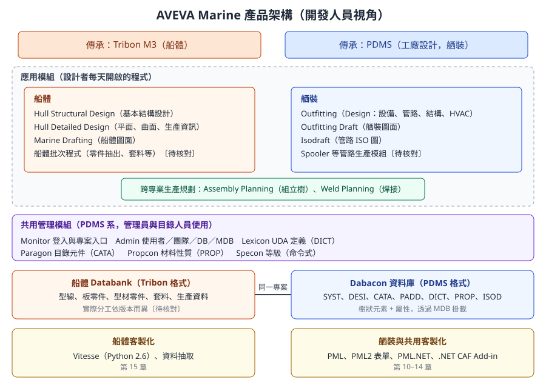
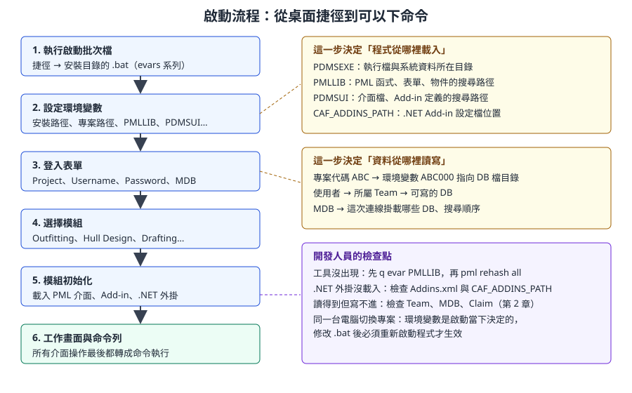

# 第 1 章　產品架構、模組與啟動環境

> 本章是第一部分「系統與資料模型」的起點，回答三個問題：AVEVA Marine 由哪些程式組成、它們怎麼被啟動、啟動時哪些設定決定了「程式從哪裡載入」與「資料從哪裡讀寫」。
>
> 內容依據 AVEVA 官方線上文件（Hull and Outfitting 12.1、AVEVA E3D 2.1 參考手冊）、AVEVA 官方產品型錄，以及 PDMS／Marine 通用的系統觀念自主撰寫，不是官方手冊的翻譯。AVEVA Marine 的舾裝部分承襲 PDMS，E3D 文件中的觀念大多相通，但介面與細節可能不同。標示 **〔待核對〕** 的項目，請以公司安裝的版本與管理員設定為準。

## 1.1 學習目標

讀完本章，你應該能夠：

1. 說明 AVEVA Marine 為什麼同時有「船體」與「舾裝」兩套風格不同的工具，以及它們的歷史來源。
2. 列出主要應用模組與管理模組，並說出每個模組負責的資料。
3. 描述從桌面捷徑到出現工作畫面的啟動流程，指出每一步由什麼設定控制。
4. 解釋 `PMLLIB`、`PDMSUI`、`PDMSEXE`、`CAF_ADDINS_PATH` 與專案路徑變數（`ABC000` 形式）的用途，並會在命令列查詢它們。
5. 分辨船體 Databank 與舾裝 Dabacon 資料庫在存放方式與開發介面上的差異。
6. 理解「所有介面操作背後都是命令」，並能用命令列做最基本的查詢。

## 1.2 產品的來源：兩條血統合成一套系統

AVEVA Marine 不是從零開始設計的單一產品，而是兩套成熟系統的整合：

| 來源 | 原本的用途 | 在 Marine 中變成 | 典型特徵 |
|---|---|---|---|
| **Tribon M3**（原 Kockums Computer Systems 發展，後由 AVEVA 併購〔年份待核對〕） | 造船專用的船體設計與生產系統 | Hull 系列模組、Marine Drafting、船體生產資訊 | 以船舶座標（肋位、縱向位置）思考；資料存在 Databank；客製化用 Vitesse（Python） |
| **PDMS**（Plant Design Management System） | 工廠（石化、電廠）三維設計系統 | Outfitting 舾裝設計、Outfitting Draft、Isodraft、管理模組 | 以階層樹與屬性思考；資料存在 Dabacon 資料庫；客製化用 PML 與 .NET |

官方文件指出，Hull 與 Marine Drafting 的單位設定在 12.0、12.1 與 Tribon M3 之間保持一致，這說明了船體部分與 Tribon 的延續關係。舾裝部分則幾乎完全沿用 PDMS 的資料模型，所以 PDMS 與後來 AVEVA E3D 的文件，對理解舾裝資料非常有幫助。

> **開發人員須知：** 這段歷史不是背景知識而已，它直接決定你要學哪一種開發技術。想讀寫管路、設備、鐵舾裝，走 PML 或 .NET；想讀船體板架的板厚、零件資料，通常要走 Vitesse 或船體專用介面。同一個需求如果同時牽涉船體與舾裝，就要預先規劃兩種技術如何交換資料（第 10、15 章）。

把兩條血統合在一起看，可以用一個開發人員熟悉的比喻：Marine 像是一家公司併購了另一家公司之後的整合系統。前台（選單、登入、專案）已經統一，但後端仍有兩套資料庫引擎、兩套腳本語言，彼此透過同步與參照交換資料。

## 1.3 整體架構



*圖 1-1　AVEVA Marine 的分層架構。上方是兩條產品血統，中間是設計者使用的應用模組與管理員使用的管理模組，下方是兩種資料儲存方式與對應的客製化技術。（本課程自繪）*

由上往下看，可以分成四層：

| 層 | 內容 | 開發人員的對應概念 |
|---|---|---|
| 應用模組 | Hull Structural Design、Hull Detailed Design、Outfitting、Drafting 等 | 前端應用程式（Client Application） |
| 管理模組 | Monitor、Admin、Lexicon、Paragon、Propcon、Specon | 資料庫管理工具、主檔維護工具 |
| 資料層 | Dabacon 資料庫、船體 Databank | 資料庫引擎與資料檔 |
| 客製化層 | PML、PML.NET、.NET CAF Add-in、Vitesse | 外掛 API、內嵌腳本語言 |

## 1.4 應用模組

### 1.4.1 船體模組

| 模組 | 做什麼 | 主要使用者 |
|---|---|---|
| **Hull Structural Design** | 基本設計階段，以結構概念快速建立主要構件，供強度評估、重量估算 | 基本設計、結構工程師 |
| **Hull Detailed Design** | 詳細設計，涵蓋平面船體（Planar Hull）、曲面船體（Curved Hull）與生產資訊（Production Information） | 船體詳細設計、生產設計 |
| **Marine Drafting** | 承襲 Tribon 的船體圖面工具，產生板架圖、分段圖、零件圖 | 船體設計、出圖人員 |
| **Assembly Planning** | 建立分段與組立樹，規劃裝配順序 | 生產設計、生管 |
| **Weld Planning** | 焊接資訊與焊接規劃 | 生產設計、焊接工程 |

> 〔公開版未收錄：AVEVA 官方產品截圖〕Hull Structural Design 介面：左側模型樹，右側全船艙區 3D 視圖

*圖 1-2　Hull Structural Design 的工作畫面。左側是模型樹，右側是全船艙區與選取中的分段。（來源：AVEVA Hull and Outfitting Datasheet）*

> 〔公開版未收錄：AVEVA 官方產品截圖〕Hull Detailed Design 介面：船艏區域的板架、肋板與外板縱骨

*圖 1-3　Hull Detailed Design 的工作畫面，顯示船艏內部結構。結構設計與詳細設計共用同一個模型，只是細節程度不同。（來源：AVEVA Hull and Outfitting Datasheet）*

### 1.4.2 舾裝模組

| 模組 | 做什麼 | 承襲自 |
|---|---|---|
| **Outfitting**（在 PDMS 稱為 Design） | 設備、管路、鐵舾裝結構、通風（HVAC）、電纜托架、支架的三維建模 | PDMS Design |
| **Outfitting Draft** | 從舾裝模型產生佈置圖、剖面圖並標註 | PDMS Draft |
| **Isodraft** | 依管線或管段自動產生等角管段圖（ISO） | PDMS Isodraft |
| Spooler、管件預製等 | 管段切分與預製資料〔模組名稱與授權待核對〕 | PDMS |

> 〔公開版未收錄：AVEVA 官方產品截圖〕Outfitting 設計畫面：左側模型樹，中間泵與管路，右側關聯設定面板

*圖 1-4　Outfitting 的典型畫面。左側的模型樹（Design Explorer）就是第 3 章要介紹的元素樹，中間是 3D 視圖，右側是屬性與關聯面板。（來源：AVEVA Hull and Outfitting Datasheet）*

> **專業提醒：** 「在某個模組看得到船體」不代表「可以在該模組修改船體」。舾裝設計者在 Outfitting 中常會看到船體結構作為參考背景，但寫入權限由專案的團隊與資料庫設定決定（第 2 章）。

### 1.4.3 管理模組

管理模組來自 PDMS 系統，船體與舾裝共用：

| 模組 | 用途 | 操作的資料庫 | 誰會用 |
|---|---|---|---|
| **Monitor** | 進入專案後的起點，可切換模組、修改密碼等〔介面依版本而異〕 | SYST（讀取） | 所有人 |
| **Admin** | 建立使用者、團隊（Team）、資料庫、MDB，設定權限、合併 Session、管理 Extract | SYST | 系統管理員 |
| **Lexicon** | 定義使用者自訂屬性（UDA）與使用者自訂元素型別（UDET） | DICT | 管理員、資料模型負責人 |
| **Paragon** | 建立與維護目錄元件（參數化幾何、點集） | CATA | 目錄管理員 |
| **Propcon** | 材料性質資料 | PROP | 目錄或材料管理員 |
| **Specon** | 以命令方式建立或修改等級（Specification） | CATA | 目錄管理員 |

> **開發人員須知：** 你的工具若需要新增欄位（例如在設備上記錄「採購單號」），正確做法是請管理員在 Lexicon 定義 UDA，而不是把資料塞進 `DESC` 之類的現有欄位。這相當於「請 DBA 加一個欄位」，而不是在備註欄裡用逗號分隔存資料。

## 1.5 兩種資料儲存方式

### 1.5.1 Dabacon：舾裝與管理資料

Dabacon 是 PDMS 系產品的資料庫引擎。它的特徵：

- **樹狀結構**：所有資料都是元素（Element），每個元素有一個擁有者（Owner），最上層是 WORLD。官方 E3D 文件描述：除了 WORLD 以外，所有資料庫元素都被其他元素擁有。
- **型別決定欄位**：元素型別（SITE、ZONE、EQUI、PIPE…）決定它有哪些屬性，也決定它底下可以放哪些型別的成員。
- **多種資料庫類型**：設計模型（DESI）、目錄（CATA）、圖面（PADD）等，都用同樣的元素與屬性結構，只是元素型別不同。
- **交易與版本**：變更以 Session 為單位寫入，可以查詢歷史，也可以合併（第 2 章）。

對開發人員來說，Dabacon 可以想成「一個以樹為主要組織方式的物件資料庫」，PML 與 .NET API 都直接操作它的元素與屬性。

### 1.5.2 Databank：船體的 Tribon 傳統

船體資料承襲 Tribon，以 Databank 形式存放型線、板零件、型材零件、套料、生產資料等。它的存取介面主要是船體模組本身與 Vitesse 的 Python 函式庫（例如 `kcs_dex` 資料抽取）。

| 比較項目 | Dabacon（舾裝為主） | 船體 Databank |
|---|---|---|
| 資料形狀 | 元素樹 + 屬性 | 依物件類型（板架、零件、套料）分門別類存放 |
| 常用開發介面 | PML、PML.NET、.NET API | Vitesse（Python 2.6）、資料抽取語言 |
| 權限控制 | Team 擁有 DB、Claim 機制 | 依船體專案設定〔待核對〕 |
| 適合的工具 | 查詢、報表、批次修改屬性、表單 | 板厚報表、零件清單、船體圖面自動化 |

> **版本差異〔待核對〕：** Marine 12 系列中，部分船體模型元素（例如板架 `HPANEL`、板 `HPLATE`、加強材 `HSTIFF`）也出現在 Dabacon 的資料模型中，可以用 PML 查詢；而零件、套料等生產資料仍以 Databank 為主。哪些船體資料可以從 Dabacon 讀到、與 Databank 如何同步，依版本與專案設定而異。動手寫船體工具前，先在訓練專案中實際查詢確認（第 3、15 章）。

## 1.6 啟動流程



*圖 1-5　從桌面捷徑到工作畫面的六個步驟。右側標出每一步由哪些設定控制，以及開發人員常用的檢查點。（本課程自繪）*

### 1.6.1 步驟說明

1. **執行啟動批次檔。** 開始選單或桌面捷徑通常指向安裝目錄中的批次檔（`.bat`），例如本課程開源範例中提到的 `marine.bat`。批次檔會呼叫一系列設定環境變數的檔案（PDMS 系常稱為 evars 檔）〔實際檔名依版本待核對〕。
2. **設定環境變數。** 安裝路徑、專案路徑、PML 搜尋路徑、介面檔路徑都在這一步決定。
3. **登入。** 出現登入表單，選擇專案（Project）、輸入使用者名稱（Username）與密碼（Password），並選擇 MDB。
4. **選擇模組。** 選擇要進入 Outfitting、Hull 相關模組、Drafting 或管理模組〔畫面與選項依版本而異〕。
5. **模組初始化。** 模組依 `PDMSUI` 載入介面定義，依 `PMLLIB` 找到 PML 表單與函式，依 Add-in 設定載入 PML Add-in 與 .NET 外掛。
6. **出現工作畫面。** 此時可以開啟命令列（Command Window）下命令。

### 1.6.2 為什麼開發人員要在意啟動流程

你寫的工具能不能「出現」，完全取決於步驟 2 與步驟 5：

| 症狀 | 最可能的原因 | 對應步驟 |
|---|---|---|
| 新寫的 PML 函式「找不到」 | 檔案不在 `PMLLIB` 的任何一個目錄，或索引沒更新 | 2、5 |
| 自訂選單沒出現 | Add-in 定義檔不在 `PDMSUI` 對應的子目錄 | 2、5 |
| .NET 外掛沒有載入 | `<模組>Addins.xml` 沒有登錄，或 `CAF_ADDINS_PATH` 指錯 | 2、5 |
| 同事電腦正常、你的電腦不正常 | 兩人的捷徑呼叫了不同的批次檔，環境變數不同 | 1、2 |
| 改了批次檔沒生效 | 環境變數在程式啟動時讀取，必須重新啟動 | 1 |

## 1.7 環境變數

### 1.7.1 主要變數一覽

| 變數 | 用途 | 開發人員會碰到的情境 |
|---|---|---|
| `PDMSEXE` | 執行檔與系統資料所在的安裝目錄 | 找官方 PML 範例、訊息檔 |
| `PMLLIB` | PML 函式、表單、物件、巨集的搜尋路徑，可以有多個目錄，依序搜尋 | 部署公司 PML 工具庫（第 10 章） |
| `PDMSUI` | 介面檔與 Add-in 定義的搜尋路徑，例如舾裝的 `DES\DFLTS\ADDINS` 子目錄 | 部署 PML Add-in 選單（第 13 章） |
| `CAF_ADDINS_PATH` | .NET Add-in 設定檔的位置，讓設定檔可以放在安裝目錄以外 | 部署 C# 外掛（第 14 章） |
| `ABC000` | 專案 `ABC` 的資料庫檔案目錄（`000` 是固定後綴） | 確認自己連到哪一份專案資料 |
| `ABCISO`、`ABCMAC`、`ABCPIC` 等 | 專案的 ISO 設定、巨集、圖檔等目錄〔後綴清單待核對〕 | 出圖、批次巨集 |
| `PDMSUSER`、`PDMSWK` | 使用者工作目錄與暫存目錄〔待核對〕 | 工具輸出暫存檔的位置 |
| 船體專用變數 | Tribon 系船體專案的 Databank 與設定檔路徑，常以 `SB_` 開頭〔待核對〕 | Vitesse 腳本找資料 |

> **開發人員須知：** 專案代碼通常是三個英數字，例如專案 `ABC` 對應 `ABC000`。這是 PDMS 系產品的慣例：系統用「專案代碼 + 000」這個環境變數找到該專案的資料庫檔案。如果你的電腦能看到別人的專案，代表你的環境中定義了那個專案的 `XXX000` 變數。

### 1.7.2 搜尋路徑的運作方式

`PMLLIB` 與 `PDMSUI` 都是「路徑清單」，系統依序搜尋，**先找到的先用**。這和作業系統的 `PATH`、Python 的 `sys.path` 一樣：

```
PMLLIB = D:\Company\pmllib  C:\AVEVA\Marine\OH12.1.SP4\pmllib
         ^ 公司工具庫（先搜尋）  ^ 官方檔案（後搜尋）
```

因此，公司工具庫的正確擴充方式是**在官方路徑前面加上自己的目錄**，而不是修改官方檔案。這也表示：如果公司目錄中有一個與官方同名的檔案，它會「覆蓋」官方版本。這是一把雙面刃，第 10 章會詳細說明規範。

PML 搜尋還有一層索引：每個 `PMLLIB` 目錄可以有 `pml.index` 檔案。新增或改名檔案後，要在命令列執行 `pml rehash all` 讓系統重建記憶中的索引，否則找不到新檔案。

### 1.7.3 在系統內查詢環境變數

在命令列中，可以用 `q evar` 查詢環境變數（本課程開源範例的安裝腳本即使用這個寫法）：

```
q evar PMLLIB
q evar PDMSUI
q evar CAF_ADDINS_PATH
```

在 PML 程式中，可以用字串的環境變數展開讀取，例如在路徑字串中寫 `'%PMLLIB%'`〔PML 中展開環境變數的方式依情境而異，第 11 章再詳細說明〕。

在 Windows 命令提示字元（已執行過啟動批次檔的視窗）中，也可以直接看：

```bat
rem 示意：在已設定 Marine 環境的命令提示字元中檢查
echo %PMLLIB%
echo %PDMSUI%
set | findstr /i "000="
```

最後一行列出所有以 `000=` 結尾的變數，可以快速看出這個環境看得到哪些專案。

### 1.7.4 客製化環境變數的原則

| 原則 | 說明 |
|---|---|
| 不修改官方批次檔 | 升級或安裝 Service Pack 時會被覆蓋；應使用官方提供的客製化掛勾或公司自己的包裝批次檔〔PDMS 系常見 `custom_evars.bat`，Marine 是否提供待核對〕 |
| 公司路徑放在前面 | `set PMLLIB=D:\Company\pmllib %PMLLIB%` |
| 路徑集中管理 | 所有人使用同一份公司批次檔，避免「只有我的電腦可以」 |
| 記錄版本 | 批次檔納入版本管理（第 17 章） |

## 1.8 命令列：所有介面操作背後都是命令

PDMS 系產品有一個重要的設計：**圖形介面上的大多數操作，最後都會轉成命令字串交給命令直譯器執行**。表單上按下一個按鈕，可能就是執行了一段 PML，而那段 PML 送出的是 `NEW EQUI`、`POS E 1000 N 0 U 0` 這樣的命令。

這帶來三個好處：

1. **可以直接下命令**：在命令列（Command Window）輸入命令，結果與點選介面相同。
2. **可以錄製與追蹤**：開啟 PML 追蹤後，可以看到介面實際執行了哪些命令（第 17 章）。
3. **可以寫成程式**：把命令寫進巨集或 PML 函式，就是自動化的起點（第 11、12 章）。

### 1.8.1 開啟命令列

在 Outfitting 中，命令列通常從 `Display > Command Line` 開啟〔選單位置依版本待核對〕。它包含一個輸出區與一個輸入欄，輸入的命令會顯示在輸出區，查詢結果也會印在那裡。

### 1.8.2 第一次下命令

以下是「唯讀」的查詢，可以在任何專案安全執行：

```
q evar PMLLIB
q name
q type
q owner
q att
```

| 命令 | 結果 |
|---|---|
| `q evar PMLLIB` | 印出 `PMLLIB` 的內容 |
| `q name` | 目前元素（CE）的名稱 |
| `q type` | 目前元素的型別，例如 `EQUI` |
| `q owner` | 目前元素的擁有者 |
| `q att` | 列出目前元素的所有一般屬性與值 |

命令不分大小寫，`Q NAME` 與 `q name` 相同。第 3 章會系統性地介紹查詢與導覽命令。

> **專業提醒：** 命令列可以執行修改資料的命令（例如 `delete`、`new`）。在正式專案中練習時，只使用 `q` 開頭的查詢命令；所有會修改資料的練習都應在訓練專案中進行。

### 1.8.3 命令、PML1、PML2 的關係

| 層次 | 範例 | 說明 |
|---|---|---|
| 命令（Command） | `q name`、`new EQUI` | 命令直譯器的基本語言 |
| PML1 | `var !x (name)`、`$!x` | 早期的巨集語言，以變數與字串替換為主 |
| PML2 | `!x = !!ce.name`、`define function` | 物件導向的 PML，表單與物件都用它 |
| .NET | `CurrentElement.Element` | 透過 API 操作同一個資料庫 |

四者最後都作用在同一個 Dabacon 資料庫上，只是抽象層級不同。

### 1.8.4 確認版本

同一個命令在不同版本的行為可能不同，所以回報問題、查文件之前，先確認版本與 Service Pack。常見的確認方式：

- 登入畫面或說明選單中的「關於」視窗〔位置依版本待核對〕。
- 安裝目錄名稱，例如開源範例預設的 `OH12.1.SP4` 這類命名。
- 命令列查詢版本資訊，PDMS 系常見 `q banner`〔Marine 中是否可用待核對〕。

### 1.8.5 文件導覽：去哪裡查官方說明

AVEVA Marine 12.1 的線上文件需要瀏覽器（JavaScript）才能閱讀；E3D 2.1 的部分參考手冊則有可直接開啟的靜態頁面。舾裝與管理的觀念相通，可以互相參照，但要注意版本差異：

| 想查的主題 | Marine 12.1 文件（docs.aveva.com） | E3D 2.1 對應手冊（help.aveva.com） | 本課程章節 |
|---|---|---|---|
| 產品與模組總覽 | Navigating the AVEVA Marine Documentation | Getting Started | 1 |
| 資料庫、Team、MDB、Session | Administration 相關主題 | Database Management Reference Manual（DBRM） | 2 |
| 元素型別與屬性 | Data Model 相關主題 | Data Model Reference Manual（DMRM） | 3 |
| 位置表示式、WRT、PML 物件 | Customization 相關主題 | Software Customisation Reference Manual（SCRM） | 4、11 |
| PML 語言與表單 | Marine Customization | PML Customisation User Guide（PMLPUG） | 11–13 |
| .NET 開發 | Marine Customization | .NET Customisation User Guide | 14 |
| 船體 Vitesse | Hull 客製化相關主題 | 無（E3D 不含 Vitesse） | 15 |

> **開發人員須知：** 引用 E3D 文件時，在筆記或程式註解中寫明「依 E3D 2.1 文件，Marine 版本待驗證」。E3D 2.x 有不少 Marine 12.1 沒有的新功能，直接照抄可能在公司版本中無法執行。

## 1.9 開發人員須知

- **先畫出你的環境地圖。** 動手寫工具之前，先記錄公司的版本、Service Pack、安裝路徑、批次檔、專案代碼、`PMLLIB` 與 `PDMSUI` 內容。很多「程式錯誤」其實是環境錯誤。
- **確認你的工具屬於哪條血統。** 需求涉及板架、零件、套料，多半要用船體介面；涉及設備、管路、屬性報表，多半用 PML 或 .NET。
- **不要修改安裝目錄內的官方檔案。** 用搜尋路徑的優先順序擴充。官方檔案在升級時會被覆蓋，修改後也難以追蹤。
- **環境變數是啟動時決定的。** 修改批次檔、新增目錄後，要重新啟動模組；只新增 PML 檔案時，`pml rehash all` 即可。
- **命令列是你的除錯器。** 任何屬性或位置的疑問，先在命令列用 `q` 查清楚，再寫程式。

## 1.10 練習

以下練習只做查詢，不修改資料。若需要建立資料，請在訓練專案中進行。

### 練習 1：建立「公司環境卡」

在訓練電腦上，記錄下表：

| 項目 | 你的記錄 |
|---|---|
| AVEVA Marine 版本與 Service Pack | |
| 安裝目錄 | |
| 桌面捷徑指向的批次檔 | |
| `PDMSEXE` | |
| `PMLLIB`（依搜尋順序列出每個目錄） | |
| `PDMSUI` | |
| `CAF_ADDINS_PATH`（若有） | |
| 可見的專案代碼（`XXX000` 變數） | |
| 訓練專案代碼、帳號、MDB | |
| 已授權的模組 | |

### 練習 2：比較兩台電腦的環境

請同事在他的電腦上做同樣的記錄，比較 `PMLLIB` 的差異。如果不同，找出原因（不同的捷徑、個人批次檔或使用者層級的環境變數）。

### 練習 3：模組與資料對照

針對本章列出的每個應用模組，寫下：它主要讀寫哪一種資料（Dabacon 的哪類 DB，或船體 Databank），以及公司裡由哪個部門使用。

### 練習 4：第一次使用命令列

1. 登入訓練專案的 Outfitting。
2. 開啟命令列。
3. 在模型樹中點選一台設備，然後依序執行 `q name`、`q type`、`q owner`、`q att`。
4. 再點選它的擁有者（ZONE），重複一次，比較兩者的屬性清單有什麼不同。

## 1.11 自我檢核

- [ ] 我能說明 AVEVA Marine 的船體部分與舾裝部分各自承襲哪個產品。
- [ ] 我能列出 Hull Structural Design、Hull Detailed Design、Outfitting、Marine Drafting、Outfitting Draft、Isodraft、Assembly Planning、Weld Planning 的用途。
- [ ] 我能說出 Monitor、Admin、Lexicon、Paragon、Propcon、Specon 各自管理哪類資料。
- [ ] 我能描述啟動流程的六個步驟。
- [ ] 我知道 `PMLLIB`、`PDMSUI`、`PDMSEXE`、`CAF_ADDINS_PATH` 與 `ABC000` 的用途，也會用 `q evar` 查詢。
- [ ] 我能解釋為什麼公司工具庫要放在 `PMLLIB` 的前面，而不是修改官方檔案。
- [ ] 我能說明 Dabacon 資料庫與船體 Databank 的差別，以及各自的開發介面。
- [ ] 我理解「介面操作背後都是命令」，並已在訓練專案中用命令列查詢過一個元素。

**延伸閱讀：** 回到[第 0 章　課程總覽與知識地圖](ch00_knowledge_map_zh-TW.reading.html)；下一章[第 2 章　專案、資料庫、MDB 與權限](ch02_project_database_zh-TW.reading.html)說明資料存在哪裡、誰能改；開發環境與部署細節見[第 10 章](ch10_dev_environment_zh-TW.reading.html)；術語與指令見[附錄 B](appx_b_glossary_zh-TW.reading.html)。

## 1.12 資料來源

- AVEVA Hull and Outfitting 12.1 線上文件入口：<https://docs.aveva.com/bundle/hull-and-outfitting/page/1224159.html>
- Navigating the AVEVA Marine Documentation（文件組織，含 Hull、Design、Draft、Marine Customization 等主題）：<https://docs.aveva.com/bundle/hull-and-outfitting/page/1225292.html>
- AVEVA E3D 2.1 Getting Started：How AVEVA E3D Data is Stored（資料庫階層、擁有者與成員）：<https://help.aveva.com/AVEVA_Everything3D/2.1/GS/GS4.4.1.html>
- AVEVA E3D 2.1 Database Management Reference Manual（資料庫概念，給系統管理員）：<https://help.aveva.com/AVEVA_Everything3D/2.1/DBRM/DBRM1.02.01.html>
- AVEVA Hull and Outfitting Datasheet（本章截圖來源）：<https://www.aveva.com/content/dam/aveva/documents/perspectives/datasheets/Datasheet_HullandOutfitting.pdf.coredownload.inline.pdf>
- AVEVA Outfitting Brochure：<https://www.aveva.com/content/dam/aveva/documents/brochures/Brochure_AVEVA_Outfitting.pdf>
- 開源範例 aveva-marine-dev-skill（MIT 授權，`marine.bat`、`q evar`、`PDMSUI` 部署方式）：<https://github.com/912141548/aveva-marine-dev-skill>
- eryar，〈AVEVA .NET Quick Start Guide〉（`CAF_ADDINS_PATH` 與 `<模組>Addins.xml`）：<https://developer.aliyun.com/article/235787>
