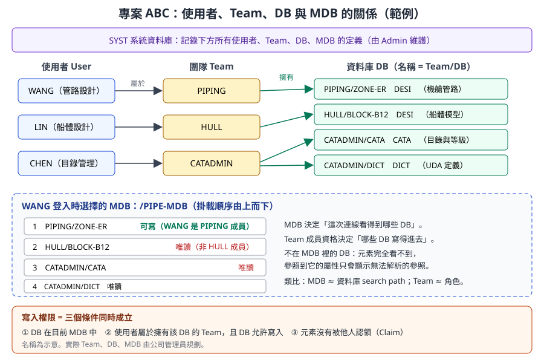
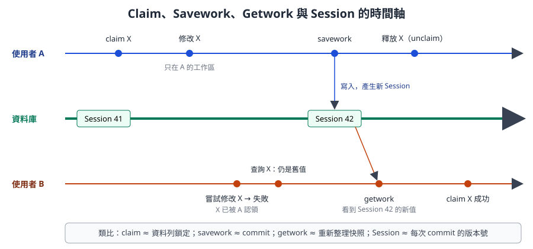
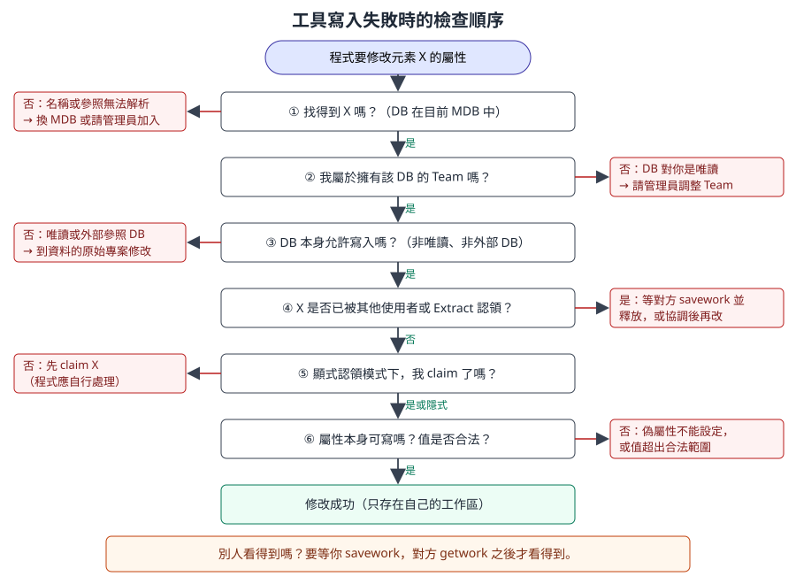

# 第 2 章　專案、資料庫、MDB 與權限

> 本章說明 AVEVA Marine 的資料「存在哪裡、誰能改、何時對別人可見」。對開發人員來說，這一章最實用的成果是：當你的工具出現「寫入失敗」時，能依序檢查 MDB、Team、DB 模式、認領（Claim）與屬性，而不是盲目重試。
>
> 內容依據 AVEVA E3D 2.1 Database Management Reference Manual、AVEVA 線上文件中關於多寫入資料庫認領模式的說明，以及 PDMS／Marine 通用的專案管理觀念自主撰寫。舾裝與管理模組承襲 PDMS，所以 E3D／PDMS 的資料庫觀念大致適用；船體 Databank 的權限與存放方式另有一套，本章只做概念說明。命令的確切語法與選單名稱標示 **〔待核對〕** 者，請在公司版本的訓練專案中確認。

## 2.1 學習目標

讀完本章，你應該能夠：

1. 說明一個專案由哪些資料庫組成，SYST 系統資料庫記錄了什麼。
2. 列出 DESI、CATA、PADD、DICT、PROP、ISOD、SYST 各自存放的資料，並說明船體 Databank 的定位。
3. 解釋 User、Team、DB 三者的關係，以及寫入權限如何判斷。
4. 說明 MDB 的作用與搜尋順序。
5. 解釋顯式與隱式認領（Claim）、釋放的時機。
6. 說明 Savework、Getwork 與 Session 的關係，知道變更何時對他人可見。
7. 說明 Extract（衍生資料庫）與 Global 多地點同步的基本概念。
8. 面對「工具寫入失敗」，能依序找出原因。

## 2.2 專案的組成

### 2.2.1 專案就是一組資料庫

一個 AVEVA Marine 專案（Project）通常以三個字元的專案代碼識別，例如 `ABC`。專案在磁碟上是一個目錄（由環境變數 `ABC000` 指向，見第 1 章），裡面是多個資料庫檔案。

| 開發人員熟悉的概念 | AVEVA 中的對應 |
|---|---|
| 一套資料庫系統執行個體 | 專案（Project） |
| 系統目錄（system catalog）、帳號表 | SYST 系統資料庫 |
| 一個 schema 或一組資料表 | 一個 DB（例如 `PIPING/ZONE-ER`） |
| 連線字串中的資料庫清單、search path | MDB |
| 角色（Role） | Team |
| 資料列鎖定 | Claim |
| Commit | Savework |
| 交易版本號 | Session |

### 2.2.2 SYST：系統資料庫

SYST（系統資料庫，PDMS 文件中也稱為 System DB）是專案的「中央目錄」，記錄：

- 專案中有哪些使用者（User）與密碼、權限等級。
- 有哪些團隊（Team），以及誰屬於哪個 Team。
- 有哪些資料庫（DB）、類型、擁有的 Team、存取模式。
- 有哪些 MDB，每個 MDB 包含哪些 DB、順序為何。

SYST 由 Admin 模組維護。一般使用者與開發人員通常只能讀取它，不能修改。

> **開發人員須知：** 你寫的工具不應該假設固定的 DB 或 MDB 名稱。如果工具需要知道「目前元素在哪個 DB」，請在執行時查詢，而不是把 `PIPING/ZONE-ER` 寫死在程式裡。

## 2.3 資料庫類型

E3D 官方文件說明，模型資料庫之外的 CATALOGUE、PADD、ISOD、LEXICON、PROPERTIES 等資料庫也都是階層式結構。在 PDMS／Marine 中，常見的 DB 類型如下：

| 類型 | 全名或意義 | 內容 | 由哪個模組維護 | 開發人員常見用途 |
|---|---|---|---|---|
| **DESI** | Design | 設計模型：SITE、ZONE、設備、管路、結構、HVAC，以及 Marine 中部分船體模型元素 | Outfitting（Design）、Hull 模組 | 查詢、報表、批次修改 |
| **CATA** | Catalogue | 目錄元件、等級（Spec）、型鋼斷面、螺栓等 | Paragon、Specon | 追蹤元件來源（唯讀） |
| **PADD** | Drawing | 舾裝圖面：DEPT、REGI、DRWG、SHEE、VIEW、標註 | Outfitting Draft | 批次出圖、圖面清單 |
| **DICT** | Dictionary | UDA、UDET 等使用者自訂資料模型 | Lexicon | 查詢自訂屬性的定義 |
| **PROP** | Properties | 材料性質（密度等） | Propcon | 重量計算 |
| **ISOD** | Isodraft | ISO 圖的樣式與選項 | Isodraft | 修改 ISO 輸出設定（通常由管理員） |
| **SYST** | System | 使用者、Team、DB、MDB 定義 | Admin | 查詢目前使用者與 MDB |
| 其他 | 例如排程、管段、圖示資料庫 | 依授權模組而定〔待核對〕 | | |
| **船體 Databank** | Tribon 系資料 | 型線、板零件、型材零件、套料、生產資料 | Hull 模組與船體批次程式 | Vitesse 抽取（第 15 章） |

> **專業提醒：** 船體 Databank 的實際組成、檔案位置與權限控制，依專案與版本設定而異〔待核對〕。本章後面關於 Team、MDB、Claim 的說明，主要適用於 Dabacon 資料庫（DESI、CATA、PADD 等）。

### 2.3.1 一個 DB 存什麼範圍

設計資料通常不是全部放在一個 DESI DB，而是依專業與區域切成多個 DB。例如：

| DB 名稱（示意） | 擁有的 Team | 內容 |
|---|---|---|
| `PIPING/ZONE-ER` | PIPING | 機艙區的管路 |
| `EQUIP/ZONE-ER` | EQUIP | 機艙區的設備 |
| `HULL/BLOCK-B12` | HULL | 分段 B12 的船體模型 |
| `CATADMIN/CATA` | CATADMIN | 公司目錄與等級 |

DB 名稱通常採用 `Team名稱/DB名稱` 的形式，名稱本身就說明了擁有者〔命名方式依公司規劃〕。切分原則會影響權限、協作與效能，是專案初期由管理員決定的設計。

## 2.4 User、Team 與寫入權限



*圖 2-1　範例專案中的使用者、Team、DB 與 MDB。使用者 WANG 屬於 PIPING，所以只有 `PIPING/ZONE-ER` 對他可寫；MDB 中其他 DB 對他是唯讀。（本課程自繪，名稱為示意）*

規則可以濃縮成三句話：

1. **Team 擁有 DB。** 每個 DB 屬於一個 Team。
2. **User 屬於 Team。** 一個使用者可以屬於多個 Team。
3. **只有擁有 DB 的 Team 成員，才能寫入該 DB。** 其他人即使看得到，也只能讀。

用資料庫術語說：Team 是角色，DB 是授權單位，授權只有「讀」與「寫」兩種粒度，以 DB 為單位，而不是以元素為單位。元素層級的協調交給下一節的 Claim。

此外，DB 本身還有存取模式與狀態，會讓「Team 成員也寫不進去」：

| DB 狀態 | 意義 | 對工具的影響 |
|---|---|---|
| 多寫入（Multiwrite） | 多位使用者可同時寫入同一個 DB，以元素認領協調 | 需要注意 Claim |
| 單一寫入（Update）〔名稱待核對〕 | 同一時間只能有一位使用者以寫入模式開啟 | 別人開著時，你只能讀 |
| 唯讀或凍結 | 管理員把 DB 設為不可修改，例如已發行的區域 | 任何人都寫不進去 |
| 外部或參照 DB（Foreign）〔名稱待核對〕 | 從其他專案引用的 DB，例如共用目錄 | 只能在原始專案修改 |

## 2.5 MDB：這次連線看得到哪些 DB

MDB（Multiple Database）是登入時選擇的「DB 組合」。它決定：

- **看得到什麼。** 不在 MDB 中的 DB，其元素在這次連線中完全不存在。參照到這些元素的屬性（例如管線的等級參照）會無法解析。
- **搜尋順序。** MDB 中的 DB 有先後順序。依名稱尋找元素、在某些情況決定新建的頂層元素放在哪個 DB 時，順序會有影響〔新建頂層元素的 DB 選擇規則待核對〕。
- **讀寫組合。** MDB 中同時包含可寫與唯讀的 DB。可寫與否仍由 Team 決定，MDB 只是「掛載」。

PDMS 系的 MDB 中，DB 可以是「目前（current）」或「延後（deferred）」狀態：延後的 DB 已列在 MDB 中，但這次連線不開啟，需要時再切換〔Marine 介面上的操作方式待核對〕。

常見的 MDB 規劃：

| MDB（示意） | 給誰用 | 可寫 DB | 唯讀參考 DB |
|---|---|---|---|
| `/PIPE-MDB` | 管路設計 | 管路 DB | 設備、船體、目錄 |
| `/HULL-MDB` | 船體設計 | 船體 DB | 舾裝（用於開孔協調）、目錄 |
| `/CATA-MDB` | 目錄管理 | 目錄 DB | 設計 DB（檢查使用情形） |
| `/READ-ALL` | 報表、查詢工具 | 無 | 全部 |

> **開發人員須知：** 唯讀報表工具最好用一個「只讀、包含全部 DB」的 MDB 執行。這樣不會誤改資料，也不會因為漏掛某個 DB 而產生不完整的報表。報表開頭應列出執行時的 MDB 與時間，讓讀者知道資料範圍。

## 2.6 Claim：元素層級的協調

### 2.6.1 為什麼需要 Claim

多寫入 DB 允許多人同時工作。如果兩人同時修改同一條管線，就會產生衝突。AVEVA 的做法是「認領」：修改一個元素之前，先把它認領到自己名下，其他人在你釋放之前不能修改它。這相當於資料庫的悲觀鎖定（Pessimistic Locking）。

### 2.6.2 顯式與隱式認領

認領模式是 **DB 的設定**，不是使用者的偏好。AVEVA 線上文件說明，隱式／顯式認領模式由 DB 設定決定，同時適用於使用者認領與 Extract 認領。

| 模式 | 行為 | 優點 | 對工具的影響 |
|---|---|---|---|
| **隱式（Implicit）** | 使用者修改元素時，系統自動認領 | 使用者不必多一步 | 工具第一次修改時才會發現被別人認領 |
| **顯式（Explicit）** | 必須先執行 `claim` 命令，才能修改 | 意圖明確，衝突在修改前就暴露 | 工具必須先 claim，否則寫入失敗 |

在顯式模式下，典型的命令順序如下（示意）：

```
-- 示意：顯式認領模式下修改一個元素
claim /PUMP-P101
/PUMP-P101
desc 'Main cooling pump'
savework
unclaim /PUMP-P101
```

- `claim` 後面可以接元素名稱，也可以認領一整個分支〔一次認領子階層的語法待核對〕。
- `unclaim` 把元素釋放給其他人〔課程總綱稱為 Release；PDMS 命令為 `unclaim`，Extract 層級另有 `release`，語法待核對〕。
- 未釋放的認領在登出時是否自動釋放，依版本與設定而定〔待核對〕。好習慣是工具完成後主動釋放。

### 2.6.3 認領的粒度

認領的單位是元素，但實務上「修改一個元件」可能需要認領它的擁有者。例如在分支上插入一個新元件，會改變分支的成員清單，所以分支本身也需要被認領〔各元素型別所需的認領範圍待核對〕。設計批次工具時，最好在開始修改前一次認領所有需要的元素，任何一個失敗就整批放棄，避免改到一半。

## 2.7 Session、Savework、Getwork



*圖 2-2　使用者 A 認領並修改 X，在 Savework 之前，修改只存在 A 的工作區；Savework 之後資料庫產生新的 Session；使用者 B 必須 Getwork 才看得到新值。（本課程自繪）*

### 2.7.1 三個動作

| 動作 | 意義 | 資料庫類比 |
|---|---|---|
| 修改 | 改變只存在於自己的工作區，別人看不到 | 交易中、尚未 commit |
| `savework` | 把自己的修改寫入 DB，產生新的 Session | Commit |
| `getwork` | 重新讀取 DB，看到別人已 Savework 的變更 | 重新整理快照（Refresh snapshot） |

重點是：**你看到的資料是登入（或上次 Getwork）時的快照，加上你自己的修改**。這是一種快照隔離（Snapshot Isolation）。因此：

- 你修改後沒有 Savework，其他人永遠看不到；如果程式當掉，修改就遺失。
- 別人 Savework 之後，你不 Getwork 就看不到。報表工具在執行前做一次 Getwork，可以拿到最新資料。
- 離開模組時，系統通常會詢問是否儲存〔離開命令與預設行為依版本待核對〕。

### 2.7.2 Session

每次 Savework 都在 DB 中產生一個新的 Session。Session 就像版本號，記錄這次變更由誰、在何時做出。用途：

- **追蹤變更**：可以查詢元素在哪個 Session 最後被修改。E3D 文件列有 `LASTMOD` 這類偽屬性，可帶限定詞查詢某屬性的最後修改資訊，例如 `Q LASTMOD(ATTNAME XLEN)`〔Marine 版本中的可用屬性待核對〕。
- **比較差異**：系統可以比較兩個 Session 之間的變更〔功能名稱依版本待核對〕。
- **回溯**：管理員可以在必要時把 DB 回溯到較早的 Session〔Admin 中的回溯功能與命令待核對〕。
- **合併**：Session 累積太多會讓 DB 變大，管理員會定期合併（Merge Changes）。合併後，被合併的中間 Session 無法再回溯〔待核對〕。

> **開發人員須知：** 批次工具應該在合理的段落 Savework，並在 Savework 時留下可辨識的紀錄（例如寫入自己的日誌檔：工具名稱、版本、處理元素數）。一次修改上萬個元素才 Savework，若中途失敗，損失全部工作；每改一個就 Savework，又會產生大量 Session。常見折衷是每處理一批（例如一個 ZONE）就 Savework 一次。

### 2.7.3 Undo 與 Savework 的差異

Undo 是在自己工作區內的回復，Savework 之後的變更不能用 Undo 撤回（需要另一次修改或管理員回溯）。PML 提供 Undo 標記的相關功能（第 12 章）。

## 2.8 Extract：衍生資料庫

Extract 是從一個 DB（稱為 Master 或父 DB）衍生出來的子 DB。可以把它想成 Git 的分支：

| Git 概念 | Extract 概念 |
|---|---|
| 從 main 建立分支 | 從 Master 建立 Extract |
| 在分支上 commit | 在 Extract 中 Savework |
| 把分支推回 main | 把 Extract 的變更寫回 Master（Flush）〔命令名稱待核對〕 |
| 從 main 拉取更新 | Refresh Extract〔待核對〕 |
| 鎖定分支中修改的物件 | Extract 認領（Extract Claim） |

使用情境：

- 大型專案中，一組設計者在 Extract 中工作，完成一個階段後再寫回 Master，讓 Master 保持穩定。
- 試做或方案比較：在 Extract 中嘗試，不滿意就丟棄。
- 多層 Extract：Extract 還可以再衍生 Extract。認領模式會在每一層 Extract 分別檢查；官方文件說明，某一層 Extract 若設為顯式模式，需要從該層認領的隱式認領會失敗。

> **開發人員須知：** 在 Extract 環境中，「我改了但別人看不到」可能不是因為沒有 Savework，而是變更還在 Extract 中，尚未寫回 Master。先確認自己連到的是 Master 還是 Extract。

## 2.9 Global：多地點同步

當設計分散在多個地點（例如總部與分公司、或與外包設計公司合作）時，AVEVA Global 讓每個地點有自己的資料庫副本，並自動同步。核心概念：

- **主要地點（Primary Location）**：每個 DB 只有一個地點可以寫入，其他地點持有唯讀副本。
- **傳播（Propagation）**：主要地點的變更定期傳送到其他地點，所以其他地點看到的資料會有延遲。
- **遠端認領**：要修改主要地點在他處的 DB 元素，需要跨地點的認領或轉移主要地點〔具體機制待核對〕。

對開發人員來說，Global 環境下要注意：報表的資料可能不是最新的；「寫入失敗」的原因可能是 DB 的主要地點不在本地。

## 2.10 開發人員須知：工具為什麼寫入失敗

這是本章最重要的一節。寫入失敗時，請依下圖的順序檢查。



*圖 2-3　寫入失敗的六個檢查點。前三點與「DB」有關，後三點與「元素與屬性」有關。全部通過後，修改仍只存在自己的工作區，要 Savework 後別人才看得到。（本課程自繪）*

### 2.10.1 常見原因與檢查方式

| # | 原因 | 典型現象 | 怎麼檢查 | 怎麼解決 |
|---|---|---|---|---|
| 1 | DB 不在目前 MDB | 依名稱找不到元素；參照屬性無法解析 | 換用包含全部 DB 的 MDB 再查一次 | 改用正確 MDB，或請管理員把 DB 加入 MDB |
| 2 | 不是擁有 DB 的 Team 成員 | 元素看得到，但修改時出現資料庫唯讀之類的錯誤 | 查詢元素所在的 DB 名稱，再比對自己的 Team | 請管理員調整，或請該 Team 成員執行 |
| 3 | DB 唯讀、凍結或為外部 DB | 所有人都無法修改 | 向管理員確認 DB 狀態 | 到原始專案修改，或申請解凍 |
| 4 | 元素被他人認領 | 錯誤訊息指出元素已被其他使用者認領 | 查詢元素的認領狀態〔查詢方式待核對〕 | 協調對方 Savework 並釋放 |
| 5 | 顯式模式下未認領 | 錯誤訊息指出必須先認領 | 確認 DB 的認領模式 | 程式先 `claim`，失敗時中止 |
| 6 | 屬性不可寫或值不合法 | 錯誤訊息指出屬性或值錯誤 | 確認屬性是否為偽屬性、型別是否正確 | 改寫正確的屬性，或修正值的型別與範圍 |
| 7 | 在 Extract 中 | 自己修改成功，但 Master 的使用者看不到 | 確認目前是否在 Extract | 依流程寫回 Master |
| 8 | Global 主要地點不在本地 | 本地 DB 為唯讀副本 | 向管理員確認 DB 的主要地點 | 在主要地點修改 |
| 9 | 有人在你讀取後已修改並 Savework | 認領或修改時被拒絕，或資料不一致 | 先 `getwork` 再試〔是否強制需要待核對〕 | 工具在修改前先 Getwork |

### 2.10.2 在命令列查詢自己的處境

以下查詢在 PDMS 系產品中常見，用來確認「我是誰、我在哪個 DB」〔各查詢在 Marine 中的確切關鍵字請在訓練專案驗證〕：

```
-- 示意：查詢目前環境（唯讀）
q user
q mdb
q dbname
q att
```

| 查詢 | 目的 |
|---|---|
| `q user` | 目前登入的使用者〔待核對〕 |
| `q mdb` | 目前使用的 MDB〔待核對〕 |
| `q dbname`（在某元素上） | 該元素所在 DB 的名稱〔偽屬性名稱待核對〕 |
| `q att` | 列出元素的一般屬性，確認要寫的屬性存在 |

### 2.10.3 程式中的防禦寫法

工具的寫入段落應該被錯誤處理包住，失敗時留下明確訊息。以下是 PML2 的示意寫法（錯誤處理語法見第 11 章）：

```
-- 示意：寫入前先認領，失敗時中止並回報
define function !!mySetDesc(!elem is DBREF, !text is STRING) is BOOLEAN
  !name = !elem.flnn
  -- 1. 嘗試認領（顯式模式下必要；隱式模式下也無害）
  claim $!name
  handle any
    !!alert.error('無法認領 ' & !name & '：' & !!error.text)
    return false
  endhandle
  -- 2. 修改屬性
  !elem.desc = !text
  handle any
    !!alert.error('無法修改 ' & !name & '：' & !!error.text)
    return false
  endhandle
  return true
endfunction
```

這段程式的重點不在語法，而在流程：**先認領、再修改、每一步都檢查錯誤、把元素名稱與系統訊息一起回報給使用者**。有了這樣的訊息，使用者或管理員就能依 2.10.1 的表格快速定位原因。

### 2.10.4 寫入型工具的上線前檢查清單

在把一個會修改資料的工具交給使用者之前，逐項確認：

| 檢查項目 | 為什麼 |
|---|---|
| 工具在執行前顯示「將修改哪些元素、改成什麼」並要求確認 | 讓使用者在寫入前發現錯誤範圍 |
| 工具在修改前先 Getwork | 避免以舊資料為基礎做修改 |
| 工具在修改前一次認領全部目標元素，任何一個失敗就整批中止 | 避免改到一半 |
| 每個錯誤都回報元素名稱與系統訊息原文 | 讓管理員能依 2.10.1 定位原因 |
| 工具結束時釋放自己認領的元素 | 避免擋住其他設計者 |
| 修改後 Savework 的時機已說明（自動或由使用者決定） | 使用者知道何時對他人可見 |
| 寫入日誌：時間、使用者、MDB、元素、舊值、新值 | 事後追查與手動回復 |
| 已在訓練專案中以「無權限帳號」測試過 | 確認失敗路徑真的會被正確處理 |
| 已在顯式與隱式認領的 DB 各測試一次（若公司兩者並存） | 認領行為不同 |

> **開發人員須知：** 不要在程式中吞掉錯誤後繼續執行。批次修改時，「部分成功」比「全部失敗」更難處理，因為使用者不知道哪些改了、哪些沒改。最穩健的做法是先預覽（列出將修改的元素）、再認領全部、再修改、最後 Savework，並寫入日誌（第 12、17 章）。

## 2.11 練習

所有練習只在**訓練專案**中進行。查詢類練習在正式專案也安全，但仍請先取得管理員同意。

### 練習 1：畫出你的專案地圖

向管理員取得訓練專案的資訊，畫出類似圖 2-1 的圖：你的帳號屬於哪些 Team，每個 Team 擁有哪些 DB，你使用的 MDB 包含哪些 DB、順序為何。

### 練習 2：找出元素所在的 DB

在 Outfitting 中選三個不同專業的元素（一台設備、一條管線、一個船體或鐵舾裝元素），查詢它們所在的 DB，判斷你對每個元素是否有寫入權限。

### 練習 3：體驗快照隔離

與同事一起，在訓練專案中：

1. 兩人都登入同一個 MDB。
2. A 修改一台訓練設備的 `DESC`，不要 Savework。
3. B 查詢該設備的 `DESC`，記錄結果。
4. A 執行 `savework`。B 再查詢一次，記錄結果。
5. B 執行 `getwork`，再查詢一次。
6. 說明三次查詢結果不同的原因。

### 練習 4：體驗認領衝突

承練習 3，A 認領某元素後，B 嘗試修改同一元素，記錄 B 看到的錯誤訊息原文。再請 A 釋放，B 重試。把錯誤訊息原文記錄到公司的「常見錯誤表」中，之後寫工具時會用到。

### 練習 5：寫一份寫入失敗的排除手冊

以 2.10.1 的表格為基礎，填入公司實際的 DB 命名、管理員聯絡方式、錯誤訊息原文，做成一頁給同事使用的排除手冊。

## 2.12 自我檢核

- [ ] 我能說明專案、SYST、DB、MDB 之間的關係。
- [ ] 我能說出 DESI、CATA、PADD、DICT、PROP、ISOD、SYST 各存放什麼，以及船體 Databank 的定位。
- [ ] 我能解釋「Team 擁有 DB、User 屬於 Team」如何決定寫入權限。
- [ ] 我能說明 MDB 決定「看得到什麼」，以及 DB 順序的意義。
- [ ] 我能區分顯式與隱式認領，並知道認領模式是 DB 的設定。
- [ ] 我能說明 Savework 與 Getwork 的差別，以及修改何時對他人可見。
- [ ] 我能用 Git 分支的比喻說明 Extract。
- [ ] 我知道 Global 環境下每個 DB 只有一個主要地點可以寫入。
- [ ] 遇到寫入失敗，我能依六個檢查點逐一排除，並知道要記錄哪些資訊給管理員。

**延伸閱讀：** 上一章[第 1 章　產品架構、模組與啟動環境](ch01_architecture_zh-TW.reading.html)；下一章[第 3 章　資料階層、元素、屬性與導覽](ch03_hierarchy_attributes_zh-TW.reading.html)；認領與儲存的程式寫法見[第 12 章](ch12_pml_database_zh-TW.reading.html)；錯誤排除見[第 17 章](ch17_debug_deploy_zh-TW.reading.html)。

## 2.13 資料來源

- AVEVA E3D 2.1 Database Management Reference Manual（給系統管理員的資料庫結構說明）：<https://help.aveva.com/AVEVA_Everything3D/2.1/DBRM/DBRM1.02.01.html>
- AVEVA E3D 2.1 Getting Started：How AVEVA E3D Data is Stored（各類資料庫皆為階層結構）：<https://help.aveva.com/AVEVA_Everything3D/2.1/GS/GS4.4.1.html>
- AVEVA E3D 2.1 DBRM：Pseudo Attributes（偽屬性在查詢時計算）：<https://help.aveva.com/AVEVA_Everything3D/2.1/DBRM/DBRM1.02.17.html>
- AVEVA 線上文件：多寫入資料庫的隱式／顯式認領模式與 Extract 認領（E3D Design 與 Engineering 文件，需以瀏覽器開啟）：<https://docs.aveva.com/bundle/e3d-design/page/874658.html>、<https://docs.aveva.com/bundle/e3d-design/page/911920.html>、<https://docs.aveva.com/bundle/e3d-design/page/911922.html>、<https://docs.aveva.com/bundle/engineering/page/871738.html>
- AVEVA Engineering 線上文件：偽屬性限定詞（例如 `LASTMOD(ATTNAME ...)`）：<https://docs.aveva.com/bundle/engineering/page/911892.html>
- AVEVA Hull and Outfitting 12.1 線上文件入口：<https://docs.aveva.com/bundle/hull-and-outfitting/page/1224159.html>
