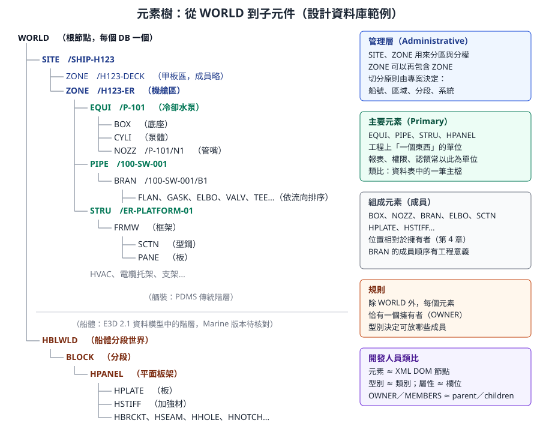
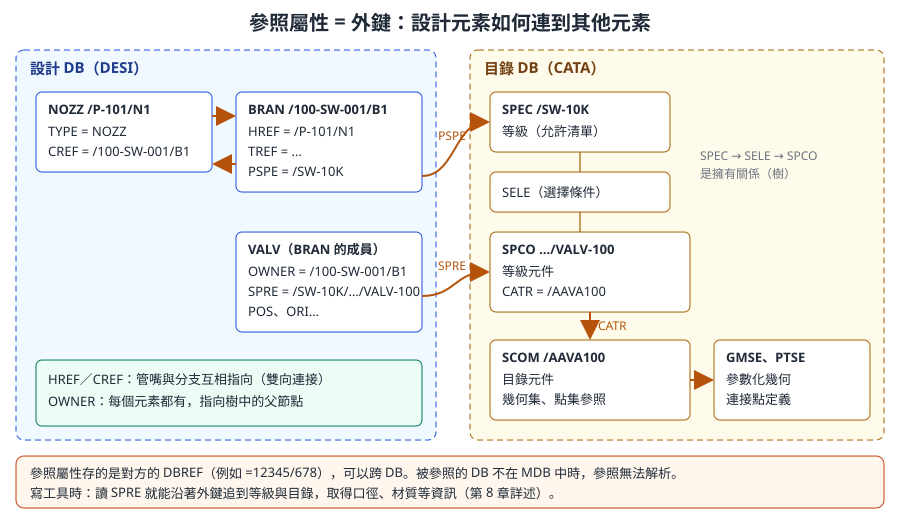

# 第 3 章　資料階層、元素、屬性與導覽

> 本章是整套課程中最核心的資料模型章節。所有 PML 查詢、.NET API、報表工具，操作的都是本章介紹的「元素樹」與「屬性」。讀完本章，你應該能在命令列中自由地移動、查詢任何元素，並把它對應到開發人員熟悉的樹狀資料結構與資料庫欄位。
>
> 內容依據 AVEVA E3D 2.1 Data Model Reference Manual（DMRM）、Database Management Reference Manual（DBRM）、Software Customisation Reference Manual（SCRM）的公開頁面，以及 PDMS／Marine 通用的命令列用法自主撰寫。E3D 2.1 的資料模型與 Marine 12.1 舾裝大致相同，並已包含船體平面板架元素；不同版本的屬性清單可能有差異。命令範例中標示 **〔待核對〕** 者，請在公司訓練專案中驗證。

## 3.1 學習目標

讀完本章，你應該能夠：

1. 畫出 WORLD → SITE → ZONE → 主要元素 → 子元件的樹，並說明每一層的用途。
2. 辨認常見的元素型別：EQUI、PIPE／BRAN、STRU／FRMW／SCTN／PANE、HVAC，以及船體的 BLOCK、HPANEL、HPLATE、HSTIFF、HBRCKT。
3. 用三種方式識別一個元素：名稱、DBREF、型別加序號。
4. 把屬性分成系統、幾何、參照、偽屬性、UDA 五類，並知道各類能不能寫。
5. 查詢 NAME、TYPE、OWNER、MEMBERS、DESC、POS、ORI、SPRE、PURP、FUNC 等常用屬性。
6. 理解 CE（目前元素），並用命令移動到擁有者、成員或指定名稱的元素。
7. 使用 `Q` 與 `Q ATT` 查詢屬性，也會用 `OF` 查詢「不是 CE 的元素」。
8. 說明合法成員（Legal Members）的概念，並知道去哪裡查。

## 3.2 元素樹

### 3.2.1 每個 DB 都是一棵樹

AVEVA E3D 官方文件描述：資料庫是階層式的樹狀結構；除了最上層的 WORLD，所有元素都被其他元素擁有；被擁有的元素稱為擁有者的成員（Member），例如 ZONE 是 SITE 的成員。



*圖 3-1　設計資料庫的元素樹範例。上半部是承襲 PDMS 的舾裝階層，下半部是 E3D 2.1 資料模型中的船體平面板架階層。名稱為示意。（本課程自繪；船體階層依 AVEVA E3D 2.1 DMRM）*

以開發人員的角度理解：

| AVEVA 概念 | 樹狀資料結構 | XML DOM | 關聯式資料庫 |
|---|---|---|---|
| 元素（Element） | 節點 | Element node | 一筆資料列 |
| 元素型別（Type） | 節點種類 | 標籤名稱 | 資料表 |
| 屬性（Attribute） | 節點資料 | Attribute | 欄位 |
| OWNER | parent | parentNode | 指向父資料的外鍵 |
| MEMBERS | children（有順序） | childNodes | 子資料（依序號排序） |
| 參照屬性 | 交叉連結 | IDREF | 外鍵 |
| WORLD | 根節點 | documentElement | 無 |

### 3.2.2 每一層的用途

| 層級 | 型別 | 用途 | 實務切分方式 |
|---|---|---|---|
| 根 | WORLD | 每個 DB 的根，使用者不會直接建立 | 系統自動存在 |
| 管理層 | SITE | 最上層的分區 | 依船號、主要區域或專業〔依公司規劃〕 |
| 管理層 | ZONE | 第二層分區，ZONE 可以再包含 ZONE | 依分段、艙區或系統 |
| 主要元素 | EQUI、PIPE、STRU、HVAC… | 工程上「一個東西」 | 一台設備、一條管線、一組平台 |
| 次級元素 | BRAN、FRMW、SUBE… | 主要元素的組成單位 | 管線的分支、結構的框架 |
| 元件 | ELBO、VALV、SCTN、BOX、NOZZ… | 最細的組成 | 管件、型鋼、基本體、管嘴 |

E3D 2.1 DMRM 描述 ZONE 是第三層的管理元素，可代表工廠的地理或組織區段，並可直接包含設備、土建、管路元素；ZONE 的合法擁有者包括 SITE 與 ZONE 本身。船上的「工廠區段」，在實務中通常對應到分段、艙區或系統。

> **專業提醒：** SITE 與 ZONE 的切分不是技術問題，而是專案管理問題。它會影響權限（不同 Team 的 DB 通常各有自己的 SITE）、圖面範圍、報表統計與效能。寫工具前，先向管理員取得專案的階層規劃，不要假設「一船一個 SITE」。

## 3.3 主要元素型別

### 3.3.1 舾裝元素

| 專業 | 主要元素 | 常見成員 | 說明 |
|---|---|---|---|
| 設備 | `EQUI` | `SUBE`（子設備）、基本體 `BOX`、`CYLI`、`CONE`、`DISH`…、管嘴 `NOZZ` | 基本體有正、負體積（負體積表示挖空） |
| 管路 | `PIPE` → `BRAN` | `FLAN`、`GASK`、`ELBO`、`TEE`、`VALV`、`REDU`、`ATTA`… | BRAN 的成員順序就是沿流向的元件順序 |
| 鐵舾裝／結構 | `STRU` → `FRMW`（`SBFR`） | `SCTN`（型鋼）、`PANE`（板）、節點 | 型鋼斷面引用目錄 |
| 通風 | `HVAC` | HVAC 分支與風管元件 | 結構與管路相似 |
| 其他 | 支架、電纜托架（`CWAY`）、`RPLANE` 等 | | E3D 2.1 中 ZONE 的合法成員清單很長，見 3.9 節 |

### 3.3.2 船體元素

E3D 2.1 DMRM 列出一組「Hull Planar」與「Hull General」類別的元素。由上而下：

| 元素 | 說明（依 DMRM） | 合法擁有者 | 重要成員 |
|---|---|---|---|
| `HBLWLD` | 船體分段世界（Hull Block World） | WORLD | BLOCK |
| `BLOCK` | 分段，屬 Hull General 類別的主要元素 | HBLWLD、WORLD | `HPANEL`、`CPANEL`（曲面板架） |
| `HPANEL` | 平面板架，Hull Planar 類別的主要元素 | BLOCK | `HPLATE`、`HSTIFF`、`HBRCKT`、`HSEAM`、`HHOLE`、`HNOTCH`、`HFLANG`、`HCTOUT`、`HPANBO`（邊界）、`HBEAD`、`HPILLR`、`HSUBPN` 等 |
| `HPLATE` | 板架中的板 | HPANEL | 無 |
| `HSTIFF` | 加強材 | HPANEL | 型材端部、切口、開孔、缺口元素（`HPREND`、`HPRCUT`、`HPRHOL`、`HPRNOT`） |
| `HBRCKT` | 肘板 | HPANEL | `HBRABO`、`HBRFLA`、`HBRSTI` |

DMRM 中，`HBRCKT`、`HPLATE` 等船體元素帶有 `TBID`（Tribon ID）、`CHNGD`（變更計數）、`IsChgd`（船體模型是否被修改）、`Modsta`（建模狀態）等屬性。`TBID` 這個名稱本身就說明了：這些 Dabacon 元素是船體模型（Tribon 系）在設計資料庫中的對應。

> **版本差異〔待核對〕：** 上表依 E3D 2.1 的資料模型。AVEVA Marine 12.1 中，船體元素在 Dabacon 中的階層、名稱與可寫性可能不同；船體元素的建立與修改通常應透過船體模組完成，而不是直接修改 Dabacon 屬性。用 PML 讀取船體元素前，先在訓練專案中用 `Q TYPE`、`Q OWNER` 實際確認階層（第 5、15 章）。

> 〔公開版未收錄：AVEVA 官方產品截圖〕Design Explorer 模型樹與設備：左側為元素樹，中間為泵與管路

*圖 3-2　Design Explorer 就是元素樹的視覺化。展開樹節點，等於走訪 MEMBERS；點選節點，等於設定 CE。（來源：AVEVA Hull and Outfitting Datasheet）*

## 3.4 元素的識別方式

同一個元素可以用三種方式指稱：

| 方式 | 寫法 | 例子 | 特性 |
|---|---|---|---|
| **名稱** | `/` 開頭 | `/P-101`、`/100-SW-001/B1` | 人看得懂；可以改名；不是每個元素都有名稱 |
| **DBREF（資料庫參照）** | `=` 開頭，兩段數字 | `=12345/678` | 系統內部的唯一識別；改名不變；是參照屬性實際儲存的值 |
| **型別加序號** | 型別 + 序號，相對於擁有者 | `ELBO 3 OF /100-SW-001/B1` | 沒有名稱的元件常以此表示；序號會隨成員插入或刪除而改變 |

### 3.4.1 名稱

- 名稱以 `/` 開頭，在專案中應唯一〔唯一性的確切範圍依版本待核對〕。
- 名稱常帶有階層意味，例如分支 `/100-SW-001/B1` 是管線 `/100-SW-001` 的第一個分支。這只是命名慣例，真正的擁有關係由 OWNER 決定。
- 很多元件（彎頭、法蘭、基本體）沒有名稱。介面上會顯示為類似「ELBOW 3 of BRANCH /100-SW-001/B1」的形式。
- 查詢名稱相關的屬性時要注意：`NAME` 是使用者設定的名稱；E3D 系文件中另有 `FLNM`、`FLNN`、`NAMN` 等偽屬性提供完整名稱或不含 `/` 的名稱〔各偽屬性的確切定義待核對〕。本課程開源範例 MyCollect 就用 `!results[!e].flnn` 取得設備名稱放進表格。

### 3.4.2 DBREF

DBREF 是元素的內部參照，格式為 `=` 加兩段數字，例如 `=12345/678`。可以把它想成「資料庫編號 + 該資料庫內的元素編號」組成的主鍵。E3D 2.1 DBRM 說明，參照型（Ref）屬性儲存的是另一個元素的內部資料庫參照，以兩個整數表示。

> **開發人員須知：** 工具在記憶體中保存元素時，用 DBREF（PML 的 `DBREF` 物件，或 .NET 的 `DbElement`），不要保存名稱字串。名稱可能被改、可能不存在；DBREF 在元素存在期間保持不變。但若要把元素識別寫到外部檔案（例如 Excel 回寫），要考慮 DB 重整或合併後參照是否仍有效〔待核對〕，通常同時記錄名稱與 DBREF。

### 3.4.3 型別加序號

在 BRAN 中，第三個彎頭可以寫成 `ELBO 3`。這是相對於目前擁有者的位置性識別，類似 XPath 的 `elbo[3]`。插入一個新彎頭後，原本的 `ELBO 3` 可能變成 `ELBO 4`，所以只適合在互動操作中臨時使用，不適合寫進程式長期保存。

## 3.5 屬性

### 3.5.1 屬性的值型別

E3D 2.1 DBRM 列出屬性的基本型別，與一般程式語言對照如下：

| AVEVA 型別 | 意義 | 程式語言對照 | 例子 |
|---|---|---|---|
| Integer | 整數 | `int` | 序號 |
| Real | 實數，可帶單位 | `double` | 直徑、長度 |
| Bool／Logical | 布林 | `bool` | 是否鎖定 |
| String／Text | 字串 | `string` | `DESC` |
| Ref | 指向另一元素的參照 | 外鍵、物件參照 | `SPRE`、`OWNER` |
| Position | 三個距離組成的位置 | 3D 點 | `POS` |
| Direction | 方向 | 單位向量 | 管嘴方向 |
| Orientation | 姿態（三軸方向） | 旋轉矩陣 | `ORI` |
| Word | 最多 4 或 6 個大寫字元的代碼 | 列舉值（enum） | `TYPE`、`PURP` |
| 陣列 | 上述型別的陣列 | 陣列 | 參數清單 |

Word 型別值得特別注意：DBRM 說明，Word 是最多 4 或 6 個大寫 ASCII 字元，以整數形式儲存，常作為列舉值使用；輸入過長會被**靜默截斷**，小寫會轉大寫，不允許空白。因此 `PURP` 寫入 `'PIPING'` 時，結果可能是 `PIPI`〔各屬性的字元上限依屬性而定〕。工具寫入 Word 型屬性前，應先驗證長度。

### 3.5.2 屬性分類

這是本章的核心表格。開發人員最常犯的錯，是試圖寫入一個不能寫的屬性，或把偽屬性當成儲存的資料。

| 類別 | 說明 | 範例 | 可以寫嗎？ | 開發人員對照 |
|---|---|---|---|---|
| **系統屬性** | 每個元素都有，描述身分與結構 | `NAME`、`TYPE`、`OWNER`、`LOCK` | `NAME` 可寫；`TYPE`、`OWNER` 透過專門命令改變（例如移動元素）〔待核對〕 | 主鍵、類別、父鍵 |
| **一般／工程屬性** | 依型別而有，描述工程意義 | `DESC`、`PURP`、`FUNC`、`AREA` | 可寫（需權限） | 一般欄位 |
| **幾何屬性** | 位置、方向與尺寸 | `POS`、`ORI`、`HEIG`、`DIAM`、`XLEN` | 可寫，但常有連動（例如管件位置由連接決定） | 座標欄位 |
| **參照屬性** | 指向其他元素 | `SPRE`、`CREF`、`HREF`、`TREF`、`PSPE`、`CATR` | 可寫，但必須指向合法元素 | 外鍵 |
| **偽屬性**（Pseudo Attribute） | 查詢時才計算，不存在資料庫中 | `CUTLENGTH`、`WVOL`、`FLNN`、`LASTMOD`、`ATTLIS` | 一般不能寫 | 計算欄位、View |
| **UDA**（使用者自訂屬性） | 公司在 Lexicon 定義，名稱以 `:` 開頭 | `:VENDOR`、`:PO_NO`（示意） | 可寫（需權限） | 擴充欄位 |

關於偽屬性，E3D 2.1 DBRM 的說明是：偽屬性在查詢時計算，不與一般屬性一起存在資料庫中，例如 SCTN 的 `CUTLENGTH`；這類屬性超過 1200 個；由於值是從其他屬性推導而來，一般不能直接設定。E3D Getting Started 也說明，偽屬性是系統為特定目的設定、使用者不能修改的屬性。

> **開發人員須知：** 偽屬性很好用，但要注意兩件事。第一，它每次查詢都要計算，在大量元素上查詢昂貴的偽屬性（例如需要幾何計算的）會很慢。第二，它沒有「歷史」，因為它不存在資料庫中。報表若需要固定某個時點的值，要自己把結果寫下來。

### 3.5.3 參照屬性就是外鍵



*圖 3-3　參照屬性串起整個資料模型：管嘴與分支以 `CREF`／`HREF` 互相指向；分支以 `PSPE` 指向等級；閥門以 `SPRE` 指向等級元件，等級元件再以 `CATR` 指向目錄元件。（本課程自繪）*

參照屬性存的是對方元素的 DBREF。因此：

- 它可以跨 DB，例如設計 DB 中的 `SPRE` 指向目錄 DB 中的 `SPCO`。
- 被參照的 DB 不在目前 MDB 中時，參照無法解析（第 2 章）。
- 沿著參照可以「走」到其他元素，就像 SQL 的 JOIN。第 8 章會完整說明 `SPRE` → 等級 → 目錄的鏈結。

### 3.5.4 常用屬性速查

| 屬性 | 意義 | 型別 | 出現在 | 備註 |
|---|---|---|---|---|
| `NAME` | 名稱 | String | 所有元素 | 可為空 |
| `TYPE` | 元素型別 | Word | 所有元素 | 唯讀 |
| `OWNER` | 擁有者 | Ref | 除 WORLD 外所有元素 | 樹的父節點 |
| `MEMBERS` | 成員清單 | Ref 陣列 | 有成員的元素 | 有順序 |
| `DESC` | 描述 | String | 多數元素 | 自由文字；不要用來存結構化資料 |
| `POS` | 位置 | Position | 有位置的元素 | 預設相對於擁有者（第 4 章） |
| `ORI` | 方向姿態 | Orientation | 有方向的元素 | 例如 `Y is N and Z is U` |
| `SPRE` | 等級元件參照 | Ref | 管件、型鋼等 | 外鍵，指向 SPCO |
| `PURP` | 用途代碼 | Word | 多數管理與主要元素 | 公司自訂代碼，例如區分系統〔待核對〕 |
| `FUNC` | 功能描述 | String | 多數管理與主要元素 | 例如設備功能 |

依 E3D 2.1 DMRM，ZONE 的屬性包括 Name、Description、Function、Purpose、Number、Area、Position、Orientation、Pspec 等。可以看到 `FUNC`、`PURP`、`POS`、`ORI` 連管理層元素都有。

## 3.6 CE：目前元素

### 3.6.1 CE 是什麼

CE（Current Element）是命令列的「游標」。大多數命令與查詢，預設作用在 CE 上：

- `Q NAME` 查的是 CE 的名稱。
- `DESC 'xxx'` 改的是 CE 的描述。
- `NEW EQUI` 會在 CE 底下（或依規則在適當層級）建立新元素〔建立位置規則見第 12 章〕。

在介面上，CE 通常就是 Design Explorer 中被選取的節點。在 PML2 中，CE 以全域變數 `!!ce` 表示，型別是 DBREF。

> **開發人員須知：** 依賴 CE 的程式容易出錯：使用者在執行過程中點了別的元素，或程式自己移動了 CE 而沒有還原。好的工具會：一開始記住 `!start = !!ce`，處理時用 DBREF 物件與 `OF` 語法讀取資料而不移動 CE，結束時把 CE 還原。

### 3.6.2 導覽命令

| 目的 | 命令列寫法 | PML2 寫法（示意） | 備註 |
|---|---|---|---|
| 依名稱跳轉 | `/P-101` | `!!ce = object DBREF('/P-101')` | 命令列最常用 |
| 依 DBREF 跳轉 | `=12345/678` | `!!ce = object DBREF('=12345/678')` | |
| 到擁有者 | `END`〔待核對〕 | `!!ce = !!ce.owner` | PDMS 系常用 `END` 回上一層 |
| 到第 n 個成員 | `1`、`2`…〔待核對〕 | `!!ce = !!ce.members[1]` | PML 陣列從 1 開始 |
| 到第 n 個某型別成員 | `ELBO 3` | | 相對於 CE |
| 下一個、上一個同層元素 | `NEXT`、`PREV`〔待核對〕 | | |
| 沿參照屬性跳轉 | `GOTO SPRE`〔待核對〕 | `!!ce = !!ce.spre` | 從設計元件跳到等級元件 |

「〔待核對〕」的項目是 PDMS 系常見的命令，請在公司版本中逐一試過，把可用的寫法記到自己的速查表（附錄 B）。

## 3.7 用 `Q` 查詢屬性

### 3.7.1 基本形式

`Q` 是 `QUERY` 的縮寫。最常用的四種寫法：

```
Q NAME
Q DESC
Q ATT
Q POS OF /P-101
```

| 寫法 | 意義 |
|---|---|
| `Q 屬性` | 查詢 CE 的某個屬性 |
| `Q ATT` | 列出 CE 的所有一般屬性與值 |
| `Q 屬性 OF 元素` | 查詢指定元素的屬性，不移動 CE |
| `Q 屬性 WRT 元素` | 位置、方向類屬性相對於指定元素的座標系（第 4 章） |

E3D 2.1 SCRM 的說明中，`Q POS` 回傳 CE 相對於其擁有者的位置，`Q POS OF /EQUIP1` 回傳 `/EQUIP1` 相對於其擁有者的位置，`Q POS WRT /*` 則回傳世界座標；DBRM 也列有 `Q POS WRT /MYBRAN`、`Q PPOS(1) WRT /MYBRAN` 這類寫法。

### 3.7.2 一次完整的查詢練習（唯讀）

以下是在一台泵上做的完整查詢流程。名稱為示意，請換成訓練專案中實際存在的元素：

```
/P-101
Q TYPE
Q NAME
Q OWNER
Q MEMBERS
Q DESC
Q POS
Q POS WRT /*
Q ORI
Q ATT
```

| 命令 | 你會看到的內容（示意） | 學到什麼 |
|---|---|---|
| `/P-101` | CE 移到這台泵 | 依名稱導覽 |
| `Q TYPE` | `EQUI` | 型別 |
| `Q NAME` | `/P-101` | 名稱 |
| `Q OWNER` | 所屬 ZONE 的名稱 | 父節點 |
| `Q MEMBERS` | 基本體與管嘴清單 | 子節點 |
| `Q DESC` | 描述文字 | 一般屬性 |
| `Q POS` | 相對於 ZONE 的位置，例如 `E 12000mm N 3500mm U 2100mm` | 相對座標 |
| `Q POS WRT /*` | 世界座標 | 座標轉換 |
| `Q ORI` | 例如 `Y is N and Z is U` | 姿態 |
| `Q ATT` | 全部一般屬性 | 屬性清單因型別而異 |

接著，到它的一個管嘴，查連接關係：

```
/P-101
Q MEMBERS
NOZZ 1
Q CREF
Q NAME OF CREF
```

最後一行使用「屬性 OF 參照屬性」的寫法，直接查出管嘴所連接的分支名稱，而不必移動 CE〔`OF` 後接參照屬性的寫法請在公司版本驗證〕。

### 3.7.3 `Q ATT` 與其他屬性清單

E3D 2.1 DBRM 說明了四種「屬性清單」偽屬性，它們決定 `Q ATT` 與程式看到什麼：

| 偽屬性 | 內容 | 用途 |
|---|---|---|
| `ATTLIS` | 所有非偽屬性，包含 UDA 與隱藏屬性 | PML 的 DBREF `attributes` 方法使用同一份清單 |
| `ATTOUT` | 同 `ATTLIS`，但排除隱藏屬性 | `Q ATT` 與屬性工具表單使用這份清單 |
| `UDALIS` | 該元素可用的 UDA，包含隱藏的 | 找出公司自訂欄位 |
| `PSATTS` | 該元素可用的偽屬性 | 清單很長（數百個），查詢可能較慢 |

因此 `Q ATT` **不會**列出偽屬性，也不會列出隱藏屬性。但隱藏屬性仍可以個別查詢。想知道某型別有哪些偽屬性可用，可以查 `Q PSATTS`；想看公司的自訂欄位，可以查 `Q UDALIS`。

### 3.7.4 查詢 UDA 與偽屬性

```
Q UDALIS
Q :VENDOR
Q WVOL
Q LASTMOD
```

- UDA 的名稱以冒號開頭，例如 `:VENDOR`（示意名稱，請改用公司實際定義的 UDA）。
- `WVOL` 是元素在世界座標中的包圍盒（6 個值：最小 E／N／U 與最大 E／N／U）。第 18 章的外板開孔論文中，實際的 PML 程式就用 `WVOL of $!csurf` 判斷點落在哪塊外板上。
- `LASTMOD` 可以帶限定詞，例如 `Q LASTMOD(ATTNAME XLEN)`，查詢某屬性最後被修改的資訊（AVEVA Engineering 文件的例子；Marine 版本可用性待核對）。

### 3.7.5 命令列查詢與 PML 取值的差別

`Q` 是給人看的：結果印在命令列，格式含單位，不方便程式處理。程式中應該直接取值：

```
-- 示意：在 PML2 中讀取屬性，不移動 CE
!pump = object DBREF('/P-101')
!name = !pump.name
!type = !pump.type
!pos  = !pump.pos
!own  = !pump.owner
!mems = !pump.members
$P 名稱 $!name 型別 $!type 擁有者 $!own
```

| 比較 | `Q` 命令 | PML 取值 |
|---|---|---|
| 對象 | 預設 CE，或用 `OF` | 任何 DBREF 物件 |
| 結果 | 文字輸出到命令列 | 有型別的值（STRING、REAL、POSITION、DBREF…） |
| 用途 | 互動查詢、除錯 | 程式邏輯 |
| 錯誤 | 印出錯誤訊息 | 可以用 `handle` 攔截 |

第 12 章會完整介紹 PML 的資料庫操作。


*圖 3-4　真實專案中的 PML 片段：用 `WVOL of $!csurf` 讀取偽屬性（包圍盒），用 `!basePos.East` 等取出位置分量，用 `Namn of $!csurf` 取得名稱。這正是本章「屬性 OF 元素」的寫法在程式中的應用。（來源：Kim, Park & Yang, 2020, JAMET 44(3), Figure 6，CC BY-NC 3.0）*

## 3.8 屬性值的單位與格式

`Q` 的輸出通常帶有單位，例如 `2100mm`。程式取值時得到的是數值，單位由目前的單位設定決定（第 4 章）。寫入時：

- 長度通常可以帶單位，例如 `HEIG 500mm`〔單位語法待核對〕。
- 字串屬性用單引號，例如 `DESC 'Main cooling pump'`。
- 參照屬性寫入元素名稱或 DBREF，例如 `SPRE /SW-10K/...`（示意）。
- Word 屬性注意長度上限與自動轉大寫。

## 3.9 合法成員（Legal Members）

不是任何型別都可以放在任何型別底下。資料模型定義了每個型別的**合法擁有者**與**合法成員**。這相當於 XML Schema 的內容模型，或物件模型中「這個類別的 children 只能是哪些類別」。

以 E3D 2.1 DMRM 的 ZONE 為例：

| 項目 | 內容（摘錄） |
|---|---|
| 合法擁有者 | APPLDATA、SITE、ZONE |
| 合法成員 | EQUIPMENT、PIPE、STRUCTURE、HVAC、SUPPORT、RESTRAINT、CABLE、CWAY、DATUM、TEXT、ZONE、Hull Panel Element（UPANEL）等二十多種 |

再以船體為例：`HPANEL` 的合法擁有者是 `BLOCK`；`HPLATE` 的合法擁有者是 `HPANEL`，且沒有合法成員。

### 3.9.1 為什麼開發人員要懂合法成員

- **建立元素時**：在 EQUI 底下建立 BRAN 會失敗，因為 BRAN 只能在 PIPE（或 HVAC）底下。建立工具必須先把 CE 移到合法的擁有者。
- **走訪樹時**：知道 ZONE 的合法成員，才能寫出不遺漏的收集條件（例如設備可能在 ZONE 底下，也可能在 SUBE 底下）。
- **讀取船體時**：板厚在 HPLATE 上，加強材在 HSTIFF 上，兩者都是 HPANEL 的成員。

### 3.9.2 去哪裡查

1. **官方資料模型參考（DMRM）**：每個元素型別一頁，列出屬性、合法擁有者與合法成員。E3D 2.1 版本可在 help.aveva.com 線上查閱。
2. **命令列**：PDMS 系有查詢合法成員的偽屬性，常見寫法為 `Q LIST`〔名稱與輸出格式待核對〕。
3. **介面**：在 Design Explorer 中對元素按右鍵建立新元素時，選單中只會列出合法的型別〔依版本而異〕。

## 3.10 開發人員須知

- **樹是唯一的組織方式。** 沒有「資料表」可以直接 SELECT，所有查詢都是「在某個範圍（子樹）內找某型別的元素」，再讀屬性。第 12 章的 `COLLECTION` 與 `collect` 都是這個模式。
- **型別決定一切。** 先確認 `TYPE`，再決定要讀哪些屬性。對不存在的屬性取值會出錯，程式要處理。
- **參照屬性要判斷是否為空。** `SPRE` 未設定時會是空參照（常顯示為 `Nulref` 或 `=0/0`〔顯示方式待核對〕），沿著它取值會出錯。
- **不要把結構化資料存進 DESC。** 需要新欄位，請管理員定義 UDA。
- **DBREF 保存元素，名稱給人看。** 程式內部用 DBREF，輸出報表時才轉成名稱。
- **偽屬性是計算值。** 不能寫、可能很慢、沒有歷史。
- **CE 要還原。** 工具開始時記住 CE，結束時恢復，避免使用者「點一下工具，選取就跑掉」。

## 3.11 練習

查詢類練習在任何專案都安全；練習 5 會修改資料，**只能在訓練專案進行**。

### 練習 1：畫出訓練專案的樹

從 WORLD 開始，畫出訓練專案的前三層（SITE、ZONE、主要元素），標出每個 SITE 屬於哪個 DB（用第 2 章的方法查詢）。

### 練習 2：十種元素的屬性筆記

選 10 種不同型別的元素（EQUI、NOZZ、PIPE、BRAN、ELBO、VALV、STRU、SCTN、ZONE、一個船體元素），對每一個執行 `Q ATT`，整理成表格：型別、合法擁有者（用 `Q OWNER` 推得）、你認為最重要的 5 個屬性。這是第 2 週的課程產出。

### 練習 3：追蹤一條參照鏈

選一個閥門，依序查詢：

```
Q SPRE
Q NAME OF SPRE
```

再移到等級元件，查它的 `CATR`。把整條鏈畫成類似圖 3-3 的圖。

### 練習 4：找出偽屬性

對一個 SCTN 查詢 `Q PSATTS`，從清單中找出 `CUTLENGTH`（或公司版本中的對應名稱），查詢它的值。說明為什麼這個值不存在資料庫中。

### 練習 5：觀察序號識別的不穩定（僅限訓練專案）

在訓練專案的一條分支上，記錄 `ELBO 2` 的 DBREF（`Q REF`〔待核對〕）。在它前面插入一個新彎頭後，再查 `ELBO 2` 的 DBREF。比較兩者，說明為什麼程式不應保存型別加序號形式的識別。

## 3.12 自我檢核

- [ ] 我能畫出 WORLD → SITE → ZONE → 主要元素 → 子元件的樹，並說明每層的用途。
- [ ] 我能說出 EQUI、PIPE、BRAN、STRU、FRMW、SCTN、PANE、HVAC 的意義與上下關係。
- [ ] 我知道船體平面板架 `HPANEL` 的擁有者與主要成員（`HPLATE`、`HSTIFF`、`HBRCKT`）。
- [ ] 我能說明名稱、DBREF、型別加序號三種識別方式的差異與適用時機。
- [ ] 我能把屬性分成系統、一般、幾何、參照、偽屬性、UDA，並說明哪些能寫。
- [ ] 我能查詢 NAME、TYPE、OWNER、MEMBERS、DESC、POS、ORI、SPRE、PURP、FUNC。
- [ ] 我會用 `Q`、`Q ATT`、`Q 屬性 OF 元素`、`Q POS WRT /*`。
- [ ] 我知道 `Q ATT` 不顯示偽屬性與隱藏屬性，並會用 `PSATTS`、`UDALIS` 找它們。
- [ ] 我能說明合法成員的概念，並知道在 DMRM 中查詢。
- [ ] 我理解為什麼工具要用 DBREF 保存元素、並在結束時還原 CE。

**延伸閱讀：** 上一章[第 2 章　專案、資料庫、MDB 與權限](ch02_project_database_zh-TW.reading.html)；下一章[第 4 章　座標、方向與幾何](ch04_coordinates_geometry_zh-TW.reading.html)；目錄與等級的參照鏈見[第 8 章](ch08_catalogue_spec_zh-TW.reading.html)；用 PML 查詢與收集見[第 12 章](ch12_pml_database_zh-TW.reading.html)；指令速查見[附錄 B](appx_b_glossary_zh-TW.reading.html)。

## 3.13 資料來源

- AVEVA E3D 2.1 Getting Started：How AVEVA E3D Data is Stored（階層、擁有者與成員）：<https://help.aveva.com/AVEVA_Everything3D/2.1/GS/GS4.4.1.html>
- AVEVA E3D 2.1 Getting Started：Pseudo-Attributes：<https://help.aveva.com/AVEVA_Everything3D/2.1/GS/GS4.4.5.html>
- AVEVA E3D 2.1 DMRM：Design Database（設計資料庫元素總覽）：<https://help.aveva.com/AVEVA_Everything3D/2.1/DMRM/DMRM5.09.001.html>
- AVEVA E3D 2.1 DMRM：Zone Element（ZONE 屬性、合法擁有者與成員）：<https://help.aveva.com/AVEVA_Everything3D/2.1/DMRM/DMRM5.09.082.html>
- AVEVA E3D 2.1 DMRM：Planar Panel Element（HPANEL）：<https://help.aveva.com/AVEVA_Everything3D/2.1/DMRM/DMRM5.09.406.html>
- AVEVA E3D 2.1 DMRM：Planar Panel Bracket Element（HBRCKT）：<https://help.aveva.com/AVEVA_Everything3D/2.1/DMRM/DMRM5.09.393.html>
- AVEVA E3D 2.1 DMRM：Block Element（BLOCK）：<https://help.aveva.com/AVEVA_Everything3D/2.1/DMRM/DMRM5.09.288.html>
- AVEVA E3D 2.1 DBRM：Attributes（屬性型別）：<https://help.aveva.com/AVEVA_Everything3D/2.1/DBRM/DBRM3.04.01.html>
- AVEVA E3D 2.1 DBRM：Query Attributes（ATTLIS、ATTOUT、UDALIS、PSATTS）：<https://help.aveva.com/AVEVA_Everything3D/2.1/DBRM/DBRM3.04.09.html>
- AVEVA E3D 2.1 DBRM：Pseudo Attributes：<https://help.aveva.com/AVEVA_Everything3D/2.1/DBRM/DBRM1.02.17.html>
- AVEVA E3D 2.1 DBRM：Relative Positions, Directions, Orientations（`Q POS WRT`）：<https://help.aveva.com/AVEVA_Everything3D/2.1/DBRM/DBRM3.04.14.html>
- AVEVA E3D 2.1 SCRM：WRT（`Q POS`、`Q POS OF`、`Q POS WRT /*`）：<https://help.aveva.com/AVEVA_Everything3D/2.1/SCRM/SCRM6.5.18.html>
- AVEVA Engineering 線上文件：偽屬性限定詞：<https://docs.aveva.com/bundle/engineering/page/911892.html>
- Kim, Park & Yang (2020), Journal of Advanced Marine Engineering and Technology 44(3)，CC BY-NC 開放取用：<https://doi.org/10.5916/jamet.2020.44.3.196>
- 開源範例 aveva-marine-dev-skill（MyCollect 範例中的 `flnn`、`COLLECTION` 用法，MIT 授權）：<https://github.com/912141548/aveva-marine-dev-skill>
- AVEVA Hull and Outfitting Datasheet（圖 3-2 來源）：<https://www.aveva.com/content/dam/aveva/documents/perspectives/datasheets/Datasheet_HullandOutfitting.pdf.coredownload.inline.pdf>
