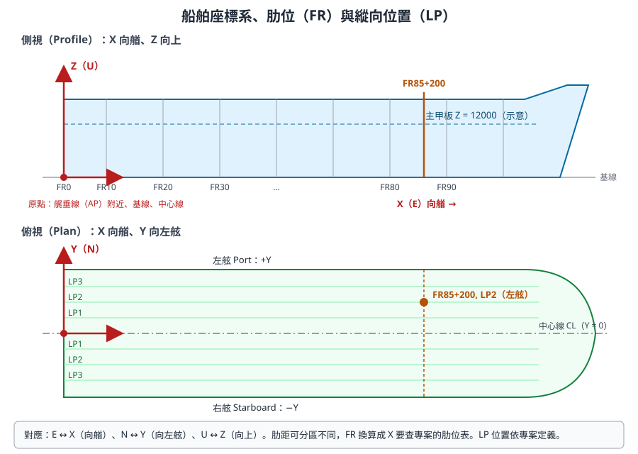
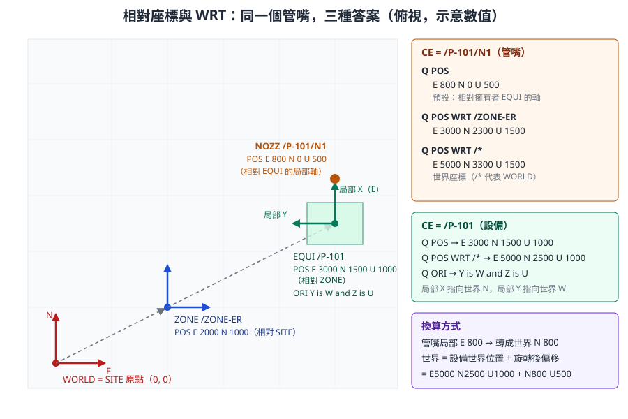
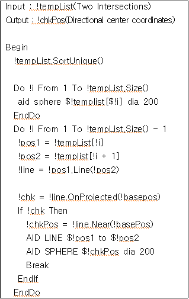

# 第 4 章　座標、方向與幾何

> 本章說明 AVEVA Marine 如何表示「在哪裡」與「朝哪個方向」。舾裝承襲 PDMS，用東、北、上（E／N／U）描述位置；船體承襲 Tribon，用 X／Y／Z 與肋位、縱向位置描述位置。兩者在同一個專案中共存，開發人員必須能互相換算，並理解「位置預設是相對於擁有者」這個最容易出錯的規則。
>
> 內容依據 AVEVA Hull and Outfitting 12.1 線上文件（船舶座標系與 FR／LP 定位）、AVEVA E3D 2.1 Software Customisation Reference Manual（位置表示式、WRT、PLANE 物件）、Database Management Reference Manual，以及開放取用論文中的實際 PML 程式自主撰寫。不同版本的語法細節可能不同，標示 **〔待核對〕** 者請在公司訓練專案中驗證。

## 4.1 學習目標

讀完本章，你應該能夠：

1. 說明世界座標 E／N／U 與船舶座標 X／Y／Z 的對應，以及船舶座標原點的慣例位置。
2. 讀懂並寫出 `E 1000 N 2000 U 300` 這類位置、`N 45 E` 這類方向、`Y is N and Z is U` 這類姿態。
3. 解釋「位置預設相對於擁有者」，並用 `WRT` 在不同座標系間轉換。
4. 用肋位（FR）與縱向位置（LP）描述船體位置，並說明為什麼船體建模偏好參考而不是數值。
5. 說明左右舷的符號慣例與對稱建模時的注意事項。
6. 認識 PML 的 POSITION、DIRECTION、ORIENTATION、LINE、PLANE 物件。
7. 知道長度、角度單位在哪裡設定，以及工具輸出時要注意什麼。

## 4.2 兩套座標語言

### 4.2.1 船舶座標系

AVEVA Hull and Outfitting 文件描述的船舶座標系慣例是：

- **原點**通常位於船艉、低處、中心線上，例如艉垂線（AP）與基線的交點。把原點放在船艉，可以讓 X 座標都是正值。
- **X 軸**指向船艏。
- **Y 軸**指向左舷（Portside）。
- **Z 軸**向上。Z 座標可以是負值（例如基線以下的構件）。



*圖 4-1　船舶座標系、肋位與縱向位置。上為側視，下為俯視。FR 沿 X 方向編號，LP 是平行於中心線的縱向位置。數值為示意。（本課程自繪，依 AVEVA Hull and Outfitting 文件的座標系說明）*

### 4.2.2 舾裝的世界座標

PDMS 系的舾裝模組沿用工廠設計的習慣，以地理方向描述位置：

| 舾裝（PDMS 系） | 船舶（Tribon 系） | 船上意義 | 反方向 |
|---|---|---|---|
| E（East，東） | X | 向艏 | W（West）、−X，向艉 |
| N（North，北） | Y | 向左舷 | S（South）、−Y，向右舷 |
| U（Up，上） | Z | 向上 | D（Down）、−Z，向下 |

兩套都是右手座標系，對應關係是 **E = X、N = Y、U = Z**。所以「東」在船上就是「船艏方向」，「北」就是「左舷方向」。

> **專業提醒：** 這個對應是 Marine 專案的常見設定，但它取決於專案初始化時船體座標系如何對應到舾裝世界座標〔請向管理員確認公司專案的設定〕。在官方型錄的畫面中，可以同時看到兩種寫法：設備定位手把顯示 `X 35 -Y`，閥門方向手把顯示 `E 45 U`。介面顯示哪一種，可能與模組和設定有關〔待核對〕。

> 〔公開版未收錄：AVEVA 官方產品截圖〕設備定位：3D 操控手把顯示方向 X 35 -Y

*圖 4-2　以 3D 操控手把定位設備，畫面即時顯示方向 `X 35 -Y`，意思是「從 +X 往 −Y 轉 35 度」。（來源：AVEVA Hull and Outfitting Datasheet）*

> 〔公開版未收錄：AVEVA 官方產品截圖〕閥門方向調整：圓形操控手把顯示 E 45 U

*圖 4-3　以圓形操控手把旋轉閥門手輪，顯示方向 `E 45 U`，意思是「從 E 往 U 轉 45 度」。（來源：AVEVA Hull and Outfitting Datasheet）*

## 4.3 位置、方向與姿態

### 4.3.1 三種幾何量

| 量 | 意義 | 寫法範例 | 屬性 | 數學對照 |
|---|---|---|---|---|
| 位置（Position） | 空間中的一個點 | `E 1000 N 2000 U 300` | `POS` | 3D 點 |
| 方向（Direction） | 一個指向，不含位置 | `N`、`N 45 E`、`E 45 U`、`-X` | 管嘴方向、連接點方向等 | 單位向量 |
| 姿態（Orientation） | 物件局部座標軸的整體朝向 | `Y is N and Z is U` | `ORI` | 旋轉矩陣 |

E3D 2.1 DBRM 說明，Position、Direction、Orientation 都是由三個實數組成的特殊屬性型別。

### 4.3.2 位置的寫法

位置由三個分量組成，每個分量是「方向字母 + 數值」：

```
E 1000 N 2000 U 300
W 500 S 1200 D 100
E 1000mm N 2000mm U 300mm
```

- 負方向可以用反向字母（`W`、`S`、`D`）表示。
- 數值可以帶單位〔可接受的單位寫法依版本待核對〕。
- 省略的分量視為 0〔待核對〕。

E3D 2.1 SCRM 列出更多位置表示式，常用的有：

| 寫法 | 意義 |
|---|---|
| `POS OF /VESS1 WRT /*` | 某元素的位置屬性，以世界座標表示 |
| `P1 POS OF /CYL2` | 某元素第 1 個連接點（P-point）的位置 |
| `N 45 W 20000 U 1000` | 直接寫出的卡氏座標位置 |
| `N 1000 FROM /ATEST` | 從某元素往北 1000 的位置 |
| `N 1000 FROM P1 OF /BOX2` | 從某元素的連接點出發的偏移 |
| `N (DESP[1] + 10) E` | 數值部分可以是運算式 |

### 4.3.3 方向的寫法

方向表示「從一個軸往另一個軸轉一個角度」：

| 寫法 | 意義 |
|---|---|
| `N` | 正北（船上：指向左舷） |
| `-X` 或 `W` | 指向船艉 |
| `N 45 E` | 從 N 往 E 轉 45 度，也就是東北 |
| `E 45 U` | 從 E 往 U 仰起 45 度 |
| `X 35 -Y` | 從 +X 往 −Y 轉 35 度（船上：從艏向往右舷偏 35 度） |

### 4.3.4 姿態的寫法

姿態用「局部軸指向哪個世界方向」描述，通常指定兩個軸，第三個軸由右手定則決定：

```
ORI Y is N and Z is U
ORI Y is W and Z is U
ORI X is N and Z is U
```

- `Y is N and Z is U` 是預設姿態：局部軸與擁有者的軸一致。
- `Y is W and Z is U` 表示繞垂直軸轉了 90 度：局部 Y 指向 W，局部 Z 仍向上，依右手定則局部 X 指向 N。
- 姿態也可以帶角度的方向，例如 `Y is N 30 E and Z is U`〔語法細節待核對〕。

> **開發人員須知：** 姿態本質上是旋轉矩陣。程式中如果需要做座標換算，不要自己解析 `Y is W and Z is U` 字串再寫三角函數，應該使用 PML 的 ORIENTATION、POSITION 物件方法，或用 `WRT` 讓系統換算（4.4 節、4.7 節）。

### 4.3.5 設定位置與姿態的命令

以下命令會修改資料，**只能在訓練專案中練習**：

```
-- 示意：設定 CE 的位置與姿態（僅限訓練專案）
/TRAIN-EQUI-01
POS E 1000 N 2000 U 300
ORI Y is N and Z is U
Q POS
Q ORI
```

PDMS 系還有相對移動的命令，例如 `BY E 100`（往東移 100）〔Marine 中的可用性待核對〕。

## 4.4 相對座標與 WRT

### 4.4.1 規則：位置預設相對於擁有者

這是本章最重要的觀念。E3D 2.1 SCRM 說明：預設情況下，卡氏座標是以擁有元素的座標系表示；`Q POS` 回傳 CE 相對於其擁有者的位置；要取得世界座標，使用 `Q POS WRT /*`。

換句話說，`POS` 屬性儲存的是「在擁有者座標系中的位置」，就像 HTML 中 `position: relative` 的元素，或遊戲引擎中物件的 local transform。要知道絕對位置，必須沿著擁有者鏈一路累加平移與旋轉。



*圖 4-4　同一個管嘴在三種座標系下的位置。設備 `/P-101` 繞垂直軸轉了 90 度，所以管嘴的局部 `E 800` 在世界座標中變成 `N 800`。（本課程自繪，數值為示意）*

### 4.4.2 換算步驟

以圖 4-4 為例，管嘴的世界座標是這樣算出來的：

| 步驟 | 元素 | 在擁有者座標系中的 POS | 擁有者的世界位置 | 擁有者姿態 | 本元素的世界位置 |
|---|---|---|---|---|---|
| 1 | ZONE `/ZONE-ER` | E 2000 N 1000 U 0 | SITE 在原點 | 預設 | E 2000 N 1000 U 0 |
| 2 | EQUI `/P-101` | E 3000 N 1500 U 1000 | E 2000 N 1000 U 0 | 預設 | E 5000 N 2500 U 1000 |
| 3 | NOZZ `/P-101/N1` | E 800 N 0 U 500 | E 5000 N 2500 U 1000 | `Y is W and Z is U`（局部 E 指向世界 N） | E 5000 N 3300 U 1500 |

第 3 步的關鍵是：管嘴的局部 `E 800` 要先用設備的姿態旋轉，變成世界方向的 `N 800`，再加上設備的世界位置。

### 4.4.3 WRT 的用法

`WRT`（With Respect To）指定「以哪個元素的座標系表示」：

```
Q POS
Q POS WRT /*
Q POS WRT /ZONE-ER
Q POS OF /P-101/N1 WRT /*
Q PPOS(1) WRT /MYBRAN
```

| 寫法 | 結果 |
|---|---|
| `Q POS` | 相對於擁有者 |
| `Q POS WRT /*` | 世界座標（`/*` 代表 WORLD） |
| `Q POS WRT /ZONE-ER` | 以指定元素的座標系表示 |
| `Q PPOS(1) WRT /MYBRAN` | 第 1 個連接點相對於某分支（E3D 2.1 DBRM 範例） |

`WRT` 也可以接在卡氏座標後面，把「相對於某元素」的位置變成絕對位置。SCRM 的例子是 `N 100 WRT /BOX1`：表示在 `/BOX1` 的座標系中往北 100 的那個點。SCRM 也提到 `WRT` 可以再加上 `FROM` 限定，以及 `CONSTRUCT` 語法預設使用世界座標。

> **開發人員須知：** 工具輸出座標時，**一定要說明是哪個座標系**。報表欄位寫「POS」是不夠的，應寫成「世界座標 X（mm）」或「相對 ZONE」。比對兩個元素的距離、做干涉判斷時，兩個位置必須在同一個座標系，最簡單的做法是全部換成世界座標。

### 4.4.4 為什麼要相對座標

相對座標看起來麻煩，但它讓「移動整組物件」變得簡單：移動一台設備，只要改設備的 `POS`，它底下的所有基本體與管嘴自動跟著移動，因為它們的位置是相對於設備的。這和 CAD 的區塊（Block）或 3D 引擎的場景圖（Scene Graph）是同一個設計。

## 4.5 船體定位系統：肋位與縱向位置

### 4.5.1 為什麼船體不用絕對座標

船體設計很少直接寫「X = 64250」，而是寫「FR85 + 200」。理由是：

1. **與船的結構對齊。** 肋骨、橫艙壁都位在肋位上，用肋位描述最自然。
2. **變更可傳遞。** 如果肋距表調整，以肋位描述的構件會跟著重算。
3. **溝通方便。** 現場、圖面、船級審查都用肋位溝通。

### 4.5.2 肋位（FR）

AVEVA Hull and Outfitting 文件說明的重點：

- FR 只能用來定義 **X 方向**（船長方向）的位置。
- 位置可以寫成相對於某個肋位的偏移，正值表示往船艏。
- 可以一次指定一組等間隔的肋位，文件中的例子是 `FR123(5)133 + 500`，表示「肋位 123、128、133 各往艏 500 mm」。

常見寫法：

| 寫法 | 意義 |
|---|---|
| `FR85` | 肋位 85 |
| `FR85+200` | 肋位 85 往艏 200 mm |
| `FR85-300` | 肋位 85 往艉 300 mm |
| `FR123(5)133 + 500` | 肋位 123、128、133 各往艏 500 mm |

肋位與 X 座標的換算由專案的**肋位表**決定。肋距不一定固定，常見做法是艉部、中段、艏部採用不同肋距，例如（示意）：

| 區段 | 肋距 | FR 與 X 的換算（示意） |
|---|---|---|
| FR0 至 FR20 | 700 mm | X = FR × 700 |
| FR20 至 FR180 | 800 mm | X = 14000 + (FR − 20) × 800 |
| FR180 以後 | 650 mm | X = 142000 + (FR − 180) × 650 |

依上表，`FR85+200` 的 X = 14000 + 65 × 800 + 200 = 66200 mm。實際數值必須查公司專案的肋位表。

### 4.5.3 縱向位置（LP）

LP（Longitudinal Position）描述的是縱向構件（縱骨、縱桁）的位置。AVEVA 文件說明，LP 可以定義 **Y 方向**的位置（例如船底縱骨的編號），也可以定義 **Z 方向**的位置（例如舷側縱骨的編號）。也就是說，`LP` 的意義取決於它用在哪個方向：

| 用途 | LP 代表 | 例子（示意） |
|---|---|---|
| 船底、甲板縱骨 | 距中心線的 Y 位置 | `LP4` = 從中心線算起第 4 條縱骨的位置 |
| 舷側縱骨 | Z 方向的高度位置 | `LP3` = 舷側第 3 條縱骨的高度 |

LP 也可以加偏移，例如 `LP4+50`〔寫法依版本待核對〕。

### 4.5.4 甲板高度與平面

Z 方向除了 LP，也常以甲板、平台或基線高度表示，例如「主甲板」「二甲板 + 300」。這些高度可能以命名的參考面（Reference Surface Object，RSO）或座標平面定義，由初始設計階段建立〔寫法依公司專案設定待核對〕。

> **專業提醒：** 肋位表、LP 定義、甲板高度在專案初始化時由管理員設定，修改它們會影響整船的船體模型。開發人員的工具應**讀取**這些定義來換算，而不是在程式中寫死肋距。

> 〔公開版未收錄：AVEVA 官方產品截圖〕船殼曲面上的肋位線與外板接縫

*圖 4-5　船殼曲面上的肋位線與外板接縫。肋位線就是 FR 在曲面上的軌跡。（來源：AVEVA Hull and Outfitting Datasheet）*

### 4.5.5 板架的局部座標

船體平面板架有自己的局部座標系：板架所在的型面（Mould Plane）是局部的 UV 平面。這是「相對座標」觀念在船體上的延伸：板架內的構件以型面座標描述，型面本身再以 FR、LP 或甲板高度定位。第 5 章會詳細說明。

## 4.6 左右舷與對稱

### 4.6.1 符號慣例

依船舶座標系，Y 軸指向左舷：

| 位置 | Y 的符號 | 常見標記 |
|---|---|---|
| 左舷（Port） | Y > 0 | P、PS |
| 中心線上 | Y = 0 | C、CL |
| 右舷（Starboard） | Y < 0 | S、SB |

### 4.6.2 對稱建模

船體結構大多左右對稱。常見做法是只建一舷，或以對稱的定義同時涵蓋兩舷；命名上常以後綴區分，例如無後綴代表對稱、`P` 代表左舷、`S` 代表右舷〔確切規則以公司命名規範為準〕。

開發人員要注意：

- **鏡射不只是 Y 變號。** 位置的鏡射是 Y → −Y，但方向與姿態的鏡射會改變左右手性。型材的腹板方向、肘板的朝向，鏡射後不一定能用「轉一下」得到。
- **對稱定義的元素可能只有一筆資料。** 統計數量、重量時，要知道一筆資料是代表一舷還是兩舷〔對稱元素的屬性表示方式待核對〕。
- **報表要標示舷別。** 只給座標的報表，讀者容易看錯左右。

## 4.7 PML 的幾何物件

PML2 提供一組幾何物件，讓程式不必自己寫向量運算。以下整理本課程有依據的成員與方法；未在官方頁面或實際程式中看到的部分標示〔待核對〕。

| 物件 | 代表 | 有依據的成員與方法 | 依據 |
|---|---|---|---|
| `POSITION` | 點 | `.east`、`.north`、`.up` 分量；`.Line(POSITION)` 建立兩點之間的直線 | 論文實際 PML、開源 pml-json |
| `DIRECTION` | 單位向量 | 由方向字串建立，例如 `N 45 E`〔建構方式待核對〕 | 一般用法 |
| `ORIENTATION` | 姿態 | PLANE 的 `Orientation` 成員型別 | E3D 2.1 SCRM |
| `LINE` | 直線或線段 | `.OnProjected(POSITION)` 判斷投影是否落在線段上；`.Near(POSITION)` 取最近點 | 論文實際 PML |
| `PLANE` | 平面 | `Position`、`Orientation` 成員；`Plane(POSITION, ORIENTATION)`；`Direction()`；`Intersection(LINE)`；`Intersection(PLANE)`；`Near(POSITION)`；`XYOffset(POSITION)` | E3D 2.1 SCRM PLANE Object |

### 4.7.1 讀取位置分量

從資料庫取得的 `POS` 是 POSITION 物件，可以直接取分量：

```
-- 示意：讀取設備的世界座標分量
!pump  = object DBREF('/P-101')
!world = object DBREF('/*')
!wpos  = !pump.pos.wrt(!world)
!x = !wpos.east
!y = !wpos.north
!z = !wpos.up
$P X=$!x Y=$!y Z=$!z
```

〔`.wrt()` 方法名稱與參數寫法待核對；若不可用，可改用 PML1 表示式 `var !wpos (POS WRT /* )` 之類的寫法，語法同樣請在訓練專案驗證。〕

### 4.7.2 真實程式中的幾何物件

第 18 章的外板開孔論文附有實際執行的 PML 截圖，其中一段示範了 POSITION 與 LINE 的用法：



*圖 4-6　實際 PML：`!pos1.Line(!pos2)` 由兩個 POSITION 建立 LINE；`!line.OnProjected(!basepos)` 判斷開孔中心的投影是否落在線段上；`!line.Near(!basePos)` 取線段上最近的點；`AID LINE`、`AID SPHERE` 在 3D 視圖畫輔助圖形以目視除錯。（來源：Kim, Park & Yang, 2020, JAMET 44(3), Figure 11，CC BY-NC 3.0）*

用自己的話改寫這段邏輯（示意）：

```
-- 示意：在一串交點中，找出包夾目標點的線段，並取得線上最近點
-- !pts 為 POSITION 陣列，!target 為 POSITION
do !i from 1 to !pts.size() - 1
  !seg = !pts[!i].Line(!pts[!i + 1])
  if (!seg.OnProjected(!target)) then
    !nearest = !seg.Near(!target)
    break
  endif
enddo
```

### 4.7.3 平面運算

E3D 2.1 SCRM 的 PLANE 物件提供常見的平面運算，例如：

| 方法 | 回傳 | 用途 |
|---|---|---|
| `Plane(POSITION, ORIENTATION)` | PLANE | 由原點與姿態定義平面 |
| `Direction()` | DIRECTION | 平面的法向（Z 方向） |
| `Intersection(LINE)` | POSITION | 無限直線與平面的交點 |
| `Intersection(PLANE)` | LINE | 兩平面的交線 |
| `Intersection(PLANE, PLANE)` | POSITION | 三平面的交點 |
| `Near(POSITION)` | POSITION | 平面上離指定點最近的點 |
| `XYOffset(POSITION)` | XYPOSITION | 把點換成平面上的 XY 偏移 |

這些方法很適合用在「某點投影到甲板面」「管線與艙壁的交點」這類船上常見的計算。Marine 版本中的可用方法請以公司版本的 Software Customisation Reference Manual 核對〔待核對〕。

## 4.8 單位

| 項目 | 常見預設 | 說明 |
|---|---|---|
| 船體長度 | mm | 官方文件指出，Hull 與 Marine Drafting 的單位設定在 12.0、12.1 與 Tribon M3 之間保持一致 |
| 舾裝長度 | mm（可設定為英制） | PDMS 系可分別設定距離（distance）與口徑（bore）的單位〔命令與介面待核對〕 |
| 管徑（Bore） | mm 或 inch | 口徑單位可能與距離單位不同，例如距離用 mm、口徑用 inch |
| 角度 | 度（degree） | 方向與姿態中的角度 |
| 圖面 | 依圖面設定 | 比例與標註單位在圖面中另行設定（第 9 章） |

> **開發人員須知：** 從 `Q` 的輸出取值時，字串會帶單位（例如 `2100mm`），不要用字串切割去解析。程式中應直接取屬性值，並在報表標題寫明單位。與外部系統交換資料時（第 16 章），在檔案中明確記錄單位與座標系，避免對方誤以為是公尺或英吋。

## 4.9 開發人員須知

- **POS 是相對位置。** 需要絕對位置，就用 `WRT /*`；比較兩個元素的位置，先轉到同一座標系。
- **E／N／U 與 X／Y／Z 是同一件事的兩種說法。** 在 Marine 專案中通常 E = X（艏）、N = Y（左舷）、U = Z（上），但仍以專案設定為準。
- **不要寫死肋距。** FR 與 X 的換算要讀專案的定義。工具輸出時，同時提供 FR 寫法與 X 座標，對船體人員最友善。
- **注意左右舷符號。** Y > 0 是左舷。報表加上舷別欄位。
- **使用系統的幾何物件。** POSITION、LINE、PLANE 的方法比自己寫三角函數可靠。
- **用 AID 圖形除錯幾何。** 論文作者在 3D 視圖畫輔助球與輔助線檢查計算結果，這是幾何程式最有效的除錯方法（第 17 章）。

## 4.10 練習

查詢類練習在任何專案都安全；練習 4 會修改資料，**只能在訓練專案進行**。

### 練習 1：同一個點，三種座標

選一個管嘴，查詢：

```
Q POS
Q POS WRT /*
Q POS WRT <它所屬的 ZONE 名稱>
```

再到它所屬的設備，查詢 `Q POS`、`Q ORI`、`Q POS WRT /*`。用 4.4.2 的表格方法，手算管嘴的世界座標，與系統的結果比對。

### 練習 2：把世界座標換成 FR

取得公司專案的肋位表。把練習 1 得到的世界 X 座標換算成「FRnn ± 偏移」的寫法，請船體同事確認是否正確。

### 練習 3：舷別判讀

在訓練專案中找三個元素：一個在左舷、一個在右舷、一個在中心線上。查詢它們的世界 Y 座標，驗證 Y 的正負號與舷別的對應。

### 練習 4：觀察相對座標（僅限訓練專案）

1. 建立或選擇一台訓練設備，記錄它的一個管嘴的 `Q POS` 與 `Q POS WRT /*`。
2. 把設備的 `ORI` 改成 `Y is W and Z is U`。
3. 再查一次管嘴的兩個位置。說明為什麼 `Q POS` 沒變，`Q POS WRT /*` 變了。
4. 把設備的姿態改回原值。

### 練習 5：讀懂實際程式

閱讀圖 4-6 的程式，回答：`!templist` 中的元素是什麼型別？`OnProjected` 回傳什麼型別？為什麼作者要用 `AID SPHERE` 畫出每個交點？

## 4.11 自我檢核

- [ ] 我能說出船舶座標系的原點慣例與 X、Y、Z 的方向。
- [ ] 我知道 E／N／U 與 X／Y／Z 的對應，以及要向誰確認公司專案的設定。
- [ ] 我能讀寫位置 `E 1000 N 2000 U 300`、方向 `N 45 E`、姿態 `Y is N and Z is U`。
- [ ] 我能解釋「POS 預設相對於擁有者」，並用 `Q POS WRT /*` 取得世界座標。
- [ ] 我能手算一個簡單例子中，經過旋轉的子元素的世界座標。
- [ ] 我能解釋 `FR85+200`、`FR123(5)133 + 500` 的意義，並用肋位表換算 X。
- [ ] 我知道 LP 可以代表 Y 方向或 Z 方向的縱向位置。
- [ ] 我知道 Y > 0 是左舷，並了解鏡射時方向與姿態的注意事項。
- [ ] 我認識 POSITION、DIRECTION、ORIENTATION、LINE、PLANE，並知道 PLANE 有哪些常用方法。
- [ ] 我知道工具輸出座標時要標明座標系與單位。

**延伸閱讀：** 上一章[第 3 章　資料階層、元素、屬性與導覽](ch03_hierarchy_attributes_zh-TW.reading.html)；船體型面與拓撲參考見[第 5 章](ch05_hull_modelling_zh-TW.reading.html)；外板開孔的完整幾何案例見[第 18 章](ch18_case_studies_zh-TW.reading.html)；術語見[附錄 B](appx_b_glossary_zh-TW.reading.html)。

## 4.12 資料來源

- AVEVA Hull and Outfitting 12.1 線上文件：船舶座標系、原點與軸向（需以瀏覽器開啟）：<https://docs.aveva.com/bundle/hull-and-outfitting/page/1110625.html>
- AVEVA Hull and Outfitting 12.1 線上文件：FR 與 LP 定位語法：<https://docs.aveva.com/bundle/hull-and-outfitting/page/1115619.html>、<https://docs.aveva.com/bundle/hull-and-outfitting/page/1112589.html>
- AVEVA E3D 2.1 SCRM：Positions（位置表示式）：<https://help.aveva.com/AVEVA_Everything3D/2.1/SCRM/SCRM6.5.17.html>
- AVEVA E3D 2.1 SCRM：WRT（相對與絕對座標、`Q POS WRT /*`、`N 100 WRT /BOX1`）：<https://help.aveva.com/AVEVA_Everything3D/2.1/SCRM/SCRM6.5.18.html>
- AVEVA E3D 2.1 SCRM：PLANE Object：<https://help.aveva.com/AVEVA_Everything3D/2.1/SCRM/SCRM3.3.59.html>
- AVEVA E3D 2.1 DBRM：Attributes（Position、Direction、Orientation 型別）：<https://help.aveva.com/AVEVA_Everything3D/2.1/DBRM/DBRM3.04.01.html>
- AVEVA E3D 2.1 DBRM：Relative Positions, Directions, Orientations：<https://help.aveva.com/AVEVA_Everything3D/2.1/DBRM/DBRM3.04.14.html>
- Kim, Park & Yang (2020), Journal of Advanced Marine Engineering and Technology 44(3)，CC BY-NC 開放取用（圖 4-6 來源）：<https://doi.org/10.5916/jamet.2020.44.3.196>
- k-awata/pml-json（開源，POSITION 物件的 east、north、up 成員用例）：<https://github.com/k-awata/pml-json>
- AVEVA Hull and Outfitting Datasheet（圖 4-2、4-3、4-5 來源）：<https://www.aveva.com/content/dam/aveva/documents/perspectives/datasheets/Datasheet_HullandOutfitting.pdf.coredownload.inline.pdf>
