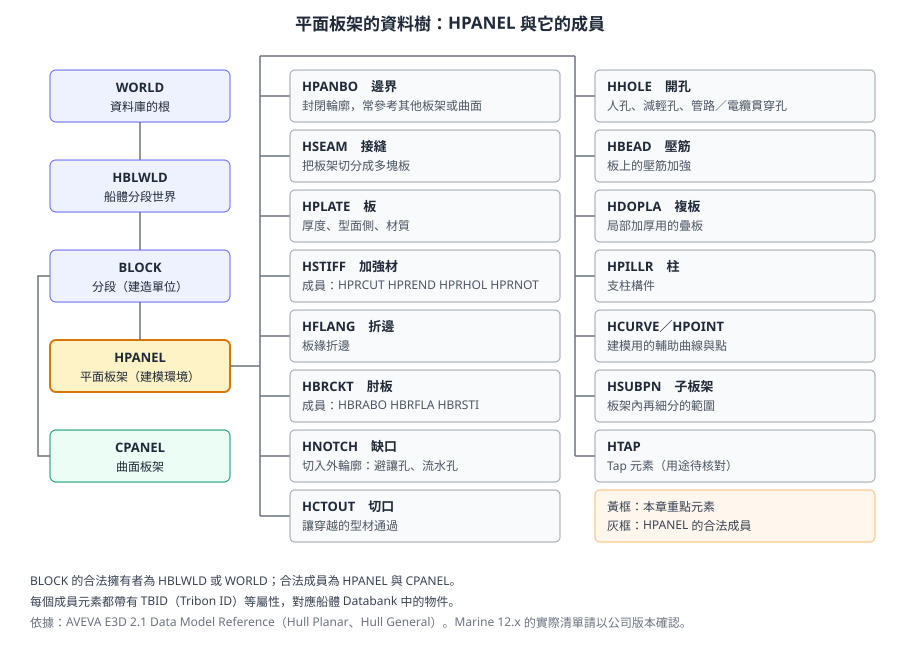
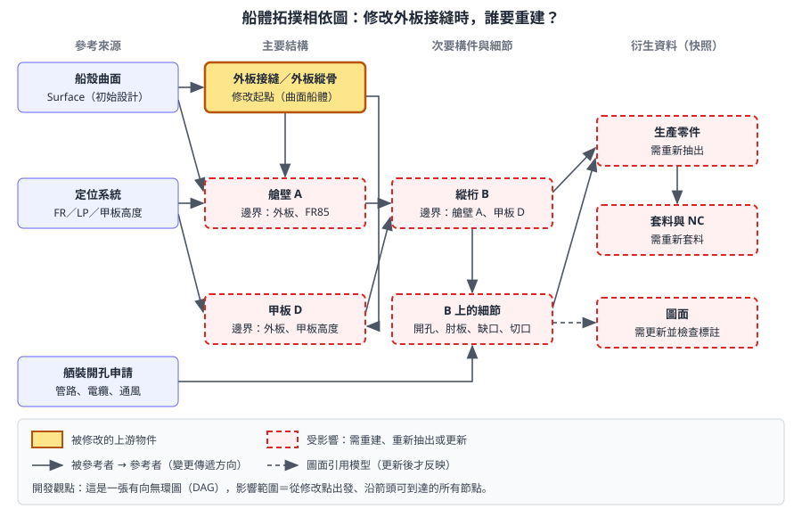

# 第 5 章　船體建模：曲面、板架與拓撲

> 本章是第二部分「船舶設計業務領域」的第一章，說明船體結構在 AVEVA Marine 中如何建模，以及為什麼「改一處會牽動很多處」。讀完本章，你應該能看懂一個平面板架由哪些資料組成、這些資料彼此如何參照，並判斷哪些船體資料適合用程式讀取、哪些修改不應該自動化。
>
> 內容依據 AVEVA 官方線上文件（Hull and Outfitting 12.1）、AVEVA E3D 2.1 Data Model Reference（船體元素定義）、AVEVA 官方產品型錄、開放取用的學術論文，以及 Tribon／AVEVA Marine 船體設計的通用工程實務自主撰寫，不是官方手冊的翻譯。E3D 2.1 的資料模型與 Marine 12.x 相近但不保證完全相同。標示 **〔待核對〕** 的項目，請以公司版本與管理員設定為準。所有建模練習只能在訓練專案進行。

## 5.1 學習目標

讀完本章，你應該能夠：

1. 說出船體資料從初始設計、結構設計、詳細設計到生產的流動順序，以及每一層產生什麼資料。
2. 畫出一個平面板架（Planar Panel）的組成樹，並說明型面、邊界、接縫、板、加強材、折邊、肘板、缺口、切口、開孔各自的工程意義。
3. 分辨設計板架與生產板架。
4. 用「相依圖」的觀念解釋拓撲參考，並能列出一次上游修改的影響範圍。
5. 說明曲面船體的接縫、對接縫、外板縱骨與外板展開。
6. 知道船體 Scheme 是什麼，以及它對開發人員的價值。
7. 判斷哪些船體資料適合用程式讀取，哪些修改不應該自動化。

## 5.2 船體資料鏈：從曲面到生產

AVEVA Marine 的船體功能源自 Tribon M3。船體資料並不是一次畫完，而是沿著設計階段逐層細化。每一層都以上一層的結果為「參考」，這也是本章後面所說拓撲相依的起點。

| 層次 | 主要內容 | 交給下游什麼 | 開發人員的類比 |
|---|---|---|---|
| 初始設計（Initial Design） | 船殼曲面（Surface）、型線、參考面物件、肋位與縱向定位系統 | 曲面幾何、座標參考系統 | 基礎資料與座標系統的「常數表」 |
| 結構設計（Hull Structural Design） | 主要構件的概念佈置，用於強度評估、重量估算、基本設計 | 主要構件的位置與尺寸 | 粗粒度的資料模型草稿 |
| 曲面船體（Curved Hull） | 外板接縫與對接縫、船殼曲線、外板縱骨、外板與曲面板架 | 外板厚度、材料方向、縱骨位置 | 被大量引用的上游模組 |
| 平面船體（Planar Hull） | 甲板、艙壁、縱桁、肋板等平面板架與其附屬構件 | 零件幾何、焊接與裝配資訊 | 細粒度的業務物件 |
| 生產資訊（Production） | 零件抽出、套料、型材草圖、樣板、NC 資料 | 切割、彎曲、裝配用資料 | 由模型衍生的物化資料 |
| 裝配與焊接規劃 | 分段、組立樹、焊接資訊 | 生產排程與工時 | 另一種角度的分組與彙總 |

生產資訊與裝配規劃在[第 6 章](ch06_hull_production_zh-TW.reading.html)說明，本章聚焦前四層。

官方文件特別指出兩個依賴關係，值得先記住：

1. 曲面船體產生的**接縫與外板縱骨**，會被內部結構的平面建模引用。
2. 外板的**厚度與材料方向**，會影響貼合在外板上的內部構件幾何。

所以外板一旦變更，連接在外板上的平面板架都可能要重建。這是船體設計的變更管理比舾裝更嚴格的根本原因。

### 5.2.1 實際系統畫面

> 〔公開版未收錄：AVEVA 官方產品截圖〕Hull Structural Design 介面：左側為模型樹，右側 3D 視圖顯示全船艙區與一個選取中的分段

*圖 5-1　Hull Structural Design 的畫面。左側模型樹列出結構物件，右側 3D 視圖顯示全船艙區劃分，用於初步定義主要構件、估算重量與材料。（來源：AVEVA Hull and Outfitting Datasheet）*

> 〔公開版未收錄：AVEVA 官方產品截圖〕結構設計與詳細設計共用同一個模型資料庫，設計視角與生產視角並存

*圖 5-2　結構設計（Design view）與詳細設計（Production view）共用同一個模型。官方說明，基本設計可依自訂的分段接縫，劃分成詳細設計用的分段與板架。（來源：AVEVA Hull and Outfitting Datasheet）*

> 〔公開版未收錄：AVEVA 官方產品截圖〕分段劃分：全船甲板結構沿分段接縫切分成三個分段

*圖 5-3　分段劃分（Block Division）。上方為整體結構，下方為依分段接縫切出的分段，之後在 Hull Detailed Design 中繼續細化。（來源：AVEVA Hull and Outfitting Datasheet）*

> **專業提醒：** 分段（Block）是造船廠的「建造單位」，不是單純的資料夾。分段的劃分會影響板架怎麼切、零件怎麼編號、組立順序怎麼排。開發報表時，分段幾乎永遠是第一層的分組鍵。

## 5.3 船體資料在哪裡：資料模型概觀

### 5.3.1 兩種儲存方式並存

第 1、2 章提過，船體資料承襲 Tribon，存放在 **Databank**；舾裝資料承襲 PDMS，存放在 **Dabacon** 資料庫。AVEVA Marine 12.x 為了讓船體與舾裝共用一個 3D 環境，船體模型在設計資料庫中也有對應的元素，這些元素帶有 `TBID`（Tribon ID）屬性，用來對應 Databank 中的物件。〔待核對〕哪一方是「主資料」、兩者何時同步，依版本與專案設定而異，請向系統管理員確認。

對開發人員而言，實務上的結論是：

| 需求 | 常見做法 |
|---|---|
| 在 3D 環境中瀏覽、收集船體元素、讀名稱與階層 | PML 或 .NET，以 `HPANEL` 等元素型別操作（第 12、14 章） |
| 讀取板厚、材質、型材規格、零件資訊等船體專屬資料 | Vitesse（Python）的資料抽取介面（[第 15 章](ch15_hull_vitesse_zh-TW.reading.html)） |
| 修改船體模型 | 透過船體建模功能或 Scheme，不建議直接寫入資料庫 |

### 5.3.2 船體元素階層

依 AVEVA E3D 2.1 Data Model Reference，船體元素的階層如下：

- `WORLD` 之下有 `HBLWLD`（Hull Block World，船體分段世界）。
- `HBLWLD` 之下是 `BLOCK`（分段）。`BLOCK` 的合法擁有者為 `HBLWLD` 或 `WORLD`。
- `BLOCK` 的合法成員為 `HPANEL`（平面板架）與 `CPANEL`（曲面板架）。
- `HPANEL` 的合法成員包括邊界、接縫、板、加強材、折邊、肘板、缺口、切口、開孔、壓筋、複板、柱、輔助曲線與點、子板架等。



*圖 5-4　平面板架的資料樹。左側是從 WORLD 到 HPANEL 的階層，右側是 HPANEL 的合法成員。（本課程自繪，依據 AVEVA E3D 2.1 Data Model Reference）*

幾個值得注意的屬性（依 DMRM 的元素說明）：

| 屬性 | 出現在 | 意義 | 開發時的用途 |
|---|---|---|---|
| `TBID` | 板架與其成員 | Tribon ID，對應 Databank 中的物件 | 在兩種資料來源之間建立對照鍵 |
| `IsChgd` | 例如 `HSTIFF`、`HBRCKT` | 船體模型被修改時為真 | 判斷是否需要重新抽出生產資訊 |
| `Modsta` | 例如 `HSTIFF`、`HBRCKT` | 模型建立狀態（列舉值） | 篩選建立完成或尚未完成的構件 |
| `CHNGD` | 例如 `HBEAD`、`HBRCKT` | 修改計數器 | 追蹤修改次數 |
| `Spref` | 例如 `HSTIFF` | 元件等級參照 | 連到型材規格（等級與目錄見[第 8 章](ch08_catalogue_spec_zh-TW.reading.html)） |
| `Desparam` | 例如 `HSTIFF` | 設計參數 | 讀取設計端的參數值 |

〔待核對〕各元素實際帶有哪些屬性，請在公司版本中以 `Q ATT` 逐一查詢，不要只依本表撰寫程式。

> **開發人員須知：** `HSTIFF` 底下還有 `HPRCUT`、`HPREND`、`HPRHOL`、`HPRNOT`（加強材的切口、端部、開孔、缺口），`HBRCKT` 底下還有 `HBRABO`、`HBRFLA`、`HBRSTI`（肘板的邊界、折邊、加強材）。也就是說，「一個板架有多少開孔」這類統計不能只看 `HPANEL` 的直接成員，必須遞迴走訪，或用收集（Collection）一次收集整個範圍內的某型別元素。

## 5.4 平面板架的解剖

平面板架是平面船體建模的基本單位。官方資料模型將它描述為平面船體 3D 建模的基本元素，同時也是在其中建立接縫、板、加強材、肘板等構件的**建模環境**。板架的大小差異很大，小到只有一塊肘板狀的板，大到含數百個零件的整層甲板。

> 〔公開版未收錄：AVEVA 官方產品截圖〕Hull Detailed Design 介面：左側模型樹，右側為船艏區域的板架、肋板與外板縱骨

*圖 5-5　Hull Detailed Design 的畫面。右側為船艏區域的內部結構：肋板、開孔與外板縱骨（黃色），是平面板架與曲面外板交會的典型區域。（來源：AVEVA Hull and Outfitting Datasheet）*

### 5.4.1 組成總表

| 組成 | 元素型別 | 工程意義 | 常見錯誤 |
|---|---|---|---|
| 型面 Mould Plane | 板架本身的屬性 | 板架所在的平面，也是局部 UV 座標系 | 型面側選錯，板厚長錯方向 |
| 邊界 Boundary | `HPANBO` | 構成封閉輪廓的邊 | 順序錯誤、未封閉、參考錯物件 |
| 接縫 Seam | `HSEAM` | 把板架切成多塊板 | 位置不配合鋼板規格或分段 |
| 板 Plate | `HPLATE` | 每一塊板的厚度、型面側、材質 | 缺少板定義，零件無法抽出 |
| 加強材 Stiffener | `HSTIFF` | 型材型號、方向、端部處理 | 腹板方向、端部處理錯誤 |
| 折邊 Flange | `HFLANG` | 板緣折邊 | 折邊方向與相鄰構件干涉 |
| 肘板 Bracket | `HBRCKT` | 構件交接處的補強板 | 型式與連接構件不符 |
| 缺口 Notch | `HNOTCH` | 切入外輪廓的去除區 | 避讓孔漏建 |
| 切口 Cutout | `HCTOUT` | 讓穿越型材通過的開口 | 穿越處沒有切口 |
| 開孔 Hole | `HHOLE` | 板內部的封閉開孔 | 太靠近邊緣或焊道 |
| 其他 | `HBEAD`、`HDOPLA`、`HPILLR` 等 | 壓筋、複板、柱 | 依構件而定 |

### 5.4.2 型面（Mould Plane）

每個板架都位在一個平面上，這個平面同時是板架的局部座標系（UV 平面）。型面可以是主平面（X、Y、Z 其中一個為定值），也可以是斜面。建模時要先決定兩件事：

- **型面位置採用哪個參考**：例如肋位 `FR85`（橫艙壁）或某甲板高度（甲板）。[第 4 章](ch04_coordinates_geometry_zh-TW.reading.html)說明了肋位與縱向位置的寫法。
- **型面側（Moulded Side）**：板厚從型面往哪一側長。這會直接決定相鄰構件的實際接觸位置。

用開發人員的話說，型面就是這個板架的「本地座標系」，板架內所有構件的位置都相對於它表示。

### 5.4.3 邊界（Boundary）

依公開的官方訓練教材摘要（TM-2102），每個板架最多可有 **12 條邊界**，在預設視角下依**逆時針順序**給定，而且必須構成**封閉輪廓**〔待核對：上限與方向規則依版本〕。邊界依輸入順序編號，之後的缺口、角隅處理會以「第幾條邊界、第幾個角」來引用。

常見的邊界來源有四種：

| 邊界來源 | 例子 | 特性 |
|---|---|---|
| 其他板架 | 以艙壁、甲板、縱桁為邊界 | 參考的板架移動，本板架跟著變 |
| 船殼曲面 | 以外板曲面為邊界 | 曲面或外板厚度改變會影響本板架 |
| 定位系統平面 | `FR`、`LP`、某甲板高度 | 定位系統變更時跟著變 |
| 直接輸入 | 點與線的座標 | 不會自動跟著任何東西變 |

> **專業提醒：** 重排或增減邊界之後，原本掛在「第 3 條邊界」上的缺口，可能變成掛在另一條邊界上。這和程式中「以陣列索引當作識別鍵」的風險完全一樣：索引會因插入或刪除而位移。修改邊界後，務必重新檢查所有依邊界或角隅編號定位的特徵。

### 5.4.4 接縫（Seam）與板（Plate）

接縫把板架切成多塊板，每一塊板都要有板定義：

| 屬性 | 說明 | 檢查重點 |
|---|---|---|
| 厚度 Thickness | 板厚 | 是否符合結構圖與船級要求 |
| 型面側 Position | 板厚相對於型面往哪一側 | 與相鄰構件一致，避免重疊或留縫 |
| 材質 Material Quality | 鋼級，例如 A、AH32、AH36 | 與結構圖、材料表一致 |

板架內**每一塊板都必須有板定義**，缺少定義會導致零件無法正確抽出。接縫位置應配合鋼板規格、套料效率與分段劃分，不應只依幾何方便決定。

### 5.4.5 加強材（Stiffener）

加強材是板架上數量最多、也最容易出錯的構件。定義時通常會涉及：

- **型材型號**：扁鋼、球扁鋼、角鋼、T 型材等，從公司的型材標準庫選用。
- **位置與方向**：沿哪條線佈置、腹板朝哪一側、翼緣朝哪個方向。
- **傾角**：例如貼合外板時，腹板是否垂直於外板。
- **端部處理（End Cut）**：斜切（Snipe）、直切，或以肘板連接。
- **與穿越構件的關係**：穿過切口，或在該處截斷。

> 〔公開版未收錄：AVEVA 官方產品截圖〕型材穿越板材：左為切口，中為切口加補板，右為剖面

*圖 5-6　型材穿越板材時的切口與補板。從左到右：純切口、切口加補板（Collar），以及剖面示意。（來源：AVEVA Hull and Outfitting Datasheet）*

> **專業提醒：** 加強材的端部處理會決定生產端的切割形狀與焊接長度。設計審查時，可依「端部處理 → 是否需要肘板 → 穿越處的切口與補板」的順序逐點檢查。

### 5.4.6 缺口、切口與開孔：三種「去除材料」

三者都是把材料去掉，但工程意義與資料型別都不同：

| 類型 | 元素型別 | 定義 | 典型用途 |
|---|---|---|---|
| 缺口 Notch | `HNOTCH`（加強材上為 `HPRNOT`） | 切入板或型材**外輪廓**的去除區 | 焊道避讓孔（Scallop）、流水孔、通氣孔、角隅缺口 |
| 切口 Cutout | `HCTOUT`（加強材上為 `HPRCUT`） | 包圍**穿越型材**的開口 | 縱骨穿過肋板時的開口，常搭配 Collar 或 Clip |
| 開孔 Hole | `HHOLE`（加強材上為 `HPRHOL`） | 位於板內部、不切到外輪廓的封閉孔 | 減輕孔、人孔、管路與電纜貫穿孔 |

缺口可以依「與接縫或線的交點」或「距加強材端點的距離」定位，也可以引用交會接縫，或以 `FR`、`LP` 座標定義限制型缺口（Limit Notch）。

> **開發人員須知：** 舾裝的貫穿孔最後會落在 `HHOLE` 這類元素上（[第 7 章](ch07_outfitting_zh-TW.reading.html)）。如果要寫「檢查每個管路貫穿是否都有對應船體開孔」的工具，比對的兩端就是舾裝的貫穿資料與船體的開孔元素，比對鍵通常是位置、尺寸與所屬板架。

### 5.4.7 肘板（Bracket）

肘板用於構件交接處的補強，例如縱骨端部、甲板橫梁與肋骨的連接。肘板通常從標準型式庫中選用，再給定尺寸、厚度、折邊與所連接的構件。在資料模型中，`HBRCKT` 自己也有邊界（`HBRABO`）、折邊（`HBRFLA`）與加強材（`HBRSTI`），是一個「小板架」。

## 5.5 設計板架與生產板架

官方資料模型把平面船體資料分成三個階段：**參考面**（由 Initial Hull Design 建立）、**設計板架**（由 Structural Hull Design 建立）、**生產板架**（主要用於 Hull Detailed Design）。

> 〔公開版未收錄：AVEVA 官方產品截圖〕一個設計板架細分為多個帶開孔與加強材的生產板架

*圖 5-7　同一個結構區域從設計板架（左）細化為多個生產板架（右）。生產板架帶有加強材、開孔與缺口等細節。（來源：AVEVA Hull and Outfitting Datasheet）*

| 比較項目 | 設計板架 | 生產板架 |
|---|---|---|
| 目的 | 強度評估、重量估算、基本設計 | 產生零件、圖面與生產資訊 |
| 粒度 | 粗，一個板架可能跨多個分段 | 細，依分段與建造方式切分 |
| 細節 | 主要尺寸、板厚、主要加強材 | 每塊板、每支加強材、缺口、開孔、肘板 |
| 主要使用者 | 基本設計、結構計算 | 詳細設計、生產設計 |
| 開發類比 | 概念資料模型 | 實體資料模型 |

> **專業提醒：** 兩者共用同一個模型，所以設計端的修改有機會傳遞到生產端，但這不代表「改了就自動正確」。從設計板架切分出生產板架之後，生產端常會加上大量細節，上游修改時仍要檢查細節是否還成立。

## 5.6 拓撲參考與相依鏈

### 5.6.1 參考而不是數值

板架邊界如果寫成「與 FR85 艙壁相交」，而不是「X = 64,250」，艙壁移動時板架就能**跟著重算**。這就是 Marine 船體建模的核心觀念：**用拓撲（Topology）描述構件之間的關係**。

| 描述方式 | 優點 | 風險 |
|---|---|---|
| 參考其他構件或定位系統 | 設計變更可自動傳遞 | 依賴鏈太長時，一處錯誤會影響多個板架 |
| 直接輸入數值座標 | 簡單、可預期 | 變更後要人工逐一修改，容易遺漏 |

實務原則是：**主要結構邊界用參考，局部細節才用數值。**

用開發人員熟悉的話說，這就像試算表中的儲存格公式：`=A1+B1` 會跟著 A1 變，直接打上數字則不會。拓撲參考讓模型變成一張由公式串起來的試算表。

### 5.6.2 相依圖



*圖 5-8　船體拓撲相依圖。箭頭從「被參考者」指向「參考者」，也就是變更傳遞的方向。修改外板接縫（黃框）時，所有沿箭頭可到達的節點（紅色虛線框）都要重建、重新抽出或更新。（本課程自繪）*

上圖可以讀成一條典型的相依鏈：

```
船殼曲面 → 外板接縫／外板縱骨 → 艙壁 A → 縱桁 B → B 上的開孔、肘板
                                  甲板 D ↗
```

這是一張**有向無環圖（DAG）**。開發人員熟悉的幾個概念可以直接套用：

| 圖論概念 | 在船體建模中的意義 |
|---|---|
| 節點 | 板架、外板、定位系統、開孔申請 |
| 有向邊 | 「以……為邊界或參考」的關係 |
| 從某節點出發可到達的節點集合 | 一次修改的影響範圍 |
| 拓撲排序 | 合理的建模與重建順序：上游先、下游後 |
| 環 | 不應出現。兩個板架互為邊界，會造成無法決定的重算順序〔系統如何處理依版本而異，待核對〕 |

### 5.6.3 專業團隊的做法

1. **由外往內、由主到次建模**：先完成曲面與外板，再建主要艙壁與甲板，最後才是次要構件與細節。這正是拓撲排序。
2. **凍結上游**：外板與主要結構確認後，才大量細化下游；若必須修改，先評估影響範圍。
3. **重建後檢查**：重建板架後，確認邊界、缺口、肘板是否仍附著在正確的參考上。
4. **控制依賴鏈長度**：避免為了「方便跟著變」而讓細節參考很遠的上游物件。

## 5.7 曲面船體（Curved Hull）

### 5.7.1 工作內容

依官方文件，曲面船體涵蓋：

- 產生**接縫與對接縫（Seams and Butts）**，以及一般用途的船殼曲線。
- 定義**外板縱骨（Shell Profile）**。
- 定義並**展開外板（Shell Plate）**。
- 以既有的外板與外板縱骨組成**曲面板架**（資料模型中的 `CPANEL`）。
- 在曲面外板上定義開孔，用於劃線或切割。

> 〔公開版未收錄：AVEVA 官方產品截圖〕曲面外板模型：綠色外板上的紅色外板縱骨與內部構件

*圖 5-9　曲面船體模型。綠色為外板，紅色為外板縱骨與橫向構件。官方說明，曲面板會依船廠的工作方法自動展開。（來源：AVEVA Hull and Outfitting Datasheet）*

> 〔公開版未收錄：AVEVA 官方產品截圖〕船殼曲面上的肋位線與外板接縫

*圖 5-10　船殼曲面上的肋位線與外板接縫規劃。（來源：AVEVA Hull and Outfitting Datasheet）*

### 5.7.2 接縫（Seam）與對接縫（Butt）

外板的分板線分成兩個方向：大致沿船長方向的稱為接縫（Seam），大致沿橫向切斷的稱為對接縫（Butt）。兩者合起來把整個船殼切成一塊塊外板。接縫規劃會影響：

| 因素 | 說明 |
|---|---|
| 鋼板利用率 | 板寬、板長受鋼廠規格限制 |
| 成形難度 | 雙曲度大的區域，分板方式影響冷彎或線加熱的工作量 |
| 分段劃分 | 對接縫通常配合分段接頭 |
| 內部結構 | 接縫不應與內部構件的焊道過度接近 |

### 5.7.3 外板縱骨（Shell Profile）

外板縱骨是貼在外板內側的加強材。它的位置通常由曲線（例如與某平面的交線）定義，腹板方向要考慮與外板的夾角。外板縱骨會被內部平面板架引用（例如肋板上的切口位置），所以它也是相依圖中的重要上游。

### 5.7.4 展開與樣板

曲面外板必須展開成平板才能切割。系統會依船廠的工作方法自動展開，並可產生**彎曲樣板**（依曲率產生內側或外側樣板）。官方文件也提到，傳統木樣板逐漸被**可重複使用、可調整的樣板**取代；12.1 SP3 的版本說明中有胎架支柱（Jig Pillar）相關的強化。樣板與胎架在第 6 章詳述。

> **開發人員須知：** 曲面上的幾何計算（例如求某點的法向量）比平面困難許多。[第 18 章](ch18_case_studies_zh-TW.reading.html)的外板開孔案例就是以「建立虛擬平面、求與外板的交線、再算斜率」的方式，在曲面上求得開孔方向。這類演算法要用輔助圖形（`AID`）逐步目視驗證。

## 5.8 變更影響評估與重建

### 5.8.1 修改前的影響評估清單

修改任何上游構件前，至少回答下列問題：

- [ ] 哪些板架以它作為邊界或參考？（相依圖的直接下游）
- [ ] 這些板架又被誰參考？（遞迴下游）
- [ ] 是否已產生生產資訊、已套料，甚至已下料？
- [ ] 是否有舾裝開孔（管路、電纜、通風）依附在受影響的板上？
- [ ] 是否需要通知圖面、生產或其他專業？

> **專業提醒：** 已下料的零件被修改，代價遠高於設計階段的修改。請與生產管理確認零件狀態後，再決定修改方式。

### 5.8.2 重建的順序

重建要依拓撲順序進行：先重建最上游被修改的物件，再依序往下游重建。如果順序顛倒，下游板架會以舊的上游幾何計算，結果仍然錯誤，而且看起來「已經重建過」。

| 步驟 | 動作 | 檢查 |
|---|---|---|
| 1 | 修改上游物件 | 修改內容與設計變更單一致 |
| 2 | 依拓撲順序重建下游板架 | 邊界是否封閉、是否仍參考正確物件 |
| 3 | 檢查細節 | 缺口、肘板、開孔是否仍在正確位置 |
| 4 | 重新抽出生產資訊 | 零件數、編號、重量是否合理（第 6 章） |
| 5 | 更新圖面 | 標註是否仍正確（[第 9 章](ch09_drawings_zh-TW.reading.html)） |
| 6 | 通知下游 | 生產、舾裝、圖面負責人 |

## 5.9 船體 Scheme：文字化的建模描述

板架的定義可以用文字形式呈現，業界常稱為 **Scheme**。Tribon 時期即以文字描述板架，Marine 中仍保有這種能力〔待核對：Scheme 的檔案位置、關鍵字與編輯方式依版本而異〕。專業使用者會利用 Scheme：

- 一次檢視整個板架的完整定義，比在對話框逐項點選快。
- 比對兩個相似板架的差異。
- 以相似板架為範本，修改後建立新板架。

以下只是**示意結構**，用來說明「Scheme 是一份描述性的原始碼」這個觀念，關鍵字不是官方語法：

```
// 示意：不是官方 Scheme 語法，僅說明內容組成
PANEL 'B21-FL-FR42'  BLOCK 'B21'
  PLANE  X = FR42                     // 型面：參考肋位
  BOUNDARY  'B21-DB'                   // 邊界 1：內底板
  BOUNDARY  SHELL                      // 邊界 2：外板曲面
  BOUNDARY  'B21-GD-LP3'               // 邊界 3：縱桁
  BOUNDARY  Z = 0                      // 邊界 4：基線
  PLATE  THICKNESS 12  QUALITY 'AH32'  SIDE AFT
  STIFFENER  PROFILE 'FB150x12'  ...
  HOLE  'LIGHTENING-600x400'  ...
```

對開發人員來說，Scheme 的意義有三點：

1. **它是可比對的文字**：可以用一般的 diff 工具比較兩個版本的板架定義，甚至放進版本管理。
2. **它是建模的「原始碼」**：板架的 3D 幾何是由這份描述「編譯」出來的結果。修改原始碼再重建，比直接修改幾何結果更可靠。
3. **它暴露了相依關係**：每一條 `BOUNDARY` 參考了哪個物件，一眼可見。解析 Scheme 是建立相依圖的一種可行方式〔待核對：Scheme 是否能以程式批次輸出〕。

## 5.10 程式範例：唯讀查詢船體資料

以下兩段程式都只**讀取**，不修改模型。

### 5.10.1 PML：統計某分段下每個平面板架的直接成員

```pml
-- 示意：未在實機驗證。列出分段 /B21 下所有 HPANEL，統計板與加強材數量
-- 只讀取，不修改模型
!coll = object COLLECTION()
!coll.type('HPANEL')
!coll.scope(/B21)
!panels = !coll.results()

do !p values !panels
   !nPlate = 0
   !nStiff = 0
   do !m values !p.members
      if (!m.type eq 'HPLATE') then
         !nPlate = !nPlate + 1
      elseif (!m.type eq 'HSTIFF') then
         !nStiff = !nStiff + 1
      endif
   enddo
   !msg = !p.name & '  plates=' & !nPlate.string() & '  stiffeners=' & !nStiff.string()
   $p $!msg
enddo
```

收集（`COLLECTION`）與走訪的寫法在[第 12 章](ch12_pml_database_zh-TW.reading.html)詳述。這裡要注意的業務重點是：`HSTIFF` 底下的切口、開孔不在 `HPANEL` 的直接成員中，要統計它們必須把範圍擴大到整個分段，再依型別收集。

### 5.10.2 Vitesse：以資料抽取語言讀取板厚

板厚、材質這類船體專屬資料，可用 Vitesse 的資料抽取介面讀取。以下片段整理自 `Docs\examples\vitesse-hull-report` 的開源範例（完整說明見第 15 章），語法為 Python 2.6：

```python
import kcs_dex, kcs_util

ok = kcs_util.success()

def get_real(est):
    # est 形如 HULL.PANEL('DECK01').PLA(1).THICKNESS
    res = kcs_dex.extract(est)
    if res == ok:
        typ = kcs_dex.next_result()
        if typ == 2:            # 1=INT, 2=REAL, 3=STRING
            return kcs_dex.get_real()
    return None

thk = get_real("HULL.PANEL('%s').PLA(1).THICKNESS" % 'DECK01')
```

`HULL.PANEL('名稱').PLA(1).THICKNESS` 這類抽取語句，正好對應本章的資料結構：板架 → 第 1 塊板 → 厚度。範例中的板架名稱 `DECK01` 僅為示意，請換成訓練專案中的實際名稱。

## 5.11 開發人員須知

### 5.11.1 適合用程式讀取的船體資料

| 資料 | 典型用途 | 備註 |
|---|---|---|
| 板架清單、名稱、所屬分段 | 進度統計、命名規範檢查 | 用收集即可取得 |
| 板厚、材質、型材規格 | 材料統計、與結構圖比對 | 多半透過 Vitesse 抽取 |
| 開孔、缺口、切口的數量與位置 | 貫穿孔比對、審查報表 | 注意成員的巢狀結構 |
| 修改旗標與狀態（`IsChgd`、`Modsta`） | 找出需要重新抽出的構件 | 屬性名稱依版本確認 |
| `TBID` | 建立 3D 元素與 Databank 物件的對照 | 作為整合鍵 |

### 5.11.2 不應自動化的修改

| 修改 | 為什麼不要自動化 |
|---|---|
| 批次修改邊界或型面參考 | 會改變拓撲，影響範圍難以預估 |
| 批次移動接縫或對接縫 | 影響零件、套料與已下料的鋼板 |
| 自動重建大量板架 | 重建順序錯誤時結果看似正確卻是錯的 |
| 直接寫入船體 Databank | 繞過建模邏輯，可能破壞資料一致性 |
| 刪除構件 | 下游參考會失去對象 |

如果業務真的需要批次修改（例如統一更新某型號加強材的規格），建議的模式是：**程式產生修改清單與預覽 → 人工審查 → 以官方建模功能或 Scheme 執行 → 重建後以程式比對前後差異**。程式負責「找」與「驗」，人負責「改」。

> **開發人員須知：** 把船體模型當作一張相依圖來看待。任何寫入動作都要先回答「影響範圍是什麼」。如果你的工具答不出這個問題，它就不應該寫入。

## 5.12 練習（只能在訓練專案）

### 練習 5-1：讀懂一個既有板架

1. 選一個中等複雜度的板架，例如某肋位的實肋板。
2. 列出它的型面、所有邊界，以及各邊界參考的物件。
3. 列出所有板的厚度與材質，與結構圖比對。
4. 列出所有缺口、切口、開孔，依 5.4.6 節分類。
5. 若公司版本可輸出 Scheme，對照找出上述每一項在文字中的位置。

### 練習 5-2：畫出相依圖

1. 選一個被多個板架參考的艙壁。
2. 用紙筆或任何繪圖工具，畫出以它為起點、往下游兩層的相依圖。
3. 依 5.8.1 節清單，列出受影響的板架與零件。
4. 在訓練專案中把艙壁移動一個肋距，依拓撲順序重建相關板架。
5. 比較前後差異：哪些自動更新了，哪些需要人工處理？

### 練習 5-3：唯讀統計

1. 在訓練專案中執行 5.10.1 節的 PML 範例（範圍改成訓練專案中的分段名稱）。
2. 擴充程式，改為統計整個分段中 `HHOLE` 與 `HNOTCH` 的數量。
3. 與練習 5-1 的人工統計結果比對。

## 5.13 自我檢核

- [ ] 我能說出船體資料鏈的各層，以及每層交給下游什麼資料。
- [ ] 我能畫出 `WORLD → HBLWLD → BLOCK → HPANEL` 的階層，並列出至少 8 種 `HPANEL` 成員。
- [ ] 我能解釋型面、型面側與邊界順序的意義。
- [ ] 我能區分缺口、切口與開孔。
- [ ] 我能說明設計板架與生產板架的差別。
- [ ] 我能用相依圖解釋「改一處牽動多處」，並說出合理的重建順序。
- [ ] 我能說明接縫、對接縫、外板縱骨與外板展開。
- [ ] 我知道 Scheme 是板架的文字化描述，並說得出它對開發的價值。
- [ ] 我能列出適合程式讀取的船體資料，以及不應自動化的修改。

## 資料來源

- AVEVA E3D 2.1 Data Model Reference：[Planar Panel Element (HPANEL)](https://help.aveva.com/AVEVA_Everything3D/2.1/DMRM/DMRM5.09.406.html)、[Planar Panel Stiffener Element (HSTIFF)](https://help.aveva.com/AVEVA_Everything3D/2.1/DMRM/DMRM5.09.419.html)、[Planar Panel Bracket Element (HBRCKT)](https://help.aveva.com/AVEVA_Everything3D/2.1/DMRM/DMRM5.09.393.html)、[Planar Panel Bead Element (HBEAD)](https://help.aveva.com/AVEVA_Everything3D/2.1/DMRM/DMRM5.09.390.html)、[Block Element (BLOCK)](https://help.aveva.com/AVEVA_Everything3D/2.1/DMRM/DMRM5.09.288.html)（E3D 版本，與 Marine 12.x 可能有差異）
- AVEVA Hull and Outfitting 12.1 線上文件：[Hull and Outfitting](https://docs.aveva.com/bundle/hull-and-outfitting/page/1224159.html)、[Block Element (BLOCK)](https://docs.aveva.com/bundle/hull-and-outfitting/page/1136009.html)、[Planar Hull 面板概念](https://docs.aveva.com/bundle/hull-and-outfitting/page/1110536.html)、曲面船體相關主題（[1110564](https://docs.aveva.com/bundle/hull-and-outfitting/page/1110564.html)）、[Hull Detailed Design 版本說明](https://docs.aveva.com/bundle/hull-and-outfitting/page/1224401.html)（需以瀏覽器開啟）
- AVEVA 官方產品資料（本章截圖來源）：[AVEVA Hull and Outfitting Datasheet](https://www.aveva.com/content/dam/aveva/documents/perspectives/datasheets/Datasheet_HullandOutfitting.pdf.coredownload.inline.pdf)、[Hull Detailed Design Brochure](https://www.aveva.com/content/dam/aveva/documents/brochures/Brochure_AVEVA_HullDetailedDesign_11-18.pdf)
- 官方訓練課程：[AVEVA Marine 12.1.5 Hull Detailed Design – Planar Hull Modelling（Learning Academy）](https://learningacademy.aveva.com/courses/aveva-marine-1215-hull-detailed-design-planar-hull-modelling-instructor-led-training)；訓練手冊 TM-2101、TM-2102、TM-2103 僅參考公開摘要中的定義
- 曲面開孔演算法：Kim, Park & Yang (2020), [Journal of Advanced Marine Engineering and Technology 44(3)](https://doi.org/10.5916/jamet.2020.44.3.196)，CC BY-NC 3.0
- Vitesse 抽取範例：本課程 `Docs\examples\vitesse-hull-report`（開源範例，授權見 `Docs\examples\LICENSE-aveva-marine-dev-skill.txt`）
