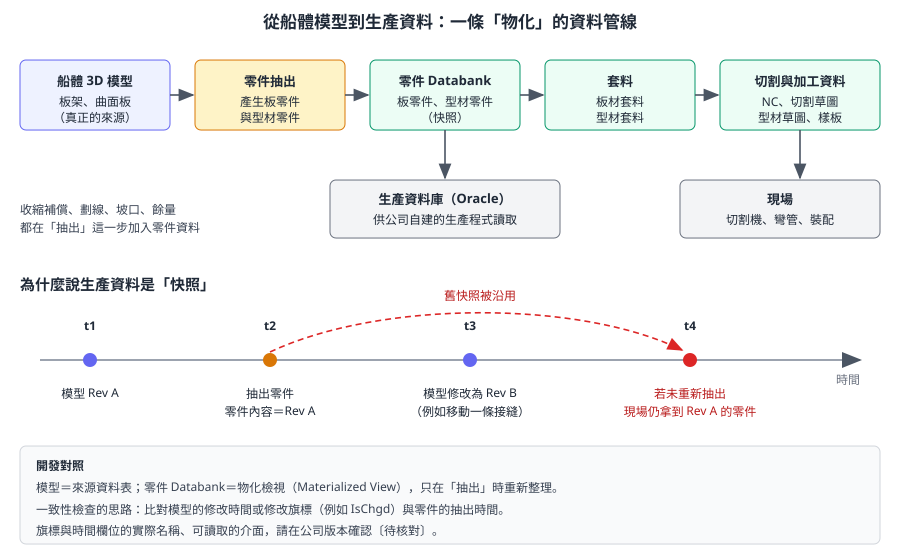
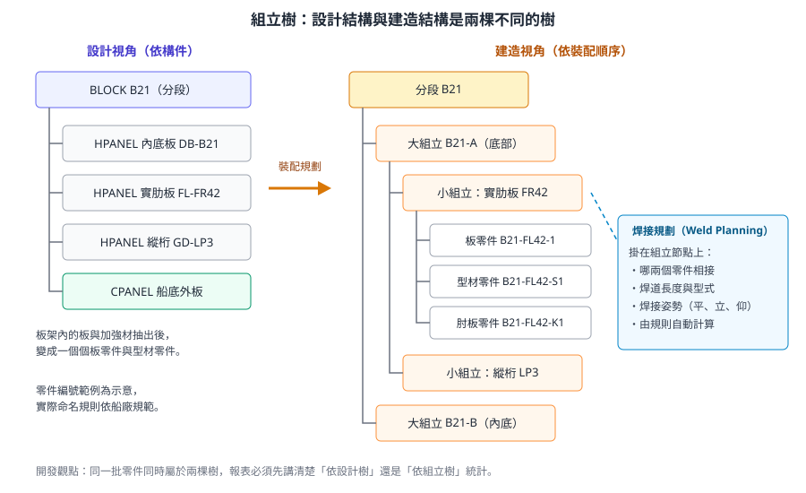

# 第 6 章　船體生產資訊、套料與裝配

> 本章說明船體 3D 模型如何變成工廠可以使用的資料：零件、套料、切割與劃線資訊、型材草圖、樣板，以及裝配與焊接規劃。對開發人員來說，本章最重要的觀念是：**生產資料是模型在某一時刻的快照**，模型修改後若沒有重新產生，下游拿到的就是舊資料。
>
> 內容依據 AVEVA 官方線上文件（Hull and Outfitting 12.1）、AVEVA 官方產品型錄與新聞稿，以及船廠生產設計的通用實務自主撰寫，不是官方手冊的翻譯。生產資訊模組的實際選單、Databank 名稱與檔案位置依版本與專案設定差異很大，標示 **〔待核對〕** 的項目請以公司環境確認。所有練習只能在訓練專案進行。

## 6.1 學習目標

讀完本章，你應該能夠：

1. 說明「零件抽出」做了什麼，以及板零件與型材零件包含哪些資訊。
2. 列出船體生產資料的存放位置：型線、板零件、型材零件、套料與生產資料庫。
3. 解釋套料的目的，並計算鋼板利用率；說明零件方向、劃線、坡口的意義。
4. 說明型材草圖、彎曲樣板與胎架的用途。
5. 解釋焊接收縮補償與裝配劃線。
6. 畫出組立樹，並說明裝配規劃與焊接規劃的關係。
7. 說明生產資料為什麼是快照，以及開發工具應如何處理模型與生產資料的一致性。

## 6.2 從模型到生產：整體流程

傳統造船流程在設計與生產之間，有一個「放樣（Lofting）」階段：由放樣人員依圖面重新取得實際尺寸、製作樣板。官方產品資料指出，AVEVA 的生產資訊功能可以直接從模型產生零件製造與裝配所需的資訊，**不必另設放樣階段**；輸出的切割與劃線資訊可以包含**焊接收縮補償**，並直接驅動 NC 生產設備。



*圖 6-1　從船體模型到生產資料的管線。上半部是資料流，下半部說明為什麼零件 Databank 是模型的「快照」。（本課程自繪）*

整個流程可以用開發人員熟悉的資料管線來理解：

| 步驟 | 船廠用語 | 開發類比 | 產出 |
|---|---|---|---|
| 1 | 3D 建模（[第 5 章](ch05_hull_modelling_zh-TW.reading.html)） | 維護來源資料表 | 板架、曲面板 |
| 2 | 零件抽出（Part Generation） | 執行 ETL，產生衍生資料 | 板零件、型材零件 |
| 3 | 套料（Nesting） | 最佳化排程（二維裝箱問題） | 套料板、套料型材 |
| 4 | 產生加工資料 | 匯出到外部系統的格式 | NC 程式、切割草圖、型材草圖、樣板 |
| 5 | 裝配與焊接規劃 | 另一種分組與彙總 | 組立樹、焊接資訊 |

## 6.3 零件抽出

### 6.3.1 零件是什麼

在設計模型中，一個平面板架包含板、加強材、肘板等構件。生產端需要的不是「構件」，而是「一塊要從鋼板上切下來的料」或「一根要從型材上切下來的料」。零件抽出就是把模型中的構件轉換成可製造的零件：

| 零件類型 | 來自模型的哪裡 | 主要內容 |
|---|---|---|
| 板零件（Plate Part） | 板架中的每一塊板、肘板、補板 | 外輪廓、內部開孔、缺口、厚度、材質、零件編號 |
| 型材零件（Profile Part） | 加強材、外板縱骨 | 型材規格、長度、端部處理形狀、開孔與缺口位置 |
| 曲面板零件 | 曲面外板 | 展開後的外輪廓，加上彎曲加工資訊 |

### 6.3.2 零件上帶有的生產資訊

模型中只有「設計意圖」，零件上則加入了大量「製造資訊」：

| 資訊 | 說明 | 為什麼需要 |
|---|---|---|
| 零件編號與標籤 | 依船廠命名規則產生 | 現場辨識、追蹤、組立歸屬 |
| 劃線（Marking） | 其他構件的安裝線、檢驗線、對位線 | 讓裝配時知道東西放哪裡 |
| 餘量（Excess） | 刻意多留的材料，之後再修切 | 吸收裝配誤差，常見於分段接頭 |
| 坡口（Bevel） | 板邊的斜切形狀 | 焊接需要，依板厚與焊接型式決定 |
| 收縮補償（Shrinkage） | 依焊道預估的收縮量，把零件放大 | 焊後尺寸才會正確 |
| 加工方向 | 軋製方向、正反面 | 某些鋼板或成形工序有方向要求 |

官方型錄也提到**零件檢查**功能：顯示自動產生的零件，包含所有標籤、劃線、餘量與坡口資訊，讓設計者在交付前確認。

> 〔公開版未收錄：AVEVA 官方產品截圖〕左為 3D 零件，右為自動產生的零件草圖

*圖 6-2　從 3D 零件（左）自動產生零件草圖（右），草圖上有標籤、劃線與加工資訊。（來源：AVEVA Hull and Outfitting Datasheet）*

> **專業提醒：** 零件抽出前，請確認第 5 章的板定義完整（每塊板都有厚度、型面側、材質）。缺少板定義是零件抽出失敗最常見的原因之一。

### 6.3.3 零件編號與識別

零件編號是生產端的主鍵：切割機、物流、組立、ERP 都靠它辨識零件。船廠通常把多種資訊編進零件編號中，以下為**示意**的組成方式：

| 片段 | 例子 | 意義 |
|---|---|---|
| 船號 | `S1234` | 哪一艘船 |
| 分段 | `B21` | 屬於哪個分段 |
| 板架或組立 | `FL42` | 來自哪個板架，或屬於哪個組立 |
| 序號 | `001` | 同一板架內的流水號 |
| 舷別 | `P`／`S` | 左舷或右舷（對稱構件） |

〔待核對〕公司的實際編號規則、由系統自動產生還是人工指定，請向生產設計負責人確認。

> **開發人員須知：** 撰寫整合工具前，先確認一件事：**重新抽出後，同一個零件的編號會不會改變？** 如果會，外部系統以零件編號為鍵存放的資料（例如切割進度、物流狀態）就會在每次重新抽出後失去對應。這是生產資料整合最常見的設計缺陷。

## 6.4 資料存放：Databank 與生產資料庫

官方文件說明了下列船體生產資料的存放位置：

| 資料庫／Databank | 內容 | 開發類比 |
|---|---|---|
| 型線 Form Databank | 曲面、船殼曲線、接縫與對接縫 | 幾何基礎資料 |
| 板零件 Plate Databank | 從模型抽出、可直接生產的板零件 | 衍生資料表（板） |
| 型材零件 Profile Databank | 從模型抽出、可直接生產的型材零件 | 衍生資料表（型材） |
| 套料 Nested Plates／Burning Sketches | 套料結果與切割草圖 | 最佳化結果 |
| 套料型材 Nested Profiles | 型材的套料結果 | 最佳化結果 |
| 生產資料庫 Production Database | 存放抽出零件資訊的 Oracle 資料庫 | 供外部系統查詢的整合資料庫 |

官方說明，生產資料庫是給**使用者自行開發的生產程式**使用的。這是船體生產資料與外部系統（MES、ERP）整合最正規的入口。

〔待核對〕Tribon 時期各 Databank 以 `SB_` 開頭的環境變數指定位置，Marine 12.x 的實際名稱、路徑與 Oracle 生產資料庫是否啟用，請向系統管理員取得專案設定。

> **開發人員須知：** 不要直接寫入 Databank 或生產資料庫。Databank 的內部格式不公開，生產資料庫的資料由抽出流程產生；直接寫入會讓資料與模型不一致，而且下次重新抽出時會被覆蓋。外部系統應**唯讀**取用，必要時把自己的資料存在另一個資料庫，以零件編號關聯。

## 6.5 套料（Nesting）

### 6.5.1 套料在做什麼

套料是把零件排列在原料鋼板上的工作，直接影響材料成本。從演算法角度看，它是一個二維不規則形狀的裝箱問題（Bin Packing），一般無法求得最佳解，只能求得夠好的解。

AVEVA 的自動板材套料（Automated Plate Nesting）是 Hull Detailed Design 的外掛功能。官方新聞稿宣稱，與半自動套料相比，最多可節省 13% 原料。12.1 SP4 版本說明也列出套料草圖零件表、方向文字等改善。

### 6.5.2 鋼板利用率

套料最常用的指標是**鋼板利用率**：

```
鋼板利用率 = 零件淨面積總和 ÷ 使用的原料鋼板面積 × 100%
```

例如在一塊 2,500 mm × 10,000 mm（25 m²）的鋼板上排了 21.5 m² 的零件，利用率是 86%。剩下的 3.5 m² 可能成為可再利用的餘料，或成為廢料。

| 影響利用率的因素 | 說明 |
|---|---|
| 鋼板規格 | 板寬、板長、厚度要與零件匹配 |
| 零件形狀 | 不規則形狀難以緊密排列 |
| 同厚度、同材質的零件數量 | 只有同厚度、同鋼級的零件能排在同一塊板上 |
| 零件方向限制 | 有軋製方向要求的零件不能任意旋轉 |
| 切割間隙與邊緣 | 切割寬度與夾持邊會佔用面積 |

### 6.5.3 套料時的其他考量

- **鋼板管理**：鋼級、爐號、船級證書。部分零件要求可追溯到特定爐號。
- **切割順序與熱變形**：切割順序不當會讓板材受熱變形，影響精度。
- **零件方向**：軋製方向是否有要求，曲面零件的成形方向。
- **劃線資訊**：構件安裝線、檢驗線、零件編號。
- **坡口與邊緣加工**：坡口零件要確認切割機是否支援。

### 6.5.4 型材套料與型材草圖

型材零件需要輸出**型材草圖**，內容包括長度、端部處理形狀、開孔與缺口位置、劃線與零件編號，供型材加工線使用。**型材套料**則決定一根原料型材（例如 12 m）能切出哪些零件，屬於一維的裝箱問題，比板材套料單純，但同樣影響材料成本。

## 6.6 曲面零件：樣板與胎架

曲面外板展開成平板切割後，還要彎成正確的曲面。這需要兩種工具：

| 工具 | 用途 | 系統提供的資訊 |
|---|---|---|
| 彎曲樣板（Template） | 在彎板時比對曲率，確認是否彎到位 | 依曲率產生內側或外側樣板，可輸出多種格式 |
| 胎架（Jig／Pin Jig） | 支撐曲面板或分段的可調整支柱 | 每根支柱的位置與高度 |

官方文件提到，傳統木樣板逐漸被**可重複使用、可調整的樣板**取代；12.1 SP3 的版本說明中有胎架支柱（Jig Pillar）相關的強化。胎架的高度資料本質上是「曲面在一組格點上的高度值」，是很適合以程式輸出成表格的資料〔待核對：公司版本可輸出的格式〕。

## 6.7 收縮補償與裝配劃線

### 6.7.1 焊接收縮補償

鋼材焊接後會收縮。如果零件完全照設計尺寸切割，焊完之後整個組立會變短、變窄。收縮補償的做法是：**依焊道的位置與數量，把零件預先放大**。

官方型錄說明，系統可依船廠實測的收縮表，分析焊道後自動決定板與型材的收縮量與方向。概念上的計算如下（數值僅為示意，實際以船廠收縮表為準）：

```
示意：一塊 6,000 mm 長的板，沿長度方向有 3 條橫向焊道與之相接
     若船廠收縮表規定每條焊道收縮 0.5 mm
     則切割長度 = 6,000 + 3 × 0.5 = 6,001.5 mm
```

> **開發人員須知：** 因為零件尺寸含收縮補償，所以**零件的尺寸不等於模型的設計尺寸**。如果你寫的工具要比對模型與零件，必須先決定比較的是「設計尺寸」還是「切割尺寸」，否則會產生大量假的差異。

### 6.7.2 裝配劃線與劃線三角

劃線是在零件上標示其他構件應該放在哪裡。官方型錄提到 Genauigkeit 劃線三角：自動產生劃線三角與對位線，讓裝配時的零件對位更容易、更準確。

> 〔公開版未收錄：AVEVA 官方產品截圖〕劃線三角與對位線示意

*圖 6-3　Genauigkeit 劃線三角與對位線，用於提高裝配精度。（來源：AVEVA Hull and Outfitting Datasheet）*

## 6.8 裝配規劃與焊接規劃

### 6.8.1 組立樹

船不是一次焊成的，而是由零件組成小組立，小組立組成大組立，大組立組成分段，分段在船台或船塢合攏。**組立樹**描述了這個由下往上的裝配順序：

```
船
└── 分段（Block）
    └── 大組立
        └── 小組立
            └── 零件（板零件、型材零件）
```



*圖 6-4　同一批零件同時屬於兩棵樹：設計視角依構件組織（左），建造視角依裝配順序組織（右）。焊接資訊掛在組立節點上。（本課程自繪，零件編號為示意）*

> 〔公開版未收錄：AVEVA 官方產品截圖〕雙層底分段模型

*圖 6-5　分段模型。組立規劃以分段為單位，向下展開大組立、小組立與零件。（來源：AVEVA Hull and Outfitting Datasheet）*

官方說明 Assembly Planning 的工作順序是：先建立整船建造策略，再細化組立定義，最後準備組立生產資料。

| 設計樹與組立樹的差別 | 設計樹 | 組立樹 |
|---|---|---|
| 組織原則 | 依構件（板架） | 依裝配順序 |
| 一個板架的零件 | 都在同一個 `HPANEL` 下 | 可能分屬不同小組立 |
| 誰維護 | 設計者 | 生產設計、生產管理 |
| 開發類比 | 依資料表的主鍵分組 | 依另一個維度（工序）分組 |

### 6.8.2 焊接規劃

Hull Weld Planning 會分析船體組立結構，依可自訂的規則計算完整的焊接技術資訊，例如：

- 哪兩個零件相接、焊道長度。
- 焊接型式（填角、對接）與焊腳尺寸。
- 焊接姿勢（平焊、立焊、仰焊）。

焊接資訊依賴組立樹，因為焊接姿勢取決於「這兩個零件在哪一個組立階段、以什麼方向擺放時焊接」。

> **專業提醒：** 組立順序決定了「哪些零件在何時、以什麼姿勢焊接」。設計階段若沒有考慮組立順序，可能出現焊槍無法到達、或必須仰焊的情況。

## 6.9 程式範例：一致性檢查的思路

生產資料的一致性檢查，是船體開發中最有價值的工具之一。以下 Python 程式**示意**一種不需要寫入任何系統的做法：分別從模型端與零件端匯出清單（CSV），再在系統外比對。

```python
# 示意：未在實機驗證。比對「模型板架清單」與「零件抽出清單」
# model.csv 欄位：panel, modified_at        （由模型端工具匯出）
# parts.csv 欄位：panel, part_no, extracted_at（由生產端匯出）
# 欄位名稱與匯出方式依公司系統而定〔待核對〕
import csv
from datetime import datetime

FMT = "%Y-%m-%d %H:%M:%S"

def load(path, key, ts):
    rows = {}
    with open(path, newline="", encoding="utf-8") as f:
        for r in csv.DictReader(f):
            t = datetime.strptime(r[ts], FMT)
            # 同一板架有多個零件時，取最早的抽出時間
            if r[key] not in rows or t < rows[r[key]]:
                rows[r[key]] = t
    return rows

model = load("model.csv", "panel", "modified_at")
parts = load("parts.csv", "panel", "extracted_at")

for panel, modified in sorted(model.items()):
    extracted = parts.get(panel)
    if extracted is None:
        print("NO PARTS  ", panel)
    elif modified > extracted:
        print("STALE     ", panel, "modified", modified, "extracted", extracted)
```

這段程式的重點不在語法，而在**設計原則**：

1. 先把兩邊的資料「取出來」，在系統外比對，不在生產系統中直接運算。
2. 只讀不寫，輸出的是「待處理清單」，由人決定是否重新抽出。
3. 比對鍵（板架名稱或 `TBID`）與時間欄位，要先和系統管理員確認來源與意義。

如果模型端可以讀到 `IsChgd` 這類修改旗標（第 5 章），也可以直接列出所有旗標為真的構件，作為更簡單的第一版工具〔待核對：旗標何時被清除〕。

## 6.10 開發人員須知

### 6.10.1 生產資料是快照

| 現象 | 原因 | 對策 |
|---|---|---|
| 模型改了，零件沒變 | 零件只在抽出時更新 | 建立「修改 → 重新抽出 → 重新套料 → 通知生產」的固定流程 |
| 零件尺寸與模型不同 | 零件含收縮補償與餘量 | 比對時區分設計尺寸與切割尺寸 |
| 已下料的零件被重新抽出 | 抽出不知道現場進度 | 抽出前查詢零件狀態，已下料者走變更流程 |
| 報表數字對不上 | 一份報表依模型、一份依零件 | 報表標示資料來源與擷取時間 |

### 6.10.2 整合外部系統的建議

- **以零件編號為整合鍵**：零件編號是生產端的主鍵，也是 ERP、MES 認得的識別碼。要先確認編號規則在重新抽出時是否穩定。
- **讀生產資料庫，不讀內部檔案**：官方提供的 Oracle 生產資料庫是給外部程式用的正式入口。
- **記錄擷取時間**：任何從生產資料產生的報表，都要附上資料擷取時間，讓使用者知道它是哪一刻的快照。
- **只讀不寫**：生產資訊的產生交給官方功能，自建工具負責查詢、比對與通知。

### 6.10.3 把變更流程想成狀態機

零件從產生到使用，會經過幾個狀態。把它寫成狀態機，比較容易看出哪些轉換需要管制：

```
示意：零件的狀態與轉換（狀態名稱依公司流程而定）

  [已抽出] --套料--> [已套料] --發行--> [已發行給現場] --切割--> [已下料]
     ^                   |                     |                        |
     |                   |                     |                        |
     +----模型修改，重新抽出----+---------------+                        |
                                                                        |
                                    模型修改 --> 變更單流程（不可直接重新抽出覆蓋）
```

| 轉換 | 誰觸發 | 工具可以做什麼 |
|---|---|---|
| 模型修改 → 重新抽出 | 設計者 | 偵測修改旗標，提醒需要重新抽出 |
| 已套料 → 重新套料 | 生產設計 | 列出受影響的套料板 |
| 已發行 → 變更 | 生產設計與生產管理 | 產生變更通知，附上差異清單 |
| 已下料 → 變更 | 需走變更單 | 阻擋或警告，不自動處理 |

### 6.10.4 典型的開發題目

| 題目 | 資料來源 | 技術 | 參考章節 |
|---|---|---|---|
| 需要重新抽出的板架清單 | 模型修改旗標、零件抽出時間 | PML 或 Vitesse，加上外部比對 | [第 12 章](ch12_pml_database_zh-TW.reading.html)、[第 15 章](ch15_hull_vitesse_zh-TW.reading.html) |
| 分段材料與重量統計 | 零件資料或生產資料庫 | Vitesse 抽取、SQL 查詢 | [第 15 章](ch15_hull_vitesse_zh-TW.reading.html)、[第 16 章](ch16_reports_integration_zh-TW.reading.html) |
| 套料利用率報表 | 套料結果 | 依公司可用介面〔待核對〕 | [第 16 章](ch16_reports_integration_zh-TW.reading.html) |
| 零件資料送 MES／ERP | 生產資料庫 | .NET 或排程程式唯讀查詢 | [第 14 章](ch14_dotnet_zh-TW.reading.html)、[第 16 章](ch16_reports_integration_zh-TW.reading.html) |
| 零件草圖批次輸出 | 零件與草圖 | 依版本提供的批次功能〔待核對〕 | [第 17 章](ch17_debug_deploy_zh-TW.reading.html) |

> **開發人員須知：** 把零件 Databank 想成資料庫中的「物化檢視（Materialized View）」：它查起來快、格式適合下游，但只有在重新整理（重新抽出）時才會反映來源資料的變更。所有一致性問題都源自這一點。

## 6.11 練習（只能在訓練專案）

### 練習 6-1：從板架到零件

1. 選一個第 5 章已讀懂的小板架。
2. 抽出生產資訊，列出零件清單：零件數、編號、材質、厚度、重量。
3. 對照板架中的板與加強材，確認每個構件都有對應零件。
4. 打開一個板零件的草圖，找出劃線、坡口與餘量。

### 練習 6-2：套料與利用率

1. 在訓練專案中對同厚度、同鋼級的零件執行套料。
2. 計算鋼板利用率，與系統報告的數字比對。
3. 調整一條接縫位置，重新抽出並套料，觀察零件與利用率的變化。

### 練習 6-3：快照實驗

1. 記下某板架的零件清單與抽出時間。
2. 在訓練專案中修改該板架（例如改一塊板的厚度），**不要**重新抽出。
3. 查詢零件資料，確認仍為舊值。
4. 重新抽出後再查一次，記錄差異。把這個實驗寫成給同事看的一頁說明。

### 練習 6-4：組立樹

1. 選一個分段，畫出它的組立樹（分段 → 大組立 → 小組立 → 零件）。
2. 找出一個板架的零件分屬哪些小組立。
3. 說明某條焊道在哪一個組立階段施焊，姿勢為何。

## 6.12 自我檢核

- [ ] 我能說明零件抽出做了什麼，以及板零件、型材零件包含哪些資訊。
- [ ] 我能列出型線、板零件、型材零件、套料 Databank 與生產資料庫的用途。
- [ ] 我能計算鋼板利用率，並說出影響利用率的因素。
- [ ] 我能說明劃線、餘量、坡口、收縮補償的意義。
- [ ] 我能說明型材草圖、彎曲樣板與胎架的用途。
- [ ] 我能畫出組立樹，並說明它與設計樹的差別。
- [ ] 我能說明焊接規劃為什麼依賴組立樹。
- [ ] 我能解釋「生產資料是快照」，並提出至少兩種一致性檢查做法。

## 資料來源

- AVEVA Hull and Outfitting 12.1 線上文件：[Hull and Outfitting](https://docs.aveva.com/bundle/hull-and-outfitting/page/1224159.html)、[Hull Detailed Design 版本說明](https://docs.aveva.com/bundle/hull-and-outfitting/page/1224401.html)、生產資料相關主題（[1114217](https://docs.aveva.com/bundle/hull-and-outfitting/page/1114217.html)、[1139653](https://docs.aveva.com/bundle/hull-and-outfitting/page/1139653.html)）（需以瀏覽器開啟）
- AVEVA 官方產品資料（本章截圖來源）：[AVEVA Hull and Outfitting Datasheet](https://www.aveva.com/content/dam/aveva/documents/perspectives/datasheets/Datasheet_HullandOutfitting.pdf.coredownload.inline.pdf)、[Hull Detailed Design Brochure](https://www.aveva.com/content/dam/aveva/documents/brochures/Brochure_AVEVA_HullDetailedDesign_11-18.pdf)
- AVEVA 自動套料新聞稿：[Cambridge Network](https://www.cambridgenetwork.co.uk/news/new-aveva-automated-plate-nesting-optimises-material-use-ship-and-offshore-construction)
- AVEVA E3D 2.1 Data Model Reference：[Planar Panel Stiffener Element (HSTIFF)](https://help.aveva.com/AVEVA_Everything3D/2.1/DMRM/DMRM5.09.419.html)（`IsChgd`、`Modsta` 屬性）
- 官方訓練手冊 TM-2106（Production Information）：僅參考公開摘要，完整內容請向公司或 AVEVA 取得授權版本
