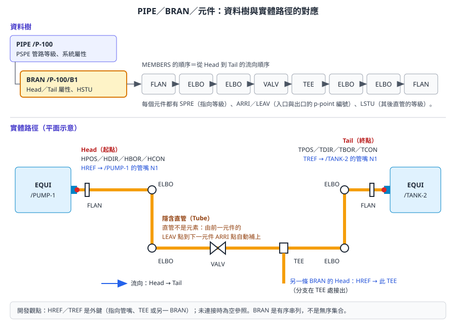
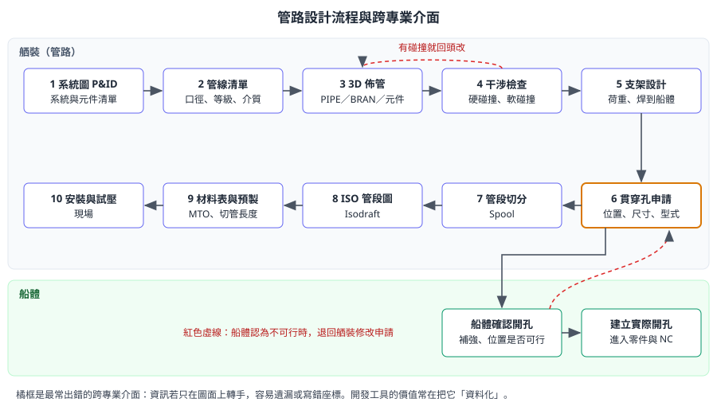

# 第 7 章　舾裝設計：設備、管路、結構、通風與電纜

> 船體設計處理的是「船本身」，舾裝（Outfitting）處理的是「船上所有的東西」：設備、管路、通風、電纜托架、鐵舾件與支架。本章說明這些物件在資料庫中怎麼建模，管路從系統圖到管段圖的設計流程，以及舾裝與船體之間最容易出錯的介面：貫穿孔。
>
> 舾裝功能承襲自 PDMS，資料階層與 PDMS／AVEVA E3D 高度相似。本章依據 AVEVA 官方線上文件（Hull and Outfitting 12.1）、AVEVA E3D Data Model Reference（E3D 版本，觀念與 Marine 舾裝相通）、AVEVA 官方產品型錄、開放取用的學術論文，以及 PDMS 系的通用知識自主撰寫，不是官方手冊的翻譯。公司的目錄、等級、命名與權限都是客製的；標示 **〔待核對〕** 的項目請以公司專案設定為準。所有會修改資料的練習只能在訓練專案進行。

## 7.1 學習目標

讀完本章，你應該能夠：

1. 畫出舾裝設計資料的階層：`WORLD → SITE → ZONE → 物件 → 子元件`。
2. 說明設備的組成：基本體、管嘴、樣板、維修空間。
3. 說明管路的 `PIPE／BRAN` 結構、Head 與 Tail、元件順序、連接與流向，並能讀懂 `HREF`、`TREF`、`ARRI`、`LEAV`、`SPRE`、`LSTU` 等屬性。
4. 描述管路設計流程：P&ID → 佈管 → 干涉檢查 → 支架 → 貫穿孔 → 管段 → ISO。
5. 說明鐵舾裝結構 `STRU／FRMW／SCTN／PANE` 與節點的關係。
6. 說明通風（HVAC）與電纜托架的建模重點。
7. 說明干涉檢查的層級與跨專業協調流程。
8. 說明船體與舾裝之間的貫穿孔介面，以及它為什麼是自動化的好題目。

## 7.2 舾裝資料階層

舾裝模型使用設計資料庫（DESI），階層如下：

```
WORLD
└── SITE              專案或區域層級的分區
    └── ZONE          依分段、區域或系統劃分
        ├── EQUI      設備
        │   └── 基本體（BOX、CYLI、CONE…）、NOZZ 管嘴
        ├── PIPE      管線
        │   └── BRAN  分支
        │       └── 元件（FLAN、GASK、ELBO、TEE、VALV…）
        ├── HVAC      通風
        │   └── BRAN → 風管元件
        ├── STRU      鐵舾裝／結構
        │   └── FRMW  框架
        │       ├── SCTN  型鋼構件
        │       └── PANE  板
        └── 支架、電纜托架等
```

> 〔公開版未收錄：AVEVA 官方產品截圖〕舾裝模型與船體結構同時顯示：綠色船體結構中的管路與設備

*圖 7-1　舾裝與船體在同一個 3D 環境中。設計者佈置管路與設備時，可以同時看到船體結構。（來源：AVEVA Hull and Outfitting Datasheet）*

| 層級 | 開發類比 | 決定了什麼 |
|---|---|---|
| `SITE` | 最上層的命名空間 | 專案或主要區域的切分 |
| `ZONE` | 子命名空間、權限邊界 | 誰能改（DB 與 Team）、圖面與報表的範圍 |
| 物件（`EQUI`、`PIPE`、`STRU`…） | 業務物件 | 一台設備、一條管線、一組鐵舾件 |
| 子元件 | 物件的組成部分 | 外形、管件、型鋼 |

〔待核對〕`SITE` 與 `ZONE` 的切分原則由專案決定。常見做法是 `SITE` 對應船號或主要區域，`ZONE` 對應分段或系統。切分方式會影響權限、圖面範圍與報表統計，請先向管理員取得專案的階層規劃。

> **開發人員須知：** 舾裝物件真正的價值在**屬性**，不在幾何：規格參照（`SPRE`）、管線等級、保溫、試壓、系統代號、區域與分段歸屬。這些屬性驅動材料表、管段圖、重量重心計算與採購。寫報表工具時，幾乎所有欄位都來自屬性與參照鏈（[第 8 章](ch08_catalogue_spec_zh-TW.reading.html)），而不是幾何。

## 7.3 設備（Equipment）

### 7.3.1 設備的組成

| 組成 | 元素 | 用途 |
|---|---|---|
| 設備本體 | `EQUI` | 名稱、位置、方向、重量、廠商等屬性 |
| 子設備 | `SUBE`〔待核對〕 | 把複雜設備分成幾組 |
| 基本體 | `BOX`、`CYLI`、`CONE`、`SNOU`、`DISH`、`PYRA`、`CTOR`、`RTOR`、`EXTR` 等 | 組成外形 |
| 管嘴 | `NOZZ` | 管路接續點，帶口徑、方向與管嘴規格 |

基本體是「用簡單形狀拼出外形」的做法，就像用方塊與圓柱拼樂高。管嘴則是設備與管路之間的介面：管路的 Head 或 Tail 以 `HREF`／`TREF` 指向管嘴（7.4 節）。

### 7.3.2 建模深度：剛好足夠

| 用途 | 需要的細節 |
|---|---|
| 空間佈置、干涉檢查 | 外形包絡、維修與拆卸空間 |
| 管路接續 | 管嘴位置、方向、口徑、法蘭規格 |
| 基座設計 | 底座尺寸、螺栓孔、重量、重心 |
| 圖面 | 可辨識的外形與名稱標示 |

過度細緻的模型會拖慢系統，也會在圖面上產生雜訊。

### 7.3.3 樣板與維修空間

官方型錄說明，設備可以用**參數化樣板**建立：選擇樣板、輸入參數即可產生複雜設備；同一設備也可以有多種圖形表現，例如把維修空間顯示出來並納入干涉檢查。

**維修空間**是「設備運轉或維修時需要淨空的體積」，例如抽出泵軸、打開熱交換器端蓋所需的空間。它通常以基本體建立，但設定為不參與材料統計，並在干涉檢查中視為軟碰撞（7.8 節）。〔待核對〕PDMS 系以基本體的 `OBST`（障礙等級）與表現等級控制此行為，實際設定值請依公司規範。

> 〔公開版未收錄：AVEVA 官方產品截圖〕設備定位：3D 視圖中的操控手把顯示方向 X 35 -Y

*圖 7-2　以 3D 操控手把定位設備，畫面即時顯示方向（例如 `X 35 -Y`，方向寫法見[第 4 章](ch04_coordinates_geometry_zh-TW.reading.html)）。（來源：AVEVA Hull and Outfitting Datasheet）*

> 〔公開版未收錄：AVEVA 官方產品截圖〕Design Explorer 與設備模型：左側模型樹，中間兩台泵與管路，右側為關聯設定面板

*圖 7-3　左側為設計模型樹，中間為泵與管路，右側面板用於設定物件之間的關聯與尺寸。（來源：AVEVA Hull and Outfitting Datasheet）*

### 7.3.4 建模順序

1. 取得廠商圖，確認版本與尺寸單位。
2. 決定設備原點與方向，通常以底座中心或主軸為準。
3. 建立外形基本體與維修空間。
4. 建立管嘴，指定正確的管嘴規格（`SPRE`）。
5. 填入重量、重心、廠商、型號等屬性（常用 UDA，見[第 3 章](ch03_hierarchy_attributes_zh-TW.reading.html)）。
6. 執行干涉檢查，並請相關專業確認。

## 7.4 管路：PIPE、BRAN 與元件

### 7.4.1 結構總覽

管路是舾裝資料模型中最精緻的部分，也是二次開發最常處理的對象。



*圖 7-4　上半部是資料樹：`PIPE` 擁有 `BRAN`，`BRAN` 依流向順序擁有元件。下半部是實體路徑：Head 以 `HREF` 連到泵的管嘴，Tail 以 `TREF` 連到槽的管嘴，元件之間的直管由系統自動補上。（本課程自繪）*

| 元素 | 角色 | 開發類比 |
|---|---|---|
| `PIPE` | 一條管線，對應管線清單上的一個管線號 | 訂單主檔 |
| `BRAN` | 管線中的一段連續路徑，有明確的起點（Head）與終點（Tail） | 有序串列 |
| 元件（`FLAN`、`ELBO`、`TEE`、`VALV`、`REDU`、`GASK`…） | 路徑上的管件與閥件 | 串列中的節點 |
| 直管（Tube） | 元件之間的直管段 | 不是元素，由系統依前後元件推算 |

一條 `PIPE` 可以有多個 `BRAN`。例如主管是一個 `BRAN`，從 `TEE` 接出的支管是另一個 `BRAN`。

### 7.4.2 Head 與 Tail

`BRAN` 本身記錄路徑兩端的資訊。依 AVEVA E3D Data Model Reference 中 Branch 元素的屬性清單，常用的有：

| 屬性 | 意義 | 說明 |
|---|---|---|
| `HPOS`／`TPOS` | Head／Tail 位置 | 起點與終點座標 |
| `HDIR`／`TDIR` | Head／Tail 方向 | 管子在端點的方向 |
| `HBOR`／`TBOR` | Head／Tail 口徑 | 端點口徑 |
| `HCON`／`TCON` | Head／Tail 連接型式 | 例如法蘭、焊接、螺紋的代碼 |
| `HREF`／`TREF` | Head／Tail 連接對象 | **外鍵**：指向管嘴、`TEE` 或另一 `BRAN`；未連接時為空參照 |
| `HSTU` | Head 直管等級 | 第一個元件之前那段直管的規格 |
| `PSPE` | 管路等級 | 這條管線選用元件時使用的等級 |
| `ISPE`／`TSPE` | 保溫／伴熱等級 | 依系統需求設定 |

屬性的完整名稱在官方文件中寫成 `Hposition`、`Href`、`Hbore`、`Pspec` 等，PML 中通常可用前四個字母的縮寫存取。

### 7.4.3 元件：順序、方向與連接

`BRAN` 的成員**依序**排列，順序就是從 Head 到 Tail 的流向順序。每個元件有幾個關鍵屬性：

| 屬性 | 意義 |
|---|---|
| `SPRE` | 規格參照，指向等級中的一個 SPCO（第 8 章），決定元件的型式、口徑、外形 |
| `ARRI`／`LEAV` | 入口與出口的 p-point 編號。例如 `TEE` 有三個 p-point，`ARRI 1 LEAV 2` 代表走主管、`ARRI 1 LEAV 3` 代表轉進支管 |
| `POS`／`ORI` | 元件的位置與方向（第 4 章） |
| `LSTU` | 該元件之後那段直管的等級 |

**直管不是元素**。系統以前一個元件的出口點（`LEAV`）到下一個元件的入口點（`ARRI`）之間的距離，自動產生直管，並以 `LSTU` 決定直管規格。所以「移動一個彎頭」時，前後直管長度會自動改變，不需要另外修改直管。

> **專業提醒：** 元件之間的連接型式必須相容，例如法蘭面對法蘭面、焊接端對焊接端。PDMS 系提供資料一致性檢查（Data Consistency Check）可找出口徑不符、連接型式不符、未連接端點等問題〔待核對：Marine 版本中的功能名稱與入口〕。

### 7.4.4 實際畫面：佈管與調整元件

> 〔公開版未收錄：AVEVA 官方產品截圖〕管路佈置過程三連圖：拉出管線、插入閥門、完成

*圖 7-5　互動式佈管的連續畫面：從管線端點拉出路徑（左）、在管線上放置閥門（中）、完成後的結果（右）。（來源：AVEVA Hull and Outfitting Datasheet）*

> 〔公開版未收錄：AVEVA 官方產品截圖〕閥門方向調整：圓形操控手把顯示 E 45 U

*圖 7-6　以圓形操控手把旋轉閥門手輪方向，畫面即時顯示角度（例如 `E 45 U`）。（來源：AVEVA Hull and Outfitting Datasheet）*

> 〔公開版未收錄：AVEVA 官方產品截圖〕機艙管路模型：多條黃色與橘色管線連接藍色設備

*圖 7-7　完成的管路模型。官方說明，管路模型依元件目錄與工程等級建立，並可產生佈置圖、ISO 圖與數量表。（來源：AVEVA Hull and Outfitting Datasheet）*

### 7.4.5 程式範例：列出一個 BRAN 的元件序列

```pml
-- 示意：未在實機驗證。列出某 BRAN 的 Head、Tail 與依序排列的元件
-- 只讀取，不修改模型
!bran = /P-100/B1

!msg = 'Head: ' & !bran.hpos.string() & '  bore=' & !bran.hbor.string() & '  href=' & !bran.href.string()
$p $!msg
do !c values !bran.members
   !spre = !c.spre
   !msg = !c.type & '  ' & !c.name & '  arri=' & !c.arri.string() & '  leav=' & !c.leav.string() & '  spre=' & !spre.string()
   $p $!msg
enddo
!msg = 'Tail: ' & !bran.tpos.string() & '  bore=' & !bran.tbor.string() & '  tref=' & !bran.tref.string()
$p $!msg
```

這段程式展示了三件事：`BRAN` 的成員是有序的，可以直接依序走訪；`HREF`／`TREF`／`SPRE` 都是參照（DBREF），可以再往下取值；未命名的元件 `.name` 會顯示系統產生的識別。〔待核對〕元素沒有名稱時 `.name` 的回傳內容，以及 `$p` 輸出 DBREF 的格式，請在公司版本測試。導覽與屬性讀取的細節見[第 12 章](ch12_pml_database_zh-TW.reading.html)。

## 7.5 管路設計流程

### 7.5.1 從系統圖到管段圖



*圖 7-8　管路設計流程與跨專業介面。橘框的貫穿孔申請是舾裝與船體之間最常出錯的介面。（本課程自繪）*

| 步驟 | 工作 | 產生或使用的資料 |
|---|---|---|
| 1 系統圖（P&ID） | 定義系統、設備、閥件與管線的邏輯關係 | 系統代號、管線號、元件清單 |
| 2 管線清單 | 每條管線的口徑、等級、介質、設計壓力與溫度 | `PIPE` 的屬性、`PSPE` |
| 3 3D 佈管 | 在空間中決定管線路徑 | `BRAN`、元件、`HREF`／`TREF` |
| 4 干涉檢查 | 找出與結構、設備、其他管線的碰撞 | 碰撞清單 |
| 5 支架設計 | 依荷重與船體結構設計管支架 | 支架模型 |
| 6 貫穿孔申請 | 管線穿過船體結構處，申請開孔 | 開孔位置、尺寸、型式 |
| 7 管段切分 | 決定工廠預製的單位（Spool） | 管段範圍、焊口 |
| 8 ISO 管段圖 | 以 Isodraft 產生等角圖（[第 9 章](ch09_drawings_zh-TW.reading.html)） | 尺寸、元件清單、切管長度 |
| 9 材料表與預製 | 統計材料、預製管段 | MTO、切管表 |

### 7.5.2 佈管原則

- **先主後支、先大後小**：先佈主管與大口徑管，再佈分支與小管。
- **預留空間**：保溫層厚度、法蘭拆裝、閥門操作、維修通道。
- **坡度與排放**：需要排放的系統要考慮坡度與低點排放。
- **貫穿結構**：穿過船體結構時要申請開孔，並遵守開孔位置、尺寸與補強規範。
- **分段接頭**：管路跨越分段時，要規劃合攏管（Closing Pipe）或調整管。

### 7.5.3 支架

管支架常用 MDS（Multi-Discipline Supports）或公司自建的支架庫；AVEVA 另有 Pipe Supports – Marine 產品處理支架細節。支架設計要同時考慮管路荷重、船體結構的位置，以及焊接到船體的方式。

> 〔公開版未收錄：AVEVA 官方產品截圖〕支架設計介面：管路模型與支架設定對話框

*圖 7-9　支架設計畫面。官方說明，Outfitting 與 Outfitting Supports 整合，可詳細設計管路、風管與電纜托架的支架。（來源：AVEVA Hull and Outfitting Datasheet）*

> **開發人員須知：** 公開的 PML 管支架案例（[第 18 章](ch18_case_studies_zh-TW.reading.html)）選擇把管夾建成 `EQUI`，而不是掛在管線上的附件，理由是避免破壞管段資訊。這說明了資料型別的選擇會影響下游：同一個實體，放在不同的樹中，會出現在不同的材料表與圖面上。

### 7.5.4 管段切分與預製

管段（Spool）是工廠預製的單位。切分時要考慮：

- 運輸與吊裝尺寸限制。
- 鍍鋅或表面處理槽的尺寸。
- 現場焊口數量與位置。
- 分段接頭與合攏管。

官方型錄提到**管件預製**功能：彎管機設定可以在設計階段納入檢查，讓管路設計一開始就符合工廠的彎管能力。

> 〔公開版未收錄：AVEVA 官方產品截圖〕管件預製管理介面：左側模型樹、中間彎管機參數表、右側彎管限制示意

*圖 7-10　管件預製（Pipe Fabrication）介面。中間為彎管機參數表，右側說明最小直管段、彎管半徑等限制。（來源：AVEVA Hull and Outfitting Datasheet）*

## 7.6 鐵舾裝結構（Structures）

鐵舾裝包括平台、梯子、扶手、設備基座、管支架的型鋼部分等。PDMS 系的結構資料階層如下：

```
STRU            結構（一組鐵舾件）
└── FRMW        框架
    ├── SCTN    型鋼構件（梁、柱、斜撐）
    ├── PANE    板（平台板、基座面板）
    └── 節點    構件之間的連接點
```

| 元素 | 主要屬性 | 說明 |
|---|---|---|
| `SCTN` | `POSS`／`POSE`（起點、終點）、`SPRE`（型鋼規格）、`BANG`（繞軸旋轉角）、`JUSL`（定位線） | 一支型鋼由兩端點與斷面規格定義 |
| `PANE` | 輪廓（`PLOO` 迴圈與 `PAVE` 頂點）、厚度 | 以多邊形輪廓擠出厚度的板 |
| 節點 | 主節點與次節點〔元素代碼依版本，待核對〕 | 記錄構件在哪裡相接，讓構件移動時連接關係得以維持 |

`SCTN` 的 `SPRE` 指向型鋼等級，再連到目錄中的型鋼斷面（第 8 章）。這和管路元件的參照鏈是同一套機制。

> **專業提醒：** 船上的鐵舾件常焊接在船體結構上，例如設備基座焊在甲板上。鐵舾件與船體的焊接介面、補強需求，要和船體設計一起確認；這類介面不屬於任何一邊的模型，最容易被遺漏。

## 7.7 通風（HVAC）與電纜

### 7.7.1 通風

通風資料的結構與管路相似：`HVAC` 之下有 `BRAN`，`BRAN` 之下是風管元件（直風管、彎頭、變徑、風門、格柵等）。依 E3D Data Model Reference，Branch 元素的合法擁有者包括 `PIPE` 與 `HVAC`，合法成員也包含 `DAMPER`、`GRILLE`、`PLENUM`、`TAPER` 等風管元件。

設計重點：

- 風管尺寸（矩形或圓形）、保溫厚度。
- 防火風門與穿越防火區域時的貫穿件。
- 大尺寸風管對空間的佔用，通常需要最早確定路徑。

### 7.7.2 電纜托架與電纜

- **電纜托架**：托架路徑、層數、與管路的間距、支架。托架在模型中通常以結構或專用元素建立〔待核對：公司使用的托架建模方式與元素型別〕。
- **電纜貫穿件**：電纜穿越艙壁或甲板時使用貫穿件（Multi Cable Transit，MCT），要維持水密或防火等級。
- **電纜佈線**：Marine 有電纜設計相關功能，可依托架路徑計算電纜長度〔待核對：公司是否授權與使用〕。

這兩類都會與管路爭奪空間。干涉檢查時，建議建立「管路／通風／電纜」三方的優先權規則，例如重力排放管優先、大風管其次。

## 7.8 干涉檢查與跨專業協調

### 7.8.1 碰撞的層級

| 層級 | 做法 | 例子 |
|---|---|---|
| 硬碰撞 | 實體重疊，必須修正 | 管子穿過梁 |
| 軟碰撞 | 侵入維修空間、保溫空間或操作空間 | 管子擋住泵的抽軸空間 |
| 規則違反 | 間距不足、坡度錯誤、未經核准的貫穿 | 電纜托架距熱管太近 |

### 7.8.2 協調流程

1. 各專業在自己的 `ZONE` 內完成初步佈置。
2. 定期執行跨專業干涉檢查，產生問題清單。
3. 協調會議依優先權規則決定修改方。
4. 追蹤問題清單直到關閉，並保留紀錄。

> **開發人員須知：** 碰撞清單是很好的開發題目：把系統產生的碰撞結果匯出，加上「負責專業、狀態、到期日」等欄位，做成追蹤表。重點是**以元素參照或名稱作為鍵**，讓下一次檢查的結果能與上一次比對，自動判斷哪些問題已解決。

## 7.9 船體與舾裝的介面：貫穿孔

### 7.9.1 為什麼這個介面容易出錯

管路、通風、電纜穿過船體結構時，需要在船體構件上開孔。開孔「需求」來自舾裝，開孔「實作」在船體（[第 5 章](ch05_hull_modelling_zh-TW.reading.html)的 `HHOLE`）。一篇開放取用的研究（Kim, Park & Yang, 2020）指出，傳統做法是舾裝把開孔資訊交給船體，船體在圖面上標示，現場再依圖面量測、劃線、手工切割；資訊在轉手過程中容易出錯，曲面外板的開孔甚至常留到現場才切割。


*圖 7-11　舊流程（左）與新流程（右）。新流程中，舾裝負責申請、建立虛擬孔與修改；船體負責確認、退回、驗證與產生實際孔，最後交給 NC 切割。（來源：Kim, Park & Yang, 2020, JAMET 44(3), Figure 1，CC BY-NC 3.0）*

### 7.9.2 以狀態管理介面

論文的系統把開孔分成兩種狀態：

| 狀態 | 意義 | 負責方 |
|---|---|---|
| Marked（虛擬孔） | 只標示位置，尚待確認或修改 | 舾裝建立 |
| Burnt（實際孔） | 確認後要在 NC 階段切出的孔 | 船體確認並產生 |


*圖 7-12　曲面板開孔對話框的實際畫面。可以看到開孔型式（`Designation`）、是否展開（`Developed`）、`Marked`／`Burnt` 狀態、座標點與方向點、餘量、坡口與修磨等欄位。（來源：Kim, Park & Yang, 2020, JAMET 44(3), Figure 3，CC BY-NC 3.0）*


*圖 7-13　產生的虛擬孔。圖面上自動標註孔型、尺寸、圓角與中心座標，供船體人員確認。（來源：Kim, Park & Yang, 2020, JAMET 44(3), Figure 4，CC BY-NC 3.0）*

建議的跨專業流程：

1. 舾裝在模型中建立開孔申請（虛擬孔），帶有位置、尺寸、型式、申請人。
2. 船體依申請檢查位置是否可行、是否需要補強，可行則建立實際開孔，不可行則退回。
3. 實際開孔進入零件抽出（[第 6 章](ch06_hull_production_zh-TW.reading.html)），由 NC 在下料階段切出。
4. 舾裝路徑若再修改，申請要重新確認，已建立的實際開孔要同步調整。

> **開發人員須知：** 這是典型的「工作流程 + 狀態機」問題：申請 → 確認 → 執行，再加上退回與變更。把它資料化之後，可以寫出很有價值的檢查工具，例如「列出所有穿過船體板架、卻沒有對應開孔的管線」，或「列出開孔位置與管線位置相差超過容許值的項目」。論文的完整實作在第 18 章說明。

## 7.10 開發人員須知

| 主題 | 注意事項 |
|---|---|
| 參照比幾何重要 | 報表欄位多半來自 `SPRE` 參照鏈，不是幾何 |
| `BRAN` 是有序串列 | 元件順序就是流向；插入元件要指定位置，不能隨意附加在最後 |
| 直管不是元素 | 不要嘗試「建立直管」；要改直管長度，就移動前後元件 |
| `HREF`／`TREF` 是外鍵 | 刪除或改名管嘴、`TEE` 時，要檢查是否有 `BRAN` 參照它 |
| 元件必須來自等級 | 不要用基本體拼出「看起來像閥」的東西（第 8 章） |
| 權限邊界在 `ZONE` 與 DB | 批次修改前先確認目標元素所在 DB 可寫入（[第 2 章](ch02_project_database_zh-TW.reading.html)） |
| 跨專業介面 | 貫穿孔、基座、支架焊接點，是工具最能創造價值的地方 |

## 7.11 練習（只能在訓練專案）

### 練習 7-1：拆解一台設備

1. 選一台泵，列出它的基本體與管嘴。
2. 記錄每個管嘴的口徑、方向與 `SPRE`。
3. 找出哪些 `BRAN` 的 `HREF` 或 `TREF` 指向這些管嘴。

### 練習 7-2：讀懂一條管線

1. 選一條有閥門、`TEE` 與分支的管線。
2. 畫出它的 `PIPE → BRAN → 元件` 樹，標出 Head、Tail 與各自的連接對象。
3. 對每個元件記錄 `ARRI`、`LEAV`、`SPRE`。
4. 在訓練專案中移動一個彎頭，觀察前後直管長度的變化。
5. 執行 7.4.5 節的 PML 範例，與手工記錄比對。

### 練習 7-3：貫穿孔流程演練

1. 選一條穿過艙壁的管線。
2. 找出對應的船體開孔，比對位置與尺寸是否一致。
3. 寫下這個開孔從申請到生產的完整流程，並標出公司目前的負責人。

### 練習 7-4：碰撞清單

1. 在訓練專案中對一個 `ZONE` 執行干涉檢查。
2. 把結果分成硬碰撞、軟碰撞、規則違反三類。
3. 設計一個追蹤表的欄位，說明如何在下一次檢查時比對結果。

## 7.12 自我檢核

- [ ] 我能畫出 `WORLD → SITE → ZONE → EQUI／PIPE／HVAC／STRU` 的階層。
- [ ] 我能說明設備的基本體、管嘴、樣板與維修空間。
- [ ] 我能解釋 `PIPE`、`BRAN`、元件的關係，並說明 Head 與 Tail。
- [ ] 我能說明 `HREF`、`TREF`、`ARRI`、`LEAV`、`SPRE`、`LSTU` 的意義。
- [ ] 我知道直管不是元素，以及這對修改的影響。
- [ ] 我能依序說出管路設計流程的各步驟與產生的資料。
- [ ] 我能說明 `STRU → FRMW → SCTN／PANE` 的結構。
- [ ] 我能說明通風與電纜托架的建模重點。
- [ ] 我能區分硬碰撞、軟碰撞與規則違反。
- [ ] 我能說明貫穿孔的跨專業流程，以及 Marked 與 Burnt 狀態。

## 資料來源

- AVEVA Hull and Outfitting 12.1 線上文件：[Hull and Outfitting](https://docs.aveva.com/bundle/hull-and-outfitting/page/1224159.html)、[Navigating the AVEVA Marine Documentation](https://docs.aveva.com/bundle/hull-and-outfitting/page/1225292.html)（需以瀏覽器開啟）
- AVEVA E3D Data Model Reference：[Branch Element（E3D 1.1，Head／Tail 與連接屬性清單）](https://help.aveva.com/AVEVA_Everything3D/1.1/DMRM/DMRM5.05.363.html)（E3D 版本，觀念與 Marine 舾裝相通）
- AVEVA E3D 線上文件：[Branch 元素說明（Head 與 Tail）](https://docs.aveva.com/bundle/everything-e3d/page/1591528.html)（需以瀏覽器開啟）
- AVEVA 官方產品資料（本章截圖來源）：[AVEVA Hull and Outfitting Datasheet](https://www.aveva.com/content/dam/aveva/documents/perspectives/datasheets/Datasheet_HullandOutfitting.pdf.coredownload.inline.pdf)、[Brochure AVEVA Outfitting](https://www.aveva.com/content/dam/aveva/documents/brochures/Brochure_AVEVA_Outfitting.pdf)
- AVEVA Pipe Supports – Marine 發佈消息：[Cambridge Network](https://www.cambridgenetwork.co.uk/news/aveva-releases-aveva-pipe-supports-marine)
- 貫穿孔案例：Kim, Park & Yang (2020), [Journal of Advanced Marine Engineering and Technology 44(3)](https://doi.org/10.5916/jamet.2020.44.3.196)，CC BY-NC 3.0
- 管支架案例：eryar，〈AVEVA MARINE 中用 PML 寫管支架程序（二）〉，[CSDN 部落格](https://blog.csdn.net/eryar/article/details/4457072)
