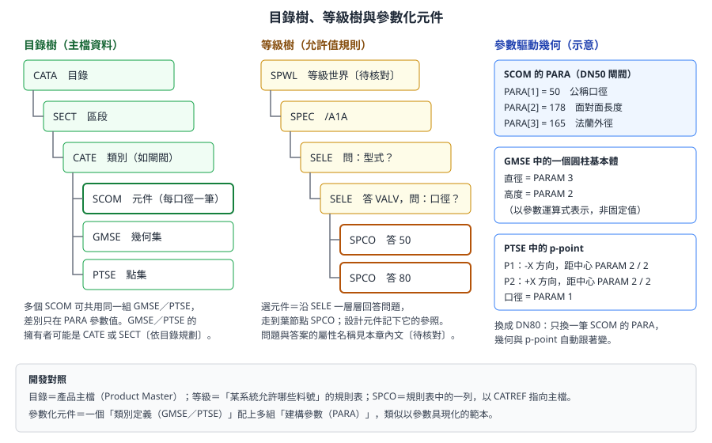
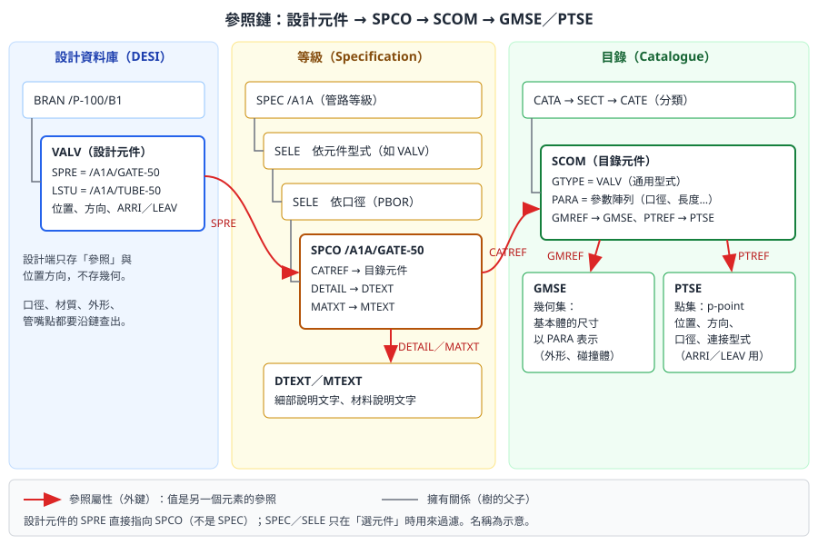

# 第 8 章　目錄與等級

> 本章回答兩個問題：設計中的每一個元件（閥、彎頭、法蘭、型鋼）**從哪裡來**，以及**等級如何約束設計**。目錄（Catalogue）與等級（Specification）是舾裝資料的主檔與規則層；設計者不能任意建立元件，必須從等級選用，而等級又引用目錄中的元件定義。看懂這條參照鏈，才能寫出正確的材料表、檢查工具與報表。
>
> 本章依據 AVEVA E3D 2.1 的 Catalogues and Specifications Reference Manual（CSRM）、Catalogues and Specifications User Guide（CSUG）、Data Model Reference（DMRM），以及 AVEVA Hull and Outfitting 12.1 線上文件自主撰寫，不是官方手冊的翻譯。E3D 與 Marine 舾裝的目錄觀念相通，但介面與細節可能不同，需在公司版本中確認。標示 **〔待核對〕** 的項目請以公司專案設定為準。目錄與等級的修改只能由授權的管理員在測試專案中進行。

## 8.1 學習目標

讀完本章，你應該能夠：

1. 說明目錄與等級存在的理由，並用「主檔資料」與「允許值規則」的觀念解釋它們。
2. 畫出目錄階層 `CATA → SECT → CATE → SCOM`，並說明幾何集（`GMSE`）與點集（`PTSE`）的角色。
3. 說明參數化元件：`PARA` 參數如何驅動幾何與連接點。
4. 畫出等級階層 `SPEC → SELE → SPCO`，並說明選擇條件（問題與答案，例如型式與口徑）。
5. 從一個設計元件出發，沿 `SPRE → SPCO → CATREF → SCOM → GMREF／PTREF` 一路查到幾何與連接點。
6. 列出型鋼、材料、螺栓、保溫等其他目錄與等級。
7. 說明目錄管理的權限與變更流程。
8. 解釋為什麼工具不應自行建立「看起來像」的元件。

## 8.2 為什麼需要目錄與等級

想像一個沒有目錄與等級的世界：每位設計者自己畫一個閘閥的外形，自己填口徑與材質。結果會是：

- 同一個閥在材料表上出現十種寫法，採購無法合併。
- 高壓系統裡被畫進了低壓閥，沒有人發現。
- ISO 圖不知道這個「閥」的連接點在哪裡，無法計算切管長度。

目錄與等級就是為了避免這些問題。三層資料的分工如下：

| 層級 | 內容 | 誰維護 | 開發類比 |
|---|---|---|---|
| 目錄 Catalogue | 元件的幾何（參數化）、連接點、屬性 | 目錄管理員 | 產品主檔（Product Master） |
| 等級 Specification | 某管路系統允許使用哪些元件、口徑範圍、材質、壓力等級 | 管材／系統工程師與管理員 | 允許值規則表、白名單 |
| 設計 Design | 實際的管線與元件，引用等級中的項目 | 設計者 | 交易資料（訂單明細） |

官方文件的說法是：在設計模組中選用元件時，系統會記錄一個**規格參照（SPREF）**，存在設計資料庫中；這個參照指向等級中的一筆**等級元件（SPCOM）**，而等級元件再指向目錄中的**目錄元件**（例如 `SCOM`）。目錄與等級可以是公司層級的標準，跨多個專案共用；設計資料則屬於單一專案。

> **專業提醒：** 設計中如果找不到需要的元件，正確的做法是**向目錄管理員提出需求**，而不是用基本體湊出一個外形相似的物件。後者會讓材料表、管段圖與採購資料全部失真。

## 8.3 目錄階層

### 8.3.1 目錄資料庫的結構

目錄存放在 CATA 類型的資料庫中（[第 2 章](ch02_project_database_zh-TW.reading.html)）。常見的階層如下：

```
CATA            目錄
└── SECT        區段（例如「閥類」「管件類」）
    ├── CATE    類別（例如「法蘭端閘閥」）
    │   ├── SCOM    目錄元件（例如每個口徑一筆）
    │   ├── GMSE    幾何集（3D 外形）
    │   ├── PTSE    點集（連接點）
    │   └── DTSE    資料集（可選）
    └── ...
```

官方 CSRM 的例子以 `PTSE 4 OF SECT 2 OF CATA /ASA-CATA` 這樣的識別方式引用點集，說明點集可以直接放在 `SECT` 之下。CSRM 也把點集與幾何集歸類為「區段與類別都可使用的元素」，所以 `GMSE`、`PTSE` 放在 `CATE` 或 `SECT` 之下都有，依目錄的規劃方式而定〔待核對：公司目錄的實際放法〕。



*圖 8-1　左為目錄樹（主檔資料），中為等級樹（允許值規則），右為參數如何驅動幾何與連接點。（本課程自繪，名稱與數值為示意）*

### 8.3.2 目錄元件的四個類別

依 CSRM，目錄元件分為四類：

| 類別 | 常見元素型別 | 用途 |
|---|---|---|
| 管路元件（Piping Component） | `SCOM` | 管件、閥、法蘭、墊片、管嘴等 |
| 型材（Profile） | `SPRF` | 結構型鋼斷面 |
| 接頭（Joint） | `SJOI` | 結構構件之間的連接 |
| 配件（Fitting） | `SFIT` | 結構上的附屬配件 |

CSRM 也說明了兩個重要的規則：目錄元件**沒有成員元素**；目錄元件本身的屬性（參數以外）必須是實際值（字詞或對其他元素的參照），不能用參數定義。

### 8.3.3 目錄元件的關鍵屬性

依 CSRM 對目錄元件的屬性說明：

| 屬性 | 意義 |
|---|---|
| `GTYPE` | 通用型式（Generic Type），例如 `VALV`、`ELBO`、`FLAN`；設計端元件的型別要與它相符 |
| `PARA`（`PARAM`） | 元件參數，一串數值，供點集與幾何集使用 |
| `PTREF` | 指向 3D 點集（`PTSE`）的參照 |
| `GMREF` | 指向 3D 幾何集（`GMSE`）的參照 |
| `DTREF` | 指向資料集（`DTSE`）的參照 |

### 8.3.4 幾何集（GMSE）與點集（PTSE）

CSRM 的定義可以摘要如下：

- **3D 點集（Pointset）**：定義元件 p-point 的位置、方向、連接型式與口徑，供設計模組、ISODRAFT 等使用。
- **3D 幾何集（Geomset）**：一組 3D 基本體，定義每個基本體的尺寸、方向與障礙（碰撞）幾何。

用開發人員的話說：

| 目錄元素 | 類比 | 被誰使用 |
|---|---|---|
| `PTSE` | 元件的「介面定義」：有幾個接口、在哪裡、朝哪裡、什麼規格 | 佈管時的連接、`ARRI`／`LEAV`、ISO 圖、連接檢查 |
| `GMSE` | 元件的「外觀與碰撞體」 | 3D 顯示、圖面、干涉檢查 |

[第 7 章](ch07_outfitting_zh-TW.reading.html)提到元件的 `ARRI`／`LEAV` 是 p-point 編號，它們的意義就定義在 `PTSE` 中。

## 8.4 參數化元件

### 8.4.1 參數驅動幾何

目錄不會為每個口徑畫一次閥。做法是：**一組 `GMSE`／`PTSE` 定義形狀與接口的「公式」，每一筆 `SCOM` 提供一組參數值**。例如：

| 位置 | 內容（示意） |
|---|---|
| `SCOM`（DN50 閘閥）的 `PARA` | `[1] 50` 公稱口徑、`[2] 178` 面對面長度、`[3] 165` 法蘭外徑 |
| `GMSE` 中的圓柱基本體 | 直徑 = `PARAM 3`，高度 = `PARAM 2` |
| `PTSE` 中的 p-point | P1 在 -X 方向距中心 `PARAM 2 / 2`；P2 在 +X 方向距中心 `PARAM 2 / 2`；口徑 = `PARAM 1` |

換成 DN80 閘閥時，只要再建一筆 `SCOM`，給一組不同的 `PARA`，就能共用同一組 `GMSE`／`PTSE`。這就是參數化元件。

> **開發人員須知：** 參數化元件很像「類別定義加上建構參數」：`GMSE`／`PTSE` 是類別，`SCOM` 的 `PARA` 是建構參數，設計中的元件是實例。所以要知道某個閥的實際長度，不能只看 `SCOM`，要把 `PARA` 代入 `GMSE` 的運算式才得到結果。通常應透過系統提供的屬性或偽屬性取得計算後的值，而不是自己解析運算式〔待核對：公司版本可用的偽屬性〕。

### 8.4.2 三種參數

CSRM 說明，點集與幾何集的屬性可以用三種參數定義：

| 參數種類 | 存在哪裡 | 例子 |
|---|---|---|
| 元件參數（Component Parameters） | 目錄元件的 `PARA` | 口徑、面對面長度 |
| 設計參數（Design Parameters） | 設計資料庫中的元件 | 可變長度的元件，由設計者給定長度 |
| 保溫參數（Insulation Parameters） | 保溫等級 | 保溫厚度 |

元件參數可以是數值、運算式或字詞；保溫、結構與設計參數只能是數值或運算式。[第 5 章](ch05_hull_modelling_zh-TW.reading.html)看到 `HSTIFF` 有 `Desparam`（設計參數）屬性，正是同一個觀念在船體元素上的體現。

### 8.4.3 目錄的建立方式

CSRM 說明，目錄通常以**目錄巨集（Catalogue Macros）**的形式建立成一個函式庫，專案的目錄資料庫再從這些巨集中挑選組成。建立與修改目錄資料庫的工具是 **Paragon** 模組（[第 1 章](ch01_architecture_zh-TW.reading.html)的管理模組之一）。

## 8.5 等級階層

### 8.5.1 等級的結構

等級存在 CATA 類型的資料庫中（與目錄同類型，但通常是不同的 DB）。結構如下：

```
SPWL            等級世界〔元素代碼待核對〕
└── SPEC        一份等級，例如 /A1A（某壓力、某材質的海水管等級）
    └── SELE    選擇器：問「型式？」
        └── SELE    選擇器：答 VALV，再問「口徑？」
            ├── SPCO    答 50 → 指向 DN50 閘閥
            └── SPCO    答 80 → 指向 DN80 閘閥
```

依 DMRM，選擇器（`SELEC`）的合法擁有者是 `SPEC` 或另一個 `SELEC`，合法成員是 `SELEC` 或等級元件（`SPCOMPONENT`，簡稱 `SPCO`）。選擇器帶有下列屬性：

| 屬性 | 意義 |
|---|---|
| `Question` | 這一層要問的問題（例如依型式或口徑分支） |
| `Answer`／`Maxanswer` | 數值答案（可為範圍） |
| `Tquestion`／`Tanswer` | 文字型的問題與答案 |
| `Default`／`Tdefault` | 預設答案 |
| `Qtype` | 問題的型別 |

用開發人員的話說，等級就是一棵**決策樹**：設計者選元件時，系統沿著 `SELE` 一層層回答問題（型式？口徑？端部型式？），走到葉節點 `SPCO`，再把它的參照寫進設計元件的 `SPRE`。

### 8.5.2 等級元件 SPCO

`SPCO` 是等級的葉節點，也是設計元件 `SPRE` 實際指向的對象。依官方文件，它的關鍵屬性有：

| 屬性 | 指向 | 說明 |
|---|---|---|
| `CATREF` | 目錄元件（`SCOM`、`SPRF` 等） | **唯一必填**的指標 |
| `DETAIL` | 細部文字（`DTEXT`） | 元件的說明文字，用於材料表 |
| `MATXT` | 材料文字（`MTEXT`） | 材料說明，用於材料表 |
| `BLTREF` | 螺栓需求（`BLTAB`） | 法蘭連接需要的螺栓 |
| `CMPREF` | 元件性質（`CMPT`，位於 Properties DB） | 重量等物理性質 |
| `PRTREF` | 零件需求 | 〔用途依公司設定，待核對〕 |

官方 E3D 文件也提醒：建立 `SPCO` 時，若 `CATREF` 指向的目錄元件不存在，會出現 `Undefined Name` 錯誤，`CATREF` 會顯示為 `=0`。這是目錄與等級不同步時最常見的徵兆。

### 8.5.3 等級的類型

| 等級類型 | 用途 |
|---|---|
| 管路等級 | 管件、閥、法蘭、墊片，設在 `PIPE` 的 `PSPE` |
| 保溫等級 | 依溫度與口徑決定保溫厚度，設在 `ISPE` |
| 伴熱等級 | 伴熱需求，設在 `TSPE` |
| 結構型鋼等級 | 鐵舾裝 `SCTN` 選用的型鋼斷面 |
| 電纜托架、支架等級 | 依公司設定〔待核對〕 |

官方文件說明，AVEVA Catalogue Manager 可儲存、管理並發佈等級，並與 AVEVA Marine 整合；可匯入的等級類型包括管路、螺栓、電纜托架、保溫與結構。等級核准後會自動發佈到設計端，必要時也可以手動執行「Republish Spec to Design」重新發佈。

### 8.5.4 等級的表格觀點

管理員維護等級時，常以「表格」的形式思考：每一列是一筆 `SPCO`，欄位是各層選擇器的答案與各種參照。以下為**示意**，欄位名稱與格式不是官方的等級檔案語法：

| 型式（TYPE） | 口徑（PBOR） | SPCO 名稱 | CATREF | DETAIL | MATXT |
|---|---|---|---|---|---|
| VALV | 50 | `/A1A/GATE-50` | `/CAT/GV-FL-50` | `/DT/GATE-VALVE` | `/MT/BRONZE` |
| VALV | 80 | `/A1A/GATE-80` | `/CAT/GV-FL-80` | `/DT/GATE-VALVE` | `/MT/BRONZE` |
| ELBO | 50 | `/A1A/ELBO-50` | `/CAT/EL90-50` | `/DT/ELBOW-90` | `/MT/STEEL` |

這張表說明了幾件事：

- **選擇器的問題就是表格的前幾欄**：型式與口徑決定走到哪一列。
- **`CATREF` 是每一列唯一必填的參照**，其他參照可以留空。
- **多列可以共用同一份文字**：例如所有口徑的閘閥共用同一筆 `DTEXT`。

〔待核對〕Marine 12.x 中等級的建立與匯入方式（Specon 文字檔、Catalogue Manager 匯入等），請以公司管理員的作業方式為準。

## 8.6 參照鏈：從設計元件一路查到幾何

### 8.6.1 整條鏈



*圖 8-2　參照鏈。紅色箭頭是參照屬性（外鍵），灰色線是擁有關係（樹的父子）。設計元件的 `SPRE` 直接指向 `SPCO`，`SPEC`／`SELE` 只在選元件時用來過濾。（本課程自繪，名稱為示意）*

用 SQL 的話說，這是一串 JOIN：

```sql
-- 示意：用 SQL 比喻參照鏈，不是可執行的查詢
SELECT d.name, s.detail, c.gtype, c.para, g.*, p.*
FROM   design_component d
JOIN   spco  s ON d.spre   = s.ref     -- 設計 → 等級
JOIN   scom  c ON s.catref = c.ref     -- 等級 → 目錄
JOIN   gmse  g ON c.gmref  = g.ref     -- 目錄 → 幾何集
JOIN   ptse  p ON c.ptref  = p.ref;    -- 目錄 → 點集
```

### 8.6.2 用 PML 走一遍參照鏈

```pml
-- 示意：未在實機驗證。從一個閥沿參照鏈查到目錄元件
-- 只讀取，不修改任何資料
!valve = /P-100/B1/VALV1          -- 請換成訓練專案中的元件名稱
!spco  = !valve.spre               -- 設計 → 等級元件
if (!spco.isNull()) then
   $p 這個元件沒有 SPRE，請檢查
   return
endif
!scom  = !spco.catref              -- 等級元件 → 目錄元件
!msg = 'SPCO : ' & !spco.name
$p $!msg
!msg = 'SCOM : ' & !scom.name & '  GTYPE=' & !scom.gtype
$p $!msg
!msg = 'GMREF: ' & !scom.gmref.string() & '  PTREF: ' & !scom.ptref.string()
$p $!msg
q PARA of $!scom                 -- 以命令列查詢顯示參數陣列
```

在命令列中也可以逐步查詢：先 `Q SPRE` 取得等級元件名稱，跳到該元件後 `Q CATREF`，再跳到目錄元件 `Q PARA`、`Q GMREF`、`Q PTREF`。〔待核對〕`.isNull()` 的寫法、`PARA` 陣列的輸出格式，請在公司版本確認；導覽與屬性讀取見[第 12 章](ch12_pml_database_zh-TW.reading.html)。

> **開發人員須知：** 參照鏈中任何一環斷掉（`SPRE` 為空、`CATREF` 為 `=0`、目錄元件被刪除），下游的材料表、ISO 圖、碰撞檢查都會出錯。寫報表或檢查工具時，**每一步都要檢查參照是否為空**，並把斷鏈的元件列入例外清單，而不是讓程式中斷或默默跳過。

### 8.6.3 斷鏈與常見問題排除

| 現象 | 可能原因 | 檢查方式 |
|---|---|---|
| 元件在 3D 中看不到或顯示異常 | `SPRE` 為空，或 `GMREF` 指向不存在的幾何集 | 沿參照鏈逐一查詢 |
| 材料表缺少某元件 | `SPRE` 為空，或 `SPCO` 沒有 `DETAIL`／`MATXT` | 查 `SPCO` 的文字參照 |
| ISO 圖無法連接 | `PTSE` 的 p-point 方向或連接型式錯誤 | 查 `PTREF` 與點集內容 |
| `CATREF` 顯示 `=0` | 建立 `SPCO` 時目錄元件尚不存在 | 確認目錄元件名稱後重新設定 |
| 設計者的 MDB 看不到等級 | MDB 未包含等級 DB | 請管理員檢查 MDB（[第 2 章](ch02_project_database_zh-TW.reading.html)） |

## 8.7 其他目錄與參考資料

管路元件只是目錄的一部分。完整的專案還有：

| 類型 | 內容 | 與設計的關係 |
|---|---|---|
| 型鋼目錄 | 型鋼斷面（`SPRF`）、接頭（`SJOI`）、配件（`SFIT`） | 鐵舾裝 `SCTN` 經等級引用 |
| 螺栓表 | 法蘭連接所需的螺栓規格與數量（`BLTAB`） | `SPCO` 的 `BLTREF` 引用 |
| 材料性質 | 密度等性質，存在 PROP 類型資料庫（`CMPT`） | `SPCO` 的 `CMPREF` 引用，用於重量計算 |
| 文字 | 細部文字（`DTEXT`）、材料文字（`MTEXT`） | 材料表與 ISO 圖的說明欄 |
| 保溫 | 保溫等級與厚度規則 | `ISPE` 引用 |
| 船體標準 | 型材斷面、肘板型式、端部處理型式等船體標準 | 船體建模引用〔存放方式與舾裝目錄不同，依版本待核對〕 |

## 8.8 目錄管理的權限與流程

### 8.8.1 權限

| 角色 | 對目錄 DB | 對等級 DB | 對設計 DB |
|---|---|---|---|
| 目錄管理員 | 讀寫 | 讀寫 | 讀 |
| 管材／系統工程師 | 讀 | 依公司規定審核 | 讀 |
| 設計者 | 讀 | 讀 | 讀寫（自己的 `ZONE`） |
| 工具開發者 | 讀 | 讀 | 依工具用途 |

權限由 Team 擁有 DB、MDB 組合決定（第 2 章）。設計者的 MDB 中，目錄與等級 DB 通常只能讀。

### 8.8.2 變更流程

1. 設計者提出需求（缺少的元件、口徑、型式），附上廠商資料。
2. 目錄管理員在**測試專案**中建立或修改目錄元件與等級。
3. 系統或管材工程師審核等級。
4. 發佈到正式專案，通知設計者。
5. 記錄變更，供日後追溯。

> **專業提醒：** 不要刪除或改名已被設計使用的 `SPCO` 或目錄元件。被參照的元素消失後，設計元件的 `SPRE` 或 `CATREF` 會失去對象，造成大量斷鏈。需要淘汰元件時，應先查詢使用情況，改以「停止在等級中提供」的方式處理〔具體做法依公司規範，待核對〕。

## 8.9 開發人員須知：為什麼工具不應自行建立「看起來像」的元件

開發自動建模工具時，常見的誘惑是：等級裡找不到合適的元件，就用基本體在設計資料庫中「畫」一個外形相同的東西。這樣做的後果：

| 下游 | 會發生什麼 |
|---|---|
| 材料表（MTO） | 這個物件沒有 `SPRE`，不會出現在材料表，或以錯誤名稱出現 |
| ISO 圖 | 沒有 `PTSE`，Isodraft 不認得它的接口，無法計算切管長度 |
| 連接檢查 | 沒有連接型式與口徑資訊，檢查會報錯或漏報 |
| 採購 | 採購清單沒有這個料號 |
| 重量重心 | 沒有 `CMPREF`，重量不正確 |
| 未來修改 | 等級更新不會影響它，它永遠停在被畫出來的那一刻 |

正確的做法：

1. 工具只從等級中選用元件，寫入 `SPRE`。
2. 找不到元件時，工具停止並回報「缺少等級項目」，而不是自行補一個。
3. 需要特殊元件時，走 8.8.2 節的變更流程。
4. 工具的測試要包含「等級中沒有對應元件」的情況。

> **開發人員須知：** 對程式來說，「看起來一樣」和「是同一個東西」完全不同。資料庫中一筆沒有外鍵的資料，在所有下游系統眼中都不存在。這和在 ERP 中手打一個沒有料號的品名是一樣的錯誤。

## 8.10 練習（只能在訓練專案）

### 練習 8-1：追蹤一個閥門的來源

1. 在訓練專案中選一個閥門。
2. 查出它的 `SPRE` 指向哪個 `SPCO`，該 `SPCO` 屬於哪個 `SPEC`，沿途經過哪些 `SELE`，每一層的問題與答案是什麼。
3. 查出 `SPCO` 的 `CATREF` 指向哪個目錄元件，記錄它的 `GTYPE` 與 `PARA`。
4. 找出它的 `GMSE` 與 `PTSE`，記錄點集中有幾個 p-point。
5. 對照設計中這個閥的 `ARRI`／`LEAV`，說明它們對應 `PTSE` 中的哪些點。

### 練習 8-2：比較兩個口徑

1. 找出同一 `CATE` 中兩個不同口徑的 `SCOM`。
2. 比較它們的 `PARA`、`GMREF`、`PTREF`。
3. 說明哪些相同、哪些不同，以及為什麼。

### 練習 8-3：斷鏈檢查

1. 執行 8.6.2 節的 PML 範例，改寫成對一個 `ZONE` 內所有管路元件執行。
2. 列出 `SPRE` 為空或 `CATREF` 為空的元件。
3. 討論：發現斷鏈時，工具應該怎麼回報？

## 8.11 自我檢核

- [ ] 我能用「主檔資料」與「允許值規則」解釋目錄與等級。
- [ ] 我能畫出 `CATA → SECT → CATE → SCOM`，並說明 `GMSE` 與 `PTSE` 的角色。
- [ ] 我能說明 `GTYPE`、`PARA`、`GMREF`、`PTREF` 的意義。
- [ ] 我能解釋參數化元件，以及元件參數、設計參數、保溫參數的差別。
- [ ] 我能畫出 `SPEC → SELE → SPCO`，並說明選擇器的問題與答案。
- [ ] 我能說明 `SPCO` 的 `CATREF`、`DETAIL`、`MATXT`、`BLTREF`、`CMPREF`。
- [ ] 我能從設計元件沿參照鏈查到幾何集與點集。
- [ ] 我能列出型鋼、螺栓、材料、保溫等其他目錄。
- [ ] 我能說明目錄管理的權限與變更流程。
- [ ] 我能說明為什麼工具不應自行建立「看起來像」的元件。

## 資料來源

- AVEVA E3D 2.1 Catalogues and Specifications Reference Manual：[Catalogue Database Structure](https://help.aveva.com/AVEVA_Everything3D/2.1/CSRM/CSRM4.05.01.html)、[目錄、等級與設計資料的關係](https://help.aveva.com/AVEVA_Everything3D/2.1/CSRM/CSRM4.05.03.html)、[Catalogue Components](https://help.aveva.com/AVEVA_Everything3D/2.1/CSRM/CSRM4.05.17.html)、[Fitting（PTREF、GMREF、PARAM、GTYPE、DTREF）](https://help.aveva.com/AVEVA_Everything3D/2.1/CSRM/CSRM4.05.21.html)、[Elements Used in Both Types of Catalogue Section/Category（Pointset 與 Geomset 定義）](https://help.aveva.com/AVEVA_Everything3D/2.1/CSRM/CSRM4.05.07.html)、[SPCOmponent and the Component Data（SPCO 的指標）](https://help.aveva.com/AVEVA_Everything3D/2.1/CSRM/CSRM11.12.5.html)
- AVEVA E3D 2.1 Catalogues and Specifications User Guide：[SPREF、SPCOM 與目錄元件](https://help.aveva.com/AVEVA_Everything3D/2.1/CSUG/CSUG3.03.02.html)
- AVEVA E3D 2.1 Data Model Reference：[Selector Element (SELEC)](https://help.aveva.com/AVEVA_Everything3D/2.1/DMRM/DMRM3.04.086.html)、[Specification Component Element (SPCOMPONENT)](https://help.aveva.com/AVEVA_Everything3D/2.1/DMRM/DMRM3.04.095.html)
- AVEVA Hull and Outfitting 12.1 線上文件：[Specification Component Element](https://docs.aveva.com/bundle/hull-and-outfitting/page/1135769.html)、[Catalogue Manager 與 Marine 整合](https://docs.aveva.com/bundle/hull-and-outfitting/page/1226804.html)、[Republish Spec to Design](https://docs.aveva.com/bundle/hull-and-outfitting/page/1230122.html)（需以瀏覽器開啟）
- AVEVA E3D Design 線上文件：[CATREF 說明](https://docs.aveva.com/bundle/e3d-design/page/889985.html)（需以瀏覽器開啟）
