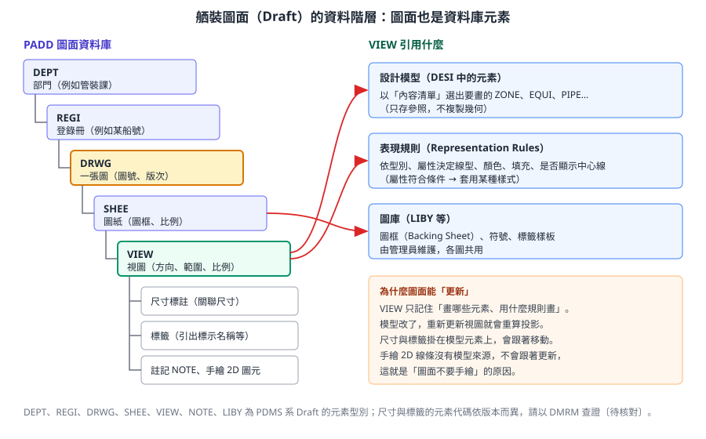
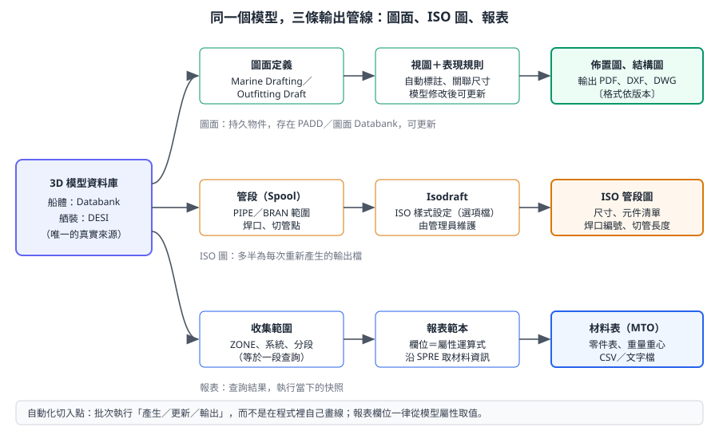

# 第 9 章　圖面、ISO 圖與報表輸出

> 本章是第二部分的最後一章，說明 3D 模型如何變成工廠與審查單位使用的文件：佈置圖、結構圖、ISO 管段圖與材料表。核心觀念只有一個：**圖面與報表都是模型的「視圖」**。資訊應該來自模型與自動標註，而不是在圖面上手繪；這樣模型修改後，圖面才能更新。對開發人員而言，本章也指出批次出圖與報表自動化的切入點。
>
> 本章依據 AVEVA Hull and Outfitting 12.1 線上文件、AVEVA E3D 2.1 的 DRAW Reference Manual 與 Data Model Reference（E3D 版本，觀念與 Marine 的 Outfitting Draft 相通）、AVEVA 官方產品型錄，以及 PDMS 系的通用知識自主撰寫，不是官方手冊的翻譯。E3D 中的圖面模組名稱為 DRAW，Marine 12.x 為 Outfitting Draft，介面與指令可能不同。標示 **〔待核對〕** 的項目請以公司版本與管理員設定為準。所有練習只能在訓練專案進行。

## 9.1 學習目標

讀完本章，你應該能夠：

1. 說明 Marine Drafting（船體圖面）與 Outfitting Draft（舾裝圖面）的差異，以及各自的客製化途徑。
2. 畫出舾裝圖面的資料階層 `DEPT → REGI → DRWG → SHEE → VIEW`，並說明標註掛在哪裡。
3. 解釋關聯尺寸、自動標註與圖面更新的原理。
4. 說明表現規則（Representation）與圖層的用途。
5. 說明 Isodraft 如何從管線產生 ISO 管段圖，以及樣式由誰設定。
6. 說明系統內建報表與材料表（MTO）的產生方式。
7. 指出批次出圖與報表自動化的切入點，以及不應該做的事。

## 9.2 兩種圖面工具

AVEVA Marine 12.1 的文件分別包含 **Marine Drafting** 與 **Outfitting Draft**。兩者都直接從 3D 模型產生圖面，但血統不同：

| 比較項目 | Marine Drafting | Outfitting Draft |
|---|---|---|
| 來源 | Tribon 的圖面系統 | PDMS 的 Draft 模組 |
| 主要用途 | 船體結構圖、板架圖、分段圖、生產用草圖 | 設備佈置圖、管路佈置圖、鐵舾裝圖 |
| 圖面資料存放 | 船體圖面 Databank〔待核對〕 | PADD 類型的 Dabacon 資料庫（[第 2 章](ch02_project_database_zh-TW.reading.html)） |
| 資料結構 | 圖面、視圖、子圖（Subpicture）等 Tribon 結構 | `DEPT → REGI → DRWG → SHEE → VIEW` 元素樹 |
| 客製化 | Vitesse（Python），例如 `kcs_draft` 模組（[第 15 章](ch15_hull_vitesse_zh-TW.reading.html)） | PML 與 .NET（第 11–14 章） |
| 開發類比 | 以 API 操作的文件物件 | 存在資料庫中的樹狀文件物件 |

> **開發人員須知：** 同一張「機艙佈置圖」如果同時有船體結構與舾裝，要先確認它是用哪一個工具產生的，才知道要用哪一套 API 自動化。混用兩種工具的圖面時，責任分工與更新流程也要事先講清楚。

## 9.3 舾裝圖面的資料階層

### 9.3.1 元素樹

PDMS 系的圖面同樣是資料庫元素。依 E3D DRAW Reference Manual，圖面（`DRWG`）是傳統紙本圖的資料庫對應物，它底下的每個元素都儲存定義這張圖所需的資訊；一張圖可以有一張或多張圖紙（`SHEE`），每張圖紙可以有一個或多個視圖（`VIEW`）。



*圖 9-1　舾裝圖面的資料階層。左側是 PADD 資料庫中的元素樹，右側是 VIEW 引用的資料。（本課程自繪）*

| 元素 | 意義 | 主要內容 |
|---|---|---|
| `DEPT` | 部門 | 分組用，例如依專業或課別 |
| `REGI` | 登錄冊（Registry） | 分組用，例如依船號或圖面類別；依 DMRM，`DRWG` 的擁有者是 Registry |
| `DRWG` | 一張圖 | 圖號、標題、版次 |
| `SHEE` | 圖紙 | 圖紙大小、圖框（Backing Sheet）參照、繪製清單名稱 |
| `VIEW` | 視圖 | 視線方向、通過點、比例、在圖紙上的大小與位置，以及要畫哪些元素 |
| 標註類元素 | 尺寸、標籤、註記 | 掛在 `VIEW` 或 `SHEE` 下〔元素代碼依版本，待核對〕 |
| `LIBY` | 圖庫 | 圖框、符號、標籤樣板，由管理員維護 |

DRAW Reference Manual 說明，每個 `VIEW` 會記錄自己的視圖參數（視線方向、通過點或比例）、在圖紙上的大小、位置與方向，以及一個參照，指向列出「要畫哪些設計或目錄元素」的清單元素。依 DMRM，`SHEE` 的屬性包括圖框參照（`Bsrf`）、圖紙大小（`Size`）與繪製清單名稱（`Idlname`）等。

### 9.3.2 開發人員的讀法

| 圖面概念 | 開發類比 |
|---|---|
| `DRWG` 樹 | 文件物件模型（DOM） |
| `VIEW` 的內容清單 | 一段查詢：「要顯示哪些元素」 |
| 表現規則 | 樣式表（CSS）：依型別與屬性決定外觀 |
| 圖框、符號 | 範本與元件庫 |
| 更新圖面 | 重新執行查詢並重新繪製 |

所以 `VIEW` 本身**不存幾何**，它存的是「畫哪些東西」與「怎麼畫」。真正的線條是在產生或更新時，依模型即時計算出來的。

### 9.3.3 圖面的生命週期

圖面和程式碼一樣有生命週期。把它想清楚，批次工具才知道在哪個階段可以做什麼：

| 階段 | 動作 | 誰負責 | 工具可以做什麼 |
|---|---|---|---|
| 建立 | 選範本、建立 `DRWG`、`SHEE`、`VIEW` | 設計者 | 依清單批次建立同類型圖面的骨架 |
| 編輯 | 調整視圖、加標註 | 設計者 | 檢查命名、圖框、比例是否符合規範 |
| 更新 | 依最新模型重新產生 | 設計者或批次作業 | 批次更新並記錄時間 |
| 審查 | 檢查內容與品質 | 審查者 | 產生檢查清單、比對前後版差異 |
| 發行 | 定版、輸出 PDF 或交付格式 | 文管 | 批次輸出、填寫版次資訊 |
| 改版 | 模型變更後再更新、升版次 | 設計者與文管 | 找出「模型已改但圖未更新」的圖面 |

> **開發人員須知：** 「模型已改、圖面未更新」和第 6 章的「模型已改、零件未重新抽出」是同一類問題：衍生資料落後於來源資料。檢查工具的思路也相同，比對模型修改時間與圖面更新時間〔圖面更新時間能否以屬性讀取，待核對〕。

## 9.4 視圖內容與表現規則

### 9.4.1 視圖內容

決定一個視圖要顯示什麼，通常有三個層面：

- **範圍**：哪些 `ZONE`、`EQUI`、`PIPE`、`STRU` 要畫進來，哪些要排除。
- **視線與剖切**：從哪個方向看、是否剖切、剖切面在哪裡（例如某甲板以上 1.5 m 的平面圖）。
- **比例與位置**：在圖紙上的比例與擺放位置。

### 9.4.2 表現規則（Representation Rules）

表現規則決定「同一個 3D 物件在圖面上畫成什麼樣子」，例如：

| 物件 | 可能的表現 |
|---|---|
| 管路 | 單線或雙線、是否畫中心線、保溫是否顯示 |
| 設備 | 實線外形、維修空間是否顯示 |
| 結構 | 剖切到的構件填充、看到的構件細線、隱藏線虛線 |
| 船體構件 | 板厚線、型材符號、型面側標示 |

規則通常以「元素型別與屬性符合某條件 → 套用某種線型、顏色、填充」的形式定義，由管理員設定、各圖共用。〔待核對〕Outfitting Draft 中表現規則的元素型別與設定介面，請以公司版本確認。

### 9.4.3 圖層

圖層（Layer）用來分類圖面上的圖元，方便控制顯示、列印與匯出到其他 CAD 系統。Marine Drafting 承襲 Tribon 的圖層觀念；匯出 DXF／DWG 時，圖層對照表通常由公司統一設定〔待核對：公司的圖層規範與對照方式〕。

> **專業提醒：** 表現規則與圖層是**公司標準**，不是個人偏好。個別圖面上手動覆寫線型或圖層，下一次更新或換人接手時，常會被還原或造成不一致。

## 9.5 關聯尺寸、自動標註與圖面更新

### 9.5.1 為什麼圖面能更新

官方型錄說明，所有圖面（包含佈置圖與 ISO 圖）都有**關聯尺寸與智慧標註**，設計修改後可以自動更新。原理是：

1. 視圖只記住「畫哪些元素、用什麼規則畫」。
2. 尺寸與標籤掛在**模型元素**上，而不是掛在圖面座標上。
3. 模型修改後執行更新，系統重新計算投影，尺寸與標籤跟著所掛的元素移動、重算數值。

> 〔公開版未收錄：AVEVA 官方產品截圖〕圖面產生介面：左側模型樹、中間圖面預覽、右側範本與搜尋結果

*圖 9-2　圖面產生介面。官方說明，所有圖面都有關聯尺寸與智慧標註，設計修改後可自動更新。（來源：AVEVA Hull and Outfitting Datasheet）*

> 〔公開版未收錄：AVEVA 官方產品截圖〕全船佈置圖

*圖 9-3　從模型產生的全船佈置圖。（來源：AVEVA Hull and Outfitting Datasheet）*

### 9.5.2 船體圖面：在圖面中建模

官方型錄也提到船體的**在圖面中建模**（Model in a Drawing）：各類板架圖可直接從模型產生，並可在圖面中直接建模與修改。這代表船體圖面不只是輸出，也可以是建模介面。

> 〔公開版未收錄：AVEVA 官方產品截圖〕板架圖面：在圖面中直接建模與標註

*圖 9-4　板架圖面。官方稱為「在圖面中建模」，各類板架圖可直接從模型產生並在圖面中修改。（來源：AVEVA Hull and Outfitting Datasheet）*

### 9.5.3 什麼會更新、什麼不會

| 圖面內容 | 模型修改後 | 說明 |
|---|---|---|
| 由視圖投影產生的線條 | 更新 | 重新依模型計算 |
| 掛在模型元素上的尺寸 | 更新 | 數值與位置都重算 |
| 掛在模型元素上的標籤（名稱、規格） | 更新 | 內容來自屬性 |
| 掛在圖紙座標上的註記 | 不會移動 | 位置可能與新的模型不符 |
| 手繪的 2D 線條、文字 | 不更新 | 沒有模型來源 |
| 被刪除元素的標註 | 可能失效或成為孤立標註 | 要人工檢查〔系統行為依版本，待核對〕 |

> **專業提醒：** 圖面上用手工畫的線條，模型修改後不會跟著更新。應盡量讓圖面上的資訊來自模型與自動標註，減少手工繪製。如果發現某種資訊「只能手畫」，通常代表模型缺少對應的資料，應回頭補模型或提出客製需求。

### 9.5.4 圖面品質檢查

- [ ] 圖框、圖號、版次、比例正確。
- [ ] 視圖範圍與方向正確，剖面標示一致。
- [ ] 標註沒有重疊，尺寸鏈閉合。
- [ ] 圖面已在最新模型上更新。
- [ ] 沒有孤立標註（所掛元素已刪除）。
- [ ] 版次說明清楚列出本次變更內容。

## 9.6 Isodraft：ISO 管段圖

### 9.6.1 ISO 圖是什麼

ISO 圖（Isometric Drawing，等角管段圖）是以等角投影畫出單一管線或管段的圖，不依比例，但標示完整尺寸。它是管路預製工廠最重要的文件，內容包括：

- 管線路徑與每段尺寸。
- 元件清單（來自等級的細部文字與材料文字，[第 8 章](ch08_catalogue_spec_zh-TW.reading.html)）。
- 焊口編號、現場焊口標示。
- 切管長度。
- 管段（Spool）編號與範圍。

> 〔公開版未收錄：AVEVA 官方產品截圖〕自動產生的管路等角圖（ISO）

*圖 9-5　自動產生的管路等角圖。（來源：AVEVA Hull and Outfitting Datasheet）*

### 9.6.2 Isodraft 的運作

| 項目 | 說明 |
|---|---|
| 輸入 | `PIPE` 或 `BRAN`（[第 7 章](ch07_outfitting_zh-TW.reading.html)），以及元件的參照鏈（第 8 章） |
| 樣式設定 | ISO 圖的格式、符號、材料表欄位、切分規則等，由管理員設定，存放於 ISOD 類型資料庫與選項檔〔設定方式依版本，待核對〕 |
| 輸出 | ISO 圖檔、材料清單、切管清單 |
| 依賴 | 元件的 `PTSE`（判斷接口）、`SPCO` 的 `DETAIL`／`MATXT`（材料說明）、`LSTU`（直管規格） |

Isodraft 完全依賴第 7、8 章的資料品質。常見的 ISO 圖錯誤，追根究柢多半是：

- 元件沒有 `SPRE`，或參照鏈斷掉。
- 元件之間沒有正確連接（連接型式或口徑不符）。
- 用基本體拼出的「假元件」，Isodraft 不認得。

> **開發人員須知：** ISO 圖出錯時，先不要懷疑 Isodraft，而是先跑一遍資料一致性檢查與第 8 章的斷鏈檢查。ISO 圖是資料品質的「試金石」。

## 9.7 系統內建報表與材料表（MTO）

### 9.7.1 報表是什麼

報表是「對模型執行一段查詢，再把結果排成表格」。PDMS 系提供報表功能，可定義報表範本：

| 報表組成 | 意義 | 開發類比 |
|---|---|---|
| 收集範圍 | 要報哪些元素（例如某 `ZONE` 內所有 `VALV`） | `FROM ... WHERE` |
| 欄位 | 每一欄是一個屬性或屬性運算式 | `SELECT` 欄位清單 |
| 排序與分組 | 依系統、口徑、型式排序或小計 | `ORDER BY`、`GROUP BY` |
| 輸出 | 畫面、文字檔、CSV | 結果集匯出 |

〔待核對〕報表範本的建立介面、檔案格式與存放位置依版本而異，請以公司版本的報表功能為準。

### 9.7.2 材料表（MTO）

材料表（Material Take-Off）是採購與生產的依據。以管路為例，MTO 的邏輯是：

1. 收集範圍內所有管路元件。
2. 依 `SPRE`（等級元件）分組計數；同一個 `SPCO` 代表同一種料。
3. 直管不是元素，要另外依 `LSTU` 分組，加總長度。
4. 從 `SPCO` 的 `DETAIL`／`MATXT` 取得說明文字；需要時從 `BLTREF` 計算螺栓。

```pml
-- 示意：未在實機驗證。依 SPRE 統計某 BRAN 的元件數量（不含直管）
!bran   = /P-100/B1            -- 請換成訓練專案中的名稱
!keys   = ARRAY()
!counts = ARRAY()
do !c values !bran.members
   !k = !c.spre.string()
   !idx = !keys.findfirst(!k)
   if (!idx.unset()) then
      !keys.append(!k)
      !counts.append(1)
   else
      !counts[!idx] = !counts[!idx] + 1
   endif
enddo
do !i index !keys
   !msg = !keys[!i] & '   qty=' & !counts[!i].string()
   $p $!msg
enddo
```

〔待核對〕`.findfirst()` 找不到時的回傳值、DBREF 的 `.string()` 輸出格式，請在公司版本確認；陣列與字串方法見[第 11 章](ch11_pml_language_zh-TW.reading.html)。這段程式的業務重點是：**以 `SPRE` 作為料號鍵**，而不是以名稱、描述或外形。

### 9.7.3 船體報表

船體的材料與重量報表通常來自零件資料（[第 6 章](ch06_hull_production_zh-TW.reading.html)），而不是直接來自模型；Marine 也提供重量重心等報表。要特別注意報表的資料來源是「模型」還是「抽出的零件」，兩者在收縮補償、餘量與時間點上都可能不同。



*圖 9-6　同一個模型，三條輸出管線。圖面是可更新的持久物件，ISO 圖多半為每次重新產生的輸出檔，報表則是執行當下的快照。（本課程自繪）*

## 9.8 開發人員須知：批次出圖與報表自動化

### 9.8.1 切入點

| 自動化需求 | 切入點 | 技術 |
|---|---|---|
| 批次更新一批舾裝圖面 | 依 `REGI` 或 `DRWG` 清單逐一執行更新與輸出 | PML 巨集呼叫 Outfitting Draft 的命令（[第 12 章](ch12_pml_database_zh-TW.reading.html)）〔指令依版本，待核對〕 |
| 批次輸出 PDF／DXF | 同上，在更新後執行輸出 | PML 或 .NET |
| 船體圖面的批次處理 | 開啟圖面、處理、儲存 | Vitesse 的 `kcs_draft` 等模組（第 15 章） |
| 批次產生 ISO 圖 | 依管線清單逐一呼叫 Isodraft | PML 巨集〔指令依版本，待核對〕 |
| 自訂報表 | 收集元素、讀屬性、沿參照鏈取資料、寫檔 | PML 的收集與檔案物件（第 12、16 章） |
| 圖面檢查 | 讀取 `DRWG` 樹，檢查圖號、版次、是否已更新 | PML 或 .NET 讀取 PADD 元素 |

### 9.8.2 批次工具的骨架

不論用 PML、.NET 或 Vitesse，批次出圖工具的骨架都差不多。以下 PML **示意**只呈現結構；真正執行更新與輸出的指令，請依公司版本的 Outfitting Draft 文件填入：

```pml
-- 示意：批次處理一個 REGI 下所有圖面的骨架，未在實機驗證
-- 實際的「更新」「輸出」指令依版本而異〔待核對〕
!regi  = /REG-S1234-PIPING          -- 請換成訓練專案中的名稱
!coll  = object COLLECTION()
!coll.type('DRWG')
!coll.scope(!regi)
!drwgs = !coll.results()

!ok   = 0
!fail = ARRAY()
do !d values !drwgs
   -- 1. 前往該圖面，例如把 CE 設為 !d
   -- 2. 執行更新（依公司版本的指令）
   -- 3. 執行輸出（依公司版本的指令）
   -- handle 區塊處理「緊接在它前面的那一個命令」所發生的錯誤
   handle any
      !fail.append(!d.name)
   elsehandle none
      !ok = !ok + 1
   endhandle
enddo
!msg = '完成 ' & !ok.string() & ' 張，失敗 ' & !fail.size().string() & ' 張'
$p $!msg
```

這個骨架要表達的設計重點：

1. **範圍由資料決定**：以 `REGI` 或清單收集圖面，而不是寫死圖號。
2. **單張失敗不中斷整批**：每張圖都包在錯誤處理中，失敗的記下來最後回報。
3. **先更新再輸出**，並把處理時間寫入日誌，方便追查（[第 17 章](ch17_debug_deploy_zh-TW.reading.html)）。

〔待核對〕`handle` 只攔截緊接在前的單一命令；若更新與輸出是多個命令，每個命令後都要有自己的錯誤處理，或把它們包成一個函式再處理。完整寫法見第 11 章與公司版本的 PML 參考手冊。

### 9.8.3 不應該做的事

| 不建議 | 原因 | 建議做法 |
|---|---|---|
| 用程式在圖面上畫線、寫字來「補資訊」 | 模型修改後不會更新 | 把資訊放進模型屬性（例如 UDA），用標籤顯示 |
| 用程式修改表現規則或圖庫 | 影響全公司的圖面 | 走管理員的變更流程 |
| 報表欄位寫死文字或數值 | 與模型脫鉤 | 一律從屬性與參照鏈取值 |
| 批次輸出前不更新 | 輸出的是舊圖 | 先更新再輸出，並記錄更新時間 |
| 長時間批次作業在尖峰時段執行 | 佔用授權與資源 | 排程在離峰時段，並記錄日誌（第 16、17 章） |

> **開發人員須知：** 圖面與報表都是模型的「視圖」。自動化工具的目標是**讓這些視圖更快、更一致地被重新產生**，而不是在視圖上加入模型沒有的資訊。凡是要在圖面上手動補的東西，都值得問一句：這個資訊應不應該存在模型裡？

## 9.9 練習（只能在訓練專案）

### 練習 9-1：拆解一張圖

1. 在訓練專案中找一張設備佈置圖。
2. 在資料樹中找出它的 `DEPT`、`REGI`、`DRWG`、`SHEE`、`VIEW`。
3. 記錄 `VIEW` 的方向、比例與內容範圍。
4. 列出圖上的標註，分辨哪些掛在模型元素上，哪些是手繪。

### 練習 9-2：圖面更新

1. 產生一張簡單的設備佈置圖。
2. 移動一台設備，更新圖面。
3. 觀察哪些標註自動更新，哪些需要人工處理，填入 9.5.3 節的表格。

### 練習 9-3：ISO 圖與資料品質

1. 選一條管線產生 ISO 圖。
2. 對照第 8 章的參照鏈，確認 ISO 圖元件清單中的每一項說明來自哪個 `SPCO` 的哪個文字。
3. 在訓練專案中刻意讓兩個元件的連接型式不符，重新產生 ISO 圖，觀察錯誤訊息。完成後還原。

### 練習 9-4：自製材料表

1. 執行 9.7.2 節的 PML 範例。
2. 擴充成對一個 `ZONE` 內所有 `BRAN` 執行，並加上依 `LSTU` 統計直管總長度的功能（直管長度的取得方式請查第 12 章與公司版本文件）。
3. 與系統內建報表的結果比對，說明差異原因。

## 9.10 自我檢核

- [ ] 我能說明 Marine Drafting 與 Outfitting Draft 的差異與各自的客製化途徑。
- [ ] 我能畫出 `DEPT → REGI → DRWG → SHEE → VIEW` 的階層。
- [ ] 我能說明 `VIEW` 存的是「畫什麼、怎麼畫」，而不是幾何。
- [ ] 我能解釋關聯尺寸與圖面更新的原理，並列出不會更新的內容。
- [ ] 我能說明表現規則與圖層的用途。
- [ ] 我能說明 Isodraft 的輸入、樣式設定與輸出，以及它依賴哪些資料。
- [ ] 我能說明報表與 MTO 的組成，並知道 MTO 應以 `SPRE` 為料號鍵。
- [ ] 我能列出批次出圖與報表自動化的切入點，以及不應該做的事。

## 資料來源

- AVEVA E3D 2.1 DRAW Reference Manual：[Drawing、Sheet 與 View 的關係](https://help.aveva.com/AVEVA_Everything3D/2.1/DRUGP/DRUGP4.04.02.html)（E3D 版本，觀念與 Marine Outfitting Draft 相通）
- AVEVA E3D 2.1 Data Model Reference：[Drawing Element (DRWG)](https://help.aveva.com/AVEVA_Everything3D/2.1/DMRM/DMRM7.11.038.html)、[Sheet Element](https://help.aveva.com/AVEVA_Everything3D/2.1/DMRM/DMRM7.11.122.html)
- AVEVA Hull and Outfitting 12.1 線上文件：[Hull and Outfitting](https://docs.aveva.com/bundle/hull-and-outfitting/page/1224159.html)、[Navigating the AVEVA Marine Documentation](https://docs.aveva.com/bundle/hull-and-outfitting/page/1225292.html)、[Drawing 元素（Hull and Outfitting 版，頁面 1136379）](https://docs.aveva.com/bundle/hull-and-outfitting/page/1136379.html)（需以瀏覽器開啟）
- AVEVA 官方產品資料（本章截圖來源）：[AVEVA Hull and Outfitting Datasheet](https://www.aveva.com/content/dam/aveva/documents/perspectives/datasheets/Datasheet_HullandOutfitting.pdf.coredownload.inline.pdf)、[Brochure AVEVA Outfitting](https://www.aveva.com/content/dam/aveva/documents/brochures/Brochure_AVEVA_Outfitting.pdf)
- Vitesse 圖面模組範例：本課程 `Docs\examples\vitesse-hull-report`（開源範例，授權見 `Docs\examples\LICENSE-aveva-marine-dev-skill.txt`）
