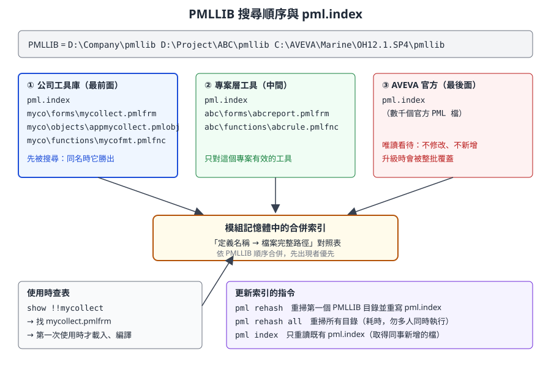
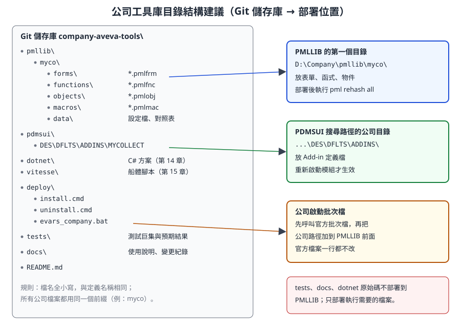

# 第 10 章　開發環境：PMLLIB、檔案類型與部署結構

> 本章是第三部分「二次開發技術」的第一章，回答一個看似簡單、卻讓最多新手卡關的問題：**程式放在哪裡，系統怎麼找到它？** 讀完本章，你會知道 PML 檔案要怎麼命名、放在哪個目錄、改完之後要下什麼指令才會生效，以及公司工具庫應該怎麼組織、怎麼部署、怎麼移除。
>
> 內容依據 AVEVA E3D 2.1 的 PML Customisation User Guide 與 Software Customisation Guide（help.aveva.com 公開頁面）、AVEVA Marine 12.1 SP4 開源範例（aveva-marine-dev-skill，MIT 授權）自主撰寫。AVEVA Marine 的舾裝部分承襲 PDMS，PML 機制與 E3D 高度相同，但目錄名稱（例如 `PDMSUI` 與 E3D 的 `PMLUI`）與部分指令可能有版本差異。標示 **〔待核對〕** 的項目，請以公司安裝版本確認。

## 10.1 學習目標

讀完本章，你應該能夠：

1. 比較 PML、PML.NET、.NET Add-in、Vitesse 四條開發路線，並為一個需求選出合適的路線。
2. 說明 `PMLLIB` 搜尋路徑與 `pml.index` 索引的運作方式，知道新增、修改、搬移檔案後分別要執行哪個指令。
3. 依檔案類型正確命名 `.pmlfnc`、`.pmlfrm`、`.pmlobj` 等檔案，並說出「檔名必須等於定義名稱」的原因。
4. 說明 `PDMSUI` 與 Add-in 定義目錄的角色。
5. 以「平行目錄 + 搜尋順序」擴充系統，而不修改任何官方檔案。
6. 建立個人開發環境：訓練專案、開發帳號、編輯器、版本控制。
7. 為公司規劃一個可以部署、可以移除、可以回復的工具庫目錄結構。

## 10.2 四條開發路線

AVEVA Marine 不只有一種客製化技術。選錯路線的代價很高：例如想用 PML 讀船體板架的零件資料，常會發現資料根本不在 PML 能直接看到的地方。下表先建立全局觀，後續章節再分別深入。

| 路線 | 語言 | 執行位置 | 適合的工作 | 不適合的工作 | 本課程章節 |
|---|---|---|---|---|---|
| **PML** | PML1／PML2 | 舾裝相關模組（Outfitting／Design、Draft 等）內的直譯器 | 查詢、報表、表單、選單、批次修改、規則 | 大量運算、複雜 UI、與外部系統的網路連線 | 第 11–13 章 |
| **PML.NET** | C# 類別 + PML 呼叫 | C# 組件載入到 PML 中 | 補足 PML 做不到的事：檔案格式、演算法、.NET 控制項 | 單純的查詢工具（多一種語言就多一份維護） | 第 14 章 |
| **.NET Add-in（CAF）** | C# | 模組啟動時由 CAF 框架載入 | 停靠視窗、大型工具、與 ERP／PDM 整合 | 一次性的小腳本 | 第 14 章 |
| **Vitesse** | Python 2.6 | 船體模組（承襲 Tribon） | 船體板架、零件、船體圖面的讀取與自動化 | 舾裝資料（管路、設備） | 第 15 章 |

選擇路線時，可以依序問三個問題：

1. **資料在哪裡？** 舾裝資料（Dabacon 資料庫）優先考慮 PML；船體 Databank 資料優先考慮 Vitesse。
2. **介面有多複雜？** 一個對話框加幾個按鈕，PML2 表單就夠了；需要停靠視窗、即時更新、複雜表格，考慮 .NET。
3. **誰來維護？** PML 工具可以由懂業務的工程師維護；.NET 工具需要有 C# 能力與 Visual Studio 建置環境的人。

> **開發人員須知：** 不要因為「C# 比較熟」就把所有工具都寫成 .NET Add-in。PML 是 AVEVA 介面本身使用的語言，系統內建的表單、選單、規則大量依賴它；只用 .NET 而不懂 PML，會看不懂官方程式，也無法掛進既有選單。建議所有開發人員都先學好 PML，再視需要加上 .NET。

## 10.3 PML 程式如何被找到：PMLLIB 與 pml.index

### 10.3.1 PMLLIB 是一個「路徑清單」

`PMLLIB` 是一個環境變數，內容是一串目錄，彼此以空白分隔。它的角色和你熟悉的這些東西一樣：

| 你熟悉的機制 | 對應到 PML |
|---|---|
| Windows／Linux 的 `PATH` | 依序搜尋目錄，找到第一個符合的就使用 |
| Python 的 `sys.path` | 匯入模組時依序搜尋 |
| Java 的 classpath | 類別名稱對應到檔案位置 |

官方文件規定：**PML 檔案必須存放在 `PMLLIB` 指向的目錄之中**（可以放在子目錄裡）。函式、表單、物件都是從 `PMLLIB` 自動載入的；你不需要寫 `import` 或 `include`，只要呼叫 `!!myFunction()` 或 `show !!myForm`，系統就會去找對應的檔案。

一個典型的公司環境可能長這樣：

```text
PMLLIB = D:\Company\pmllib  D:\Project\ABC\pmllib  C:\AVEVA\Marine\OH12.1.SP4\pmllib
```

三個目錄各有用途：公司工具庫放最前面，專案專用工具放中間，AVEVA 官方的 PML 放最後面。路徑與安裝目錄名稱只是示意，請依公司實際環境調整。

在命令列可以查看目前的設定：

```pml
q evar PMLLIB
q evar PDMSUI
```

### 10.3.2 pml.index：每個目錄一份索引

如果每次呼叫函式都要掃描硬碟上幾千個檔案，系統會非常慢。所以 PML 使用索引：

- 模組啟動時，PML 會讀取 `PMLLIB` 每個目錄中的 `pml.index` 檔（若不存在則掃描並建立）。
- 這些索引被合併成記憶體中的一張對照表：**定義名稱 → 檔案完整路徑**。
- 呼叫 `!!mycoArea()` 或 `show !!mycollect` 時，系統查表找到檔案，**第一次使用時才真正讀檔並載入**。
- 同一個名稱出現在多個目錄時，**排在 `PMLLIB` 前面的目錄優先**。這就是「以搜尋順序覆蓋」的基礎。



*圖 10-1　PMLLIB 搜尋順序與 pml.index。每個 PMLLIB 目錄有自己的索引檔，模組把它們依順序合併成一張對照表。（本課程自繪）*

> **專業提醒：** 部分較新的 AVEVA 產品版本說明索引改為在記憶體中管理，不再產生 `pml.index` 檔案。AVEVA Marine 12.1 屬於使用 `pml.index` 的世代，但仍請在公司環境實際查看目錄中是否有這個檔案〔待核對〕。

### 10.3.3 更新索引與重新載入的指令

| 指令 | 作用 | 什麼時候用 |
|---|---|---|
| `pml rehash` | 重新掃描 **`PMLLIB` 的第一個目錄**，更新它的 `pml.index` | 在自己的工作目錄（放在第一位）新增了檔案 |
| `pml rehash all` | 重新掃描 **所有** `PMLLIB` 目錄並更新索引 | 不確定檔案在哪個目錄、或部署了新的工具庫 |
| `pml index` | **不重建**，只重新讀取既有的 `pml.index` | 同事或管理員已經更新了共用目錄的索引，你要取得新內容 |
| `pmlscan 目錄名稱` | 在 AVEVA 產品**沒有執行**時，從作業系統更新某個目錄的索引 | 部署腳本、夜間排程 |
| `pml reload form !!表單名` | 重新讀取已載入的表單定義 | 修改了表單檔（`.pmlfrm`） |
| `pml reload object 物件名` | 重新讀取物件定義 | 在物件中新增了方法或成員 |
| `q var !!PML.getpathname('檔名.pmlobj')` | 查詢某個檔案實際從哪個路徑載入 | 懷疑載入的是別的目錄的同名檔 |

幾個官方文件特別提醒的細節：

- **把自己的工作目錄放在 `PMLLIB` 第一位。** 這樣 `pml rehash` 只需要掃描這一個目錄，速度快。
- **`pml rehash all` 會花一些時間，而且如果兩個使用者同時執行，索引檔可能無法正確重建。** 所以官方建議只在必要時使用，並由系統管理員收緊共用 `PMLLIB` 目錄的寫入權限。
- **只修改既有物件的方法內容，不需要 reload；新增方法才需要。** 修改表單檔且動到預設建構子時，則需要重新載入表單。
- 有時需要先刪除舊的 `pml.index` 再執行 `pml rehash`，才能讓索引反映檔案的刪除或改名。

### 10.3.4 「改了沒生效」的判斷表

| 你做了什麼 | 應該執行 | 備註 |
|---|---|---|
| 新增一個 `.pmlfnc`／`.pmlfrm`／`.pmlobj` | `pml rehash`（檔案在第一個目錄）或 `pml rehash all` | 不 rehash 就會出現「找不到函式／表單」 |
| 檔案改名或搬到別的子目錄 | 刪除舊索引後 `pml rehash all` | 舊索引可能還指向原路徑 |
| 修改表單的版面或 gadget | `pml reload form !!表單名`，再 `show` | 表單已開啟時先關閉 |
| 在物件定義裡新增方法 | `pml reload object 物件名` | 已存在的物件實例仍是舊定義，建議重新建立 |
| 修改函式內容 | 再呼叫一次通常即可；若仍是舊行為，重新啟動模組〔待核對〕 | 不同版本對函式快取的行為可能不同 |
| 新增或修改 Add-in 定義檔 | 重新啟動模組 | Add-in 只在模組啟動時讀取（見第 13 章） |
| 修改啟動批次檔或環境變數 | 重新啟動整個 AVEVA | 環境變數在程序啟動時決定 |

> **開發人員須知：** 把 `pml rehash`、`pml reload form` 想成「編譯並重新部署」。PML 沒有 IDE 幫你自動重載，所有「我明明改了」的問題，八成是索引或快取沒更新，而不是程式邏輯錯誤。

## 10.4 檔案類型與命名規則

### 10.4.1 副檔名一覽

官方文件定義的 PML 檔案副檔名（**副檔名必須是小寫**）：

| 副檔名 | 內容 | 定義語法 | 呼叫方式 | 自動載入 |
|---|---|---|---|---|
| `.pmlfnc` | 全域函式（PML Function） | `define function !!名稱(...)` … `endfunction` | `!!名稱(...)`、`call !!名稱(...)` | 是 |
| `.pmlfrm` | 表單（Form） | `setup form !!名稱` … `exit`，加上 `define method` | `show !!名稱`、`!!名稱.方法()` | 是 |
| `.pmlobj` | 自訂物件型別（Object） | `define object 名稱` … `endobject`，加上 `define method` | `object 名稱(...)` | 是 |
| `.pmlcmd` | PML 命令物件（Command） | 依版本而定 | 由命令管理器使用 | 是〔Marine 12.1 是否支援待核對〕 |

另外還有**巨集**（Macro）。巨集是一連串依序執行的命令，用 `$M 檔案路徑` 執行。官方說明巨集檔名可以是作業系統允許的任何名稱，常見用 `.mac`；不少公司與開源範例使用 `.pmlmac` 作為慣例。巨集**不經過** `pml.index` 自動載入，通常放在 `PDMSUI` 的目錄下或以完整路徑執行。新開發的程式碼，官方建議優先寫成函式或物件方法，因為它們會檢查引數型別、可以有回傳值。

### 10.4.2 「檔名 = 定義名稱」規則

這是新手最常犯錯的地方。PML 的索引用**檔名**來猜**定義名稱**，所以兩者必須一致：

| 定義 | 檔名（全小寫） | 錯誤示範 |
|---|---|---|
| `define function !!mycoArea(...)` | `mycoarea.pmlfnc` | `MycoArea.pmlfnc`（有大寫）、`myco_area.pmlfnc`（名稱不同） |
| `setup form !!mycollect` | `mycollect.pmlfrm` | `mycollect.pmlfrm.txt`（編輯器多加了副檔名） |
| `define object APPMYCOLLECT` | `appmycollect.pmlobj` | `appMyCollect.pmlobj` |
| `define object MYCOTALLY` | `mycotally.pmlobj` | 兩個物件寫在同一個檔案裡 |

規則整理：

1. **一個檔案只放一個定義**：一個函式、一個表單（含它的方法）、或一個物件（含它的方法）。
2. **檔名全小寫**，並與定義名稱相同（不含 `!!`）。PML 的定義名稱本身不分大小寫，但檔名比對以小寫為準。
3. **副檔名小寫**，而且決定了檔案的種類。
4. **檔案可以放在子目錄**（例如 `myco\forms\`），索引會掃描子目錄，所以子目錄只是為了讓人好整理。

> **專業提醒：** PML 的函式、表單、物件型別名稱都在**同一個全域命名空間**。如果你寫了 `!!report()`，而官方或別的部門也有一個 `report.pmlfnc`，誰先被找到就用誰，另一個會悄悄失效。公司所有檔案都應該加上固定前綴（本課程範例用 `myco`），就像 C# 的命名空間或 Java 的套件名稱。

### 10.4.3 檔案標頭範本

公司工具庫的每個檔案都應該有一致的標頭。下面的格式取材自開源範例 `appmycollect.pmlobj`（MIT 授權），它模仿了 AVEVA 官方 PML 檔的標頭風格：

```pml
------------------------------------------------------------------------
--
-- File:            mycoarea.pmlfnc
--   Type:          Function Definition
--   Module:        myco
--   Author:        王小明
--   Created:       2026-10-28
-- Description:     計算矩形面積（教學範例）
--
------------------------------------------------------------------------
```

標頭記錄的資訊在出問題時非常有用：看到一個陌生的檔案，馬上知道它屬於哪個工具、誰負責、做什麼。

## 10.5 PDMSUI 與 Add-in 定義目錄

`PMLLIB` 管「程式碼」，`PDMSUI` 管「介面設定」。在 PDMS 與 AVEVA Marine 中，`PDMSUI` 指向一組介面相關目錄，依模組分成子目錄（例如舾裝設計模組的 `DES`）。E3D 文件中對應的變數叫 `PMLUI`，概念相同。

| 項目 | `PMLLIB` | `PDMSUI` |
|---|---|---|
| 放什麼 | 函式、表單、物件（`.pmlfnc`、`.pmlfrm`、`.pmlobj`） | 巨集、預設值、Add-in 定義檔、應用程式介面設定 |
| 如何載入 | 透過 `pml.index` 依名稱自動載入 | 由模組依固定子目錄讀取，或以 `$M` 執行 |
| 修改後 | `pml rehash`／`pml reload` | 多數情況需重新啟動模組 |

### 10.5.1 Add-in 定義檔

**PML Add-in** 是讓你的工具在模組啟動時被「掛上去」的機制，例如在選單裡多一個項目。它由兩個部分組成：

1. **Add-in 定義檔**：一個沒有副檔名的純文字檔，放在 `PDMSUI` 下的 Add-in 目錄，每一行是「鍵: 值」。
2. **Add-in 物件**：一個 `.pmlobj`，放在 `PMLLIB`，實作 `.modifyMenus()` 等掛勾方法。

Add-in 目錄的位置有版本差異：

| 來源 | 路徑 |
|---|---|
| AVEVA Marine 12.1 SP4 開源範例（`install.cmd`） | `%PDMSUI%\DES\DFLTS\ADDINS\` |
| E3D 1.1 Software Customisation Guide 的範例 | `DES\DFLTS\ADDINS` 目錄 |
| E3D 1.1／2.1 文件的一般格式說明 | `%PMLUI%\<模組>\ADDINS\<addin 名稱>` |

請在公司安裝目錄中，找到官方 Add-in 定義檔實際所在的資料夾，以那裡為準〔待核對〕。

開源範例的定義檔只有兩行：

```text
Name: MYCOLLECT
Object: APPMYCOLLECT
```

官方文件列出的常用鍵：

| 鍵 | 作用 |
|---|---|
| `Name` | Add-in 的唯一識別名稱（必填） |
| `Title` | 描述文字；若 Add-in 定義的是一個應用程式，會顯示在主視窗標題列 |
| `ShowOnMenu` | 是否出現在 Applications 選單，預設 false |
| `Object` | Add-in 物件型別名稱（用於有選單列的模組），系統會呼叫它的 `.modifyMenus()` 等方法 |
| `Control` | 使用者自訂的控制物件型別；模組啟動時系統會建立同名全域變數 |
| `ModuleStartup` | 模組第一次啟動時執行的回呼，例如 `!!myAddinController.initialise()` |
| `StartupModify`、`SwitchModify` | 在指定應用程式啟動或切換時加掛回呼，格式為「應用程式名稱:回呼」 |

Add-in 物件的寫法與載入流程，在第 13 章完整解說。

## 10.6 不修改官方檔案的原則

AVEVA 安裝目錄裡有數千個 PML 檔案，很多看起來「改一行就能達成需求」。**請不要這樣做。** 原因如下：

| 直接修改官方檔案的後果 | 說明 |
|---|---|
| 升級時被覆蓋 | 安裝 Service Pack 或修補程式會換掉官方檔案，你的修改消失，而且沒人記得改過什麼 |
| 無法追蹤 | 官方檔案不在公司的版本控制裡，出問題時無法比對 |
| 影響所有專案 | 官方目錄通常是所有專案共用，一個錯誤會讓全公司停擺 |
| 失去支援 | 系統異常時，原廠支援通常要求先回到未修改的狀態 |

正確做法是「**平行目錄擴充、搜尋順序覆蓋**」：

1. **擴充（優先）**：新功能寫成公司自己的檔案，放在公司目錄。透過 Add-in 物件把選單項目「加上去」，而不是改官方的選單定義。
2. **覆蓋（最後手段）**：如果真的必須改變官方表單或函式的行為，把該檔案**複製**到公司目錄（`PMLLIB` 較前面），在副本上修改。官方原檔保持不動，移除副本就能回到原狀。
3. **記錄覆蓋清單**：每一個覆蓋的官方檔案，都要記錄原始版本、修改原因、負責人。升級時逐一比對新版官方檔案，決定是否重新套用。

> **專業提醒：** 覆蓋官方檔案等於「fork 了一份官方程式碼」，升級後官方可能修了錯誤或改了介面，而你的副本仍是舊版。能用 Add-in 掛勾達成的，就不要覆蓋。

### 10.6.1 公司包裝批次檔

要把公司目錄加到 `PMLLIB` 前面，也不應該修改官方啟動批次檔。常見做法是寫一個公司的包裝批次檔：先呼叫官方批次檔，再調整環境變數。

```bat
@echo off
rem -- 示意：公司包裝批次檔 evars_company.bat
rem -- 1. 先呼叫官方批次檔設定標準環境（檔名與參數依公司安裝而定〔待核對〕）
call "C:\AVEVA\Marine\OH12.1.SP4\marine.bat" %*

rem -- 2. 把公司工具庫放到 PMLLIB 最前面（以空白分隔）
set PMLLIB=D:\Company\pmllib %PMLLIB%

rem -- 3. 公司介面目錄（Add-in 定義檔）的加入方式依版本而定〔待核對〕
rem set PDMSUI=...
```

> **開發人員須知：** 官方批次檔通常在最後才啟動主程式，如果先 `call` 官方批次檔，它可能直接把 AVEVA 開起來，你的 `set` 就來不及生效。實務上要先閱讀官方批次檔的結構，找出它預留的客製化掛勾（PDMS 系常見 `custom_evars.bat` 一類的檔案）或把「設定環境」與「啟動程式」分開呼叫〔待核對〕。這件事請與系統管理員一起確認，不要自行修改共用捷徑。

## 10.7 開發用專案、帳號與工具

### 10.7.1 環境分層

| 環境 | 用途 | 資料 | 誰能寫入 |
|---|---|---|---|
| 個人開發 | 寫程式、反覆測試 | 訓練專案（官方範例專案或公司複製的測試專案） | 開發人員自己 |
| 測試 | 部署前驗證、使用者試用 | 正式專案的複本或專用測試專案 | 開發人員、測試人員 |
| 正式 | 日常設計工作 | 正式專案 | 設計人員；工具只讀或經審核後寫入 |

申請開發環境時，向系統管理員確認這些項目：

- **訓練專案代碼**與可登入的 **MDB**：所有會修改資料的練習只能在這裡做。
- **開發帳號**：屬於有寫入權限的 Team，才能測試建立與修改。
- **個人 `PMLLIB` 目錄**：放在你自己的磁碟，排在 `PMLLIB` 第一位，`pml rehash` 才快，也不會影響別人。
- **共用工具庫的唯讀副本**：開發時你看得到公司其他工具，但不能直接改共用目錄。

### 10.7.2 編輯器與編碼

| 項目 | 建議 |
|---|---|
| 編輯器 | Visual Studio Code 或 Notepad++。兩者都有社群提供的 PML 語法高亮（VS Code 擴充套件、Notepad++ 自訂語言定義）；安裝前請檢查發佈者、支援版本與公司軟體政策 |
| 檔案編碼 | 依公司版本測試：中文註解或中文表單標題能否正確顯示。AVEVA Marine 12.1 的 PML 檔通常以系統字碼頁（繁體中文 Windows 為 Big5／CP950）讀取，E3D 2.x 以後對 Unicode 支援較完整〔待核對〕。第 16 章會再談編碼 |
| 換行 | Windows 格式（CRLF）最保險 |
| 副檔名 | 關閉「隱藏已知副檔名」，避免存成 `xxx.pmlfnc.txt` |
| 縮排 | 用空白不用 Tab，兩格縮排（與開源範例一致） |

### 10.7.3 開發迴圈

一個 PML 工具的日常開發流程：

```text
1. 在編輯器修改檔案（個人 PMLLIB 目錄）
2. 新檔案：pml rehash        已載入的表單：pml reload form !!xxx
3. 在命令列執行：show !!xxx  或  !r = !!xxx(...)  再 q var !r
4. 有問題：$R100（追蹤開）→ 重現 → $R0（追蹤關），或用 $P 印出變數
5. 通過後提交到 Git，再部署到測試環境
```

追蹤與除錯在第 11 章與第 17 章詳細說明。

## 10.8 公司工具庫的目錄結構建議



*圖 10-2　建議的公司工具庫結構。左邊是 Git 儲存庫，右邊是部署目的地。只有執行所需的檔案會被部署。（本課程自繪）*

結構背後的設計原則：

| 原則 | 做法 | 理由 |
|---|---|---|
| 一個前綴 | 所有 PML 定義名稱與目錄都用 `myco`（請換成公司代碼） | 避免與官方或其他部門撞名；一眼看出哪些是公司的 |
| 依類型分子目錄 | `forms`、`functions`、`objects`、`macros`、`data` | 與官方 `PMLLIB` 的組織習慣一致，好找 |
| 原始碼與部署分離 | 儲存庫包含測試、文件、.NET 原始碼；部署只複製執行需要的檔案 | 正式環境保持乾淨，也避免使用者看到測試程式 |
| 部署可重複、可移除 | `install.cmd` 與 `uninstall.cmd` 成對 | 出問題時可以在幾分鐘內回到上一版 |
| 資料與程式分離 | 對照表、標準尺寸放在 `data`，程式讀檔取得 | 改資料不必改程式（第 16 章） |
| 不寫死路徑 | 程式中以環境變數或 `!!PML.getpathname()` 找到自己的資料檔 | 部署位置改變時不用改程式 |

命名慣例建議：

| 對象 | 慣例 | 範例 |
|---|---|---|
| 函式 | `!!myco` + 動詞名詞 | `!!mycoFindEqui()`、`mycofindequi.pmlfnc` |
| 表單 | `!!myco` + 名詞 | `!!mycofinder`、`mycofinder.pmlfrm` |
| 物件型別 | `MYCO` + 名詞（全大寫書寫） | `MYCOTALLY`、`mycotally.pmlobj` |
| Add-in 物件 | `APP` + 工具名 | `APPMYCOLLECT`（沿用官方 `APPxxx` 慣例） |
| 全域變數 | `!!myco` + 名稱，越少越好 | `!!mycoDebug` |
| 選單欄位名稱 | `myco` + 功能 | `myCollect`、`myCollectSep` |

## 10.9 讀懂部署腳本：install.cmd

開源範例 `examples/starter-kit-mycollect/install.cmd`（MIT 授權，Copyright © 2026 erbi112211-boop）示範了最小的部署流程。以下摘錄關鍵段落並逐段說明（原檔註解為簡體中文）：

```bat
if "%PMLLIB%"=="" (
  echo [ERR] 请先在 Marine 启动环境里运行本脚本 ^(marine.bat 环境^)
  goto :eof
)
if "%PDMSUI%"=="" (
  echo [ERR] PDMSUI 未定义
  goto :eof
)

set KIT=%~dp0

xcopy /s /y /i "%KIT%pmllib\myco" "%PMLLIB%myco"
if errorlevel 1 ( echo [ERR] PML 源码复制失败 & goto :eof )

copy /y "%KIT%addins-des\MYCOLLECT" "%PDMSUI%DES\DFLTS\ADDINS\MYCOLLECT"
if errorlevel 1 ( echo [ERR] ADDIN 文件复制失败 & goto :eof )
```

| 段落 | 說明 |
|---|---|
| 檢查 `PMLLIB`、`PDMSUI` | 必須在已執行啟動批次檔的命令視窗中執行，否則環境變數不存在 |
| `set KIT=%~dp0` | 取得腳本自己所在的目錄（結尾含 `\`），讓腳本不依賴目前工作目錄 |
| `xcopy ... "%PMLLIB%myco"` | 把整個 `myco` 子目錄複製到 PMLLIB，**新增目錄，不修改官方檔案** |
| `copy ... ADDINS\MYCOLLECT` | 把 Add-in 定義檔放到 Add-in 目錄 |
| `if errorlevel 1` | 每一步都檢查失敗，失敗就停止 |

腳本最後提示的驗證步驟也值得照做：重新啟動模組、`q evar pmllib` 確認路徑、`pml rehash all`、`show !!mycollect` 冒煙測試、檢查 Utilities 選單。移除方式是刪除 `%PMLLIB%myco` 與 Add-in 定義檔。

> **開發人員須知：** 這個腳本假設 `PMLLIB` **只有一個目錄而且以 `\` 結尾**（`"%PMLLIB%myco"` 直接把字串接起來）。如果公司的 `PMLLIB` 是多個以空白分隔的目錄（本章建議的做法），這行會產生錯誤的路徑。正式部署腳本應該明確指定目標目錄（例如 `D:\Company\pmllib\`），而不是從 `PMLLIB` 推算。

改良後的部署腳本骨架：

```bat
@echo off
rem -- 示意：公司部署腳本 deploy\install.cmd
setlocal
set TARGET_PML=D:\Company\pmllib
set TARGET_ADDIN=D:\Company\pdmsui\DES\DFLTS\ADDINS
set KIT=%~dp0..
set STAMP=%DATE:~0,4%%DATE:~5,2%%DATE:~8,2%

rem 1. 備份現有版本（回復用）
if exist "%TARGET_PML%\myco" xcopy /s /i /y "%TARGET_PML%\myco" "%TARGET_PML%\_backup\myco_%STAMP%" >nul

rem 2. 部署 PML 與 Add-in 定義
xcopy /s /i /y "%KIT%\pmllib\myco" "%TARGET_PML%\myco"
if errorlevel 1 goto :fail
copy /y "%KIT%\pdmsui\DES\DFLTS\ADDINS\MYCOLLECT" "%TARGET_ADDIN%\MYCOLLECT"
if errorlevel 1 goto :fail

rem 3. 重建索引（AVEVA 未執行時可用 pmlscan；工具位置依安裝而定〔待核對〕）
echo [OK] 部署完成，請使用者重新啟動模組
goto :eof

:fail
echo [ERR] 部署失敗，請從 _backup 回復
exit /b 1
```

這個骨架有三個重點：目標目錄明確、部署前先備份、失敗時有清楚的回復指引。`%DATE%` 的格式依 Windows 地區設定而不同，取子字串的位置要依公司電腦調整。第 17 章會把部署與回復流程完整化。

## 10.10 開發人員須知

- **先確認環境，再懷疑程式。** 「找不到函式」「表單沒更新」「選單沒出現」幾乎都是路徑、檔名、索引或 Add-in 目錄的問題。用 `q evar PMLLIB`、`q var !!PML.getpathname('xxx.pmlfrm')` 先確認系統看到的是哪個檔案。
- **把 PML 的全域命名空間當成稀缺資源。** 每一個函式、表單、物件名稱都是全域的。統一前綴，並在 Git 儲存庫中用腳本檢查有沒有重名。
- **個人目錄放第一位。** 開發時你的副本會優先載入，不影響同事；測試完再部署到共用目錄。
- **共用目錄要唯讀。** 官方也建議管理員收緊 `PMLLIB` 目錄的寫入權限。一般使用者能寫入共用 `PMLLIB`，等於任何人都能「覆蓋」任何工具。
- **不要在尖峰時間執行 `pml rehash all`。** 它會掃描所有目錄，而且多人同時執行可能讓索引損壞。部署後請使用者重新啟動模組，或改用 `pml index` 讀取已更新的索引。
- **部署要可以回復。** 每次部署前備份上一版，並記錄部署時間、版本、內容。

## 10.11 練習

> 以下練習只能在**訓練專案**與**個人目錄**中進行，不要修改共用或官方目錄。

### 練習 1：環境盤點

在命令列執行下列指令，把結果填入表格：

```pml
q evar PMLLIB
q evar PDMSUI
q var !!PML.getpathname('appmycollect.pmlobj')
```

| 項目 | 你的環境 |
|---|---|
| `PMLLIB` 依序有哪些目錄 | |
| 哪一個是你的個人目錄（應在第一位） | |
| `PDMSUI` 的值 | |
| 官方 Add-in 定義檔所在的實際資料夾 | |
| 每個 `PMLLIB` 目錄是否有 `pml.index` | |

如果第三行回報錯誤，表示索引中沒有這個檔案，這是正常的，代表 MyCollect 尚未部署。

### 練習 2：第一個函式與索引

1. 在個人 `PMLLIB` 目錄建立 `myco\functions\mycohello.pmlfnc`：

```pml
-- 示意：第一個函式
define function !!mycoHello(!who is STRING) is STRING
  return 'Hello, ' & !who
endfunction
```

2. 不執行任何指令，直接在命令列輸入 `q var !!mycoHello('PML')`，記錄錯誤訊息。
3. 執行 `pml rehash`，再試一次，應該看到 `'Hello, PML'`。
4. 把檔名改成 `MycoHello.pmlfnc`（有大寫），刪除 `pml.index` 後 `pml rehash`，觀察結果，再改回來。

### 練習 3：搜尋順序覆蓋

1. 在個人目錄與另一個測試目錄各放一個 `mycohello.pmlfnc`，回傳不同的字串。
2. 調整 `PMLLIB` 順序（只在個人的測試捷徑中調整），重新啟動模組，確認哪一個勝出。
3. 用 `!!PML.getpathname('mycohello.pmlfnc')` 驗證系統實際載入的路徑。

### 練習 4：規劃公司工具庫

依圖 10-2 建立一個 Git 儲存庫骨架，並撰寫：

- `README.md`：工具庫用途、前綴、部署方式、負責人。
- `deploy\install.cmd` 與 `deploy\uninstall.cmd`：目標目錄明確、部署前備份。
- 一份命名慣例表（可直接修改 10.8 節的表格）。

## 10.12 自我檢核

- [ ] 我能說出 PML、PML.NET、.NET Add-in、Vitesse 各自適合的工作，並為一個需求選出路線。
- [ ] 我能解釋 `PMLLIB` 的搜尋順序，以及同名檔案在不同目錄時誰會被使用。
- [ ] 我知道 `pml rehash`、`pml rehash all`、`pml index`、`pml reload form`、`pml reload object` 的差別與使用時機。
- [ ] 我能依定義名稱寫出正確的檔名，並說明為什麼檔名必須小寫且與定義名稱一致。
- [ ] 我能說明 `.pmlfnc`、`.pmlfrm`、`.pmlobj`、`.pmlcmd` 與巨集的差別。
- [ ] 我知道 `PDMSUI` 與 Add-in 定義目錄的角色，以及 Add-in 定義檔的主要鍵。
- [ ] 我能說明為什麼不修改官方檔案，以及「平行目錄擴充、搜尋順序覆蓋」的做法。
- [ ] 我已建立個人開發目錄，並放在 `PMLLIB` 第一位。
- [ ] 我能為公司規劃工具庫目錄結構與命名前綴，並寫出可回復的部署腳本。

## 10.13 資料來源

- AVEVA E3D 2.1 PML Customisation User Guide：Storing and Loading PML Files（`PMLLIB`、`pml.index`、`pml rehash`、`pml index`、`pmlscan`）：<https://help.aveva.com/AVEVA_Everything3D/2.1/PMLPUG/PMLCG4.04.09.html>
- 同上：Rebuilding All PML File Indexes（`pml rehash all` 的注意事項）：<https://help.aveva.com/AVEVA_Everything3D/2.1/PMLPUG/PMLCG4.04.10.html>
- 同上：Querying the Location of PML Files（`!!PML.getpathname`）：<https://help.aveva.com/AVEVA_Everything3D/2.1/PMLPUG/PMLCG4.04.11.html>
- 同上：Filename Extensions（副檔名一覽與小寫規定）：<https://help.aveva.com/AVEVA_Everything3D/2.1/PMLPUG/PMLCG4.04.08.html>
- 同上：General Features of PML（函式、巨集、`PMLLIB` 與 `PMLUI` 搜尋路徑）：<https://help.aveva.com/AVEVA_Everything3D/2.1/PMLPUG/PMLCG4.04.01.html>
- 同上：Developing a PML Object with Methods（`pml reload object`）：<https://help.aveva.com/AVEVA_Everything3D/2.1/PMLPUG/PMLCG3.03.23.html>
- 同上：Naming and Running Macros（`$M`）：<https://help.aveva.com/AVEVA_Everything3D/2.1/PMLPUG/PMLCG8.08.2.html>
- AVEVA E3D 2.1 PML Customisation User Guide：Defining a PML Add-in（Add-in 定義檔的鍵）：<https://help.aveva.com/AVEVA_Everything3D/2.1/PMLPUG/PMLCG24.27.03.html>
- AVEVA E3D 1.1 Software Customisation Guide：PML Add-in 定義檔鍵（含 `Object`）：<https://help.aveva.com/AVEVA_Everything3D/1.1/SOFTCG/SOFTCG24.27.03.html>
- AVEVA E3D 1.1 Software Customisation Guide：Add-in 範例與 `DES\DFLTS\ADDINS` 目錄：<https://help.aveva.com/AVEVA_Everything3D/1.1/SOFTCG/SOFTCG24.27.20.html>
- 開源範例 aveva-marine-dev-skill（MIT 授權，`install.cmd`、Add-in 定義檔、目錄慣例）：<https://github.com/912141548/aveva-marine-dev-skill>；本地副本：[`examples/starter-kit-mycollect/`](examples/starter-kit-mycollect/install.cmd)
- 相關章節：[第 1 章　產品架構、模組與啟動環境](ch01_architecture_zh-TW.reading.html)、[第 11 章　PML 語言核心](ch11_pml_language_zh-TW.reading.html)、[第 13 章　PML2 表單、選單與 Add-in](ch13_pml_forms_addins_zh-TW.reading.html)、[第 17 章　除錯、測試、部署與版本管理](ch17_debug_deploy_zh-TW.reading.html)
