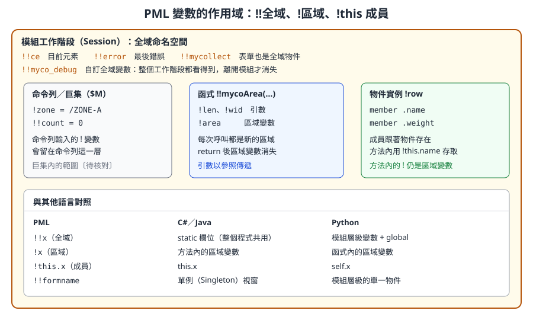
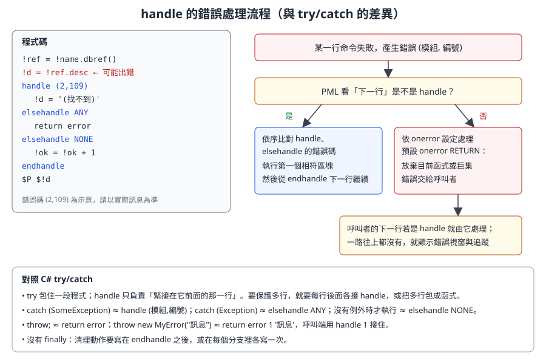

# 第 11 章　PML 語言核心

> 本章把 PML（Programmable Macro Language）當成一門程式語言來教：變數、型別、運算子、流程控制、字串、陣列、函式、物件、錯誤處理與巨集。每一節都附可讀的範例，並與 C#、Python 等常見語言對照，讓有程式經驗的讀者能快速建立正確的心智模型，也避開 PML 特有的陷阱。
>
> 語法依據 AVEVA E3D 2.1 的 PML Customisation User Guide 與 Software Customisation Reference Manual（help.aveva.com 公開頁面）。AVEVA Marine 12.1 的 PML 與 E3D 2.1 高度相同，但個別方法可能有版本差異。範例開頭標示「-- 示意」者為本課程自行撰寫、未在實機驗證的程式；請先在訓練專案中執行。互動練習可搭配 [PML 互動練習頁](aveva_pml_learning_guide.html)。

## 11.1 學習目標

讀完本章，你應該能夠：

1. 說明 PML1 與 PML2 的差別，並辨識一段程式屬於哪一種風格。
2. 正確使用區域變數 `!x`、全域變數 `!!x` 與物件成員 `!this.x`。
3. 使用 STRING、REAL、BOOLEAN、ARRAY、DBREF、POSITION 等內建型別，並做型別轉換。
4. 寫出 `if`、`do`（from/to、values、indices）、`break`、`skip`、`golabel` 等流程控制。
5. 運用字串與陣列的常用方法，並記得陣列從 1 開始。
6. 定義函式與程序，理解引數以參照傳遞的後果。
7. 定義一個 PML 物件：成員、方法、建構子與 `!this`。
8. 用 `handle`／`elsehandle`／`endhandle` 處理錯誤，並能自訂錯誤。
9. 執行巨集，使用 `$P`、`$!`、`$R` 等指令輸出與除錯。

## 11.2 PML1 與 PML2

PML 有兩代語法，而且在同一個系統裡並存：

| 面向 | PML1 | PML2 |
|---|---|---|
| 年代與定位 | 早期的巨集語言 | 在 PML1 之上擴充的物件導向版本 |
| 變數 | 幾乎都當字串處理，常用 `var` 指令設定 | 變數是**有型別的物件**，直接用 `=` 指定 |
| 取值方式 | 常用 `$!x` 把變數展開成文字再交給命令 | 直接在運算式中使用 `!x` |
| 典型語法 | `var !list collect all EQUI for /ZONE-A` | `!coll = object COLLECTION()` |
| 介面 | 舊式表單 | `setup form` 表單、gadget、callback |
| 今天的用途 | 規則（Rules）、報表範本中的運算式；大量既有程式 | 新開發的函式、物件、表單 |

官方文件說明：PML2 是較新的擴充，特別適合表單與選單；但 PML1 並未被淘汰，部分工作（例如規則與報表範本）只能使用 PML1 運算式，有些任務用 PML1 反而更有效率。實務上你讀到的公司程式與官方程式，常常在同一個檔案裡混用兩者。

> **開發人員須知：** 把 PML2 想成「主語言」，PML1 想成「內嵌的命令語言」。PML2 負責變數、邏輯、物件；需要對資料庫下命令時（例如 `NEW EQUI`、`CLAIM`），就寫一行 PML1 風格的命令，必要時用 `$!` 把變數值塞進命令裡。

## 11.3 三種執行方式

同一段邏輯可以用三種方式執行：

| 方式 | 寫法 | 適合 |
|---|---|---|
| 命令列直接輸入 | 在 Command Window 逐行輸入 | 試驗語法、查詢變數 |
| 巨集 | 寫成文字檔，`$M 路徑` 執行 | 一次性的批次命令、舊程式 |
| 函式／物件／表單 | 放在 `PMLLIB`，依名稱自動載入 | 正式工具（第 10 章） |

在命令列試試看：

```pml
!greeting = 'Hello'
!name = 'PML'
!msg = !greeting & ', ' & !name
q var !msg
$P $!msg
```

`q var !msg` 會顯示變數的型別與值；`$P` 把後面的文字印到命令列，而 `$!msg` 在印出前被換成變數內容。

## 11.4 基本語法規則

| 規則 | 說明 | 範例 |
|---|---|---|
| 註解 | `--` 到行尾；`$*` 也是行註解（較舊的寫法） | `-- 這是註解` |
| 大小寫 | 關鍵字、變數名、方法名不分大小寫；**字串內容**區分大小寫 | `!Name` 與 `!name` 是同一個變數 |
| 字串分隔 | 單引號 `'...'` 或直線 `|...|`，前後必須成對 | `'abc'`、`|it's ok|` |
| 一行一個敘述 | 不使用分號；`if` 不能寫成單行 | 見 11.8 節 |
| 物件與方法 | 用點號存取成員與方法 | `!s.length()`、`!!ce.owner` |

兩種字串分隔符號的用途：字串內容本身有單引號時，用 `|...|` 包住；或在回呼字串中需要再放一層字串時（第 13 章）也很好用：

```pml
!sql = |NAME eq 'P-101'|
!callback = |!this.show('ABC')|
```

> **專業提醒：** 官方文件特別警告：分隔符號不成對時，後面很多行程式會被「吃進」字串裡而失效，錯誤訊息卻出現在很遠的地方。看到莫名其妙的語法錯誤，先檢查上方的引號是否成對。

## 11.5 變數與作用域

PML 的變數以驚嘆號開頭，不需要宣告型別，但**值本身有型別**（這點像 Python，不像 JavaScript 的隨意轉型）。

| 寫法 | 名稱 | 存活範圍 |
|---|---|---|
| `!x` | 區域變數 | 目前的函式、方法或巨集；在命令列輸入則留在命令列這一層 |
| `!!x` | 全域變數 | 整個模組工作階段，直到離開模組 |
| `!this.x` | 物件成員 | 跟著物件（或表單）存在，只能在該物件的方法中以 `!this` 存取 |



*圖 11-1　PML 變數的作用域與其他語言的對照。（本課程自繪）*

幾個重要的全域變數是系統提供的：

| 全域變數 | 型別 | 用途 |
|---|---|---|
| `!!ce` | DBREF | 目前元素（Current Element），第 12 章的主角 |
| `!!error` | 錯誤物件 | 最近一次錯誤的資訊，例如 `!!error.text` |
| `!!表單名稱` | FORM | 每個已載入的表單都是一個全域物件 |
| `!!alert` | 提示物件 | 顯示訊息框，例如 `!!alert.message('...')`、`!!alert.error('...')` |

> **開發人員須知：** 全域變數在整個工作階段都存在，而且所有工具共用同一個命名空間。少用 `!!`；必須使用時加上公司前綴（`!!mycoXxx`）。跨方法共用的狀態，放在表單或物件的成員上，而不是全域變數。

## 11.6 型別

### 11.6.1 常用內建型別

| 型別 | 說明 | 建立方式 | 其他語言對照 |
|---|---|---|---|
| STRING | 字串 | `'abc'`、`|abc|` | `string`／`str` |
| REAL | 數值（沒有獨立的整數型別） | `42`、`3.14` | `double`／`float` |
| BOOLEAN | 布林 | `TRUE`、`FALSE`（也接受 `T`、`F`、`YES`、`NO`） | `bool` |
| ARRAY | 陣列，可混放不同型別 | `ARRAY()`、`object ARRAY()` | `List<object>`／`list` |
| DBREF | 資料庫元素參照 | `!!ce`、`/P-101`、`'/P-101'.dbref()` | 指標或外鍵 |
| POSITION | 三維位置 | `'E 1000 N 2000 U 0'.position()` | 自訂 `Point3D` 結構 |
| DIRECTION | 方向 | `'E'.direction()` | 單位向量 |
| ORIENTATION | 姿態（三軸方向） | `'Y is N and Z is U'.orientation()` | 旋轉矩陣 |
| FILE | 檔案 | `object FILE('C:\temp\a.txt')` | `FileInfo`（第 16 章） |
| COLLECTION、EXPRESSION | 資料庫查詢 | `object COLLECTION()` | 查詢建構器（第 12 章） |
| 使用者自訂型別 | `define object` 定義 | `object MYCOTALLY()` | `class` |

位置、方向與姿態的字串寫法依第 4 章介紹的座標語法；字串轉成這些物件的方法（`.position()`、`.direction()`、`.orientation()`）列在官方 STRING 物件的方法表中。

### 11.6.2 查詢與轉換型別

```pml
!a = 42
!b = !a.string()          -- REAL → STRING：'42'
!c = '3.5'.real()         -- STRING → REAL：3.5
!d = 'TRUE'.boolean()     -- STRING → BOOLEAN：TRUE
!e = !a.objecttype()      -- 'REAL'
q var !b
```

| 轉換 | 方法 |
|---|---|
| 任何值 → 字串 | `.string()` |
| 字串 → 數值 | `.real()` |
| 字串 → 布林 | `.boolean()`（`TRUE`、`T`、`YES`、`Y` 為真；`FALSE`、`F`、`NO`、`N` 為假，不分大小寫） |
| 字串 → 元素參照 | `.dbref()` |
| 字串 → 位置／方向／姿態 | `.position()`、`.direction()`、`.orientation()` |

### 11.6.3 未設定的值

變數可能「存在但沒有值」，陣列也可能有「洞」。PML 提供這些檢查：

```pml
!x = REAL()               -- 建立一個未設定值的 REAL 變數
if (unset(!x)) then
  $P x 尚未設定
endif

!ref = !!ce.owner
if (badref(!ref)) then    -- 參照未設定或無法導覽
  $P 沒有有效的擁有者
endif
```

> **開發人員須知：** PML 沒有 `null` 這個字，但有 UNSET 的概念。讀資料庫屬性時常會遇到未設定的值，直接拿去運算會出錯。對可能為空的值先檢查，就像 C# 檢查 `null`。

## 11.7 運算子

| 類別 | PML | C#／Python 對照 | 備註 |
|---|---|---|---|
| 指定 | `=` | `=` | 只用於指定 |
| 相等、不等 | `eq`、`ne` | `==`、`!=` | **不能**寫 `==` |
| 大小比較 | `gt`、`lt`、`ge`、`le` | `>`、`<`、`>=`、`<=` | 論文程式中的 `Geq`、`Leq` 與 `ge`、`le` 同義〔待核對〕 |
| 邏輯 | `and`、`or`、`not` | `&&`、`||`、`!` | `!` 在 PML 是變數前綴，不是否定 |
| 算術 | `+`、`-`、`*`、`/` | 同 | 數值一律是 REAL |
| 字串串接 | `&` | `+` | `'A' & 'B'` 得 `'AB'`；`&` 會把數值轉成字串 |
| 分組 | `( )` | 同 | `if` 的條件必須用括號 |

```pml
-- 示意：運算子綜合範例
!len = 1200
!wid = 800
!area = !len * !wid / 1000000          -- 0.96（平方公尺）
!isBig = !area gt 0.5 and !len ge 1000
!label = 'Area = ' & !area & ' m2'     -- & 會轉字串
if (!isBig and not (!label eq '')) then
  $P $!label
endif
```

**短路求值：** 官方文件說明，當結果已經確定時，運算式不會強迫評估未設定的變數。例如 `!trueValue or !unsetValue` 與 `!falseValue and !unsetValue` 都不會因為 `!unsetValue` 未設定而出錯。可以利用這點寫出「先檢查再使用」的條件。

> **專業提醒：** 字串比較 `eq` 對大小寫敏感與否，請在公司版本實測〔待核對〕。需要不分大小寫時，明確使用 `!a.eqnocase(!b)` 或把兩邊都 `.upcase()` 再比較，程式意圖最清楚。

## 11.8 流程控制

### 11.8.1 if／elseif／else

```pml
if (!bore ge 200) then
  !class = 'LARGE'
elseif (!bore ge 50) then
  !class = 'MEDIUM'
else
  !class = 'SMALL'
endif
```

規則：

- 條件必須是 BOOLEAN。`if (1)`、`if ('TRUE')` 都是錯的；需要時用 `.boolean()` 轉換。
- 關鍵字是 `elseif`（一個字），不是 `else if`。
- **不能寫成單行**。官方文件把 `if (!n lt 0) then !neg = TRUE endif` 明確標為錯誤。

### 11.8.2 do 迴圈

PML 只有一個迴圈關鍵字 `do`，搭配不同子句：

| 形式 | 語法 | 對照 |
|---|---|---|
| 計數 | `do !i from 1 to 10 by 2` … `enddo` | `for (i = 1; i <= 10; i += 2)` |
| 走訪值 | `do !v values !arr` … `enddo` | `foreach (var v in arr)` |
| 走訪索引 | `do !n indices !arr` … `enddo` | `for i in range(len(arr))`（從 1 開始） |
| 無限迴圈 | `do` … `enddo` | `while (true)`，要搭配 `break` |

`from` 預設 1、`to` 預設無限大、`by` 預設 +1；迴圈變數是 REAL，結束後保留最後的值。

```pml
-- 示意：三種 do 的寫法
!names = ARRAY()
!names.append('P-101A')
!names.append('P-101B')
!names.append('HX-201')

do !i from 1 to !names.size()
  $P 第 $!i 個：$!names[$!i]
enddo

do !n values !names
  $P 名稱：$!n
enddo

do !k indices !names
  !names[!k] = !names[!k].lowcase()
enddo
```

> **專業提醒：** 開源範例 `mycollect.pmlfrm` 使用 `do !e index !results`。官方文件記載的關鍵字是 `indices`；`index` 是否為可接受的寫法，請在公司版本確認〔待核對〕。新程式建議統一寫 `indices`。

### 11.8.3 break、skip 與 golabel

```pml
-- 示意：找到第一個大於 100 的數就停止
!total = 0
do !n values !numbers
  skip if (!n lt 0)          -- 略過負數，直接進入下一圈（同 continue）
  break if (!n gt 100)       -- 跳出迴圈（同 break）
  !total = !total + !n
enddo
```

| PML | 對照 |
|---|---|
| `break`、`break if (條件)` | `break` |
| `skip`、`skip if (條件)` | `continue` |
| `golabel /名稱` 與 `label /名稱` | `goto`（少用，主要出現在舊程式與 `onerror GOLABEL`） |

官方說明 `break if` 的條件可以是任何結果為 BOOLEAN 的運算式（包含函式呼叫），括號可省略但建議保留。

## 11.9 字串處理

PML 的字串是物件，處理方式都是呼叫方法。下表整理官方 STRING 物件中最常用的方法（位置從 1 開始）：

| 方法 | 回傳 | 範例 | 結果 |
|---|---|---|---|
| `.length()` | REAL | `'ABCDE'.length()` | `5` |
| `.substring(起點, 長度)` | STRING | `'ABCDE'.substring(2, 3)` | `'BCD'` |
| `.substring(起點)` | STRING | `'ABCDE'.substring(4)` | `'DE'` |
| `.upcase()`、`.lowcase()` | STRING | `'Pump'.upcase()` | `'PUMP'` |
| `.trim()` | STRING | `'  A  '.trim()` | `'A'` |
| `.split()` | ARRAY | `'A B  C'.split()` | `['A','B','C']`（壓縮多個空白） |
| `.split(分隔字)` | ARRAY | `'A,,C'.split(',')` | `['A','','C']`（不壓縮） |
| `.part(第 n 段, 分隔字)` | STRING | `'A-B-C'.part(2, '-')` | `'B'` |
| `.match(子字串)` | REAL | `'P-101A'.match('101')` | `3`（找不到為 0） |
| `.matchwild(樣式)` | BOOLEAN | `'P-101A'.matchwild('P-*')` | `TRUE` |
| `.replace(舊, 新)` | STRING | `'P_101'.replace('_', '-')` | `'P-101'` |
| `.after(子字串)`、`.before(子字串)` | STRING | `'/Z-ER/P-101'.after('/Z-ER/')` | `'P-101'` |
| `.occurs(子字串)` | REAL | `'A-B-C'.occurs('-')` | `2` |
| `.empty()` | BOOLEAN | `''.empty()` | `TRUE` |
| `.real()`、`.boolean()`、`.dbref()` | 對應型別 | `'12.5'.real()` | `12.5` |
| `.eqnocase(另一字串)` | BOOLEAN | `'abc'.eqnocase('ABC')` | `TRUE` |

```pml
-- 示意：解析「區域-系統-序號」格式的設備名稱
!tag = 'ER-FW-101A'
!parts = !tag.split('-')
if (!parts.size() eq 3) then
  !zone = !parts[1]
  !system = !parts[2]
  !seq = !parts[3]
  $P 區域 $!zone、系統 $!system、序號 $!seq
else
  $P 名稱格式不符：$!tag
endif
```

## 11.10 陣列

### 11.10.1 基本特性

PML 陣列與多數語言最大的不同：**索引從 1 開始**。官方文件還補充：索引 0 雖然允許，但許多陣列功能會忽略第 0 個元素，不建議使用；負數索引已不允許。

```pml
!a = ARRAY()              -- 空陣列
!a[1] = 'first'           -- 直接指定也會建立元素
!a.append('second')       -- 加到最後
!a[10] = 'tenth'          -- 允許有洞（稀疏陣列）
q var !a.size()           -- 已定義元素的個數：3
q var !a[5]               -- 未定義
```

| 特性 | PML | C#／Python |
|---|---|---|
| 第一個元素 | `!a[1]` | `a[0]` |
| 最後一個元素 | `!a[!a.size()]` 或 `!a.last()`（無洞時） | `a[^1]`、`a[-1]` |
| 元素型別 | 可混放，甚至放物件 | 依宣告或任意 |
| 稀疏 | 允許有洞 | 不允許（list） |
| `size()` | 已定義元素數 | `Count`／`len()` |

> **專業提醒：** 因為允許有洞，`size()` 是「已定義元素的個數」，不一定等於最大索引。對有洞的陣列，用 `do !k indices !a` 走訪已定義的索引，或先 `.compress()` 移除未定義元素再處理。

### 11.10.2 常用方法

| 方法 | 作用 |
|---|---|
| `.append(值)`、`.appendarray(陣列)` | 加到最後 |
| `.insert(索引, 值)` | 插入並重新編號 |
| `.remove(n)`、`.removefirst()`、`.removelast()` | 移除並回傳，其餘重新編號 |
| `.size()`、`.empty()` | 元素數、是否為空 |
| `.first()`、`.last()` | 第一個、最後一個 |
| `.find(值)`、`.findfirst(值)` | 找出所有位置、第一個位置（找不到為 UNSET） |
| `.sort()` | 原地遞增排序 |
| `.sortunique()` | 排序並去除重複 |
| `.unique()` | 去除重複 |
| `.sortedindices()` | 回傳排序後的索引順序，原陣列不變 |
| `.reindex(索引陣列)` | 依索引陣列重新排列 |
| `.union()`、`.intersect()`、`.difference()` | 集合運算 |
| `.from(起點, 個數)`、`.to(終點)` | 取出片段 |
| `.clear()`、`.compress()` | 清空、移除未定義元素 |

### 11.10.3 用 sortedIndices 排序「平行陣列」

PML 沒有內建的字典或結構陣列排序，常見技巧是用 `sortedindices()` 取得順序，再套用到多個平行陣列：

```pml
-- 示意：依重量排序設備名稱
!names   = ARRAY()
!weights = ARRAY()
!names.append('P-101A')
!weights.append(850)
!names.append('HX-201')
!weights.append(2300)
!names.append('T-301')
!weights.append(120)

!order = !weights.sortedindices()   -- 依重量由小到大的索引順序
!names.reindex(!order)
!weights.reindex(!order)
do !k indices !names
  $P $!names[$!k]  $!weights[$!k] kg
enddo
```

### 11.10.4 多維陣列與物件陣列

```pml
!grid = ARRAY()
!grid[1][1] = 'Name'
!grid[1][2] = 'Desc'
!grid[2][1] = 'P-101A'
!grid[2][2] = 'FW Pump'
q var !grid[2][1]
```

「陣列的陣列」就是表格，第 13 章的 MyCollect 範例正是用這種結構把資料列交給表格控制項。陣列元素也可以是自訂物件（11.12 節）。

## 11.11 函式與程序

### 11.11.1 定義與呼叫

函式寫在 `.pmlfnc` 檔，檔名等於函式名稱（第 10 章）。官方範例：

```pml
define function !!Area( !Length is REAL, !Width is REAL ) is REAL
  !Area = !Length * !Width
  return !Area
endfunction
```

```pml
!SurfaceArea = !!Area(7, 6)     -- 42
```

| 部分 | 說明 |
|---|---|
| `define function !!名稱(...)` | 函式一定是全域名稱（`!!`） |
| `!參數 is 型別` | 引數必須宣告型別：REAL、STRING、BOOLEAN、ARRAY、DBREF、物件型別，或 `ANY` |
| 結尾的 `is REAL` | 回傳型別；省略時就是「程序」 |
| `return 值` | 回傳；函式內的引數就像區域變數 |

### 11.11.2 程序（沒有回傳值）

省略回傳型別的函式稱為 PML 程序（Procedure），以 `call` 呼叫，結果透過「輸出引數」傳回：

```pml
define function !!AreaProc( !Length is REAL, !Width is REAL, !Result is REAL)
  !Result = !Length * !Width
endfunction
```

```pml
!SurfaceArea = REAL()               -- 輸出引數必須先存在
call !!AreaProc(7, 6, !SurfaceArea)
q var !SurfaceArea                  -- 42
```

官方說明：即使沒有引數，括號也不能省略（`call !!Initialise()`）；把程序的結果直接指定給變數會出錯。

### 11.11.3 引數是參照，不是複本

這是 PML 與多數語言最不同、也最危險的一點。官方文件說明：**引數是對外部值的參照，等於原變數的另一個名字；在函式內修改引數，呼叫端的變數也會跟著改變。**

```pml
-- 示意：引數以參照傳遞
define function !!mycoShout(!text is STRING) is STRING
  !text = !text.upcase()     -- 這行也改到了呼叫端的變數
  return !text
endfunction
```

```pml
!name = 'pump'
!loud = !!mycoShout(!name)
q var !name                  -- 也變成 'PUMP'
```

| 語言 | 預設傳遞方式 |
|---|---|
| C# | 值型別傳值；參照型別傳參照的複本；需 `ref` 才能改變呼叫端變數 |
| Python | 傳物件參照；重新指定參數不影響呼叫端 |
| **PML** | **參照**：重新指定參數也會改到呼叫端的變數 |

建議：**不要修改輸入引數**。需要處理時先複製到區域變數：`!t = !text.upcase()`。另外，呼叫端傳入常數（例如字面字串）給會被修改的引數會出錯，官方文件把這種寫法標為錯誤。

## 11.12 物件導向：define object

### 11.12.1 官方範例：LIFE 物件

官方用一個極簡的物件說明所有概念：

```pml
define object LIFE
  member .Answer is REAL
endobject

define method .Life()
  !This.Answer = 42
endmethod

define method .Answer() is REAL
  return !This.Answer
endmethod

define method .Answer( !Value is REAL)
  !This.Answer = !Value
endmethod
```

```pml
!Marvin = object LIFE()      -- 自動呼叫建構子 .Life()
!Number = !Marvin.Answer()   -- 42
!Marvin.Answer(40)           -- 呼叫有引數的版本
!Number = !Marvin.Answer()   -- 40
```

| 概念 | PML | C# 對照 |
|---|---|---|
| 類別定義 | `define object 名稱` … `endobject` | `class 名稱 { }` |
| 欄位 | `member .名稱 is 型別` | 欄位宣告 |
| 方法 | `define method .名稱(...)`，寫在 `endobject` 之後、同一檔案 | 方法 |
| 建構子 | 與型別同名、無引數的方法 | 無參數建構子 |
| 有引數的建構子 | 與型別同名、引數相符的方法，例如 `object LIFE(40)` | 多載建構子 |
| 多載 | 同名方法、不同引數（`.Answer()` 與 `.Answer(!Value)`） | 方法多載 |
| 自己 | `!this` | `this` |
| 建立實例 | `object LIFE()` | `new Life()` |
| 呼叫同物件的其他方法 | `!this.Answer(!Value)` | `this.Answer(value)` |

注意：沒有繼承、沒有存取修飾詞（所有成員都是公開的）、沒有介面宣告。新增方法後要執行 `pml reload object LIFE`（第 10 章）。

### 11.12.2 範例：一個小型統計物件 MYCOTALLY

PML 沒有字典（Dictionary／dict）。下面用平行陣列實作一個「分類計數器」，可以用來統計某 ZONE 下各種元素型別的數量。檔名 `mycotally.pmlobj`：

```pml
-- 示意：mycotally.pmlobj　分類計數器
define object MYCOTALLY
  member .keys   is ARRAY
  member .counts is ARRAY
endobject

-- 建構子：初始化兩個平行陣列
define method .mycotally()
  !this.keys = ARRAY()
  !this.counts = ARRAY()
endmethod

-- 把某個鍵的計數加 1
define method .add(!key is STRING)
  !pos = !this.keys.findfirst(!key)
  if (unset(!pos)) then
    !this.keys.append(!key)
    !this.counts.append(1)
  else
    !this.counts[!pos] = !this.counts[!pos] + 1
  endif
endmethod

-- 查詢某個鍵的計數，沒有則回傳 0
define method .count(!key is STRING) is REAL
  !pos = !this.keys.findfirst(!key)
  if (unset(!pos)) then
    return 0
  endif
  return !this.counts[!pos]
endmethod

-- 依鍵排序後輸出成文字陣列
define method .report() is ARRAY
  !order = !this.keys.sortedindices()
  !lines = ARRAY()
  do !k values !order
    !lines.append(!this.keys[!k] & ' : ' & !this.counts[!k])
  enddo
  return !lines
endmethod
```

使用方式（唯讀，只讀取型別）：

```pml
-- 示意：統計目前元素底下各型別的數量
!tally = object MYCOTALLY()
!coll = object COLLECTION()
!coll.scope(!!ce)
!all = !coll.results()
do !e values !all
  !tally.add(!e.type.string())   -- 與開源範例相同，以 .string() 確保是 STRING
enddo
!lines = !tally.report()
do !line values !lines
  $P $!line
enddo
```

逐段解說：

| 段落 | 重點 |
|---|---|
| `member .keys is ARRAY` | 成員宣告型別，建構子中再給初值 |
| `.mycotally()` | 與型別同名、無引數，就是建構子；`object MYCOTALLY()` 時自動執行 |
| `.findfirst(!key)` | 官方 ARRAY 方法，找不到時回傳 UNSET，所以用 `unset()` 檢查 |
| `.count()` 有兩個 `return` | 方法可以提早回傳，與函式相同 |
| `.report()` 用 `sortedindices()` | 不改變內部陣列順序，只產生排序後的輸出 |
| 使用端沒有 `type()` | COLLECTION 沒指定型別時收集範圍內所有元素（第 12 章） |
| 先存 `!all` 再走訪 | 把方法結果先放進變數再 `do ... values`，可讀性較好，也方便用 `q var` 檢查 |

> **開發人員須知：** 物件很適合把「狀態 + 操作」包在一起，讓表單程式碼保持簡潔。第 13 章的表單本身也是物件：`setup form` 宣告成員與 gadget，`define method` 定義行為，概念完全相同。

## 11.13 錯誤處理：handle

### 11.13.1 錯誤長什麼樣子

官方以使用不存在的變數為例：

```text
(46,28) ERROR - Variable FRED not defined
```

括號中的第一個數字代表偵測到錯誤的模組或程式區段，第二個數字是錯誤編號。錯誤發生時通常有三個效果：跳出需要使用者確認的警示框、在命令列輸出錯誤訊息與呼叫追蹤、放棄目前正在執行的巨集與函式。

### 11.13.2 handle 區塊

```pml
-- 某行命令產生錯誤 (46, 28)
handle (46, 27)
  -- 不符合，不執行
elsehandle (46, 28)
  -- 符合，執行這裡
elsehandle ANY
  -- 其他任何錯誤
elsehandle NONE
  -- 沒有錯誤時才執行
endhandle
-- 處理完後從這一行繼續
```

規則（依官方文件）：

1. 錯誤發生時，PML 看**下一個要處理的命令**是不是相符的 `handle`。是的話，不輸出錯誤，改為執行該區塊，結束後從 `endhandle` 下一行繼續。
2. `elsehandle` 依序比對；`ANY` 接住其他任何錯誤；`NONE` 只在沒有錯誤時執行。
3. 下一行不是 `handle`：依 `onerror` 設定處理。預設 `onerror RETURN`，放棄目前的函式或巨集，錯誤交給呼叫者；呼叫者的下一行若是 `handle` 就由它處理，一路往上。



*圖 11-2　handle 的錯誤處理流程。注意 handle 只負責緊接在它前面的那一行。（本課程自繪）*

### 11.13.3 與 try/catch 對照

| C# | PML | 差異 |
|---|---|---|
| `try { 多行 }` | 沒有；`handle` 只保護它前面那一行 | 要保護多行，就把多行包成函式，在呼叫函式的那行後面接 `handle` |
| `catch (特定例外)` | `handle (模組, 編號)` | 以錯誤碼比對，不是以型別 |
| `catch (Exception)` | `elsehandle ANY` 或 `handle ANY` | |
| 沒有例外才執行 | `elsehandle NONE` | C# 沒有直接對應 |
| `throw;` | `return error` | 把錯誤再丟給呼叫者 |
| `throw new X("msg")` | `return error 1 '訊息'` | 使用者自訂錯誤編號 |
| `catch (X)` 接自訂錯誤 | `handle 1` | 專用寫法 |
| `finally` | 沒有 | 清理動作寫在 `endhandle` 之後 |

其他官方提供的寫法：

| 寫法 | 作用 |
|---|---|
| `q var !!error` | 在 handle 區塊中查看錯誤內容 |
| `return error noalert` | 再丟出錯誤，但不顯示警示框 |
| `return error 1 NOALERT` | 產生自訂錯誤且不顯示警示框 |
| `onerror GOLABEL /標籤` | 未處理的錯誤跳到標籤；標籤後第一行必須是 `handle` |
| `onerror CONTINUE` | 壓制錯誤與警示框（非互動測試用，官方警告可能有無法預期的效果） |
| `onerror PAUSE` | 錯誤時暫停，可輸入命令查看狀態，`$M+` 繼續；不要留在正式程式中 |

### 11.13.4 實用範例：安全讀取元素描述

```pml
-- 示意：安全讀取名稱對應元素的 DESC
define function !!mycoSafeDesc(!name is STRING) is STRING
  !ref = !name.dbref()
  handle ANY
    return '(名稱無效)'
  endhandle
  if (badref(!ref)) then
    return '(找不到元素)'
  endif
  !d = !ref.desc
  handle ANY
    return '(無法讀取 DESC)'
  endhandle
  return !d
endfunction
```

每一個可能失敗的動作後面都接了自己的 `handle`，失敗時回傳說明文字而不是讓整個工具中斷。實際錯誤碼可以先用 `handle ANY` 加 `q var !!error` 觀察，再改寫成特定錯誤碼。

> **專業提醒：** 開源範例 `mycollect.pmlfrm` 中，`import 'GridControl'` 後面接 `handle (1000,0)`，用來忽略「已經匯入過」的錯誤。這是官方範例也常用的慣用法：可預期、無害的錯誤，用特定錯誤碼接住並忽略；其他錯誤則讓它傳出去，不要一律 `handle ANY` 吞掉。

## 11.14 巨集與除錯指令

### 11.14.1 巨集

巨集是一連串命令的文字檔，以 `$M` 執行：

```pml
$M D:\Company\pmllib\myco\macros\mycoinit.pmlmac
```

官方說明巨集可以接收引數：引數寫在巨集名稱後面、以空白分隔，在巨集內以 `$1`、`$2` … 取用（最多 9 個）。從 PML 程式呼叫巨集時，引數必須是字串，PML 變數要以 `$` 展開成文字。

### 11.14.2 $ 開頭的指令

| 指令 | 作用 | 範例 |
|---|---|---|
| `$P 文字` | 把文字印到命令列 | `$P 開始處理` |
| `$!變數` | 把變數值展開成文字，嵌入命令或 `$P` | `$P 名稱：$!name`、`NEW EQUI $!newName` |
| `$M 檔案` | 執行巨集 | 見上 |
| `$R100`、`$R0` | 開啟、關閉 PML 追蹤（等同 `PML TRACE ON`／`OFF`） | 追蹤時每一行執行的程式都會印出行號 |
| `$HR` | 查看 `$R` 的線上說明 | |
| `$*` | 註解 | `$* 舊式註解` |
| `$M-`、`$M+` | 暫停、繼續巨集執行（搭配 `onerror PAUSE`） | |

### 11.14.3 $! 展開：PML1 與 PML2 的橋樑

PML2 運算式直接使用變數（`!a = !b + 1`）；但**資料庫命令是 PML1 語法**，命令解析器看到的是文字。這時就要用 `$!` 把變數「貼」進命令：

```pml
!newName = '/T-EQUI-001'
NEW EQUI $!newName            -- 命令看到的是：NEW EQUI /T-EQUI-001
```

對照：`$!` 就像 shell 的 `$var` 變數展開，或 C# 的字串內插 `$"NEW EQUI {newName}"` 之後再交給命令直譯器。也因為是「文字替換」，變數內容若含空白或特殊字元，可能讓命令變成意料之外的樣子，使用前要先驗證內容。

### 11.14.4 查詢與追蹤

| 指令 | 作用 |
|---|---|
| `q var !x` | 顯示變數型別與值 |
| `q var !!error` | 顯示最後的錯誤 |
| `PML TRACE ON`／`PML TRACE OFF` | 開關追蹤（也可在啟動前設定環境變數 `PMLTRACE=ON`） |
| `!!alert.message('...')` | 跳出訊息框（會打斷使用者，除錯用 `$P` 較好） |

第 17 章會把除錯技巧整理成完整流程。

## 11.15 與其他語言對照總表

| 主題 | PML | C# | Python |
|---|---|---|---|
| 區域變數 | `!x = 1` | `var x = 1;` | `x = 1` |
| 全域變數 | `!!x = 1` | static 欄位 | 模組變數 |
| 相等 | `eq` | `==` | `==` |
| 不等 | `ne` | `!=` | `!=` |
| 邏輯否定 | `not` | `!` | `not` |
| 字串串接 | `&` | `+` | `+` |
| 字串字面 | `'a'`、`|a|` | `"a"` | `'a'`、`"a"` |
| 陣列第一個 | `!a[1]` | `a[0]` | `a[0]` |
| 迴圈 | `do !v values !a` | `foreach` | `for v in a` |
| 繼續／跳出 | `skip`／`break` | `continue`／`break` | `continue`／`break` |
| 函式 | `define function !!f(!a is REAL) is REAL` | `static double F(double a)` | `def f(a):` |
| 引數傳遞 | 參照（會改到呼叫端） | 值或參照 | 物件參照 |
| 類別 | `define object` | `class` | `class` |
| 自己 | `!this` | `this` | `self` |
| 例外處理 | `handle`（只保護前一行） | `try/catch` | `try/except` |
| 拋出 | `return error 1 '訊息'` | `throw` | `raise` |
| 空值 | UNSET、`unset()`、`badref()` | `null` | `None` |
| 字串內插 | `$!x`（命令層級） | `$"{x}"` | `f"{x}"` |
| 印出 | `$P` | `Console.WriteLine` | `print` |

## 11.16 開發人員須知

- **陣列從 1 開始，而且可以有洞。** 從其他語言移植演算法時，所有 `0`、`-1`、`< n` 的邊界都要重新檢查。
- **不要修改輸入引數。** PML 的引數是參照，修改會影響呼叫端，造成難以追蹤的錯誤。
- **handle 只保護一行。** 把容易出錯的步驟包成小函式，呼叫處接一個 `handle`，結構會比到處加 `handle` 清楚。
- **不要一律 `handle ANY` 吞掉錯誤。** 至少記錄 `!!error.text`，否則問題會悄悄累積成錯誤資料。
- **PML1 命令與 PML2 運算式分清楚。** 運算式中用 `!x`；命令中需要變數值時用 `$!x`，並先驗證內容。
- **少用全域變數。** 狀態放在物件或表單成員上；必須使用全域變數時加公司前綴。
- **先在命令列試，再寫進檔案。** PML 沒有完整的 IDE，命令列加 `q var` 就是你的 REPL。

## 11.17 練習

> 本章練習只做計算與唯讀查詢，可在任何專案中執行；但建議仍使用訓練專案。

### 練習 1：命令列熱身

在命令列依序輸入下列程式，每一行後用 `q var` 檢查結果，並寫下你的預測與實際結果：

```pml
!s = '  ER-FW-101A  '
!t = !s.trim()
!u = !t.split('-')
!n = !u.size()
!last = !u[!n]
!ok = !last.match('101') gt 0
```

### 練習 2：字串函式

寫一個函式 `!!mycoTagSuffix(!tag is STRING) is STRING`，回傳設備名稱最後一段的英文字尾，例如 `'ER-FW-101A'` 回傳 `'A'`，沒有字尾時回傳空字串。提示：取出最後一段後，從尾端逐字檢查 `.isletters()`。

### 練習 3：陣列與排序

建立兩個平行陣列（名稱與重量），用 `sortedindices()` 依重量由大到小輸出。提示：遞增排序後反向走訪，或用 `.invert()`。

### 練習 4：完成 MYCOTALLY

1. 把 11.12.2 節的 `mycotally.pmlobj` 放進個人 `PMLLIB`，`pml rehash` 後在訓練專案的某個 ZONE 上執行使用範例。
2. 加一個方法 `.total() is REAL`，回傳所有計數的總和；執行 `pml reload object MYCOTALLY` 後測試。
3. 加一個方法 `.top(!n is REAL) is ARRAY`，回傳數量最多的前 n 個鍵。

### 練習 5：錯誤處理

1. 執行 `!x = !notDefined + 1`，記錄錯誤碼。
2. 把這行放進一個函式，後面接 `handle` 該錯誤碼，回傳 `-1`。
3. 改寫成 `return error 1 '輸入無效'`，在呼叫端用 `handle 1` 接住並印出訊息。

## 11.18 自我檢核

- [ ] 我能說明 PML1 與 PML2 的差別，並辨識程式中的 PML1 命令與 PML2 運算式。
- [ ] 我知道 `!x`、`!!x`、`!this.x` 的作用域，也知道為什麼要少用全域變數。
- [ ] 我能使用 STRING、REAL、BOOLEAN、ARRAY、DBREF、POSITION，並用 `.string()`、`.real()`、`.dbref()` 等轉換。
- [ ] 我會用 `eq`、`ne`、`gt`、`lt`、`ge`、`le`、`and`、`or`、`not`，知道不能寫 `==`。
- [ ] 我會寫 `if/elseif/else/endif`，以及 `do` 的 from/to、values、indices 三種形式，並使用 `break`、`skip`。
- [ ] 我會用 `&` 串接字串，並使用 `.substring()`、`.split()`、`.upcase()`、`.real()` 等方法。
- [ ] 我記得陣列從 1 開始，會用 `.append()`、`.size()`、`.sort()`、`sortedindices()` 與多維陣列。
- [ ] 我會定義函式與程序，並理解引數以參照傳遞的後果。
- [ ] 我能寫出一個有成員、建構子、多個方法的 PML 物件，並正確使用 `!this`。
- [ ] 我會用 `handle`／`elsehandle`／`endhandle` 處理錯誤，能用 `return error 1` 自訂錯誤。
- [ ] 我會用 `$M` 執行巨集、用 `$P` 與 `$!` 輸出、用 `$R100`／`$R0` 追蹤。

## 11.19 資料來源

- AVEVA E3D 2.1 PML Customisation User Guide（簡介，PML1 與 PML2）：<https://help.aveva.com/AVEVA_Everything3D/2.1/PMLPUG/PMLCG2.02.1.html>
- 同上：Text Delimiters：<https://help.aveva.com/AVEVA_Everything3D/2.1/PMLPUG/PMLCG4.04.07.html>
- 同上：Variables, Objects, Functions and Methods：<https://help.aveva.com/AVEVA_Everything3D/2.1/PMLPUG/PMLCG3.03.01.html>
- 同上：PML Functions and Methods：<https://help.aveva.com/AVEVA_Everything3D/2.1/PMLPUG/PMLCG3.03.12.html>
- 同上：PML Procedures：<https://help.aveva.com/AVEVA_Everything3D/2.1/PMLPUG/PMLCG3.03.14.html>
- 同上：Function Arguments（引數為參照）：<https://help.aveva.com/AVEVA_Everything3D/2.1/PMLPUG/PMLCG10.10.6.html>
- 同上：Methods on User-Defined Object Types：<https://help.aveva.com/AVEVA_Everything3D/2.1/PMLPUG/PMLCG3.03.18.html>
- 同上：Constructor Methods with Arguments：<https://help.aveva.com/AVEVA_Everything3D/2.1/PMLPUG/PMLCG3.03.20.html>
- 同上：Invoking a Method from Another Method：<https://help.aveva.com/AVEVA_Everything3D/2.1/PMLPUG/PMLCG3.03.22.html>
- 同上：Control Logic、IF Construct、BOOLEAN Expressions、DO Loops、break：<https://help.aveva.com/AVEVA_Everything3D/2.1/PMLPUG/PMLCG6.06.01.html>、<https://help.aveva.com/AVEVA_Everything3D/2.1/PMLPUG/PMLCG6.06.02.html>、<https://help.aveva.com/AVEVA_Everything3D/2.1/PMLPUG/PMLCG6.06.04.html>、<https://help.aveva.com/AVEVA_Everything3D/2.1/PMLPUG/PMLCG6.06.06.html>、<https://help.aveva.com/AVEVA_Everything3D/2.1/PMLPUG/PMLCG6.06.07.html>
- 同上：Arrays：<https://help.aveva.com/AVEVA_Everything3D/2.1/PMLPUG/PMLCG7.07.01.html>
- 同上：Errors and Error Handling、Handling Errors、Setting the ONERROR Behaviour、Other Responses to an Error：<https://help.aveva.com/AVEVA_Everything3D/2.1/PMLPUG/PMLCG11.11.1.html>、<https://help.aveva.com/AVEVA_Everything3D/2.1/PMLPUG/PMLCG11.11.2.html>、<https://help.aveva.com/AVEVA_Everything3D/2.1/PMLPUG/PMLCG11.11.3.html>、<https://help.aveva.com/AVEVA_Everything3D/2.1/PMLPUG/PMLCG11.11.4.html>
- 同上：Naming and Running Macros：<https://help.aveva.com/AVEVA_Everything3D/2.1/PMLPUG/PMLCG8.08.2.html>
- 同上：PML Tracing（`PML TRACE`、`$R100`、`$R0`）：<https://help.aveva.com/AVEVA_Everything3D/2.1/PMLPUG/PMLCG13.13.06.html>
- AVEVA E3D 2.1 Software Customisation Reference Manual：STRING Object：<https://help.aveva.com/AVEVA_Everything3D/2.1/SCRM/SCRM3.3.76.html>
- 同上：ARRAY Object：<https://help.aveva.com/AVEVA_Everything3D/2.1/SCRM/SCRM3.3.16.html>
- 開源範例 aveva-marine-dev-skill（MIT 授權，`mycollect.pmlfrm` 的 `handle (1000,0)` 與 `do ... index` 寫法）：<https://github.com/912141548/aveva-marine-dev-skill>
- 互動練習：[PML 互動練習頁](aveva_pml_learning_guide.html)
- 相關章節：[第 10 章　開發環境](ch10_dev_environment_zh-TW.reading.html)、[第 12 章　PML 資料庫操作](ch12_pml_database_zh-TW.reading.html)、[第 13 章　PML2 表單、選單與 Add-in](ch13_pml_forms_addins_zh-TW.reading.html)、[第 17 章　除錯、測試、部署與版本管理](ch17_debug_deploy_zh-TW.reading.html)
