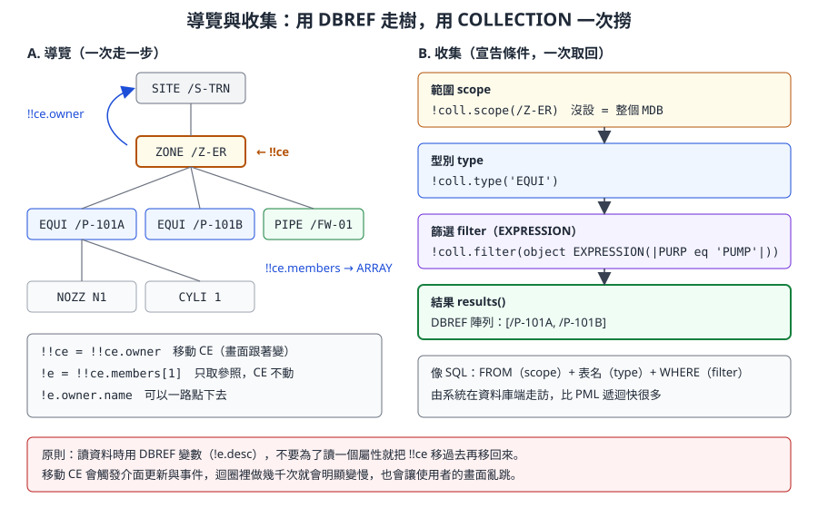
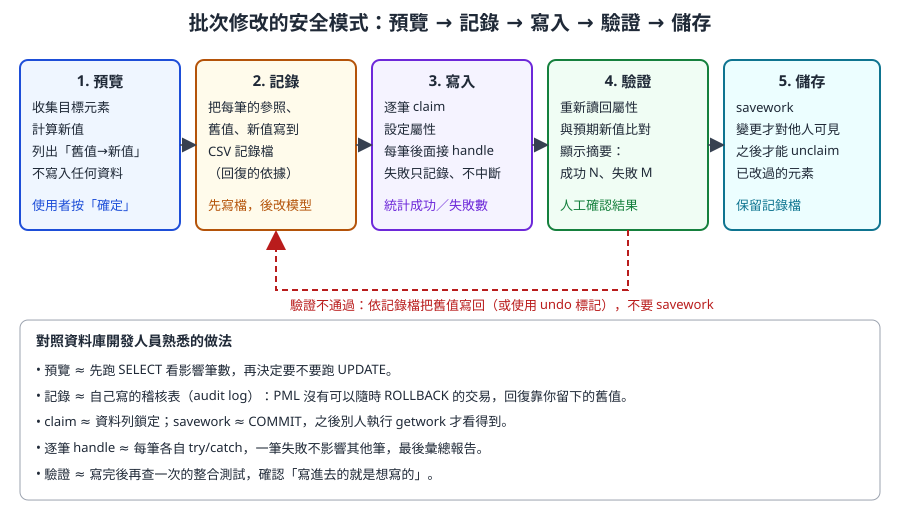

# 第 12 章　PML 資料庫操作

> 本章把第 3 章的資料階層與第 11 章的 PML 語言接起來：如何用程式在元素樹上移動、讀取屬性、查詢一批元素、建立、修改與刪除元素，以及如何在多人共用的專案中安全地寫入（認領、儲存、回復）。最後用一篇學術論文附的**實機 PML 程式截圖**練習「讀懂真實程式」。
>
> 語法依據 AVEVA E3D 2.1 PML Customisation User Guide 與 Software Customisation Reference Manual、E3D 2.1 Common Functionality（help.aveva.com 公開頁面）、Kim, Park & Yang（2020）論文的實機截圖，以及 AVEVA Marine 12.1 SP4 開源範例（MIT 授權）。AVEVA Marine 的舾裝資料庫承襲 PDMS，與 E3D 的資料存取方式高度相同，但個別命令與屬性可能有版本差異。標示「-- 示意」的程式為本課程自行撰寫、未在實機驗證；**所有會修改資料的程式只能在訓練專案中執行。**

## 12.1 學習目標

讀完本章，你應該能夠：

1. 用 `!!ce`、`OWNER`、`MEMBERS` 與元素名稱在資料樹上導覽，並說明「移動 CE」與「持有參照」的差別。
2. 用點號讀取屬性、偽屬性、參照屬性與 UDA，並說明命令 `Q` 與程式取值的差異。
3. 用 `COLLECTION` 與 `EXPRESSION` 物件查詢一批元素，也看得懂 PML1 的 `var ... collect` 與 `var ... evaluate`。
4. 建立元素並設定屬性；修改、移動、重新命名元素；刪除元素前做相依檢查。
5. 說明 claim、savework、getwork 的作用，以及 undo 標記。
6. 依「預覽 → 記錄 → 寫入 → 驗證 → 儲存」的安全模式寫批次修改工具。
7. 寫出效能合理的查詢程式。
8. 讀懂真實專案中混用 PML1 與 PML2 的資料庫程式。

## 12.2 心智模型：用開發人員的語言看 Dabacon

| AVEVA 概念 | 開發人員對照 | 本章用法 |
|---|---|---|
| 元素樹 | XML DOM、檔案系統目錄樹 | 導覽、走訪 |
| DBREF | 指向節點的指標；資料列的主鍵 | `!e = !!ce`、`!e.owner` |
| 名稱 `/P-101A` | 唯一的路徑別名（像檔案的完整路徑） | `!e = /P-101A` |
| 參照屬性（CREF、SPRE…） | 外鍵 | `!!ce.cref.pspec.rating` |
| CE（Current Element） | 游標；命令的預設操作對象 | `!!ce = !e` |
| COLLECTION | 查詢建構器（SELECT … FROM … WHERE） | `!coll.results()` |
| claim | 資料列鎖定 | `CLAIM` |
| savework | COMMIT | `SAVEWORK` |
| getwork | 重新整理，看到別人已提交的變更 | `GETWORK` |
| undo 標記 | 應用程式層級的復原堆疊 | `MARKDB`／`ENDMARKDB` |

PML 存取資料庫有兩種風格，同一個程式常會混用：

| 風格 | 寫法 | 特點 |
|---|---|---|
| **物件存取（PML2）** | `!d = !e.desc`、`!e.desc = 'x'` | 有型別、可在運算式中使用、不必移動 CE |
| **命令（PML1）** | `/P-101A`、`DESC 'x'`、`NEW EQUI /X`、`Q DESC` | 對 CE 操作；與手動在命令列輸入完全相同 |

> 〔公開版未收錄：AVEVA 官方產品截圖〕模型樹、3D 畫面中的泵與關聯面板：設計人員在介面上看到的樹，就是 PML 導覽的資料樹

*圖 12-1　舾裝設計模組的模型樹與 3D 畫面。左側樹狀結構就是 PML 中 `owner`／`members` 走訪的對象，選取的元素就是 CE。來源：AVEVA Hull and Outfitting Datasheet。*

## 12.3 導覽

### 12.3.1 !!ce：目前元素

官方文件說明：全域變數 `!!ce` 永遠指向目前元素，型別是 DBREF。可以把它複製到變數，也可以**指定新參照給 `!!ce` 來移動 CE**。

```pml
!item = !!ce                 -- 取得目前元素的參照（CE 不動）
!owner = !!ce.owner          -- 讀取擁有者
!!ce = !!ce.owner            -- 移動 CE 到擁有者（畫面跟著變）
```

### 12.3.2 取得元素參照的幾種方式

| 方式 | 寫法 | 說明 |
|---|---|---|
| 目前元素 | `!e = !!ce` | 最常用 |
| 名稱字面值 | `!e = /P-101A` | 名稱以 `/` 開頭，可以直接當 DBREF 使用 |
| 字串轉換 | `!e = !text.dbref()` | 名稱來自使用者輸入或檔案時 |
| 擁有者 | `!e = !e.owner` | 往上一層 |
| 成員 | `!kids = !e.members` | 回傳 DBREF 陣列；`!kids[1]` 是第一個成員 |
| 參照屬性 | `!spec = !e.spref` | 沿著外鍵走到另一個元素（屬性名稱依元素型別而定） |
| 命令導覽 | `/P-101A`、`OWNER` 等命令 | 移動 CE，等同在命令列輸入 |

官方範例中的「一路點下去」：

```pml
!Rating = !!CE.cref.pspec.rating     -- 沿著兩層參照讀取壓力等級
!Dir = !!CE.Pdirection[1]            -- 第 1 個 P 點的方向（DIRECTION）
!Pos = !!CE.Pposition[3]             -- 第 3 個 P 點的位置（POSITION）
```

### 12.3.3 檢查參照是否有效

```pml
if (!ref eq NULREF) then       -- 參照未設定
  ...
endif
if (unset(!ref)) then          -- 同上（NULREF 視為 UNSET）
  ...
endif
if (badref(!ref)) then         -- 未設定，或無法導覽（例如已刪除、不在 MDB 中）
  ...
endif
```



*圖 12-2　兩種取得元素的方式。導覽適合「沿著關係走幾步」；收集適合「找出所有符合條件的元素」。（本課程自繪）*

> **開發人員須知：** `!!ce = ...` 會真的移動使用者的游標，介面會更新、事件會觸發。讀資料時請用變數持有參照（`!e.desc`），不要「移過去讀完再移回來」。只有在必須使用 PML1 命令（命令預設作用在 CE）時才移動 CE，並在結束時把 CE 還原到使用者原本的位置。

## 12.4 讀取屬性

### 12.4.1 點號存取

```pml
!e = /P-101A
!name  = !e.name          -- '/P-101A'
!type  = !e.type          -- 元素型別，例如 'EQUI'
!desc  = !e.desc          -- 描述（可能未設定）
!pos   = !e.position      -- POSITION 物件
!flnn  = !e.flnn          -- 完整名稱（不含開頭斜線），開源範例用來顯示
```

官方建議**使用屬性的完整名稱**（參考 Data Model Reference Manual 附錄），以確保與未來版本相容。例如程式中寫 `position` 比縮寫 `pos` 更穩定；命令列手動輸入時用縮寫則沒有問題。

### 12.4.2 屬性的種類（複習第 3 章）

| 種類 | 例子 | 讀法 | 注意 |
|---|---|---|---|
| 系統屬性 | NAME、TYPE、OWNER、MEMBERS | `!e.owner` | 部分唯讀 |
| 一般屬性 | DESC、PURPOSE、FUNCTION | `!e.desc` | 可能未設定 |
| 幾何屬性 | POSITION、ORIENTATION、XLEN | `!e.position` | 回傳 POSITION 等物件 |
| 參照屬性 | CREF、SPREF、PSPEC | `!e.spref` | 回傳 DBREF，可能是 NULREF |
| 偽屬性 | FLNN、WVOL | `!e.flnn` | 系統即時計算，不能寫入 |
| UDA | 公司自訂，如 `:MYCOSTATUS` | `!e.:MYCOSTATUS` | 名稱以冒號開頭〔寫法待核對〕 |

### 12.4.3 Q 與程式取值的差別

| 面向 | 命令 `Q DESC` | 程式 `!d = !e.desc` |
|---|---|---|
| 對象 | 目前元素（CE） | 任何 DBREF |
| 結果 | 印到命令列的文字 | 有型別的值，存在變數中 |
| 能否後續運算 | 不能（只是輸出） | 能 |
| 用途 | 人工查詢、探索屬性名稱 | 工具程式 |
| 列出全部 | `Q ATT` 列出 CE 的所有屬性 | 先用 `Q ATT` 找到名稱，再寫進程式 |

探索新元素型別時的工作流程：在介面中選取一個元素，命令列輸入 `Q ATT` 看有哪些屬性與值，再挑需要的寫進程式。

### 12.4.4 範例：描述一個元素

```pml
-- 示意：mycodescribe.pmlfnc　印出元素的基本資訊（唯讀）
define function !!mycoDescribe(!e is DBREF)
  if (badref(!e)) then
    $P 無效的元素參照
    return
  endif
  !name = !e.flnn
  !type = !e.type.string()
  !own  = !e.owner.flnn
  $P 名稱：$!name
  $P 型別：$!type
  $P 擁有者：$!own
  !d = !e.desc
  handle ANY
    !d = '(無法讀取)'
  endhandle
  $P 描述：$!d
  !kids = !e.members
  !n = !kids.size()
  $P 成員數：$!n
endfunction
```

```pml
call !!mycoDescribe(!!ce)
```

## 12.5 查詢：COLLECTION、EXPRESSION 與 PML1 的 collect／evaluate

### 12.5.1 COLLECTION 物件

官方說明：COLLECTION 物件以「篩選運算式（EXPRESSION 物件）、型別限制、範圍清單」從系統中取出資料庫元素。常用方法：

| 類別 | 方法 | 說明 |
|---|---|---|
| 範圍 | `.scope(DBREF)` | 清除並設定範圍；**沒有設定範圍時，範圍是整個 MDB** |
| | `.addscope(DBREF)`、`.scope(DBREF 陣列)`、`.clearscope()` | 增加、取代、清除範圍 |
| 型別 | `.type(STRING)` | 清除並設定一個型別 |
| | `.addtype(STRING)`、`.types(陣列)`、`.cleartypes()` | 增加、取代、清除型別 |
| 篩選 | `.filter(EXPRESSION)`、`.clearfilter()` | 設定、清除篩選條件 |
| 結果 | `.results()` | 全部結果（DBREF 陣列） |
| | `.size()` | 結果數量 |
| | `.next(n)`、`.index()`、`.initialise()` | 分批取回、目前位置、重新評估並把位置設回 1 |

### 12.5.2 EXPRESSION 物件

EXPRESSION 是一段 PML1 運算式，讓 COLLECTION 在資料庫端篩選：

| 方法 | 說明 |
|---|---|
| `object EXPRESSION(STRING)` | 以字串建立運算式，例如 `'PURP eq |PUMP|'` 一類 |
| `.attributeexpression(STRING)` | 把屬性名稱變成運算式；官方說明 `AttributeExpression('LENGTH')` 等同 `Expression('ATTRIBUTE LENGTH')` |
| `.evaluate(DBREF)` | 對某個元素求值，回傳結果 |
| `.string()` | 取回運算式字串 |

官方也說明，讀屬性的運算式寫成 `ATTRIBUTE 名稱` 形式，速度與效率較好。

### 12.5.3 範例：找出某範圍內特定用途的設備

```pml
-- 示意：mycofindequi.pmlfnc　依 PURPOSE 找設備（唯讀）
define function !!mycoFindEqui(!scope is DBREF, !purp is STRING) is ARRAY
  !coll = object COLLECTION()
  !coll.scope(!scope)
  !coll.type('EQUI')
  if (not !purp.empty()) then
    !expr = object EXPRESSION('PURP eq |' & !purp & '|')
    !coll.filter(!expr)
  endif
  return !coll.results()
endfunction
```

```pml
!pumps = !!mycoFindEqui(/Z-ER, 'PUMP')
q var !pumps.size()
do !p values !pumps
  !n = !p.flnn
  $P $!n
enddo
```

| 程式片段 | 說明 |
|---|---|
| `!coll.scope(!scope)` | 一定要設範圍，否則會搜尋整個 MDB |
| `'PURP eq |' & !purp & '|'` | 外層用單引號，運算式內的字串用 `|...|`，避免引號衝突 |
| `not !purp.empty()` | 空字串時不加篩選 |
| 回傳 `ARRAY` | 回傳的是 DBREF 陣列，呼叫端再決定要讀哪些屬性 |

> **專業提醒：** 篩選運算式的語法屬於 PML1 運算式，屬性名稱、比較運算子與字串分隔方式請以公司版本的參考手冊確認〔待核對〕。先在命令列用 `!x = object EXPRESSION(...)` 與 `!x.evaluate(!!ce)` 測試運算式，再放進程式。

### 12.5.4 PML1 寫法：var collect 與 var evaluate

既有程式中常見 PML1 的查詢寫法：

```pml
var !list collect all EQUI for /Z-ER
```

這行把 `/Z-ER` 底下所有 EQUI 收集到陣列 `!list`（元素通常是參照的文字表示，使用前可用 `.dbref()` 轉換〔待核對〕）。

官方說明的 `evaluate` 形式，可以對每個選取的元素計算運算式，結果存入陣列：

```pml
VAR !Array EVALUATE (Expression) FOR select COUNTVAR !Counter
VAR !BOXES APPEND EVALUATE ( XLEN*YLEN ) FOR ALL BOXES
```

| 部分 | 說明 |
|---|---|
| `!Array` | 存放結果的陣列 |
| `(Expression)` | 對每個元素計算的運算式 |
| `select` | 選取條件，例如 `ALL BOXES`（語法見產品參考手冊） |
| `COUNTVAR !Counter` | 選用，記錄計算次數 |
| `APPEND` | 附加到既有陣列而不是覆蓋 |

| 需求 | 建議寫法 |
|---|---|
| 新程式、需要 DBREF 再做其他處理 | COLLECTION |
| 只需要每個元素的一個計算值（例如面積） | `var ... evaluate`，一次取回，最省事 |
| 維護舊程式 | 看得懂 `var ... collect` 即可，不必急著改寫 |

## 12.6 建立元素

### 12.6.1 NEW 命令

建立元素使用 PML1 命令 `NEW`，它作用在 CE 上：

```pml
-- 示意：在訓練 ZONE 下建立設備與一個方塊
/Z-TRAINING                          -- 1. 先把 CE 移到合法的擁有者
NEW EQUI /T-EQUI-001                 -- 2. 建立設備並命名；完成後 CE 就是新設備
DESC 'Created by myco training'      -- 3. 設定 CE 的屬性（命令風格）
NEW BOX XLEN 500 YLEN 400 ZLEN 300   -- 4. 在設備底下建立一個方塊
```

建立的規則（複習第 3 章「合法成員」）：

- 新元素的型別必須是擁有者型別的合法成員，例如 EQUI 要放在 ZONE 底下，BOX 要放在 EQUI 底下。
- 名稱在整個 MDB 中必須唯一；名稱重複時命令會失敗。
- 建立完成後，CE 會移到新元素〔CE 不是合法擁有者時系統如何決定插入位置，依版本行為待核對〕。
- 寫入前必須有該資料庫的寫入權限，explicit claim 模式下還要先 claim 擁有者（12.9 節）。

### 12.6.2 在函式中建立：$! 展開與錯誤處理

```pml
-- 示意：mycocreatetestequi.pmlfnc　建立測試設備（只能在訓練專案使用）
define function !!mycoCreateTestEqui(!zone is DBREF, !name is STRING) is DBREF
  if (!name.substring(1, 1) ne '/') then
    return error 1 '名稱必須以 / 開頭'
  endif
  !back = !!ce                       -- 記住使用者原本的 CE
  !!ce = !zone
  NEW EQUI $!name
  handle ANY
    !!ce = !back
    return error                     -- 把原始錯誤交給呼叫者
  endhandle
  !equi = !!ce
  !equi.desc = 'Created by myco training'
  !posText = 'E 1000 N 2000 U 0'
  !equi.position = !posText.position()
  !!ce = !back                       -- 還原 CE
  return !equi
endfunction
```

| 程式片段 | 說明 |
|---|---|
| 檢查名稱開頭 | `$!name` 是文字替換，輸入格式錯誤會讓命令變成意料之外的樣子 |
| `!back = !!ce` | 工具結束時把 CE 還原，不打亂使用者的工作 |
| `NEW EQUI $!name` 後接 `handle` | 名稱重複、權限不足都會在這行失敗 |
| `return error` | 不吞掉錯誤，交給呼叫者決定如何提示 |
| `!equi.desc = ...` | 建立後改用物件存取設定屬性 |
| `.position()` | 把位置字串轉成 POSITION 物件（STRING 物件的方法） |

## 12.7 修改元素

### 12.7.1 設定屬性

官方說明：只要新值的型別與屬性型別相符，就可以直接指定，**而且不必是目前元素**：

```pml
!!CE.Built = TRUE                 -- 設定目前元素

!A = !!CE
!!CE = !!CE.Owner
!A.Built = TRUE                   -- 設定非目前元素
```

屬性本身是物件（例如 POSITION）時，**不能只改其中一個成員**，要先取出、修改、再整個指定回去：

```pml
!Pos = !!CE.Position
!Pos.Up = 2000
!!CE.Position = !Pos
```

對照：這和 C# 中修改 `struct` 屬性的規則一樣：`obj.Pos.Y = 5` 不會生效，必須 `var p = obj.Pos; p.Y = 5; obj.Pos = p;`。

### 12.7.2 常見修改動作

| 動作 | 物件風格 | 命令風格（作用在 CE） | 備註 |
|---|---|---|---|
| 改描述 | `!e.desc = 'xxx'` | `DESC 'xxx'` | |
| 改位置 | `!e.position = !pos` | `POS E 1000 N 2000 U 0` | 位置語法見第 4 章 |
| 相對移動 | 取出 POSITION 後加減再指定 | `BY E 100`〔待核對〕 | |
| 改方向 | `!e.orientation = !ori` | `ORI Y is N and Z is U` | |
| 重新命名 | 〔以屬性指定名稱的寫法待核對〕 | `NAME /NEW-NAME` | 名稱必須唯一 |
| 取消名稱 | | `UNNAME` | |
| 改參照 | `!e.spref = !spco` | `SPREF /...` | 參照錯誤會產生錯誤材料表（第 8 章） |

> **專業提醒：** 設定參照屬性（特別是等級、目錄相關的 SPREF、PSPEC）等於改外鍵。工具不應該自己「找一個看起來像的」元件填進去；正確做法是依等級選擇規則取得，或由使用者明確選定（第 8 章）。

## 12.8 刪除元素與相依檢查

```pml
-- 示意：刪除目前元素（必須是 EQUI）
/T-EQUI-001
DELETE EQUI
```

`DELETE 型別` 刪除的是 CE，而且型別必須與 CE 相符，這是一道防呆。刪除會連同所有成員一起刪掉（整棵子樹）。

刪除前要問：**有沒有別的元素參照它？** 資料庫中的參照就像外鍵，刪掉被參照的一方，另一方就會留下懸空參照。例如設備的管嘴（NOZZ）可能被管線分支的頭尾參照。一個簡單的檢查方式是看管嘴的連接參照：

```pml
-- 示意：mycocandelete.pmlfnc　刪除設備前檢查管嘴是否已連接
define function !!mycoCanDelete(!equi is DBREF) is BOOLEAN
  !coll = object COLLECTION()
  !coll.scope(!equi)
  !coll.type('NOZZ')
  !nozzles = !coll.results()
  do !nz values !nozzles
    !conn = !nz.cref
    handle ANY
      !conn = NULREF
    endhandle
    if (not badref(!conn)) then
      !nzName = !nz.flnn
      !cnName = !conn.flnn
      $P 管嘴 $!nzName 已連接到 $!cnName，不可刪除
      return FALSE
    endif
  enddo
  return TRUE
endfunction
```

這個檢查只涵蓋「管嘴連接」一種關係。實際專案中，圖面、材料表、支架、Global 衍生資料庫都可能參照同一個元素。**自動刪除工具的風險很高**，建議只做「標記待刪」（例如寫入 UDA 或產生清單），由人工確認後刪除。

## 12.9 認領、儲存與復原

### 12.9.1 claim：寫入前的鎖定

多人同時編輯的資料庫（multiwrite）使用認領機制，避免兩個人同時修改同一個元素。官方說明：

| 項目 | 說明 |
|---|---|
| 認領模式 | 建立資料庫時決定。**Explicit**：修改前必須先 `CLAIM`；**Implicit**：修改時自動認領，也可以先手動認領 |
| 可認領的對象 | 只有「主要元素」（significant／primary element）。認領非主要元素時，系統會認領它上方最近的主要元素 |
| 認領範圍 | 只認領指定元素，或連同其下所有主要元素（`CLAIM /ZoneA HIERARCHY`） |
| 釋放 | `UNCLAIM 名稱`、`UNCLAIM ALL`；切換模組或離開時自動釋放全部 |
| 限制 | **修改過的元素在 savework 之前不能 unclaim** |
| Extract 資料庫 | 還要考慮 extract claim（第 2 章） |

```pml
-- 示意：認領後修改
CLAIM /T-EQUI-001
handle ANY
  $P 無法認領（可能被他人占用或沒有寫入權限）
  return
endhandle
!e = /T-EQUI-001
!e.desc = 'Updated by myco'
```

### 12.9.2 savework 與 getwork

| 命令 | 作用 | 資料庫對照 |
|---|---|---|
| `SAVEWORK` | 把這段時間的變更寫入資料庫，對其他使用者可見 | COMMIT |
| `GETWORK` | 取得其他使用者已 savework 的變更 | 重新查詢最新資料 |
| 不 savework 就離開 | 變更不會保存〔離開模組時的提示與行為依版本而定，待核對〕 | ROLLBACK |

> **開發人員須知：** **工具不應該自動執行 SAVEWORK。** savework 是使用者「確認這批變更」的動作，就像資料庫工具不會替你自動 COMMIT。工具做完修改後，顯示摘要，請使用者檢查無誤後自己按 Save Work。這也讓「驗證不通過就回復」成為可能。

### 12.9.3 undo 標記

E3D 2.1 官方文件說明，PML 可以把自己的一批資料庫修改包成一個可復原的單位：

```pml
MARKDB 'myco: batch update DESC'
-- ……一連串資料庫修改……
ENDMARKDB
```

之後使用者按一次 Undo，就能撤銷整批修改。官方另外提供可復原物件（undoable object）與 PostEvents 通知機制。AVEVA Marine 12.1 是否提供相同命令，請在訓練專案測試〔待核對〕；不支援時，回復要依靠 12.10 節的記錄檔。

## 12.10 批次修改的安全模式

批次修改是最危險、也最常被要求的工具。下面這個模式適用於任何「一次改很多元素」的需求。



*圖 12-3　批次修改的五個階段。PML 沒有可以隨時 ROLLBACK 的交易，回復要靠你事先留下的舊值。（本課程自繪）*

### 12.10.1 完整範例：批次取代設備描述中的文字

需求：把某個 ZONE 底下所有設備 DESC 中的 `FW` 換成 `FRESH WATER`。

```pml
-- 示意：mycobatchdesc.pmlfnc　批次取代 DESC 文字（只能在訓練專案使用）
-- !doWrite 為 FALSE 時只預覽，不寫入任何資料
define function !!mycoBatchDesc(!scope is DBREF, !find is STRING, !repl is STRING, !logPath is STRING, !doWrite is BOOLEAN) is REAL

  -- ===== 1. 預覽：收集並計算新值 =====
  !coll = object COLLECTION()
  !coll.scope(!scope)
  !coll.type('EQUI')
  !all = !coll.results()
  !refs = ARRAY()
  !olds = ARRAY()
  !news = ARRAY()
  do !e values !all
    !old = !e.desc
    handle ANY
      !old = ''
    endhandle
    if (!old.match(!find) gt 0) then
      !refs.append(!e)
      !olds.append(!old)
      !news.append(!old.replace(!find, !repl))
    endif
  enddo
  !n = !refs.size()
  $P 預計修改 $!n 筆
  do !k indices !refs
    !nm = !refs[!k].flnn
    !o = !olds[!k]
    !w = !news[!k]
    $P   $!nm : [$!o] -> [$!w]
  enddo
  if (not !doWrite or !n eq 0) then
    return !n
  endif

  -- ===== 2. 記錄：先寫檔，後改模型 =====
  !log = object FILE(!logPath)
  !log.open('WRITE')
  handle ANY
    $P 無法建立記錄檔，停止：$!logPath
    return error
  endhandle
  do !k indices !refs
    !log.writerecord(!refs[!k].string() & '|' & !olds[!k] & '|' & !news[!k])
  enddo
  !log.close()

  -- ===== 3. 寫入：逐筆認領與修改，失敗只記錄不中斷 =====
  MARKDB 'myco: batch DESC replace'
  !failed = ARRAY()
  do !k indices !refs
    !e = !refs[!k]
    !nm = !e.name
    !ok = TRUE
    CLAIM $!nm
    handle ANY
      !ok = FALSE
    endhandle
    if (!ok) then
      !e.desc = !news[!k]
      handle ANY
        !ok = FALSE
      endhandle
    endif
    if (not !ok) then
      !failed.append(!e.flnn)
    endif
  enddo
  ENDMARKDB

  -- ===== 4. 驗證：讀回比對 =====
  !bad = 0
  do !k indices !refs
    if (!refs[!k].desc ne !news[!k]) then
      !bad = !bad + 1
    endif
  enddo
  !nf = !failed.size()
  $P 完成：預計 $!n 筆，寫入失敗 $!nf 筆，驗證不符 $!bad 筆
  $P 記錄檔：$!logPath
  $P 請檢查結果後自行 Save Work；若需回復，依記錄檔把舊值寫回
  return !n - !bad
endfunction
```

使用方式：

```pml
-- 第一次：只預覽
!cnt = !!mycoBatchDesc(/Z-TRAINING, 'FW', 'FRESH WATER', 'D:\temp\myco_desc.log', FALSE)
-- 確認清單無誤後才寫入
!cnt = !!mycoBatchDesc(/Z-TRAINING, 'FW', 'FRESH WATER', 'D:\temp\myco_desc.log', TRUE)
```

### 12.10.2 逐段解說

| 階段 | 程式重點 | 為什麼 |
|---|---|---|
| 預覽 | 計算新值放進三個平行陣列，`$P` 列出「舊值 → 新值」 | 使用者先看到影響範圍；`!doWrite` 預設 FALSE |
| 預覽 | 讀 DESC 後接 `handle ANY` | 未設定的 DESC 不讓整個工具中斷 |
| 記錄 | `object FILE(...)`、`.open('WRITE')`、`.writerecord()`、`.close()` | **先寫記錄再改模型**；記錄檔建立失敗就停止。FILE 物件的細節見第 16 章〔方法名稱依版本核對〕 |
| 記錄 | 以 `|` 分隔參照、舊值、新值 | DESC 可能含逗號；分隔字元要選資料中不會出現的 |
| 寫入 | `MARKDB` … `ENDMARKDB` | 讓使用者可以一次 Undo 整批〔Marine 12.1 是否支援待核對；若不支援，這行會出錯並在寫入前停止，屆時移除這兩行即可〕 |
| 寫入 | 每筆 `CLAIM` 與指定屬性後各接 `handle` | 一筆失敗不影響其他筆，像每筆各自 try/catch |
| 驗證 | 重新讀取 DESC 與預期值比較 | 確認「寫進去的就是想寫的」 |
| 儲存 | 不自動 `SAVEWORK` | 由使用者檢查後確認 |

### 12.10.3 回復

回復程式讀取記錄檔，把舊值寫回去：

```pml
-- 示意：mycorestoredesc.pmlfnc　依記錄檔還原 DESC（只能在訓練專案使用）
define function !!mycoRestoreDesc(!logPath is STRING) is REAL
  !log = object FILE(!logPath)
  !lines = !log.readfile()          -- 讀入所有行〔方法名稱待核對〕
  !done = 0
  do !line values !lines
    !f = !line.split('|')
    !e = !f[1].dbref()
    !nm = !e.name
    CLAIM $!nm
    handle ANY
    endhandle
    !e.desc = !f[2]
    handle ANY
      $P 還原失敗：$!line
    elsehandle NONE
      !done = !done + 1
    endhandle
  enddo
  return !done
endfunction
```

這裡 `!refs[!k].string()` 寫出的參照文字能否以 `.dbref()` 原樣轉回，請在公司版本測試〔待核對〕；若不行，改記錄元素名稱（`.flnn` 前加 `/`）。

### 12.10.4 安全清單

- [ ] 預設只預覽；要寫入必須明確傳入參數或按下確認按鈕。
- [ ] 範圍一定要明確（`scope`），不允許空範圍（等於整個 MDB）。
- [ ] 寫入前先產生記錄檔，記錄檔失敗就停止。
- [ ] 每筆寫入各自處理錯誤，最後彙總成功與失敗數。
- [ ] 寫入後重新讀回驗證。
- [ ] 不自動 savework；告訴使用者記錄檔位置與回復方式。
- [ ] 還原 CE 到使用者原本的位置。

## 12.11 效能

| 做法 | 慢 | 快 | 原因 |
|---|---|---|---|
| 讀屬性 | 每筆都 `!!ce = !e` 再讀 | `!e.desc` 直接讀 | 移動 CE 會觸發介面更新與事件 |
| 找元素 | 自己寫遞迴走訪 `members` | COLLECTION 設定 scope／type／filter | 由系統在資料庫端走訪 |
| 篩選 | 收集全部再在 PML 迴圈中判斷 | `filter(EXPRESSION)` | 減少回到 PML 的元素數 |
| 只要一個計算值 | 收集 DBREF 再逐一讀取 | `var !x evaluate (...) for ...` | 一個命令取回所有值 |
| 範圍 | 不設 scope（整個 MDB） | 設到最小的 SITE／ZONE | 範圍越小越快 |
| 大量結果 | 一次 `results()` 幾萬筆 | `.next(n)` 分批處理 | 降低記憶體與介面停頓 |
| 字串累加 | 迴圈中反覆 `!s = !s & ...` 組成大字串 | 先 `append` 到陣列，最後一次輸出 | 減少大量字串複製 |
| 輸出 | 每筆 `$P` 或更新表單 | 處理完再一次更新 | 介面更新很昂貴 |

> **開發人員須知：** 先量測再優化。在迴圈前後各印一次時間或筆數，找出真正慢的地方。大多數 PML 工具的瓶頸不在運算，而在「移動 CE」「重複查詢」與「介面更新」。

## 12.12 讀懂真實程式：論文中的 PML 截圖

Kim, Park & Yang（2020）在 AVEVA Marine 上開發了外板開孔自動產生系統，論文附有三段實際執行的 PML 程式截圖（CC BY-NC 3.0）。這些程式混用 PML1 與 PML2，正是你在公司舊程式中會遇到的樣子。完整案例背景見第 18 章。

### 12.12.1 截圖一：找出開孔中心落在哪一塊外板


*圖 12-4　找出開孔所在外板的 PML 程式。（Kim et al., 2020, Figure 6，CC BY-NC 3.0）*

逐行解讀：

| 程式 | 意義 | 本章對應 |
|---|---|---|
| `Input : !basePos, !boxList`、`Output : !csurfList(surface)` | 作者的說明文字，不是 PML 語法 | |
| `Do !csurf Values !csurfList` | 走訪外板清單（`do values`） | 11.8.2 |
| `!boxList = WVOL of $!csurf` | PML1 運算式「屬性 of 元素」：取得外板的世界座標包圍盒（偽屬性 WVOL）；`$!csurf` 把變數展開成元素名稱 | 12.4.2、11.14.3 |
| `!x = !basePos.East` 等三行 | 從 POSITION 物件取出東、北、上分量 | 第 4 章 |
| `If !x Geq !boxList[1] and ...` | 判斷中心點是否大於等於包圍盒的最小值；`!boxList[1]`～`[3]` 是最小 E／N／U，`[4]`～`[6]` 是最大值 | 陣列從 1 開始 |
| `!surface = Namn of $!csurf` | 取得外板名稱（NAMN 屬性的確切定義〔待核對〕） | 12.4.2 |
| `Break` | 找到就跳出迴圈 | 11.8.3 |
| `If !surface Eq 'nonechk' then ... namn of $!csurfList[1]` | 都沒找到時（`!surface` 仍是預設值），用第一塊外板當預設 | 預設值模式 |

值得注意的地方：

- 截圖中 `If` 後面沒有括號、`Handle` 沒有錯誤碼，也看不到對應的 `EndHandle`。官方語法要求 `if (條件) then`，`handle` 需要錯誤碼或 `ANY`。這可能是論文排版時刪節，或該版本較寬鬆的寫法。**照抄前請改成標準語法。**
- 包圍盒判斷很快但不精確：曲面外板的包圍盒會互相重疊，所以作者保留第一塊外板作為預設值。這是「先粗篩、再精算」的典型做法。

### 12.12.2 截圖二：建立虛擬平面並求交線


*圖 12-5　求外板與虛擬平面交點的 PML 程式。（Kim et al., 2020, Figure 8，CC BY-NC 3.0）*

| 程式 | 意義 |
|---|---|
| `!bPlane = !!Dex.CreateRestrictedPlane(!pos, !normalVec, !minPos, !maxPos)` | 呼叫全域物件 `!!Dex` 的方法，以位置、法向量與範圍建立有限平面 |
| `!contList = !!Dex.SolveIntersectionSpaceCurvePML(!surfaceName, !bPlane)` | 求外板曲面與平面的交線，回傳交線清單 |
| `!tempList = Array()` | 建立空陣列 |
| `!realCont = !cont.ContourPML()` | 把交線轉成點列 |
| `!p = object Position()` | 建立空的 POSITION 物件 |
| `!p.east = !tCont[0].X()` 等三行 | 逐一設定座標分量。注意這裡的索引是 `[0]`，回傳的點列可能是 .NET 物件而非 PML 陣列〔待核對〕 |
| `!p.origin = /*` | 設定座標參考為世界（`/*` 代表 WORLD） |
| `!tempList.Append(!p)` | 收集交點 |

`!!Dex` 及其方法名稱來自論文所用版本提供的函式庫，公司版本是否相同，請以 PML 參考手冊確認〔待核對〕。這段程式也示範了一個重要觀念：**PML 可以呼叫由 .NET 或系統提供的全域物件**，這正是第 14 章 PML.NET 的用途。

### 12.12.3 截圖三：用兩個交點算出方向


*圖 12-6　計算開孔方向的 PML 程式，含 AID 除錯圖形。（Kim et al., 2020, Figure 11，CC BY-NC 3.0）*

| 程式 | 意義 |
|---|---|
| `!tempList.SortUnique()` | 排序並去除重複（官方 ARRAY 方法） |
| `Do !i From 1 To !tempList.Size()` | 計數迴圈，從 1 開始 |
| `aid sphere $!templist[$!i] dia 200` | 在 3D 視圖每個交點畫直徑 200 的輔助球，**只畫在畫面上，不寫入資料庫** |
| `!line = !pos1.Line(!pos2)` | 以相鄰兩點建立直線物件 |
| `!chk = !line.OnProjected(!basepos)` | 判斷中心點投影是否落在這段線上 |
| `!chkPos = !line.Near(!basePos)` | 線上最接近中心點的位置 |
| `AID LINE $!pos1 to $!pos2`、`AID SPHERE $!chkPos dia 200` | 畫出找到的線段與點，供人工確認 |
| `Break` | 找到就停止 |

> **專業提醒：** `AID` 輔助圖形是開發幾何演算法最實用的除錯方式：結果畫在畫面上，一眼就能看出算錯了沒有，又不會污染資料庫。`Line()`、`OnProjected()`、`Near()` 等幾何方法的確切名稱與所屬物件，請以公司版本的參考手冊確認〔待核對〕。

### 12.12.4 從讀懂到改寫

讀完這三段程式，你應該能指出：

| 觀察 | 改進方向 |
|---|---|
| 混用 PML1（`WVOL of $!csurf`）與 PML2（`!basePos.East`） | 新程式可改用 `!csurf.dbref().wvol` 一類的物件存取〔寫法待核對〕，少用 `$!` 文字替換 |
| `'nonechk'` 這種魔術字串當作「沒找到」 | 用 BOOLEAN 旗標或 UNSET 表示 |
| 錯誤處理不完整 | 每個可能失敗的屬性讀取後面接 `handle` |
| AID 圖形留在正式程式中 | 改成由除錯旗標控制，正式執行時不畫 |

## 12.13 開發人員須知

- **讀用參照，寫才動 CE。** 讀資料一律用 DBREF 變數；必須用命令時才移動 CE，結束時還原。
- **一定要設範圍。** COLLECTION 沒有 scope 時會搜尋整個 MDB，在大型專案中可能跑很久。
- **屬性可能未設定。** 讀取時加 `handle` 或先檢查，否則一個空值就讓整批處理中斷。
- **用完整屬性名稱。** 程式中寫完整名稱，與未來版本較相容；縮寫留給命令列。
- **寫入前想好回復。** 沒有記錄檔的批次修改工具，不應該上線。
- **不自動 savework。** 把確認權留給使用者。
- **刪除比修改更危險。** 優先做「標記」而不是「刪除」，並檢查參照關係。
- **舊程式先讀懂再改。** 混用 PML1／PML2 的程式很常見，先畫出資料流與每個變數的型別，再決定是否重構。

## 12.14 練習

> 練習 1、2、5 是唯讀練習；練習 3、4 會修改資料，**只能在訓練專案中進行**。

### 練習 1：導覽與屬性探索

1. 在訓練專案選取一個 EQUI，命令列執行 `Q ATT`，挑出 5 個你看得懂的屬性。
2. 用 PML 讀出這 5 個屬性，並用 `q var` 檢查每一個的型別。
3. 從這個 EQUI 一路 `.owner` 往上，印出每一層的名稱與型別，直到 WORLD。

### 練習 2：查詢函式

1. 完成 12.5.3 節的 `!!mycoFindEqui`，在訓練專案的 ZONE 上測試。
2. 擴充成可以指定型別的版本：`!!mycoFind(!scope is DBREF, !type is STRING, !exprText is STRING) is ARRAY`。
3. 用 `var !x evaluate (...)` 寫一個等效的查詢，比較兩者的程式長度與執行時間。

### 練習 3：建立與刪除（訓練專案）

1. 用 `!!mycoCreateTestEqui` 在訓練 ZONE 建立三個設備 `/T-EQUI-001` 到 `/T-EQUI-003`。
2. 故意用重複的名稱再建立一次，觀察錯誤碼，並把 `handle ANY` 改成該錯誤碼。
3. 用 `!!mycoCanDelete` 檢查後刪除這三個設備，最後執行 Save Work 前先請同事檢查。

### 練習 4：批次修改（訓練專案）

1. 以預覽模式執行 `!!mycoBatchDesc`，檢查列出的清單。
2. 寫入模式執行後，**不要** savework，先用 Undo 測試 `MARKDB` 是否有效。
3. 再執行一次寫入，用 `!!mycoRestoreDesc` 依記錄檔還原，確認 DESC 回到原值。
4. 寫下這個工具若要給設計人員使用，還缺哪些保護。

### 練習 5：讀懂真實程式

1. 把圖 12-4 的程式改寫成符合官方語法的 PML2 函式 `!!mycoFindPlate(!basePos is POSITION, !plates is ARRAY) is STRING`，`if` 加括號、`handle` 加 `ANY` 與 `endhandle`，找不到時回傳空字串。
2. 指出圖 12-6 中哪些行只用於除錯，並設計一個 `!!mycoDebug` 旗標控制是否畫出 AID 圖形。

## 12.15 自我檢核

- [ ] 我能用 `!!ce`、`.owner`、`.members` 與名稱導覽，並說明移動 CE 與持有參照的差別。
- [ ] 我會用 `NULREF`、`unset()`、`badref()` 檢查參照。
- [ ] 我能讀取一般屬性、參照屬性、偽屬性與 UDA，並說明 `Q` 與程式取值的差異。
- [ ] 我會用 COLLECTION 的 scope、type、filter、results，並用 EXPRESSION 篩選。
- [ ] 我看得懂 `var ... collect` 與 `var ... evaluate`。
- [ ] 我會用 `NEW` 建立元素、用屬性指定修改元素，知道物件型屬性要「取出、修改、指定回去」。
- [ ] 我知道 `DELETE` 的行為，並會在刪除前檢查參照關係。
- [ ] 我能說明 claim 的兩種模式、`CLAIM ... HIERARCHY`、`UNCLAIM`，以及「修改過的元素在 savework 前不能 unclaim」。
- [ ] 我知道 savework、getwork 的意義，以及為什麼工具不自動 savework。
- [ ] 我能寫出「預覽 → 記錄 → 寫入 → 驗證 → 儲存」的批次修改工具，並能依記錄檔回復。
- [ ] 我知道讓 PML 查詢變快的主要做法。
- [ ] 我能逐行解讀論文中的三段 PML 程式，並指出可改進之處。

## 12.16 資料來源

- AVEVA E3D 2.1 PML Customisation User Guide：Accessing DB Elements As Objects（`!!CE`、參照、P 點、NULREF、BADREF）：<https://help.aveva.com/AVEVA_Everything3D/2.1/PMLPUG/PMLCG9.09.05.html>
- 同上：Assigning Values to Element Attributes：<https://help.aveva.com/AVEVA_Everything3D/2.1/PMLPUG/PMLCG9.09.06.html>
- 同上：Accessing Information About a Session：<https://help.aveva.com/AVEVA_Everything3D/2.1/PMLPUG/PMLCG9.09.07.html>
- 同上：Evaluating Selected DB Elements（`VAR ... EVALUATE`）：<https://help.aveva.com/AVEVA_Everything3D/2.1/PMLPUG/PMLCG9.09.08.html>
- 同上：Undo and Redo（`MARKDB`、`ENDMARKDB`）：<https://help.aveva.com/AVEVA_Everything3D/2.1/PMLPUG/PMLCG9.09.10.html>
- 同上：Using PML in AVEVA Products（PML1 運算式與 VAR）：<https://help.aveva.com/AVEVA_Everything3D/2.1/PMLPUG/PMLCG9.09.01.html>
- AVEVA E3D 2.1 Software Customisation Reference Manual：COLLECTION Object：<https://help.aveva.com/AVEVA_Everything3D/2.1/SCRM/SCRM3.3.24.html>
- 同上：EXPRESSION Object：<https://help.aveva.com/AVEVA_Everything3D/2.1/SCRM/SCRM3.3.36.html>
- 同上：STRING Object（`.position()`、`.dbref()`、`.replace()`）：<https://help.aveva.com/AVEVA_Everything3D/2.1/SCRM/SCRM3.3.76.html>
- AVEVA E3D 2.1 Common Functionality：Claimlists（認領模式、範圍、savework 前不能 unclaim）：<https://help.aveva.com/AVEVA_Everything3D/2.1/DCFUG/DCFUG03.04.5.html>
- AVEVA E3D Design 文件：CLAIM／UNCLAIM（`CLAIM /ZoneA HIERARCHY`、`UNCLAIM ALL`，需 JavaScript）：<https://docs.aveva.com/bundle/e3d-design/page/911923.html>
- Kim, C.-S., Park, D.-W., & Yang, Y.-J. (2020). Development of an automatic shell plate hole generation system using AVEVA Marine. *Journal of Advanced Marine Engineering and Technology*, 44(3), 196–202. CC BY-NC 3.0. <https://doi.org/10.5916/jamet.2020.44.3.196>
- 開源範例 aveva-marine-dev-skill（MIT 授權，COLLECTION 用法、`.flnn`）：<https://github.com/912141548/aveva-marine-dev-skill>
- AVEVA Hull and Outfitting Datasheet（圖 12-1 來源）：<https://www.aveva.com/content/dam/aveva/documents/perspectives/datasheets/Datasheet_HullandOutfitting.pdf.coredownload.inline.pdf>
- 相關章節：[第 2 章　專案、資料庫、MDB 與權限](ch02_project_database_zh-TW.reading.html)、[第 3 章　資料階層、元素、屬性與導覽](ch03_hierarchy_attributes_zh-TW.reading.html)、[第 4 章　座標、方向與幾何](ch04_coordinates_geometry_zh-TW.reading.html)、[第 11 章　PML 語言核心](ch11_pml_language_zh-TW.reading.html)、[第 16 章　報表、檔案與外部系統整合](ch16_reports_integration_zh-TW.reading.html)、[第 18 章　實戰案例與完整範例](ch18_case_studies_zh-TW.reading.html)
