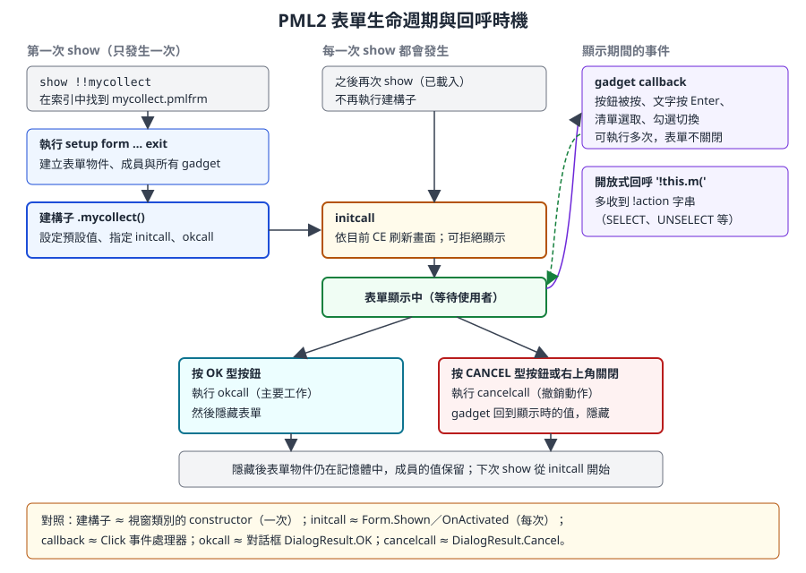
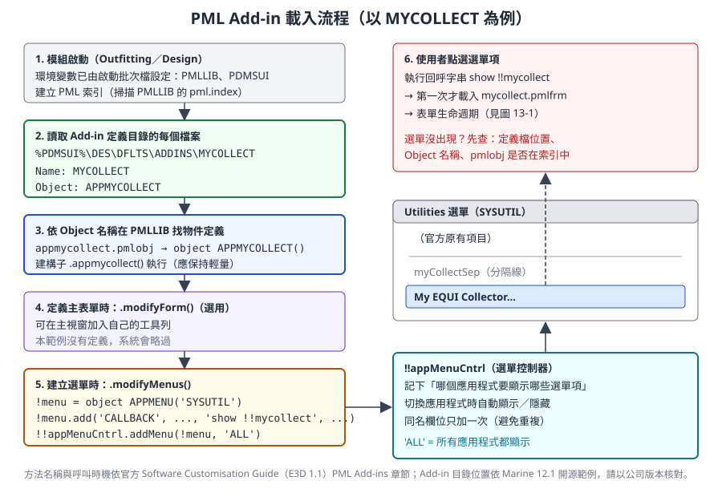

# 第 13 章　PML2 表單、選單與 Add-in

> 本章教你把第 12 章的查詢與修改程式，做成設計人員可以使用的介面：PML2 表單的定義與版面、各種控制項（gadget）、回呼與表單生命週期、在表單中嵌入 .NET 表格，以及透過 Add-in 把工具掛進系統選單。我們會先從零做一個簡單的搜尋表單，再逐行解說開源範例 MyCollect 的表單與 Add-in 物件。
>
> 語法依據 AVEVA E3D 2.1 PML Customisation User Guide、Software Customisation Reference Manual、E3D 1.1／2.1 Software Customisation Guide（help.aveva.com 公開頁面），以及 AVEVA Marine 12.1 SP4 開源範例 aveva-marine-dev-skill（MIT 授權，Copyright © 2026 erbi112211-boop）。E3D 2.x 文件中的表單以 `layout form` 開頭，AVEVA Marine 12.1／PDMS 使用 `setup form`，兩者概念相同。標示「-- 示意」的程式為本課程自行撰寫、未在實機驗證，請先在訓練專案中測試。

## 13.1 學習目標

讀完本章，你應該能夠：

1. 寫出 `setup form ... exit` 表單定義，選擇合適的表單型別。
2. 用 `path`、`hdist`／`vdist`、`at`、`frame`、`anchor`／`dock` 安排版面。
3. 使用 button、text、toggle、option、list、textpane、paragraph、frame、container 等控制項，並讀寫它們的值。
4. 區分字串回呼、方法回呼與開放式回呼，並說出建構子、`initcall`、`okcall`、`cancelcall` 的執行時機。
5. 把表單狀態放在表單成員上，用方法組織表單行為。
6. 在 PML 表單中嵌入 .NET 表格控制項。
7. 用 `APPMENU` 與 `!!appMenuCntrl` 修改選單，並寫出 Add-in 定義檔與 Add-in 物件。
8. 依「唯讀預設、確認、回饋」原則設計工具表單。

## 13.2 表單是什麼

用開發人員的語言說：**PML2 表單是一個全域單例物件，它的成員包含控制項（gadget）與你自訂的資料，它的方法就是事件處理器。**

| 表單概念 | 對照 WinForms／WPF | 說明 |
|---|---|---|
| `setup form !!mycofinder` | `class MycoFinderForm : Form` | 定義表單；名稱是全域的 `!!mycofinder` |
| gadget（`.btnFind`） | 控制項欄位 | 以點號存取：`!this.btnFind`、`!!mycofinder.btnFind` |
| `member .found is ARRAY` | 私有欄位 | 表單自己的狀態 |
| `define method .find()` | 方法 | 事件處理器或一般方法 |
| 與表單同名的方法 `.mycofinder()` | 建構子 | 表單第一次載入時執行 |
| `show !!mycofinder` | `form.Show()` | 第一次會自動載入定義 |
| `hide !!mycofinder` | `form.Hide()` | 隱藏但不銷毀 |
| `callback '!this.find()'` | `button.Click += Find` | 以字串指定事件處理器 |

表單檔的規則與第 10 章相同：檔名 `mycofinder.pmlfrm`（全小寫，等於表單名稱），放在 `PMLLIB`，新增後 `pml rehash`，修改後 `pml reload form !!mycofinder`。

## 13.3 表單定義語法

### 13.3.1 基本骨架

```pml
setup form !!mycofinder dialog resizeable
  title 'MyCo 元素搜尋'
  member .found is ARRAY
  -- 這裡放 gadget 與版面指令
exit

define method .mycofinder()
  -- 建構子
endmethod
```

| 部分 | 說明 |
|---|---|
| `setup form !!名稱` | 開始定義；E3D 2.x 文件寫作 `layout form` |
| 表單型別 | 例如 `dialog`；省略時依預設 |
| 表單選項 | 例如可調整大小。開源範例寫 `resizeable`，官方 PML.NET 範例寫 `resize`〔兩種拼法在公司版本是否皆可用，待核對〕 |
| `title '...'` | 標題列文字 |
| `member .x is 型別` | 表單成員 |
| `exit` | 結束定義區塊；**方法寫在 `exit` 之後** |

### 13.3.2 表單型別

| 型別 | 行為 | 適合 |
|---|---|---|
| `dialog` | 一般對話框，不阻擋主視窗 | 大多數工具 |
| `blockingdialog` | 阻擋式（modal）對話框，關閉前不能操作其他視窗 | 必須先回答才能繼續的輸入〔關鍵字依版本核對〕 |
| `document` | 文件型視窗，可停靠在主視窗內〔依版本核對〕 | 長時間開著的檢視器 |
| `main` | 應用程式主視窗 | 系統應用程式本身，一般工具不使用 |

> **開發人員須知：** 工具表單優先用非阻擋的 `dialog`。設計人員常常需要一邊開著工具、一邊在 3D 畫面選取元素；阻擋式對話框會讓他們無法選取，只適合「必須回答的問題」。

## 13.4 版面

PML 表單用「字元格」當單位：`width 20` 大約是 20 個字元寬，`height 10` 大約是 10 行高。

### 13.4.1 自動排列：path、hdist、vdist

| 指令 | 作用 |
|---|---|
| `path down` | 之後的 gadget 依序往下排 |
| `path right` | 之後的 gadget 依序往右排 |
| `hdist n`、`vdist n` | 自動排列時的水平、垂直間距 |

```pml
path down
text .txtA 'A' width 10 is STRING
text .txtB 'B' width 10 is STRING      -- 排在 .txtA 下方
path right
button .btnOk 'OK' OK                  -- 排在 .txtB 右方
button .btnCancel 'Cancel' CANCEL      -- 排在 .btnOk 右方
```

### 13.4.2 指定位置：at

官方文件列出的幾種 `at` 寫法：

| 寫法 | 意義 |
|---|---|
| `at 5 7.5` | 放在表單格點 (5, 7.5) |
| `at x 5.5` | X 固定為 5.5，Y 依上一個 gadget 的下緣與 `vdist` 自動計算 |
| `at xmin ymax+1` | 與上一個 gadget 左緣對齊、在其下緣再往下 1 |
| `at xmin.gadget1-2 ymax.gadget1+1` | 以指定的 gadget 為基準，往左 2、往下 1 |
| `at xmax form-size ymax form-size` | 以表單目前（定義到此為止）的右下角為基準 |

```pml
toggle .tglA 'Option A' at xmin ymax+1
button .btnGo 'Go' at xmin.tglA ymax.tglA+0.5 callback '!this.go()'
```

### 13.4.3 分組：frame

```pml
frame .fmeBtns 'Actions'
  path right
  button .btnGo  'Collect' callback '!this.collect()'
  button .btnXls 'Export...' callback '!this.export()'
exit
```

`frame` 與 `exit` 之間的 gadget 屬於這個框架，框架內有自己的排列方向。

### 13.4.4 調整大小：anchor 與 dock

| 寫法 | 意義 | 對照 |
|---|---|---|
| `anchor all` | 表單縮放時，gadget 四邊跟著表單邊緣伸縮 | WinForms `Anchor = Top, Bottom, Left, Right` |
| `dock fill` | 填滿剩下的空間 | WinForms `Dock = Fill` |

開源範例 MyCollect 對表格容器用 `anchor all`；官方 PML.NET 範例對容器用 `dock fill`。只有表單允許縮放（`resizeable`／`resize`）時才有意義。

## 13.5 控制項（Gadget）

### 13.5.1 一覽

| Gadget | 定義範例 | 主要成員／方法 | 對照 |
|---|---|---|---|
| button | `button .btnFind '搜尋' callback '!this.find()'` | `.callback`；`OK`、`CANCEL` 關鍵字讓按鈕觸發表單的 OK／CANCEL | Button |
| text | `text .txtName '名稱' width 20 is STRING` | `.val`（依 `is` 宣告的型別）、`.callback`（按 Enter 時） | TextBox |
| toggle | `toggle .tglWide '搜尋整個 MDB'` | `.val`（BOOLEAN） | CheckBox |
| option | `option .optType '型別' width 12` | `.dtext`、`.rtext`、`.val`（選取序號，0 為未選）、`.selection()`、`.select('Rtext', 值)`、`.add(...)`、`.clear()` | ComboBox（下拉） |
| list | `list .lstResult '結果' width 40 height 10` | `.dtext`、`.rtext`、`.val`、`.selection()`；可設 `multi` 多選 | ListBox |
| textpane | `textpane .tpNote '備註' width 40 height 5` | `.val`（多行文字〔型別待核對〕） | 多行 TextBox |
| paragraph | `paragraph .parStatus width 40 height 1` | `.val`（顯示文字） | Label |
| frame | `frame .fme '標題'` … `exit` | 群組容器 | GroupBox |
| container | `container .netFrame 'Grid' pmlNetControl width 60 height 16` | `.control`（指定 .NET 控制項的 handle） | 承載 .NET 控制項的 Panel |

`dtext` 與 `rtext` 是 option 與 list 的重要觀念：

| 成員 | 意義 | 範例 |
|---|---|---|
| `dtext` | 顯示給使用者看的文字（display text） | `'離心泵 P-101A'` |
| `rtext` | 程式取用的值（replacement text） | `'/P-101A'` |

這和 HTML `<option value="/P-101A">離心泵 P-101A</option>` 的 value 與顯示文字是同一個概念。官方說明 `rtext` 省略時預設等於 `dtext`，`.selection()` 回傳目前選取項目的 rtext。

### 13.5.2 讀寫 gadget 的值

```pml
!name = !this.txtName.val          -- 讀文字欄位
!this.parStatus.val = '完成'       -- 設定說明文字
if (!this.tglWide.val) then        -- toggle 是 BOOLEAN
  ...
endif
!type = !this.optType.selection()  -- option 選取項目的 rtext
```

所有 gadget 也有一些共通方法，例如 `.name()`、`.fullname()`（例如 `!!mycofinder.optType`）、`.owner()`、`.setfocus()`、`.refresh()`（見官方 COMBOBOX 等 gadget 參考）。

## 13.6 回呼（Callback）

### 13.6.1 三種回呼

| 種類 | 寫法 | 收到的資訊 | 適合 |
|---|---|---|---|
| 字串回呼 | `callback '!this.message.val = !this.capture.val'` | 無 | 一行就能完成的動作 |
| 方法回呼 | `callback '!this.find()'` | 無 | 大多數情況 |
| 開放式回呼 | `callback '!this.onList('`（字串以左括號結尾） | 系統自動補上 `(gadget, action)` 兩個引數 | 需要知道「發生了什麼事件」，例如清單的 SELECT 與 UNSELECT |

開放式回呼的方法簽章：

```pml
define method .onList(!gadget is GADGET, !action is STRING)
  if (!action eq 'SELECT') then
    -- 使用者選取了某一項
  endif
endmethod
```

官方說明：一般回呼無法區分 SELECT 與 UNSELECT；**只有指定開放式回呼時，UNSELECT 事件才會通知 PML**。多選清單在一次操作中可能先送出一連串 UNSELECT 再送出一連串 SELECT，新版本另外加了 START、STOP 動作包住這一串事件；官方建議不要在 UNSELECT 事件中以程式改變清單內容或選取。開放式回呼也可以指向一個全域函式（例如 `'!!control('`），此時函式必須獨立成檔、而且不能使用 `!this`。

### 13.6.2 表單層級的回呼

| 成員 | 什麼時候執行 | 典型用途 |
|---|---|---|
| 建構子 `.表單名()` | 表單**第一次載入**時，只執行一次 | 設定 gadget 預設值、指定其他回呼 |
| `initcall` | **每一次**顯示表單時 | 依目前 CE 刷新內容；必要時拒絕顯示 |
| `okcall` | 按下 OK 型按鈕（或祖先表單的 OK） | 收集輸入並執行主要工作，然後表單被移除 |
| `cancelcall` | 按下 CANCEL 型按鈕、祖先表單的 CANCEL，或視窗的關閉按鈕 | 撤銷已做的動作；gadget 會回到顯示時（或最後一次 APPLY 時）的值 |
| `quitcall` | 按下標題列的 X〔與 cancelcall 的先後關係依版本核對〕 | 清理 |

設定方式（官方）：

```pml
!this.initcall = '!this.onShow()'
!this.Okcall = '!this.success()'
!this.Cancelcall = '!this.undoAll()'
```

官方對 `initcall` 的限制：**不能顯示另一個表單、不能要求使用者輸入**，但可以跳出提示；若發現嚴重問題不該顯示表單，可以 `return error 1 '訊息'` 中止，訊息會以錯誤框顯示：

```pml
define method .onShow()
  if (badref(!!ce)) then
    return error 1 '請先選取一個元素'
  endif
  ...
endmethod
```



*圖 13-1　表單生命週期與回呼時機。建構子只執行一次，initcall 每次顯示都執行；隱藏後表單物件與成員值仍在記憶體中。（本課程自繪）*

### 13.6.3 官方範例：建構子只執行一次

官方 `!!hello` 範例清楚示範了建構子與 `initcall` 的差別：

```pml
layout form !!hello AutoAlign
  title 'Display Your Message'
  paragraph .Message width 15 height 1
  text .capture 'Enter message' width 15 is STRING
  button .bye 'Goodbye' OK
exit

define method .hello()
  -- default constructor - set gadget load-time default values
  !this.message.val = 'Hello world'
  !this.capture.callback = '!this.message.val = !this.capture.val'
  !this.Okcall = '!this.success()'
endmethod

define method .success()
  -- action when OK button is pressed
  !this.message.val = 'Hello again'
  !this.capture.val = ''
endmethod
```

按下 Goodbye 後表單隱藏；再次 `show !!hello` 時，段落顯示的是「Hello again」而不是「Hello world」，因為**已載入的表單不會再執行建構子**。想每次顯示都重設，就要使用 `initcall`。（在 AVEVA Marine 12.1 中，第一行改寫為 `setup form !!hello`。）

### 13.6.4 回呼方法可以帶參數

官方也示範了把回呼方法參數化，讓多個按鈕共用：

```pml
define method .success( !output is GADGET, !message is STRING, !input is GADGET )
  !output.val = !message
  !input.val = ''
endmethod
```

```pml
!this.Okcall = |!this.success( !this.message, 'Hello again', !this.capture )|
button .restore 'Restart' callback |!this.success( !this.message, 'Hello world', !this.capture )|
```

回呼字串裡又有字串時，外層用 `|...|`，內層用 `'...'`，就不會互相衝突（第 11 章）。

## 13.7 表單成員與方法：把狀態放在表單上

```pml
setup form !!mycofinder dialog
  member .found is ARRAY        -- 搜尋結果的 DBREF 陣列
  ...
exit
```

| 放在哪裡 | 好處 | 壞處 |
|---|---|---|
| 表單成員 `!this.found` | 只屬於這個表單；其他工具碰不到 | 無 |
| 全域變數 `!!mycoFound` | 任何地方都能讀 | 汙染全域命名空間，可能被其他工具覆蓋 |
| gadget 的顯示文字 | 不用另外存 | 顯示文字不是資料；排序、格式化後就對不回元素 |

最常見的模式是**清單顯示名稱（dtext），成員陣列保存對應的 DBREF**，以選取序號對應兩者（13.8 節範例）。

## 13.8 從零開始：一個簡單的搜尋表單

需求：設計人員輸入名稱關鍵字、選擇型別，在目前元素底下搜尋，結果列在清單中，選取後可以把 CE 移到該元素。這個工具是**唯讀**的。

### 13.8.1 完整程式

檔案：`myco\forms\mycofinder.pmlfrm`

```pml
-- 示意：mycofinder.pmlfrm　元素搜尋表單（唯讀）
setup form !!mycofinder dialog resizeable
  title 'MyCo 元素搜尋'
  member .found is ARRAY

  path down
  paragraph .parHelp width 40 height 1
  text .txtFilter '名稱包含' width 20 is STRING
  option .optType '型別' width 12
  toggle .tglWide '搜尋整個 MDB（較慢）'
  button .btnFind '搜尋' callback '!this.find()'
  list .lstResult '結果' width 40 height 10
  paragraph .parStatus width 40 height 1
  button .btnGoto '移到選取元素' at xmin.parStatus ymax.parStatus+0.5 callback '!this.gotoSelected()'
  path right
  button .btnClose '關閉' CANCEL
exit

-- 建構子：只在第一次載入時執行
define method .mycofinder()
  !this.found = ARRAY()
  !types = ARRAY()
  !types.append('EQUI')
  !types.append('PIPE')
  !types.append('STRU')
  !this.optType.dtext = !types
  !this.optType.rtext = !types
  !this.tglWide.val = FALSE
  !this.parHelp.val = '輸入名稱關鍵字，選擇型別後按「搜尋」'
  !this.txtFilter.callback = '!this.find()'
  !this.lstResult.callback = '!this.onList('
  !this.initcall = '!this.onShow()'
endmethod

-- 每次顯示：提示目前範圍
define method .onShow()
  !this.parStatus.val = '範圍：' & !!ce.flnn
endmethod

-- 搜尋（唯讀）
define method .find()
  !coll = object COLLECTION()
  !coll.type(!this.optType.selection())
  if (not !this.tglWide.val) then
    !coll.scope(!!ce)
  endif
  !key = !this.txtFilter.val.trim().upcase()
  !all = !coll.results()
  !this.found = ARRAY()
  !labels = ARRAY()
  do !e values !all
    !n = !e.flnn
    if (!key.empty()) then
      !hit = TRUE
    else
      !hit = !n.upcase().match(!key) gt 0
    endif
    if (!hit) then
      !this.found.append(!e)
      !labels.append(!n)
    endif
  enddo
  !this.lstResult.dtext = !labels
  !this.parStatus.val = '找到 ' & !labels.size() & ' 筆'
endmethod

-- 開放式回呼：選取時顯示型別
define method .onList(!gadget is GADGET, !action is STRING)
  if (!action eq 'SELECT') then
    !e = !this.found[!gadget.val]
    !this.parStatus.val = '選取：' & !e.flnn & '（' & !e.type.string() & '）'
  endif
endmethod

-- 把 CE 移到選取的元素
define method .gotoSelected()
  !idx = !this.lstResult.val
  if (unset(!idx)) then
    !idx = 0
  endif
  if (!idx eq 0) then
    !!alert.message('請先在清單中選取一個元素')
    return
  endif
  !!ce = !this.found[!idx]
endmethod
```

### 13.8.2 逐段解說

| 區段 | 重點 |
|---|---|
| `member .found is ARRAY` | 保存搜尋結果的 DBREF，與清單的顯示文字一一對應 |
| `paragraph .parHelp` | 說明文字；內容在建構子設定（與官方 `!!hello` 範例相同做法） |
| `text ... is STRING` | 文字欄位宣告值的型別；`.val` 取得字串 |
| `option .optType` | 下拉選單；建構子中設定 `dtext`／`rtext` |
| `toggle .tglWide` | 預設 FALSE，避免不小心搜尋整個 MDB |
| `at xmin.parStatus ymax.parStatus+0.5` | 讓「移到選取元素」按鈕對齊狀態列左緣、放在它下方 |
| `path right` 之後的「關閉」 | 排在「移到選取元素」右邊；`CANCEL` 讓它成為取消按鈕 |
| 建構子 | 只執行一次：填選項、設預設值、指定回呼 |
| `!this.txtFilter.callback` | 在文字欄位按 Enter 也會搜尋 |
| `'!this.onList('` | 以左括號結尾，代表開放式回呼，系統會傳入 gadget 與 action |
| `.onShow()` | 每次顯示時更新範圍提示 |
| `.find()` | 第 12 章的 COLLECTION，再加上 PML 端的名稱比對 |
| `!gadget.val` | 單選清單的選取序號，用它到 `!this.found` 取出 DBREF |
| `.gotoSelected()` | 未選取時提示；清單 `.val` 未選取時的值（0 或未設定）依版本可能不同，所以兩種都處理〔待核對〕 |

### 13.8.3 測試步驟

1. 把檔案放到個人 `PMLLIB` 的 `myco\forms\`，執行 `pml rehash`。
2. 在訓練專案選取一個 ZONE，命令列輸入 `show !!mycofinder`。
3. 不輸入關鍵字，選 EQUI，按「搜尋」，確認清單列出 ZONE 下所有設備。
4. 輸入部分名稱再搜尋；在清單中點選一項，確認狀態列顯示型別。
5. 按「移到選取元素」，確認模型樹與 3D 畫面跟著移動。
6. 修改表單後執行 `pml reload form !!mycofinder`，再 `show`。

> **專業提醒：** 這個範例在 PML 端以迴圈比對名稱，資料量大時會慢。正式工具可以把名稱條件改成 COLLECTION 的 EXPRESSION 篩選（第 12 章），並限制最多顯示的筆數。

## 13.9 完整解說：MyCollect 範例

MyCollect 是開源專案 aveva-marine-dev-skill 提供的可部署範例（MIT 授權，Copyright © 2026 erbi112211-boop；本地副本在 [`examples/starter-kit-mycollect/`](examples/starter-kit-mycollect/README.txt)）。它收集範圍內的所有設備，顯示在 .NET 表格中，並可匯出 Excel。原作者註明目標版本為 AVEVA Marine 12.1 SP4，部分內容仍待實機驗證。

```text
starter-kit-mycollect/
├── pmllib/myco/forms/mycollect.pmlfrm       表單
├── pmllib/myco/objects/appmycollect.pmlobj  Add-in 物件
├── addins-des/MYCOLLECT                     Add-in 定義檔
└── install.cmd                              部署腳本（第 10 章）
```


*圖 13-2　依原始碼繪製的 MyCollect 版面示意，非實機截圖；實際外觀依版本的表單樣式而異。*

### 13.9.1 表單原始碼

以下為 `mycollect.pmlfrm` 原文（MIT 授權），左側加上行號方便對照：

```pml
 1  --========================================================================
 2  -- File:      mycollect.pmlfrm   Type: Form Definition   Module: myco
 3  -- Description: Collect EQUIs under CE, show in grid, export to Excel
 4  --========================================================================
 5  import 'GridControl'
 6    handle (1000,0)
 7      -- already imported - ignore
 8    endhandle
 9
10  setup form !!mycollect dialog resizeable VarChars NoAlign
11    title 'My EQUI Collector'
12    !this.formRevision = '1.0'
13
14    member .grid     is NETGRIDCONTROL
15    member .rows     is ARRAY
16
17    path down
18    text .scope 'Scope(空=当前CE)' width 22 is STRING
19    frame .fmeBtns 'Actions'
20      path right
21      button .btnGo    'Collect'   callback '!this.collect()'   tooltip 'Collect EQUIs'
22      button .btnXls   'Export...' callback '!this.export()'    tooltip 'Save grid to Excel'
23      button .btnClose 'Close'     CANCEL
24    exit
25    container .netFrame 'Grid' nobox pmlNetControl width 60 height 16 anchor all
26  exit
27
28  define method .mycollect()
29    !this.initcall = '!this.onShow()'
30  endmethod
31
32  define method .onShow()
33    !this.grid = object NETGRIDCONTROL()
34    !this.netFrame.control = !this.grid.handle()
35    !this.collect()
36  endmethod
37
38  define method .collect()
39    !this.rows = ARRAY()
40    !heads = ARRAY()
41    !heads[1] = 'Name'
42    !heads[2] = 'Description'
43    !heads[3] = 'Type'
44    !coll = object COLLECTION()
45    !coll.type(|EQUI|)
46    !scope = !this.scope.val
47    if (!scope.empty()) then
48      !coll.scope(!!ce)
49    else
50      !target = object DBREF(!scope)
51      handle (2,109)
52        !!alert.error('Scope element not found: ' & !scope)
53        return
54      elsehandle NONE
55      endhandle
56      !coll.scope(!target)
57    endif
58    !results = !coll.results()
59    if (!results.size() gt 0) then
60      do !e index !results
61        !row = ARRAY()
62        !row[1] = !results[!e].flnn
63        !row[2] = !results[!e].desc
64        !row[3] = !results[!e].type.string()
65        !this.rows.append(!row)
66      enddo
67    else
68      !!alert.warning('No EQUI found under the scope.')
69    endif
70    !ds = object NETDATASOURCE('MyCollect', !heads, !this.rows)
71    handle (1000,0)
72      !!alert.error(!!error.text)
73      return
74    endhandle
75    !this.grid.bindToDataSource(!ds)
76    !this.grid.setNameColumnImage()
77  endmethod
78
79  define method .export()
80    !!exportToExcel(!this.grid, ||, |Save EQUI List|)
81  endmethod
82  -- End of form definition for !!mycollect
```

### 13.9.2 逐行解說

| 行 | 程式 | 解說 |
|---|---|---|
| 1–4 | 檔案標頭 | 檔名、類型、模組前綴與用途（第 10 章的標頭慣例） |
| 5 | `import 'GridControl'` | 匯入 AVEVA 提供的 .NET 表格控制項組件，之後 PML 才認得 `NETGRIDCONTROL` 型別 |
| 6–8 | `handle (1000,0)` | 同一工作階段已匯入過時會產生錯誤 (1000,0)，用特定錯誤碼接住並忽略；官方範例則寫 `handle any` |
| 10 | `setup form !!mycollect dialog resizeable VarChars NoAlign` | 定義非阻擋式、可縮放的對話框；`VarChars`、`NoAlign` 是版面選項（可變寬字元、不自動對齊）〔確切效果依版本核對〕 |
| 11 | `title` | 標題列文字 |
| 12 | `!this.formRevision = '1.0'` | 在定義區塊中設定表單成員，作為版本標記〔此成員是否為系統預定義成員待核對〕 |
| 14 | `member .grid is NETGRIDCONTROL` | 保存 .NET 表格物件的成員 |
| 15 | `member .rows is ARRAY` | 保存資料列（陣列的陣列） |
| 17 | `path down` | 之後的 gadget 由上往下排 |
| 18 | `text .scope ... is STRING` | 範圍輸入欄；空白代表使用目前 CE（原文標籤為簡體中文） |
| 19–24 | `frame .fmeBtns` … `exit` | 按鈕群組，框內 `path right` 讓三個按鈕橫排 |
| 21–22 | `callback '!this.collect()'`、`tooltip` | 方法回呼與滑鼠提示 |
| 23 | `CANCEL` | 關閉按鈕；按下時觸發 cancelcall 並隱藏表單 |
| 25 | `container .netFrame ... pmlNetControl ... anchor all` | 承載 .NET 控制項的容器，`nobox` 不畫框線，`anchor all` 隨表單縮放 |
| 26 | `exit` | 結束表單定義 |
| 28–30 | 建構子 | 只做一件事：指定 `initcall`，把實際工作延後到顯示時 |
| 32–36 | `.onShow()` | 每次顯示都建立新的 `NETGRIDCONTROL`，把它的 `handle()` 指定給容器的 `.control`，然後自動收集一次 |
| 39–43 | 建立欄位標題 | 陣列從 1 開始 |
| 44–45 | `object COLLECTION()`、`.type(|EQUI|)` | 第 12 章的收集物件 |
| 46–48 | 範圍空白 | 以目前 CE 為範圍 |
| 50 | `object DBREF(!scope)` | 由使用者輸入的名稱建立參照 |
| 51–55 | `handle (2,109)` … `elsehandle NONE` | 名稱無效時顯示錯誤並結束方法；`elsehandle NONE` 區塊是空的，表示沒有錯誤就繼續 |
| 58 | `.results()` | 取得 DBREF 陣列 |
| 60 | `do !e index !results` | 走訪索引（官方關鍵字為 `indices`，見第 11 章） |
| 61–65 | 組成資料列 | `.flnn` 完整名稱、`.desc` 描述、`.type.string()` 型別字串 |
| 68 | `!!alert.warning` | 沒有結果時提示 |
| 70 | `object NETDATASOURCE('MyCollect', !heads, !this.rows)` | 把標題與資料列包成資料來源 |
| 71–74 | `handle (1000,0)` | 建立資料來源失敗時顯示 `!!error.text` |
| 75–76 | `.bindToDataSource()`、`.setNameColumnImage()` | 綁定資料，並在名稱欄顯示元素圖示 |
| 79–81 | `!!exportToExcel(...)` | 呼叫匯出函式，把表格存成 Excel；第二個引數空字串、第三個是對話框標題〔此函式是否為公司版本內建，待核對〕 |

### 13.9.3 回呼時機對照

| 使用者動作 | 執行的程式 |
|---|---|
| 第一次從選單點 My EQUI Collector... | 載入檔案 → 執行定義區塊 → 建構子 `.mycollect()` → `initcall` 即 `.onShow()` → 建立表格並收集 |
| 按 Collect | `.collect()` |
| 按 Export... | `.export()` |
| 按 Close | cancelcall（本範例未設定）→ 隱藏表單 |
| 再次從選單開啟 | 不執行建構子，直接 `.onShow()`：建立新表格並重新收集 |

### 13.9.4 值得學的設計

- **唯讀**：只讀屬性、不修改模型，是公司第一個 PML 工具的好範本。
- **建構子保持輕量**：重的工作放在 `initcall`，表單載入失敗的機會比較小。
- **只忽略預期中的錯誤**：`import` 的重複匯入錯誤以特定錯誤碼處理。
- **以 CE 為預設範圍**：符合設計人員「先選再操作」的習慣。

### 13.9.5 需要在公司版本核對的地方

| 項目 | 觀察 | 建議 |
|---|---|---|
| `using namespace` | 官方 PML.NET 表單範例在 `setup form` 內寫了 `using namespace 'Aveva.Pdms.Presentation'` 再宣告 `member .grid is NetGridControl`；MyCollect 沒有這一行 | 若出現「找不到型別」錯誤，先加上這一行〔待核對〕 |
| 縮放關鍵字 | MyCollect 用 `resizeable`，官方範例用 `resize` | 以公司版本可接受的寫法為準 |
| `object DBREF(!scope)` | 名稱無效時，錯誤是在建立參照時發生，還是之後使用時才發生，依版本可能不同 | 可改為 `!target = !scope.dbref()` 再用 `badref(!target)` 判斷 |
| `do !e index` | 官方寫法為 `indices` | 新程式統一寫 `indices`，或用 `do !e values` 直接取元素 |
| 每次顯示都建立新表格 | `.onShow()` 中 `object NETGRIDCONTROL()` 每次都執行 | 若出現資源或閃爍問題，可只在第一次建立 |
| `!!exportToExcel` | 不是 PML 語言本身的函式 | 確認公司 `PMLLIB` 中有此函式；沒有時改用第 16 章的 CSV 匯出 |
| 介面文字 | 範圍欄位標籤為簡體中文 | 公司版本改成繁體中文或英文，並測試中文顯示 |

### 13.9.6 Add-in 物件：appmycollect.pmlobj

```pml
define object APPMYCOLLECT
endobject

define method .appmycollect()
endmethod

define method .modifyMenus()
  !menu = object APPMENU('SYSUTIL')
  !menu.add('SEPARATOR', 'myCollectSep')
  !menu.add('CALLBACK', 'My EQUI Collector...', 'show !!mycollect', 'myCollect')
  !!appMenuCntrl.addMenu(!menu, 'ALL')
endmethod
```

（原檔另有完整的標頭註解與方法說明區塊，此處省略。）

| 程式 | 解說 |
|---|---|
| `define object APPMYCOLLECT` … `endobject` | 沒有成員的物件；Add-in 物件只是「掛勾方法的容器」 |
| `.appmycollect()` | 空的建構子。官方提醒控制物件的建構子中**不要做耗時的工作** |
| `.modifyMenus()` | 標準掛勾，系統建立選單時呼叫 |
| `object APPMENU('SYSUTIL')` | 取得名為 `SYSUTIL` 的選單（Utilities 選單）的操作物件 |
| `.add('SEPARATOR', 'myCollectSep')` | 先加一條分隔線，並命名，避免重複加入 |
| `.add('CALLBACK', 顯示文字, 回呼, 欄位名稱)` | 加入選單項目；點選時執行 `show !!mycollect` |
| `!!appMenuCntrl.addMenu(!menu, 'ALL')` | 向選單控制器登記，`'ALL'` 表示所有應用程式都顯示 |

Add-in 定義檔 `MYCOLLECT`：

```text
Name: MYCOLLECT
Object: APPMYCOLLECT
```

## 13.10 在 PML 表單中嵌入 .NET 控制項

PML 原生 gadget 沒有功能完整的表格。AVEVA 提供可以放進 PML 表單的 .NET 表格控制項，做法分三步：

| 步驟 | 官方 PML.NET 範例 | MyCollect |
|---|---|---|
| 1. 匯入組件 | `import 'GridControl'` 後接 `handle any` | `import 'GridControl'` 後接 `handle (1000,0)` |
| 2. 宣告型別與容器 | 表單內 `using namespace 'Aveva.Pdms.Presentation'`、`member .grid is NetGridControl`、`container .gridFrame PmlNetControl 'grid' dock fill width 30 height 20` | `member .grid is NETGRIDCONTROL`、`container .netFrame 'Grid' nobox pmlNetControl ... anchor all` |
| 3. 建立並掛上 | 建立控制項物件，把它的 `handle()` 指定給容器的 `.control` | `!this.netFrame.control = !this.grid.handle()` |

官方的 PML.NET 表單範例（E3D 2.1 Software Customisation Guide）：

```pml
import 'GridControl'
handle any
endhandle

setup form !!MyForm resize
  using namespace 'Aveva.Pdms.Presentation'
  member .grid is NetGridControl
  path down
  container .gridFrame PmlNetControl 'grid' dock fill width 30 height 20
exit
```

AVEVA 安裝目錄的 `Samples.zip` 中有完整的 PMLGridExample。自己用 C# 寫的控制項也能用同樣方式放進 PML 表單，詳見第 14 章 PML.NET。

## 13.11 選單：APPMENU 與 !!appMenuCntrl

### 13.11.1 在既有選單中加入項目

官方 Software Customisation Guide 說明的 APPMENU 方法：

| 方法 | 作用 |
|---|---|
| `object APPMENU('選單名稱')` | 取得某個選單的操作物件 |
| `.add('欄位型別', 顯示文字, 回呼文字, 欄位名稱)` | 加到選單最後；欄位名稱省略時以顯示文字為名稱 |
| `.add('SEPARATOR', 欄位名稱)` | 加入分隔線 |
| `.insertBefore(目標欄位, ...)`、`.insertAfter(目標欄位, ...)` | 插在某個既有欄位之前或之後 |

官方附註：

- **同名欄位不會重複加入**，所以兩個 Add-in 定義同一個欄位也不會出現兩次。這也是為什麼要替每個欄位取有前綴的名稱。
- 欄位名稱與既有欄位衝突時，下一個欄位會接在既有欄位之後，以保持預期順序。
- 用應用程式名稱 `'ALL'` 可以讓選單項目出現在所有應用程式。

官方範例（在 Pipework 應用程式的 Query 選單加入「Query Owner」）：

```pml
!menu = object APPMENU('sysQry')
!menu.add('CALLBACK', 'Query Owner', 'q owner', 'QueryOwner')
!!appMenuCntrl.addMenu(!menu, 'PIPE')
```

> **專業提醒：** 官方文件的語法說明處把 `addMenu` 的引數寫成 `('APP', !menu)`，但同一份文件的完整範例與 MyCollect 都寫成 `addMenu(!menu, '應用程式')`。請以範例順序為準，並在公司版本測試〔待核對〕。選單名稱（`SYSUTIL`、`sysQry` 等）可以從官方 Add-in 物件或選單定義中查到。

### 13.11.2 新增一整個選單

要在主視窗選單列加入新的選單，使用 `APPBARMENU`：

```pml
!bmenu = object APPBARMENU()
!bmenu.add('MyCo Tools', 'mycoMenu')
!!appMenuCntrl.addBarMenu(!bmenu, 'ALL')     -- 引數順序同上，請實測〔待核對〕
```

`add` 會把新選單放在選單列最後（Window 與 Help 之前）；也有 `insertBefore`、`insertAfter`、`remove`。新選單裡的項目再用 `APPMENU('mycoMenu')` 加入。

### 13.11.3 工具列

官方說明 Add-in 物件的 `.modifyForm()` 會在**定義主表單時**被呼叫，Add-in 可以在這裡為主視窗建立自己的工具列。工具列語法依版本差異較大，本課程不展開〔待核對〕；需要圖示按鈕與停靠工具列時，也可以考慮第 14 章的 .NET UIC 自訂檔。

## 13.12 Add-in 的載入流程



*圖 13-3　PML Add-in 的載入流程，以 MYCOLLECT 為例。（本課程自繪）*

依官方 Software Customisation Guide（E3D 1.1）的 PML Add-ins 章節：

| 時機 | 系統做什麼 | Add-in 物件的對應方法 |
|---|---|---|
| 模組啟動 | 從檔案讀入所有 Add-in 定義；全域應用程式控制物件 `!!appCntrl` 管理所有應用程式回呼 | 定義檔的 `ModuleStartup` 鍵 |
| 定義主表單 | 呼叫每個 Add-in 物件的 `.modifyForm()` | 建立工具列 |
| 第一次啟動時建立選單 | 呼叫每個 Add-in 物件的 `.modifyMenus()` | 加入選單項目 |
| 切換到某個應用程式 | 呼叫 `.initialiseForm()`；定義檔的 `SwitchCall`、`SwitchModify` | 切換時的初始化 |

官方也說明：**這些方法都是選用的**，沒有定義就略過；只需要定義檔的其他屬性時，甚至可以不要 Add-in 物件。程式中可以用 `!!appCntrl.currentApp()` 查詢目前的應用程式。

部署 Add-in 的檢查清單：

- [ ] Add-in 物件（`.pmlobj`）在 `PMLLIB` 中，且**已在索引中**（官方提醒：控制物件要先加入 PML 索引，否則模組啟動時會出問題）。
- [ ] Add-in 定義檔放在正確的 Add-in 目錄（第 10 章，`%PDMSUI%\DES\DFLTS\ADDINS\` 或公司版本的對應位置）。
- [ ] 定義檔的 `Object:` 與物件型別名稱一致。
- [ ] 選單欄位名稱有公司前綴，不與官方或其他 Add-in 衝突。
- [ ] 重新啟動模組後，在預期的選單中看到項目。

## 13.13 表單設計原則

| 原則 | 做法 |
|---|---|
| **唯讀預設** | 查詢與報表工具完全不寫入；會寫入的工具預設進入「預覽」狀態，必須明確按下「套用」 |
| **確認對話框** | 寫入前顯示影響筆數並要求確認（例如 `!!alert.confirm('將修改 25 筆，是否繼續？')`，回傳值依版本核對〔待核對〕） |
| **進度回饋** | 長時間處理時更新狀態列文字或在命令列 `$P` 進度；完成時顯示成功與失敗筆數 |
| **錯誤要說人話** | 不要把 `(2,109)` 直接丟給使用者；說明「找不到名稱為 X 的元素」與下一步怎麼做 |
| **不打亂使用者** | 不任意移動 CE；必須移動時，結束後還原 |
| **非阻擋** | 優先用 `dialog`，讓使用者可以同時在 3D 畫面操作 |
| **一個表單一個任務** | 功能多時拆成多個表單，不要做出一個塞滿按鈕的「萬用工具」 |
| **輸入驗證** | 在 callback 開頭檢查輸入，錯誤時提示並 `return`，不讓錯誤值進到資料庫命令 |
| **可追溯** | 寫入工具保留記錄檔（第 12 章），並在表單上顯示記錄檔位置 |
| **一致的命名** | gadget 用型別前綴：`btn`、`txt`、`opt`、`lst`、`tgl`、`par`、`fme` |

## 13.14 開發人員須知

- **建構子只跑一次，initcall 每次都跑。** 依目前 CE 決定的內容放在 `initcall`；只需設定一次的東西放在建構子。
- **修改表單後要 reload。** `pml reload form !!xxx`；表單開著時先關閉。動到建構子時更要 reload，否則看到的仍是舊行為。
- **回呼字串是程式碼。** 引號要成對；內外層分別用 `|...|` 與 `'...'`。
- **gadget 的顯示文字不是資料。** 用表單成員保存 DBREF，用序號對應。
- **不要在 UNSELECT 事件中修改清單。** 官方明確建議避免。
- **Add-in 只在模組啟動時載入。** 改了定義檔或 `.modifyMenus()`，要重新啟動模組才看得到。
- **選單欄位名稱是全域的。** 加前綴，並利用「同名不重複加入」的特性避免重複項目。
- **嵌入 .NET 控制項要先 import。** 並注意 `using namespace` 與組件版本，這些是 PML 與 .NET 的介面，升級時最容易出問題。

## 13.15 練習

> 練習 1–3 是唯讀工具，可在訓練專案中自由測試；練習 4 會修改資料，**只能在訓練專案中進行**。

### 練習 1：完成搜尋表單

1. 依 13.8 節建立 `!!mycofinder`，部署到個人 `PMLLIB` 並測試。
2. 在 option 中加入 `HVAC` 與 `FRMW` 兩種型別。
3. 加一個 textpane，選取元素時顯示它的 DESC 與 POSITION。
4. 把名稱比對改為 COLLECTION 的 EXPRESSION 篩選，比較速度。

### 練習 2：掛進選單

1. 仿照 `appmycollect.pmlobj` 寫一個 `appmycofinder.pmlobj`，把「MyCo 元素搜尋...」加到 Utilities 選單，欄位名稱用 `mycoFinder`。
2. 撰寫 Add-in 定義檔 `MYCOFINDER`，放到個人測試用的 Add-in 目錄（依公司環境，請先與管理員確認）。
3. 重新啟動模組，確認選單項目出現，點選後開啟表單。

### 練習 3：部署 MyCollect

1. 在訓練環境依第 10 章與 `README.txt` 部署 MyCollect。
2. 執行冒煙測試：選一個 ZONE → 開啟表單 → Collect → Export... → Close。
3. 依 13.9.5 節的表格，記錄公司版本中每一項的實測結果。

### 練習 4：寫入工具表單（訓練專案）

把第 12 章的 `!!mycoBatchDesc` 做成表單：

- 欄位：範圍（預設目前 CE）、要尋找的文字、取代成的文字、記錄檔路徑。
- 按鈕：「預覽」（只列出清單）、「套用」（預覽後才可按，按下前要求確認）、「關閉」。
- 狀態列：顯示預計筆數、成功與失敗筆數、記錄檔位置。
- 套用後提醒使用者自行 Save Work。

## 13.16 自我檢核

- [ ] 我能寫出 `setup form ... exit` 的表單定義，並說明 `dialog`、`blockingdialog`、`document`、`main` 的差別。
- [ ] 我會用 `path`、`hdist`／`vdist`、`at`、`frame`、`anchor`／`dock` 安排版面。
- [ ] 我會使用 button、text、toggle、option、list、textpane、paragraph、frame、container，並讀寫 `.val`、`.dtext`、`.rtext`、`.selection()`。
- [ ] 我能區分字串回呼、方法回呼與開放式回呼，知道開放式回呼的簽章。
- [ ] 我能說出建構子、`initcall`、`okcall`、`cancelcall` 的執行時機，並畫出表單生命週期。
- [ ] 我會把表單狀態放在成員上，用序號對應清單與 DBREF。
- [ ] 我能說明如何在 PML 表單中嵌入 .NET 表格控制項（import、容器、handle）。
- [ ] 我會用 `APPMENU`、`!!appMenuCntrl.addMenu` 加入選單項目，知道 `'ALL'` 與欄位名稱的作用。
- [ ] 我能寫出 Add-in 定義檔與含 `.modifyMenus()` 的 Add-in 物件，並說明載入流程。
- [ ] 我能逐行解說 MyCollect 的表單與 Add-in 物件，並列出需要在公司版本核對的項目。
- [ ] 我能依「唯讀預設、確認、回饋」原則設計工具表單。

## 13.17 資料來源

- AVEVA E3D 2.1 PML Customisation User Guide：Revisiting the Simple Form（`!!hello` 範例、建構子、okcall）：<https://help.aveva.com/AVEVA_Everything3D/2.1/PMLPUG/PMLCG14.14.8.html>
- 同上：Callbacks: Form Methods / PML Functions（參數化回呼）：<https://help.aveva.com/AVEVA_Everything3D/2.1/PMLPUG/PMLCG15.15.03.html>
- 同上：Using a PML Function in an Open Callback：<https://help.aveva.com/AVEVA_Everything3D/2.1/PMLPUG/PMLCG15.15.06.html>
- 同上：Form Initialisation Callback（initcall）：<https://help.aveva.com/AVEVA_Everything3D/2.1/PMLPUG/PMLCG16.16.14.html>
- 同上：Form OK and CANCEL Callbacks：<https://help.aveva.com/AVEVA_Everything3D/2.1/PMLPUG/PMLCG16.16.15.html>
- 同上：Gadget 定位（`at xmin ymax+1`、`at xmin.gadget1-2 ymax.gadget1+1`）：<https://help.aveva.com/AVEVA_Everything3D/2.1/PMLPUG/PMLCG18.18.10.html>
- 同上：開放式回呼與清單事件（SELECT、UNSELECT、START、STOP）：<https://help.aveva.com/AVEVA_Everything3D/2.1/PMLPUG/PMLCG21.22.34.html>
- 同上：Defining a PML Add-in：<https://help.aveva.com/AVEVA_Everything3D/2.1/PMLPUG/PMLCG24.27.03.html>
- AVEVA E3D 2.1 Software Customisation Reference Manual：COMBOBOX／OPTION gadget 成員與方法（`Val`、`DText`、`RText`、`Selection`、`Select`）：<https://help.aveva.com/AVEVA_Everything3D/2.1/SCRM/SCRM3.3.27.html>、<https://help.aveva.com/AVEVA_Everything3D/2.1/SCRM/SCRM3.3.56.html>
- 同上：Gadget 語法（`AT` 格點座標）：<https://help.aveva.com/AVEVA_Everything3D/2.1/SCRM/SCRM3.3.08.html>
- AVEVA E3D 2.1 Software Customisation Guide：PML.NET（`import 'GridControl'`、`using namespace`、`PmlNetControl` 容器範例）：<https://help.aveva.com/AVEVA_Everything3D/2.1/SOFTCG/SOFTCG8.html>
- AVEVA E3D 2.1 .NET Customisation User Guide：PMLGridExample（位於 `Samples.zip`）：<https://help.aveva.com/AVEVA_Everything3D/2.1/NCUG/NCUG1.02.17.html>
- AVEVA E3D 1.1 Software Customisation Guide：Add-in Object（`.modifyForm()`、`.modifyMenus()`、`.initialiseForm()`）：<https://help.aveva.com/AVEVA_Everything3D/1.1/SOFTCG/SOFTCG24.27.05.html>
- 同上：Initialisation（`!!appCntrl`）：<https://help.aveva.com/AVEVA_Everything3D/1.1/SOFTCG/SOFTCG24.27.06.html>
- 同上：Addition of Menu Items（APPMENU）：<https://help.aveva.com/AVEVA_Everything3D/1.1/SOFTCG/SOFTCG24.27.09.html>
- 同上：Modifying the Bar Menu（APPBARMENU）：<https://help.aveva.com/AVEVA_Everything3D/1.1/SOFTCG/SOFTCG24.27.11.html>
- 同上：Add-in 定義檔鍵、Application Control Object 範例：<https://help.aveva.com/AVEVA_Everything3D/1.1/SOFTCG/SOFTCG24.27.03.html>、<https://help.aveva.com/AVEVA_Everything3D/1.1/SOFTCG/SOFTCG24.27.04.html>
- 同上：Example Add-in（Query Owner 選單範例、`DES\DFLTS\ADDINS`）：<https://help.aveva.com/AVEVA_Everything3D/1.1/SOFTCG/SOFTCG24.27.20.html>
- 開源範例 aveva-marine-dev-skill（MIT 授權，Copyright © 2026 erbi112211-boop；MyCollect 表單、Add-in 物件、定義檔）：<https://github.com/912141548/aveva-marine-dev-skill>；本地副本：[`examples/starter-kit-mycollect/pmllib/myco/forms/mycollect.pmlfrm`](examples/starter-kit-mycollect/pmllib/myco/forms/mycollect.pmlfrm)、[`examples/starter-kit-mycollect/pmllib/myco/objects/appmycollect.pmlobj`](examples/starter-kit-mycollect/pmllib/myco/objects/appmycollect.pmlobj)、授權條款 [`examples/LICENSE-aveva-marine-dev-skill.txt`](examples/LICENSE-aveva-marine-dev-skill.txt)
- 相關章節：[第 10 章　開發環境](ch10_dev_environment_zh-TW.reading.html)、[第 11 章　PML 語言核心](ch11_pml_language_zh-TW.reading.html)、[第 12 章　PML 資料庫操作](ch12_pml_database_zh-TW.reading.html)、[第 14 章　.NET 開發](ch14_dotnet_zh-TW.reading.html)、[第 16 章　報表、檔案與外部系統整合](ch16_reports_integration_zh-TW.reading.html)
