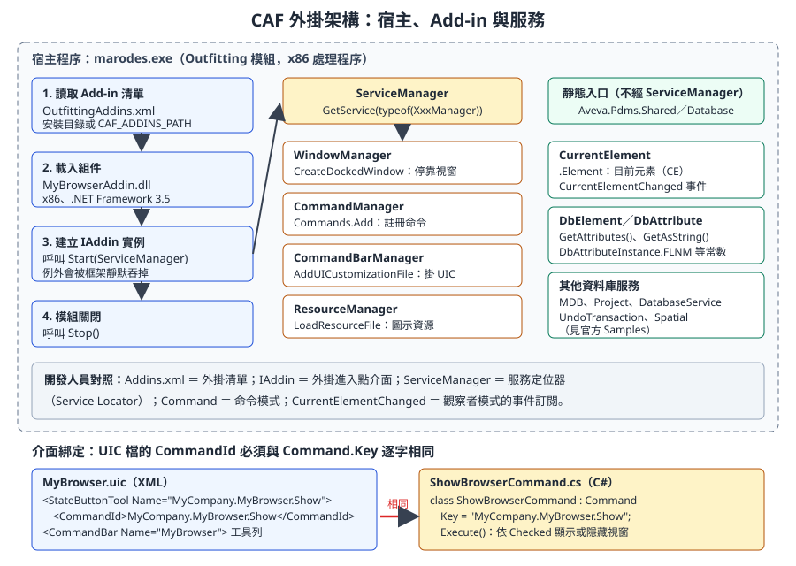
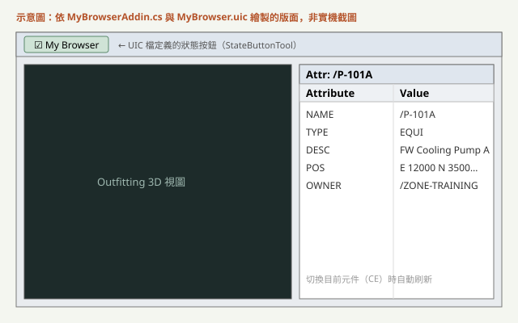
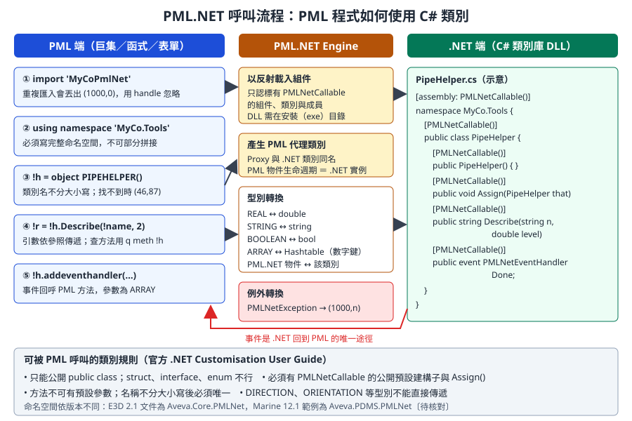

# 第 14 章　.NET 開發：PML.NET 與 CAF Add-in

> 本章說明什麼時候該從 PML 換成 C#，以及兩條 .NET 路線的寫法與部署：**CAF Add-in**（在模組內掛一個外掛，擁有自己的視窗、命令與工具列）與 **PML.NET**（把 C# 類別包成 PML 可以 `object` 出來的物件）。核心範例是 `examples/starter-kit-mybrowser/`，本章逐行解說。
>
> **資料可信度：** PML.NET 的規則、型別對應、`CAF_ADDINS_PATH` 與 `CAF_UIC_PATH` 的行為，取自 AVEVA 官方 *.NET Customisation User Guide*（help.aveva.com 上的 **AVEVA E3D 2.1** 版本）。AVEVA Marine 12.1 與 E3D 2.1 同屬 PDMS 技術系譜，架構相同，但命名空間與組件版本不同（例如 E3D 2.1 文件寫 `Aveva.Core.*`，Marine 12.1 的官方範例寫 `Aveva.Pdms.*`、`Aveva.PDMS.PMLNet`）。MyBrowser 範例來自 MIT 授權的開源專案 aveva-marine-dev-skill，針對 Marine 12.1 SP4 撰寫，**本課程未在實機上執行**。版本相依的細節標為〔待核對〕，請以公司安裝目錄下的 `Samples\` 與說明檔核對。

## 14.1 學習目標

讀完本章，你應該能夠：

1. 依需求判斷該用 PML、PML.NET、CAF Add-in 或獨立程式。
2. 說明 CAF 的組成：`IAddin`、`ServiceManager`、`WindowManager`、`CommandManager`、`CommandBarManager`，以及它們對應的軟體設計模式。
3. 讀懂並修改 MyBrowser 範例的每一行，知道 UIC 檔的 `CommandId` 為什麼必須與 `Command.Key` 一致。
4. 用 `DbElement`、`DbAttribute`、`DbAttributeInstance`、`CurrentElement` 讀取資料庫。
5. 寫出一個 `[PMLNetCallable]` 類別，並在 PML 中用 `import`、`using namespace`、`object` 呼叫它。
6. 設定正確的建置參數（.NET Framework 3.5、x86、`Copy Local = false`），並用 `<模組>Addins.xml` 與 `CAF_ADDINS_PATH` 部署。
7. 排除「外掛沒有載入」「按鈕沒有反應」「中斷點不會停」等常見問題。

## 14.2 什麼時候用 C#

PML 能完成大多數查詢、表單與批次工作（第 11 至 13 章）。下表整理四條路線的差別：

| 路線 | 程式在哪裡執行 | 適合 | 不適合 | 部署難度 |
|---|---|---|---|---|
| PML | 模組內的 PML 直譯器 | 查詢、表單、選單、批次修改 | 複雜演算法、網路通訊、資料庫連線 | 低：複製到 `PMLLIB` |
| PML.NET | PML 呼叫 C# 類別，在同一個處理程序 | 補足 PML 做不到的功能（例如 HTTP、複雜計算、讀寫 Excel） | 大型 UI | 中：DLL 放到安裝目錄 |
| CAF Add-in | 模組啟動時載入的 C# 外掛 | 停靠視窗、事件監聽、工具列、與 ERP／PDM 整合 | 只需要一張簡單表單的工具 | 中高：DLL、UIC、`Addins.xml` |
| 獨立程式 | 不開圖形介面，自己啟動 AVEVA 核心 | 夜間批次、資料轉檔 | 需要使用者互動的工具 | 高：需要授權與環境設定〔待核對〕 |

**判斷原則：**

- 能用 PML 完成且不超過幾百行，就用 PML。部署與維護成本最低，公司裡會 PML 的人也比較多。
- 只缺「一個 PML 做不到的函式」，用 PML.NET 包一個小類別，介面仍留在 PML。
- 需要常駐的視窗、要監聽目前元素變化，或要與外部系統做雙向整合，用 CAF Add-in。
- 船體模型資料的讀取，優先考慮 Vitesse 或 marAPI（第 15 章），不要用 .NET 直接猜船體元素的屬性。

> **開發人員須知：** .NET 外掛和模組跑在**同一個處理程序**裡。外掛當掉、卡住或吃光記憶體，整個 AVEVA 模組會一起出問題，使用者未存檔的工作可能遺失。這和一般 Web 服務「掛了重啟就好」的經驗完全不同，所以例外處理與效能要比平常更保守。

## 14.3 CAF 架構

CAF（Common Application Framework）是 AVEVA 模組的應用程式框架。Outfitting、Design、Hull 等模組都是 CAF 的「宿主程式」，啟動時依清單載入外掛，再把框架提供的服務交給外掛使用。



*圖 14-1　CAF 外掛架構與服務。左側是載入順序，中間是透過 `ServiceManager` 取得的服務，右側是不經 `ServiceManager` 的靜態入口，下方是 UIC 與命令的綁定關係。（本課程自繪）*

### 14.3.1 對照表：CAF 元件與熟悉的設計模式

| CAF 元件 | 作用 | 開發人員熟悉的對應 |
|---|---|---|
| `<模組>Addins.xml` | 列出要載入的外掛組件名稱 | 外掛清單、`plugins.json` |
| `IAddin` | 外掛主類別必須實作的介面：`Name`、`Description`、`Start(ServiceManager)`、`Stop()` | 外掛進入點介面、生命週期掛勾 |
| `ServiceManager` | 以 `GetService(typeof(...))` 取得框架服務 | 服務定位器（Service Locator）、簡化版的依賴注入容器 |
| `WindowManager` | 建立停靠視窗、MDI 視窗，管理版面 | 視窗管理器 |
| `CommandManager` | 註冊命令物件 | 命令模式（Command Pattern）的命令登錄處 |
| `CommandBarManager` | 工具列、選單、載入 UIC 檔 | UI 組態載入器 |
| `ResourceManager` | 載入圖示等資源檔 | 資源管理 |
| `Command` | 一個可被按鈕、選單觸發的動作，以 `Key` 識別 | 命令物件 |
| UIC 檔（`.uic`） | 用 XML 宣告工具列、按鈕與命令的對應 | 宣告式 UI 組態、Ribbon XML |
| `CurrentElement.CurrentElementChanged` | 目前元素改變時觸發的事件 | 觀察者模式、事件訂閱 |

### 14.3.2 模組、執行檔與 Addins.xml

外掛要掛在哪個模組，就寫進那個模組的清單。以下對應整理自開源知識庫對 Marine 12.1 SP4 `marine.bat` 的調查，公司版本請自行確認〔待核對〕：

| 模組 | 執行檔 | Add-in 清單 |
|---|---|---|
| Outfitting | `marodes.exe` | `OutfittingAddins.xml` |
| Design | `des.exe` | `DesignAddins.xml` |
| Hull Design | `marhdes.exe` | `HullDesignAddins.xml` |
| Marine Drafting | `mardra.exe` | `marinedraftingaddins.xml`（檔名全小寫） |
| Outfitting Draft | `marodra.exe` | `OutfittingDraftAddins.xml` |
| Admin | `adm.exe` | `AdminAddins.xml` |

清單的格式是 `ArrayOfString`，每個 `<string>` 是一個**組件名稱，不含 `.dll`**：

```xml
<?xml version="1.0" encoding="utf-8"?>
<ArrayOfString xmlns:xsi="http://www.w3.org/2001/XMLSchema-instance"
               xmlns:xsd="http://www.w3.org/2001/XMLSchema">
  <string>ExplorerAddin</string>
  <!-- 官方外掛略 -->
  <string>MyBrowserAddin</string>
</ArrayOfString>
```

### 14.3.3 CAF_ADDINS_PATH 與 CAF_UIC_PATH

官方 *.NET Customisation User Guide*（E3D 2.1）對兩個環境變數的說明如下：

| 環境變數 | 用途 | 未設定時 | 多個路徑 |
|---|---|---|---|
| `CAF_ADDINS_PATH` | 尋找 `<模組名稱>Addins.xml` | 使用產品安裝目錄 | 以分號分隔，依序搜尋 |
| `CAF_UIC_PATH` | 尋找 `<模組名稱>Customization.xml`、UIC 檔與資源檔 | 使用產品安裝目錄；安裝目錄一定會隱含附加在最後 | 以分號分隔 |

搜尋規則重點：

- 框架會在列出的目錄中尋找同名的 Addins.xml，**所有找到的檔案內容都會讀入，重複的項目只算一次**。
- 官方建議把安裝目錄也列進 `CAF_ADDINS_PATH`，否則標準外掛不會載入。
- `Customization.xml` 中可用 `$1` 代表專案代碼（例如 `$1.uic` 會換成 `APS.uic`），可加 `Optional="true"` 讓檔案不存在時不報錯。UIC 檔依序處理，容器（工具列、選單）必須先定義，才能把按鈕加進去。

> **專業提醒：** 這兩個變數在 Marine 12.1 的行為應與 E3D 2.1 相同（開源知識庫的 Marine 案例文章也提到 `CAF_ADDINS_PATH`），但請在公司版本實測一次〔待核對〕。實測方式：把一個只含自家外掛的 `OutfittingAddins.xml` 放在公司目錄，設定 `CAF_ADDINS_PATH=公司目錄;安裝目錄`，確認自家外掛與官方外掛都有載入。

### 14.3.4 UIC 檔：宣告式介面

UIC 是 XML，描述工具、工具列、選單與右鍵選單。重點節點：

| 節點 | 內容 |
|---|---|
| `<Tools>` | 工具定義池：`ButtonTool`、`StateButtonTool`、`MenuTool`、`ComboBoxTool` 等 |
| `<Command>` | 工具按下時執行的命令。`<Type>Instance</Type>` 加 `<CommandId>` 指向已註冊的 .NET 命令；`<Type>Macro</Type>` 加 `<Macro>` 可直接執行 PML，例如 `show !!myForm` |
| `<CommandBars>` | 工具列，列出要放哪些工具 |
| `<InstanceTools>` | 把已定義的工具插入既有選單，可用 `Parent`、`AfterSibling` 定位〔待核對〕 |
| `<Namespace>` | 資源命名空間，影響圖示資源的查找 |

載入 UIC 有兩種方式：

1. 在模組的 `Customization.xml` 登記（會動到官方清單，或需要另外設定 `CAF_UIC_PATH`）。
2. **外掛在 `Start()` 內呼叫 `CommandBarManager.AddUICustomizationFile("檔名.uic", "名稱")`**。MyBrowser 採用這種方式，不需要修改任何官方清單，建議自家外掛一律這樣做。

## 14.4 資料庫 API

CAF 外掛讀寫模型資料，主要用 `Aveva.Pdms.Database` 與 `Aveva.Pdms.Shared` 兩個命名空間。它們和第 12 章的 PML 操作是同一個資料庫的兩種介面。

| 類別 | 用途 | 對應的 PML 概念 |
|---|---|---|
| `DbElement` | 一個資料庫元素。`DbElement.GetElement("/名稱")` 依名稱取得，找不到時回傳 null 元素，要用 `IsNull` 判斷 | `DBREF`、`!!ce` |
| `DbAttribute` | 一個屬性的定義（包含 UDA），可用 `DbAttribute.GetDbAttribute("名稱")` 取得 | 屬性名稱 |
| `DbAttributeInstance` | 系統屬性的靜態常數，例如 `NAME`、`DESC`、`FLNM`、`FLNN` | 寫在程式裡的屬性名稱 |
| `DbElementTypeInstance` | 元素型別常數，例如 `SITE`、`EQUIPMENT`、`NOZZLE` | `'EQUI'`、`'NOZZ'` |
| `CurrentElement` | 靜態類別：`Element` 屬性是目前元素，`CurrentElementChanged` 事件 | `!!ce` 與 CE 切換 |
| `DBElementCollection`、`TypeFilter` | 依範圍與條件收集元素 | `COLLECTION` 物件 |
| `UndoTransaction` | 把多筆修改包成一個可復原的步驟 | `MARKDB`／`UNDOABLE` |

讀取屬性的常用方法：

| 屬性型別 | 讀取 | 寫入 |
|---|---|---|
| 字串 | `GetString(att)` | `SetAttribute(att, "文字")` |
| 實數 | `GetDouble(att)` | `SetAttribute(att, 60.0)` |
| 整數、布林 | `GetInteger(att)`、`GetBool(att)` | `SetAttribute(att, 3)`、`SetAttribute(att, true)` |
| 參照 | `GetElement(att)` | `SetAttribute(att, 另一個 DbElement)` |
| 位置、方向 | `GetPosition(att)`、`GetDirection(att)` | `SetAttribute(att, position)` |
| 任何型別轉成文字 | `GetAsString(att)` | 不適用 |

以下是唯讀查詢的寫法：依名稱取得一個 ZONE，列出底下所有設備的名稱與描述。

```csharp
// 示意：依官方 Samples 的 API 寫法改寫，未在實機執行
using Aveva.Pdms.Database;
using Aveva.PDMS.Database.Filters;   // 命名空間大小寫依版本而定〔待核對〕

public static string ListEquipment(string zoneName)
{
    DbElement zone = DbElement.GetElement(zoneName);
    if (zone.IsNull)
        return "找不到 " + zoneName;

    TypeFilter filter = new TypeFilter(DbElementTypeInstance.EQUIPMENT);
    DBElementCollection coll = new DBElementCollection(zone, filter);

    System.Text.StringBuilder sb = new System.Text.StringBuilder();
    foreach (DbElement e in coll)
    {
        sb.Append(e.GetAsString(DbAttributeInstance.FLNN));
        sb.Append('\t');
        sb.AppendLine(e.GetAsString(DbAttributeInstance.DESC));
    }
    return sb.ToString();
}
```

> **專業提醒：** 寫入資料庫前，請先讀第 2 章的 Team、Claim 與 Savework。`DbElement` 有 `Claim()`、`Release()`，`MDB.CurrentMDB.SaveWork(...)` 可提交工作。批次修改要用 `UndoTransaction` 包起來，讓使用者能一次復原。**本課程的外掛範例全部是唯讀的**，寫入型外掛必須經過第 17 章的審查流程。

> **開發人員須知：** 不要在 `CurrentElementChanged` 或資料庫事件的處理函式裡修改資料庫。修改會再觸發事件，很容易形成遞迴或拖慢整個模組。事件處理函式應該只「讀取並更新畫面」。

## 14.5 逐行解說 starter-kit-mybrowser

MyBrowser 是一個停靠在右側的視窗，目前元素一改變，就列出它的所有屬性。原始碼在 [`examples/starter-kit-mybrowser/`](examples/starter-kit-mybrowser/)。

| 檔案 | 角色 |
|---|---|
| [`src/MyBrowserAddin.cs`](examples/starter-kit-mybrowser/src/MyBrowserAddin.cs) | `IAddin` 主類別：建視窗、註冊命令、訂閱事件、載入資源與 UIC |
| [`src/ShowBrowserCommand.cs`](examples/starter-kit-mybrowser/src/ShowBrowserCommand.cs) | 狀態按鈕命令，與視窗的顯示狀態雙向同步 |
| [`src/AttributeListControl.cs`](examples/starter-kit-mybrowser/src/AttributeListControl.cs) | WinForms 使用者控制項（兩欄 `ListView`） |
| [`MyBrowser.uic`](examples/starter-kit-mybrowser/MyBrowser.uic) | 工具列與狀態按鈕的宣告 |



*圖 14-2　依原始碼繪製的 MyBrowser 版面示意，非實機截圖。*

### 14.5.1 MyBrowserAddin.cs

```csharp
using System;
using Aveva.ApplicationFramework;
using Aveva.ApplicationFramework.Presentation;
using Aveva.Pdms.Shared;
using Aveva.Pdms.Database;

namespace MyCompany.MyBrowser
{
    public class MyBrowserAddin : IAddin
    {
        private DockedWindow _window;
        private AttributeListControl _control;

        public string Name { get { return "MyBrowserAddin"; } }
        public string Description { get { return "CE attribute docked browser"; } }

        public void Start(ServiceManager serviceManager)
        {
            try
            {
                // 1. Docked window (content = plain WinForms control)
                WindowManager wm = (WindowManager)serviceManager.GetService(typeof(WindowManager));
                _control = new AttributeListControl();
                _window = wm.CreateDockedWindow("MyCompany.MyBrowser.List",
                                                "My Attributes", _control, DockedPosition.Right);
                _window.Width = 260;
                _window.SaveLayout = true;

                // 2. Command (state button)
                CommandManager cm = (CommandManager)serviceManager.GetService(typeof(CommandManager));
                cm.Commands.Add(new ShowBrowserCommand(_window));

                // 3. CE change -> refresh
                CurrentElement.CurrentElementChanged += OnCurrentElementChanged;

                // 4. Icon resources (MyBrowserAddin.resources alongside dll)
                ResourceManager rm = (ResourceManager)serviceManager.GetService(typeof(ResourceManager));
                rm.LoadResourceFile("MyBrowserAddin");

                // 5. uic mount
                CommandBarManager cbm = (CommandBarManager)serviceManager.GetService(typeof(CommandBarManager));
                cbm.AddUICustomizationFile("MyBrowser.uic", "MyBrowser");
            }
            catch (Exception ex)
            {
                // Start() exceptions are silently swallowed by the framework - self-log
                System.IO.File.WriteAllText(@"C:\mydev\mybrowser_start_err.txt", ex.ToString());
            }
        }

        public void Stop() { }

        private void OnCurrentElementChanged(object sender, CurrentElementChangedEventArgs e)
        {
            if (_window == null) return;
            _window.Title = "Attr: " + CurrentElement.Element.GetAsString(DbAttributeInstance.FLNM);
            _control.Clear();
            foreach (DbAttribute att in CurrentElement.Element.GetAttributes())
                _control.AddAttribute(att.Name, CurrentElement.Element.GetAsString(att));
        }
    }
}
```

| 行 | 程式 | 解說 |
|---|---|---|
| 2 到 5 | `using ...` | 四個命名空間各對應一個 AVEVA 組件：框架核心、表現層（視窗與命令）、共用服務（`CurrentElement`）、資料庫 |
| 7 | `namespace MyCompany.MyBrowser` | 建議用「公司.工具」命名，避免與官方或他人外掛衝突 |
| 9 | `class MyBrowserAddin : IAddin` | 外掛主類別。框架依 `Addins.xml` 找到組件後，會在其中找實作 `IAddin` 的類別並建立實例 |
| 11、12 | 欄位 | 視窗與控制項要存成欄位，事件處理函式才拿得到 |
| 14、15 | `Name`、`Description` | `IAddin` 要求的兩個唯讀屬性，框架用來識別與顯示外掛 |
| 17 | `Start(ServiceManager)` | 模組啟動時呼叫一次，所有初始化都在這裡 |
| 19 | `try` | **整個 `Start()` 包在 try 內**。原因見第 44 至 48 行 |
| 22 | `GetService(typeof(WindowManager))` | 向服務定位器要求視窗服務。官方範例一律以 `typeof` 取得再強制轉型 |
| 23 | `new AttributeListControl()` | 停靠視窗的內容就是一般的 WinForms `UserControl`，不需要任何 AVEVA 基底類別 |
| 24、25 | `CreateDockedWindow(key, title, control, position)` | 第一個參數是視窗的唯一識別碼，框架用它記住版面；第二個是標題；最後一個是預設停靠位置 |
| 26 | `Width = 260` | 預設寬度（像素） |
| 27 | `SaveLayout = true` | 記住使用者調整過的位置與大小，下次啟動沿用。副作用：使用者上次關掉視窗，下次也會是關閉狀態 |
| 30、31 | `cm.Commands.Add(new ShowBrowserCommand(_window))` | 把命令註冊到命令管理器。命令的 `Key` 之後會被 UIC 引用 |
| 34 | `CurrentElementChanged += ...` | 訂閱目前元素改變的事件。這是靜態事件，不經過 `ServiceManager` |
| 37、38 | `LoadResourceFile("MyBrowserAddin")` | 載入與 DLL 放在一起的 `MyBrowserAddin.resources`（圖示）。範例沒有附這個檔案；沒有圖示時按鈕會只顯示文字〔待核對：缺少資源檔時是否會丟例外〕 |
| 41、42 | `AddUICustomizationFile("MyBrowser.uic", "MyBrowser")` | 由外掛自己載入 UIC，不必修改官方 `Customization.xml` |
| 44 至 48 | `catch` 寫檔 | **`Start()` 丟出的例外會被框架靜默吞掉**，外掛就悄悄失效。所以自行把例外寫到檔案。範例寫死 `C:\mydev\`，該資料夾不存在時寫檔本身也會失敗，正式版要改（見 14.5.5） |
| 51 | `Stop()` | 模組關閉時呼叫。範例是空的，正式版應解除事件訂閱 |
| 53 | `OnCurrentElementChanged` | 事件處理函式，簽章由 `CurrentElementChangedEventHandler` 決定 |
| 55 | `if (_window == null) return;` | 若初始化失敗，避免後續 `NullReferenceException` |
| 56 | `GetAsString(DbAttributeInstance.FLNM)` | 取得元素的完整名稱（Full Name）放在視窗標題 |
| 57 | `_control.Clear()` | 清掉上一個元素的屬性 |
| 58、59 | `GetAttributes()` 迴圈 | 列舉元素所有屬性，逐一用 `GetAsString` 轉成文字。這等於 PML 的 `Q ATT` |

### 14.5.2 ShowBrowserCommand.cs

```csharp
using System;
using Aveva.ApplicationFramework.Presentation;

namespace MyCompany.MyBrowser
{
    public class ShowBrowserCommand : Command
    {
        private readonly DockedWindow _window;
        public ShowBrowserCommand(DockedWindow window)
        {
            Key = "MyCompany.MyBrowser.Show";   // must match uic CommandId exactly
            _window = window;
            _window.Closed += delegate { Checked = false; };
            WindowManager.Instance.WindowLayoutLoaded += delegate { Checked = _window.Visible; };
        }
        public override void Execute()
        {
            if (Checked) _window.Show(); else _window.Hide();
        }
    }
}
```

| 行 | 解說 |
|---|---|
| 6 | 繼承 `Command` 基底類別。命令可以有 `Checked`、`Enabled`、`Visible` 等狀態，框架會依狀態更新按鈕外觀 |
| 11 | `Key` 是命令的唯一識別碼，**必須與 UIC 檔的 `<CommandId>` 逐字相同**。不一致時按鈕照樣出現，但按了沒有任何反應，也不會報錯 |
| 13 | 使用者按視窗右上角關閉時，把按鈕的勾選狀態改成未勾選，維持雙向一致 |
| 14 | 版面載入完成後（`SaveLayout` 可能還原成隱藏），依視窗實際狀態設定勾選。這裡用 `WindowManager.Instance` 單例寫法，與主類別的 `GetService` 寫法並存；新程式建議統一用 `GetService` |
| 16 至 19 | `Execute()`：狀態按鈕被按下時，框架先切換 `Checked`，再呼叫 `Execute()`；這裡依勾選狀態顯示或隱藏視窗 |

### 14.5.3 AttributeListControl.cs

這是普通的 WinForms 程式：建立一個 `ListView`、設成詳細清單模式、加兩欄，提供 `AddAttribute` 與 `Clear` 兩個方法。它完全不依賴 AVEVA 組件，可以單獨在測試程式中開發與測試。

> **開發人員須知：** 把 UI 控制項寫成「不依賴 AVEVA 的純 WinForms」是很好的分層方式。邏輯可以在一般的 WinForms 測試程式中先跑通，只有最外層的 Add-in 類別需要進 AVEVA 測試，大幅縮短除錯循環。

### 14.5.4 MyBrowser.uic

```xml
<?xml version="1.0" encoding="utf-8"?>
<UserInterfaceCustomization xmlns:xsi="http://www.w3.org/2001/XMLSchema-instance"
                            xmlns:xsd="http://www.w3.org/2001/XMLSchema" xmlns="www.aveva.com">
  <Version>1.0</Version>
  <Tools>
    <StateButtonTool Name="MyCompany.MyBrowser.Show">
      <Command><Type>Instance</Type><CommandId>MyCompany.MyBrowser.Show</CommandId><Arguments /></Command>
      <Caption>My Browser</Caption>
    </StateButtonTool>
  </Tools>
  <InstanceTools />
  <CommandBars>
    <CommandBar Name="MyBrowser">
      <Tools><Tool Name="MyCompany.MyBrowser.Show" /></Tools>
      <DockedColumn>1</DockedColumn><DockedRow>1</DockedRow>
      <DockedPosition>Top</DockedPosition>
      <AllowFloating>true</AllowFloating><AllowHiding>true</AllowHiding>
      <FillEntireRow>false</FillEntireRow><ShowInToolbarList>true</ShowInToolbarList>
      <Caption>My Browser</Caption>
    </CommandBar>
  </CommandBars>
  <TaskPanes /><ContextMenus />
  <Namespace>MyBrowserAddin</Namespace>
</UserInterfaceCustomization>
```

| 行 | 解說 |
|---|---|
| 6 | `StateButtonTool`：有勾選狀態的按鈕，勾選狀態與命令的 `Checked` 雙向綁定。`Name` 是工具識別碼 |
| 7 | `<Type>Instance</Type>` 表示執行一個已註冊的命令實例；`<CommandId>` 就是 `ShowBrowserCommand.Key` |
| 8 | 按鈕上的文字 |
| 13、14 | 定義一條名為 `MyBrowser` 的工具列，裡面放第 6 行定義的工具 |
| 15 至 18 | 工具列預設停靠位置與行為：停在上方、可浮動、可隱藏、出現在工具列清單中 |
| 23 | `Namespace`：資源命名空間，與 `LoadResourceFile` 的名稱配合，用於圖示查找 |

### 14.5.5 範例可以改進的地方

MyBrowser 是教學骨架，放到正式環境前建議做以下修改：

| 問題 | 風險 | 建議 |
|---|---|---|
| 錯誤記錄路徑寫死 `C:\mydev\` | 資料夾不存在時連錯誤都記錄不了 | 改寫到 `%TEMP%` 或公司統一的記錄目錄，路徑由設定檔決定 |
| `Stop()` 沒有解除事件訂閱 | 模組關閉時事件仍指向已釋放的物件 | 在 `Stop()` 中 `CurrentElementChanged -= ...` |
| 目前元素可能是 null 或已刪除 | 事件處理丟例外，可能影響模組 | 先檢查 `IsNull`，整個處理函式包 try |
| 每次切換元素都重建清單 | 屬性多時畫面閃爍 | 使用 `ListView.BeginUpdate()`／`EndUpdate()` |
| 視窗隱藏時仍在刷新 | 浪費效能 | 視窗不可見時直接返回 |

改進後的事件處理函式如下：

```csharp
// 示意：在 MyBrowserAddin 類別內替換原本的 Stop() 與事件處理函式
public void Stop()
{
    CurrentElement.CurrentElementChanged -= OnCurrentElementChanged;
}

private void OnCurrentElementChanged(object sender, CurrentElementChangedEventArgs e)
{
    try
    {
        if (_window == null || !_window.Visible) return;
        DbElement ce = CurrentElement.Element;
        if (ce == null || ce.IsNull) return;

        _window.Title = "Attr: " + ce.GetAsString(DbAttributeInstance.FLNM);
        _control.Clear();
        foreach (DbAttribute att in ce.GetAttributes())
            _control.AddAttribute(att.Name, ce.GetAsString(att));
    }
    catch (Exception ex)
    {
        Log.Write(ex);   // 公司自訂的記錄類別，寫到設定檔指定的目錄
    }
}
```

`AttributeListControl` 的 `Clear` 與 `AddAttribute` 若要支援 `BeginUpdate`，可以再加一個 `SetAttributes(IList)` 方法一次填入。

## 14.6 PML.NET：讓 PML 呼叫 C#

PML.NET 讓你寫一個 C# 類別，PML 端就能像使用內建物件一樣 `object` 出來、呼叫方法。官方說明的機制是：PML.NET Engine 以反射載入組件，為每個可呼叫類別在**執行時期產生 PML 代理類別**（Proxy），PML 與 .NET 之間不需要額外的介接程式。



*圖 14-3　PML.NET 呼叫流程。中間的 Engine 負責載入、建立代理類別、轉換型別與例外；事件是 .NET 回呼 PML 的唯一途徑。（本課程自繪，依官方 .NET Customisation User Guide 整理）*

### 14.6.1 C# 端：可呼叫類別的規則

依官方指南，PML 可呼叫的類別必須符合：

| 規則 | 說明 |
|---|---|
| 組件、類別、成員都要標記 `PMLNetCallable` | Engine 只載入標記過的組件，也只看標記過的類別與方法 |
| 只能公開 `public class` | struct、interface、enum 不能直接給 PML 使用 |
| 必須有公開、標記過的**預設建構子** | 沒有參數的建構子 |
| 必須有 `Assign()` 方法 | PML 的 `!b = !a` 是「值的複製」語意，由 `Assign` 實作 |
| 方法不可使用預設參數 | 需要不同參數時改用多載 |
| 名稱不分大小寫後必須唯一 | PML 不分大小寫，`Foo()` 與 `foo()` 會衝突 |
| 型別限制 | 見 14.6.3 的型別對應表 |
| 組件位置 | 安裝目錄（`%AVEVA_DESIGN_EXE%`，Marine 為 exe 目錄）、其子目錄或 UNC 路徑 |

以下是一個最小可呼叫類別：

```csharp
// 示意：依 E3D 2.1 官方指南與 Marine 12.1 PMLNetExample 範例結構撰寫，未在實機執行
// AssemblyInfo.cs
using Aveva.PDMS.PMLNet;            // Marine 12.1 範例的命名空間；E3D 2.1 為 Aveva.Core.PMLNet〔待核對〕
[assembly: PMLNetCallable()]

// PipeHelper.cs
using System;
using System.Collections;
using Aveva.PDMS.PMLNet;

namespace MyCo.Tools
{
    [PMLNetCallable()]
    public class PipeHelper
    {
        private string _prefix = "";

        [PMLNetCallable()]
        public PipeHelper() { }

        // PML 賦值語意需要；把 that 的狀態複製到自己
        [PMLNetCallable()]
        public void Assign(PipeHelper that)
        {
            _prefix = that._prefix;
        }

        [PMLNetCallable()]
        public void SetPrefix(string prefix) { _prefix = prefix; }

        // PML 的 REAL 一律對應 double，不要用 int 參數
        [PMLNetCallable()]
        public string Describe(string name, double level)
        {
            if (string.IsNullOrEmpty(name))
                throw new PMLNetException(1000, 1, "name is empty");
            return _prefix + name + " (L" + level.ToString("0") + ")";
        }

        // PML ARRAY 對應 Hashtable，鍵為數字
        [PMLNetCallable()]
        public double Sum(Hashtable values)
        {
            double total = 0;
            foreach (object v in values.Values) total += (double)v;
            return total;
        }
    }
}
```

> **專業提醒：** `Assign` 即使類別沒有狀態也必須寫。開源知識庫對 Marine 12.1 安裝目錄的反射普查顯示，幾乎所有官方 PML.NET 類別都有 `Assign`。`PMLNetException` 的建構子與命名空間請以公司版本的 `PMLNetExample` 範例核對〔待核對〕。

### 14.6.2 PML 端：import 與 using namespace

```pml
-- 示意：在命令列或巨集中使用 PipeHelper
import 'MyCoPmlNet'
handle (1000,0)
  -- 組件已匯入過，忽略
endhandle

using namespace 'MyCo.Tools'

!h = object PIPEHELPER()
!h.SetPrefix('LINE-')
!text = !h.Describe('P1001', 2)
$P $!text

q meth !h
```

| 敘述 | 說明 |
|---|---|
| `import '組件名'` | 載入組件，名稱不含 `.dll`、不分大小寫。同一個工作階段重複匯入會丟出錯誤，所以慣例上緊接 `handle (1000,0)` 忽略 |
| `using namespace '完整命名空間'` | 讓後面的 `object` 找得到類別。範圍到巨集結束為止；**不能寫部分命名空間再拼接** |
| `object PIPEHELPER()` | 建立 .NET 實例與 PML 代理。類別名不分大小寫；找不到時報 `(46,87)` |
| `!h.Describe('P1001', 2)` | 呼叫方法，引數依參照傳遞 |
| `q meth !h` | 列出物件所有方法與建構子的簽章，是查 API 最可靠的方式 |
| `q var !h` | 顯示物件的命名空間與類別名 |

官方範例也示範了以完整路徑匯入開發中的組件，方便在不覆蓋安裝目錄的情況下測試：

```pml
import |C:\dev\PMLNetExample\bin\Debug\pmlnetexample|
```

〔待核對〕Marine 12.1 是否同樣支援以完整路徑匯入，請在訓練環境實測。

### 14.6.3 型別對應

| PML 型別 | .NET 型別 | 備註 |
|---|---|---|
| `REAL` | `double` | PML 沒有整數型別，C# 參數請用 `double` |
| `STRING` | `string` | |
| `BOOLEAN` | `bool` | |
| `ARRAY` | `Hashtable` | 鍵必須是數字；允許稀疏與多維陣列 |
| PML.NET 物件 | 對應的 `PMLNetCallable` 類別 | |
| `DIRECTION`、`ORIENTATION` 等 | 不能直接傳遞 | 改傳字串或數字陣列 |
| `DBREF` | 不能直接傳遞 | 官方說明可用陣列或字串傳遞，例如傳 `!e.string()` 或參照字串 |

### 14.6.4 事件、例外與生命週期

**事件**：.NET 不能直接呼叫 PML，只能透過事件回呼。C# 端宣告 `[PMLNetCallable()] public event PMLNetDelegate.PMLNetEventHandler Done;`，以 `ArrayList` 傳參數；PML 端：

```pml
-- 示意：!this 是表單或物件，onDone 是它的方法
!handle = !h.addeventhandler('Done', !this, 'onDone')
-- 不再需要時
!h.removeeventhandler('Done', !handle)

define method .onDone(!args is ARRAY)
  $P Done: $!args[1]
endmethod
```

**例外**：C# 端 `throw new PMLNetException(1000, 1, "訊息")`，PML 端用 `handle (1000,1)` 攔截。一般 .NET 例外（例如 `ArgumentException`）會以 `(1000,n)` 形式出現；其他例外會交給 AVEVA 的全域例外處理器，可能直接跳出錯誤對話框。所以 C# 端應自行攔截並轉成 `PMLNetException`。

**生命週期**：.NET 實例與 PML 代理同生共死。區域變數在巨集或函式結束時釋放；全域變數（`!!x`）存活到工作階段結束；切換模組時不會保留。

### 14.6.5 在 PML 表單中嵌入 .NET 控制項

第 13 章的 MyCollect 範例已經用到這個技巧：表單中放 `container ... pmlNetControl`，再把 .NET 控制項的 `handle()` 指給容器。

```pml
-- 示意：節錄自第 13 章 MyCollect 的寫法
container .netFrame 'Grid' nobox pmlNetControl width 60 height 16 anchor all
...
!this.grid = object NETGRIDCONTROL()
!this.netFrame.control = !this.grid.handle()
```

自己寫的 WinForms 控制項只要也標記成 `PMLNetCallable`，就能用相同方式嵌入 PML 表單。官方 `Samples` 中的 `PMLGridExample` 是完整範例。

## 14.7 建置設定

Marine 12.1 的 .NET 環境是 Visual Studio 2008 世代。用新版 Visual Studio 開發時，最常見的錯誤是專案被自動升級到 .NET 4.x 或 AnyCPU。

| 設定 | 值 | 原因 |
|---|---|---|
| 專案類型 | 類別庫（Class Library） | 外掛與 PML.NET 都是 DLL |
| 目標 Framework | **.NET Framework 3.5**（2.0 至 3.5 皆可） | 宿主程式執行在 CLR 2.0；4.x 組件無法載入 |
| 平台目標 | **x86** | 宿主程式是 32 位元；用 x64 編譯會出現 `BadImageFormatException` |
| AVEVA 組件參考 | HintPath 指向安裝目錄，**Copy Local = false** | 執行時使用安裝目錄的版本；複製一份到輸出目錄會造成版本衝突 |
| Specific Version | 對準公司安裝的版本 | 升級 Service Pack 後要重新建置 |
| 第三方 UI 函式庫 | 使用安裝目錄附帶的版本（例如 Infragistics） | 不要自帶更高版本的同名 DLL |

常用參考：

| 組件 | 內容 |
|---|---|
| `Aveva.ApplicationFramework` | `IAddin`、`ServiceManager` |
| `Aveva.ApplicationFramework.Presentation` | `WindowManager`、`CommandManager`、`CommandBarManager`、`Command`、`DockedWindow` |
| `Aveva.Pdms.Shared` | `CurrentElement`、`Selection` |
| `Aveva.Pdms.Database` | `DbElement`、`DbAttribute`、`MDB`、`Project` |
| `Aveva.Pdms.Geometry` | `Position`、`Direction`、`Orientation` |
| `PMLNet`〔待核對：組件名〕 | `PMLNetCallable`、`PMLNetException`、`PMLNetDelegate` |

專案檔中參考的寫法：

```xml
<!-- 示意：csproj 節錄，路徑請改成公司安裝目錄 -->
<PropertyGroup>
  <TargetFrameworkVersion>v3.5</TargetFrameworkVersion>
  <PlatformTarget>x86</PlatformTarget>
</PropertyGroup>
<ItemGroup>
  <Reference Include="Aveva.ApplicationFramework">
    <HintPath>C:\AVEVA\Marine\OH12.1.SP4\Aveva.ApplicationFramework.dll</HintPath>
    <Private>False</Private>
  </Reference>
  <Reference Include="Aveva.Pdms.Database">
    <HintPath>C:\AVEVA\Marine\OH12.1.SP4\Aveva.Pdms.Database.dll</HintPath>
    <Private>False</Private>
  </Reference>
</ItemGroup>
```

`<Private>False</Private>` 就是 Visual Studio 屬性視窗中的 `Copy Local = false`。

## 14.8 部署

### 14.8.1 CAF Add-in 的部署步驟

1. 把 `MyBrowserAddin.dll` 與 `MyBrowser.uic`（以及 `.resources`，若有）放到安裝目錄，或公司自訂的外掛目錄。
2. 在模組的 Addins.xml 加入 `<string>MyBrowserAddin</string>`。
3. 重新啟動模組。DLL 在模組執行期間會被鎖定，**更新前必須先關閉模組**。
4. 冒煙測試：工具列出現 `My Browser` 按鈕；按下後右側出現視窗；在 Explorer 點選不同元素，屬性清單會跟著變。

**不修改官方檔案的做法**：把公司版的 `OutfittingAddins.xml`（只列自家外掛）放在公司目錄，啟動批次檔設定 `CAF_ADDINS_PATH=公司目錄;安裝目錄`。官方檔案保持原樣，SP 升級時不會被覆蓋。

```bat
@echo off
rem 示意：公司啟動批次檔的片段，在呼叫 AVEVA 原本的啟動批次檔之前設定
set COMPANY_TOOLS=\\toolsrv\aveva_tools\current
set CAF_ADDINS_PATH=%COMPANY_TOOLS%\caf;C:\AVEVA\Marine\OH12.1.SP4
set CAF_UIC_PATH=%COMPANY_TOOLS%\caf
rem 之後呼叫原本的 marine.bat 與模組參數
```

〔待核對〕外掛 DLL 本身是否能放在安裝目錄以外，取決於框架的組件解析方式。若放在其他目錄載入失敗，Addins.xml 中可試著寫相對於安裝目錄的路徑（官方 Diagrams 清單有 `AddinsData\...` 的寫法），或回到「DLL 放安裝目錄、清單放公司目錄」的折衷方案。

### 14.8.2 PML.NET 組件的部署

PML.NET 組件不需要登記在 Addins.xml，只要放在 `import` 找得到的位置（安裝目錄或其子目錄）。若同一個 DLL 同時是 Add-in 又提供 PML.NET 類別，兩種機制各自運作：Addins.xml 讓它在啟動時執行 `Start()`，`import` 讓 PML 使用它的類別。

### 14.8.3 部署檢查清單

- [ ] 平台 x86、目標 .NET Framework 3.5、AVEVA 參考 `Copy Local = false`。
- [ ] DLL、UIC、資源檔都已複製；Addins.xml 已登記，舊名稱已移除。
- [ ] 每個 UIC 的 `CommandId` 與程式中的 `Key` 逐一比對過；每個按鈕都點過一次。
- [ ] `Start()` 的例外有寫入記錄檔，記錄檔路徑可寫。
- [ ] 部署與移除步驟已寫在工具說明中（第 17 章）。

## 14.9 除錯

| 方法 | 做法 | 適用 |
|---|---|---|
| F5 直接啟動 | 專案屬性 → 偵錯 → 啟動外部程式設為模組執行檔（例如 `marodes.exe`），工作目錄設為安裝目錄 | 要在 `Start()` 設中斷點時 |
| 附加到處理程序 | 模組已開啟時，Visual Studio「偵錯 → 附加至處理序」選 `marodes.exe` | 除錯事件處理、按鈕命令 |
| 自行記錄 | 寫記錄檔或 `System.Diagnostics.Trace` | 使用者端的問題重現 |
| PML 端查詢 | `q meth !obj`、`q var !obj` | PML.NET 方法名稱或簽章不符 |

> **專業提醒：** 模組通常透過啟動批次檔（設定大量環境變數）啟動。從 Visual Studio 直接啟動執行檔時，環境變數可能不完整，導致專案或 PMLLIB 找不到。比較穩定的做法是：先用公司正式的方式啟動模組，再從 Visual Studio「附加至處理序」。

常見錯誤：

| 症狀 | 可能原因 | 處理 |
|---|---|---|
| 外掛完全沒有載入、中斷點不會停 | Addins.xml 名稱寫錯（含 `.dll`、大小寫）、DLL 不在目錄、位元數錯 | 逐項核對；看 Windows 事件或自己的記錄 |
| `BadImageFormatException` | 編譯成 x64 或 AnyCPU 在 64 位元行為 | 改成 x86 |
| `FileLoadException`、版本不符 | 參考版本與安裝版本不同 | 參考指向公司安裝目錄，SP 升級後重建 |
| 外掛載入了但功能沒出現 | `Start()` 中途丟例外被吞掉 | 看 `catch` 寫出的記錄檔 |
| 按鈕出現但按了沒反應 | UIC 的 `CommandId` 與 `Key` 不一致 | 逐字比對；複製貼上而不要手打 |
| 停靠視窗沒出現 | `SaveLayout` 記住了上次的隱藏狀態 | 按工具列按鈕顯示，或重設版面 |
| PML 報 `(46,87)` | `using namespace` 未寫或拼錯、類別沒有標記 | `q namespaces` 檢查目前範圍 |
| 換了 DLL 沒效果 | 模組仍在執行，舊 DLL 被鎖定 | 關閉模組再覆蓋 |

## 14.10 開發人員須知

- **先唯讀，再寫入。** 第一個外掛應該像 MyBrowser 一樣只讀資料。會寫入資料庫的外掛要有預覽、確認、`UndoTransaction` 與第 17 章的審查。
- **UI 執行緒。** 資料庫 API 與 WinForms 控制項都應在主執行緒使用。需要長時間執行的工作（例如呼叫 Web API），不要卡住主執行緒；若使用背景執行緒，結果要用 `Control.Invoke` 回到主執行緒再更新畫面，且背景執行緒中不要呼叫資料庫 API〔待核對：官方對執行緒安全的完整說明〕。
- **不要改官方檔案。** 用 `AddUICustomizationFile` 載入自己的 UIC、用 `CAF_ADDINS_PATH` 放自己的清單。
- **反編譯風險。** .NET DLL 可以被反編譯，密碼與連線字串不可寫在程式中；需要時放在受權限保護的設定檔或使用 Windows 驗證。
- **版本綁定。** 外掛綁定安裝版本的 AVEVA 組件，Service Pack 升級後要重建並回歸測試（第 17 章）。
- **查證 API。** 官方 `Samples` 與安裝目錄附帶的 XML 文件說明（例如 `ApplicationFramework.xml`）是最可靠的依據；網路文章與 AI 生成的程式碼常混用 E3D 與 PDMS 的命名空間。

## 14.11 練習（只能在訓練專案）

1. **建置 MyBrowser。** 依 14.7 建立專案，加入三個 `.cs` 檔，建置出 x86、.NET 3.5 的 `MyBrowserAddin.dll`。用 `corflags` 或屬性視窗確認位元數。
2. **部署與冒煙測試。** 在訓練環境部署 MyBrowser，記錄你修改了哪些檔案、怎麼移除。
3. **故意做錯。** 把 UIC 的 `CommandId` 改掉一個字母，觀察按鈕的行為；再改成 x64 編譯，觀察錯誤。把觀察寫成你們團隊的排錯筆記。
4. **改進範例。** 套用 14.5.5 的改進，並在視窗上方加一個文字框，只列出名稱包含該文字的屬性。
5. **PML.NET 小類別。** 寫一個 `PMLNetCallable` 類別，提供 `ToUpperTrim(string)` 與 `Sum(Hashtable)` 兩個方法，在 PML 命令列 `import`、`q meth`、呼叫並用 `handle (1000,1)` 攔截你故意丟出的例外。

## 14.12 自我檢核

- [ ] 我能說明 PML、PML.NET、CAF Add-in、獨立程式各適合什麼情況。
- [ ] 我能畫出 CAF 的載入順序：Addins.xml → DLL → `IAddin.Start(ServiceManager)` → 取得服務。
- [ ] 我知道 `Start()` 的例外會被吞掉，並且會自行記錄。
- [ ] 我能解釋 UIC 的 `CommandId` 與 `Command.Key` 的關係。
- [ ] 我能用 `DbElement`、`DbAttribute`、`DbAttributeInstance`、`CurrentElement` 讀取屬性。
- [ ] 我能寫出符合規則的 `PMLNetCallable` 類別（預設建構子、`Assign`、無預設參數）。
- [ ] 我知道 PML `REAL` 對應 `double`、`ARRAY` 對應 `Hashtable`。
- [ ] 我能設定 .NET 3.5、x86、`Copy Local = false`，並說明 `CAF_ADDINS_PATH` 的搜尋規則。

## 資料來源

- AVEVA E3D 2.1 *.NET Customisation User Guide*（官方，版本與 Marine 12.1 不同，觀念相同）：
  - [Environment variables: CAF_ADDINS_PATH、CAF_UIC_PATH](https://help.aveva.com/AVEVA_Everything3D/2.1/NCUG/NCUG3.04.3.html)
  - [PML.NET 概述](https://help.aveva.com/AVEVA_Everything3D/2.1/NCUG/NCUG5.07.1.html)、[PML.NET 組件載入與 PMLNetCallable](https://help.aveva.com/AVEVA_Everything3D/2.1/NCUG/NCUG5.07.2.html)、[Using PML.NET：import、using namespace、Assign、型別對應、事件、例外、限制](https://help.aveva.com/AVEVA_Everything3D/2.1/NCUG/NCUG5.07.3.html)
  - [在 PML 表單中使用 .NET 控制項](https://help.aveva.com/AVEVA_Everything3D/2.1/NCUG/NCUG5.07.4.html)、[PMLNetExample 與 PMLGridExample 範例](https://help.aveva.com/AVEVA_Everything3D/2.1/NCUG/NCUG5.07.5.html)、[PMLGridExample](https://help.aveva.com/AVEVA_Everything3D/2.1/NCUG/NCUG1.02.17.html)
- 範例原始碼：[aveva-marine-dev-skill](https://github.com/912141548/aveva-marine-dev-skill)（MIT，Copyright © 2026 erbi112211-boop），本地副本 [`examples/starter-kit-mybrowser/`](examples/starter-kit-mybrowser/)，授權見 [`examples/LICENSE-aveva-marine-dev-skill.txt`](examples/LICENSE-aveva-marine-dev-skill.txt)。
- 同一開源專案的參考卷冊（自評可信度等級，標示 TODO-UNVERIFIED 者本章已標〔待核對〕）：《AVEVA-Marine-NET開發技能》《AVEVA-Marine-NET-API用法Cookbook》《AVEVA-Marine-uic定制與部署調試手冊》，以及 `references/dotnet-api/` 下的 PDMS 12.1 .NET API 文件（併入自 PDMS-12.1-Net-skill，MIT）。
- eryar，[AVEVA .NET Quick Start Guide](https://developer.aliyun.com/article/235787)（2012，入門架構說明）。
