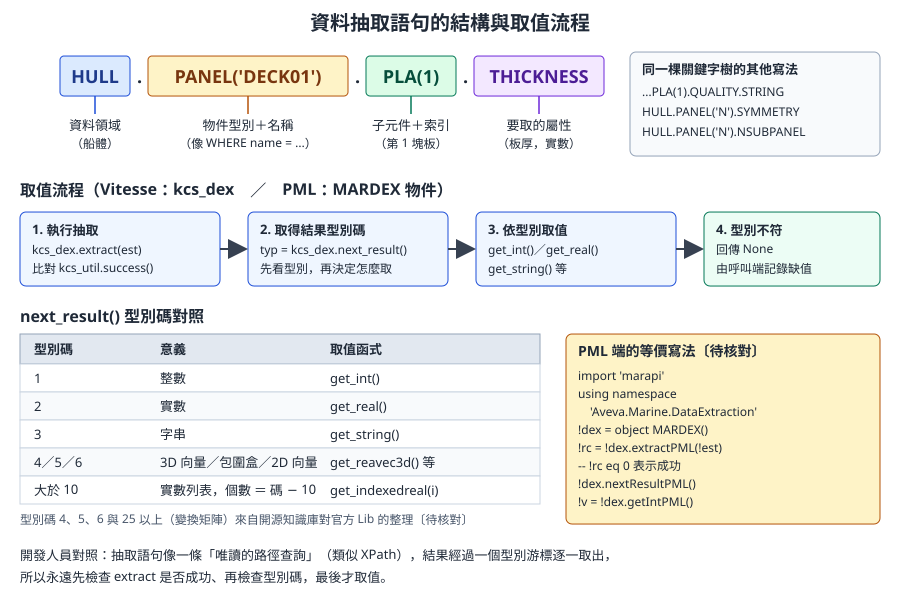
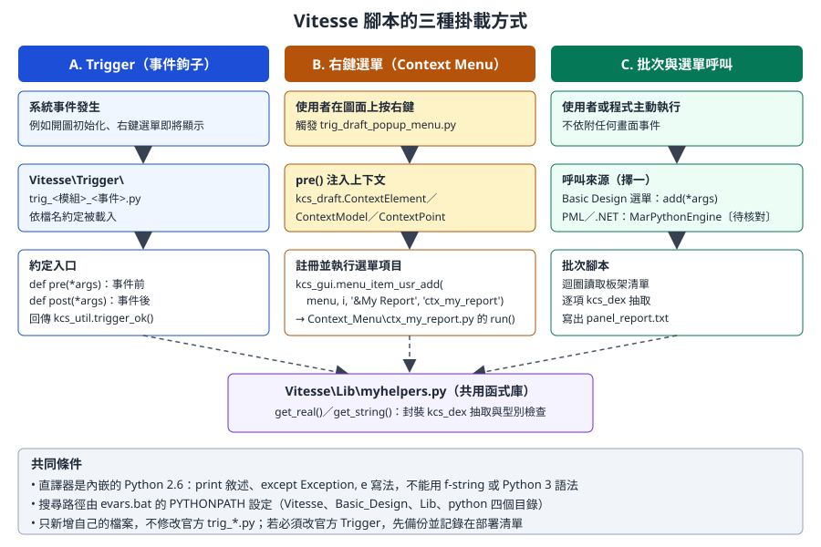

# 第 15 章　船體開發：Vitesse Python 與資料抽取

> 船體模組承襲自 Tribon，它的客製化語言不是 PML，而是內嵌在模組中的 **Vitesse**（Python 2.6）。本章說明 Vitesse 的執行環境、主要模組、資料抽取語句，以及 Trigger、右鍵選單、批次腳本三種掛載方式，最後**明確界定船體資料自動化的安全界線**。核心範例是 `examples/vitesse-hull-report/`。
>
> **資料可信度：** Vitesse 的官方文件（`Vitesse.chm`、`Python.chm`、`Data_Extraction.chm`、`vitesse_access.xls`）隨產品安裝在 `Documentation\` 目錄，網路上沒有公開的靜態版本。本章的 API 名稱與用法，主要依據 MIT 授權的開源知識庫 aveva-marine-dev-skill 對 **Marine 12.1 SP4 安裝目錄**中官方範例與函式庫的調查整理，屬於「從官方原始碼反推」的二手資料，**本課程未在實機上執行**。凡是知識庫自評未驗證、或只有單一出處的內容，都標為〔待核對〕。請務必用公司安裝目錄的 `Vitesse\Examples\` 與說明檔核對後再使用。

## 15.1 學習目標

讀完本章，你應該能夠：

1. 說明 Vitesse 在 AVEVA Marine 中的定位，以及它和 PML、.NET 的分工。
2. 寫出符合 Python 2.6 語法的腳本，並知道哪些 Python 3 習慣不能用。
3. 認識 `kcs_ui`、`kcs_draft`、`kcs_dex`、`kcs_util` 等主要模組的用途與風險等級。
4. 讀懂並寫出 `HULL.PANEL('名稱').PLA(1).THICKNESS` 這類資料抽取語句，正確處理結果型別。
5. 以 Trigger、右鍵選單、批次腳本三種方式掛載腳本。
6. 說明從 PML 或 .NET 讀取船體資料的途徑與版本限制。
7. 判斷一個船體自動化需求落在安全界線的哪一側，並提出對應的控管方式。

## 15.2 Vitesse 的定位

AVEVA Marine 由 Tribon M3（船體）與 PDMS（舾裝）整合而成（第 1 章）。兩邊的客製化技術也一起帶了進來：

| 路線 | 來源 | 主要用途 | 本課程章節 |
|---|---|---|---|
| PML | PDMS | 舾裝資料、表單、選單、通用資料庫操作 | 第 11 至 13 章 |
| .NET（CAF、PML.NET、marAPI） | PDMS／AVEVA 新架構 | 停靠視窗、外部整合；marAPI 也包裝了船體與圖面功能 | 第 14 章 |
| **Vitesse（Python 2.6）** | Tribon | 船體建模、船體圖面、資料抽取、船體 Trigger | 本章 |

> 〔公開版未收錄：AVEVA 官方產品截圖〕AVEVA Hull Detailed Design 的作業畫面

*圖 15-1　Hull Detailed Design 作業畫面。Vitesse 腳本主要服務這一類船體模組與 Marine Drafting。（來源：AVEVA Hull and Outfitting Datasheet）*

**為什麼船體要另外一套？** 第 5 章說過，船體板架不是一堆獨立的幾何，而是由「型面、邊界參考、接縫、加強材」組成的**相依圖**。板架的定義以船體語句（Scheme）表達，由船體引擎重建出幾何。Vitesse 與資料抽取語言直接面對這套引擎與資料，比從通用資料庫屬性去拼湊船體資訊更可靠。

> **開發人員須知：** 可以把船體引擎想成一個「以文字描述、經過編譯才產生結果」的系統。板架的語句像原始碼，幾何像編譯產物，資料抽取則像對編譯產物的唯讀查詢 API。讀取產物很安全；修改原始碼（板架語句）並重新編譯，就會牽動所有相依的構件。這個比喻是後面安全界線的基礎。

## 15.3 執行環境

### 15.3.1 目錄結構

依開源知識庫對 12.1 SP4 安裝目錄的調查（〔待核對〕公司版本）：

| 目錄 | 內容 | 我們可以做什麼 |
|---|---|---|
| `Vitesse\Lib\` | 官方函式庫（`Kcs*.py` 資料類別、共用工具） | 新增自己的共用模組，**不改官方檔案** |
| `Vitesse\Trigger\` | `trig_<模組>_<事件>.py` 事件鉤子 | 新增 Trigger；改官方 Trigger 前要備份並登記 |
| `Vitesse\Context_Menu\` | 右鍵選單腳本 `ctx_*.py` 與對話框 | 新增自己的選單腳本 |
| `Vitesse\Basic_Design\` | Basic Design 應用的選單與快速建模腳本 | 參考用 |
| `Vitesse\Examples\` | 官方範例 `kcs_ex_*.py`（Drafting、Hull、Model、Util、Weld 等） | **學 API 先看這裡** |
| `python\` | Python 2.6 標準函式庫 | 不要修改 |

搜尋路徑由啟動時的 `evars.bat` 設定：

```bat
rem 依開源知識庫引用的 evars.bat 內容，公司版本請自行確認〔待核對〕
set pythonpath=%pdmsexe%Vitesse;%pdmsexe%Vitesse\Basic_Design;%pdmsexe%Vitesse\Lib;%pdmsexe%python
```

### 15.3.2 Python 2.6 語法限制

內嵌的直譯器是 **Python 2.6**。習慣 Python 3 的開發人員最容易踩到下列差異：

| 項目 | Python 2.6 寫法 | Python 3 寫法（不可用） |
|---|---|---|
| 輸出 | `print 'text'`、`print x` | `print('text')` 在 2.6 會印出 tuple 或不同結果 |
| 例外 | `except Exception, e:` | `except Exception as e:`（2.6 其實也支援 `as`，但官方腳本一律用逗號寫法，建議跟隨） |
| 字串格式 | `'%s t=%s' % (p, t)`、`'{0}'.format(x)` | f-string `f'{x}'` |
| 字串型別 | `str` 是位元組、`unicode` 是文字；中文要特別處理 | `str` 即 Unicode |
| 整數除法 | `7 / 2` 等於 `3` | `7 / 2` 等於 `3.5` |
| 字典迭代 | `d.iteritems()`、`d.keys()` 回傳 list | `d.items()` 回傳 view |
| 檔案 | `open(path, 'w')`，沒有 `encoding` 參數 | `open(path, 'w', encoding='utf-8')` |
| 第三方套件 | 只能用隨附的函式庫；GUI 用 wxPython | `pip install` 任何套件 |

> **專業提醒：** 腳本的中文字串與註解，檔案開頭加上 `# -*- coding: utf-8 -*-`，存成 UTF-8。寫檔輸出中文時，用 `codecs.open(path, 'w', 'utf-8')` 或先 `.encode('utf-8')`。輸出到船體介面的訊息建議先用英文，避免編碼問題〔待核對：Marine 介面對 Vitesse 中文訊息的顯示行為〕。

## 15.4 主要模組

`kcs_*` 模組是編譯在 Marine 主程式中的 C 擴充模組，**沒有 `.py` 原始碼**，也沒有可直接閱讀的簽章檔。官方說明在 `Vitesse.chm` 與 `Python.chm`；開源知識庫則從官方範例的實際呼叫反推出下列清單（〔待核對〕完整簽章）：

| 模組 | 用途 | 代表函式 | 風險 |
|---|---|---|---|
| `kcs_util` | 回傳碼、環境變數、座標換算 | `success()`、`ok()`、`trigger_ok()`、`TB_environment_get(name)`、`coord_to_pos()` | 低 |
| `kcs_ui` | 使用者互動：訊息、輸入、選擇、點取 | `message_confirm(msg)`、`string_req(prompt)`、`real_req()`、`choice_select()`、`point2D_req()` | 低 |
| `kcs_dex` | **資料抽取**（唯讀） | `extract(est)`、`next_result()`、`get_int()`、`get_real()`、`get_string()`、`get_indexedreal(i)` | 低 |
| `kcs_draft` | 船體圖面：開圖、建立圖元、識別、尺寸、匯出 | `dwg_open()`、`dwg_new()`、`text_new()`、`model_identify()`、`dwg_dxf_export()` | 中：會改圖面 |
| `kcs_gui` | 選單 | `menu_get()`、`menu_add()`、`menu_item_usr_add()` | 低 |
| `kcs_db` | 物件清單查詢 | `object_list_get(criteria, dbname, list)` | 低 |
| `kcs_model` | 模型關係、干涉 | `model_hull_contact(model)`、`model_interference_check()` | 低至中 |
| `kcs_hullpan` | 平面板架管理 | `pan_activate()`、`pan_store()`、`pan_recreate()`、`pan_split()`、`pan_topology()` | **高：會改船體模型** |
| `kcs_chm` | 曲面船體 | `curve_planar_create()`、`stiffener_split()`、`cpan_hole_create()`、`store()` | **高** |
| `kcs_hull` | 板架語句執行 | `pan_init()`、`pan_exec_stmt()`、`pan_store()` | **高** |
| `kcs_weld`、`kcs_assembly` | 焊接計算、組立 | `weld_calculation()`、`assembly_activate()` | 高 |

另外，`Vitesse\Lib\` 中的 `Kcs*.py` 是純 Python 的資料類別，例如 `KcsPoint3D.Point3D`、`KcsModel.Model`、`KcsContour2D.Contour2D`，用來在呼叫 `kcs_*` 函式時傳遞幾何與模型資訊。

**錯誤處理慣例：** `kcs_*` 函式失敗時會丟出例外，模組上的 `error` 屬性存放錯誤碼字串（例如 `kcs_draft.error`）。官方範例的寫法是：

```python
# 依開源知識庫整理的官方範例寫法（Vitesse\Lib\CommonSample.py 的模式）〔待核對〕
try:
    kcs_draft.dwg_new(name, form, dwgtype)
except:
    print 'kcs_draft error: ' + str(kcs_draft.error)
```

## 15.5 資料抽取語言

資料抽取（Data Extraction）是 Tribon 時代就有的唯讀查詢語言，用一條「路徑」指出要取的船體資料。



*圖 15-2　抽取語句的結構與取值流程。（本課程自繪）*

### 15.5.1 語句結構

| 片段 | 範例 | 意義 | 開發人員對照 |
|---|---|---|---|
| 資料領域 | `HULL` | 船體資料（另有 `STRUCT` 等） | 資料庫或 schema |
| 物件型別＋名稱 | `PANEL('DECK01')` | 名為 DECK01 的平面板架 | `WHERE name = 'DECK01'` |
| 子元件＋索引 | `PLA(1)` | 第 1 塊板 | 子集合索引（從 1 開始） |
| 屬性 | `THICKNESS` | 板厚 | 欄位 |
| 屬性的子項 | `QUALITY.STRING` | 材質等級的字串表示 | 欄位的格式化 |

常見語句（來源為開源知識庫對官方 PML 與 Python 檔案的整理，〔待核對〕）：

| 語句 | 取得 |
|---|---|
| `HULL.PANEL('N').PLA(1).THICKNESS` | 第 1 塊板的板厚 |
| `HULL.PANEL('N').PLA(1).QUALITY.STRING` | 第 1 塊板的材質 |
| `HULL.PANEL('N').SYMMETRY` | 板架的對稱代碼 |
| `HULL.PANEL('N').NBOUNDARY` | 邊界數量 |
| `HULL.PANEL('N').STIFFENER(n).PROFILE.TYPE_CODE` | 第 n 根加強材的型材類型碼 |
| `HULL.PANEL('N').NSUBPANEL` | 子板架數量 |
| `HULL.CPANEL('N').STIF(id).NAME` | 曲面板架加強材名稱 |

> **專業提醒：** 開源知識庫提到官方的 `DatExt_*.xls` 表格收錄了上千條關鍵字鏈與回傳型別。完整清單請查公司安裝目錄的 `Data_Extraction.chm` 與相關表格，不要從網路片段猜語句。關鍵字有縮寫規則（例如 `STIF` 與 `STIFFENER`），請以官方表格為準。

### 15.5.2 取值三步驟

1. `kcs_dex.extract(語句)`：執行抽取，回傳值與 `kcs_util.success()` 比較。
2. `kcs_dex.next_result()`：取得下一個結果的**型別碼**。
3. 依型別碼呼叫對應的取值函式。

| 型別碼 | 意義 | 取值函式 |
|---|---|---|
| 1 | 整數 | `get_int()` |
| 2 | 實數 | `get_real()` |
| 3 | 字串 | `get_string()` |
| 大於 10 | 實數列表，個數為「型別碼減 10」 | `get_indexedreal(i)` |
| 4、5、6、25 以上 | 3D 向量、包圍盒、2D 向量、變換矩陣〔待核對〕 | `get_reavec3d()`、`get_box()` 等 |

### 15.5.3 範例：共用抽取函式

以下是 `examples/vitesse-hull-report/` 中的 `Vitesse\Lib\myhelpers.py`（原文為簡體註解，此處只節錄程式）。它與官方 `TBhook_ConfigNote` 說明中的 `getIntegerValue`、`getRealValue` 等函式結構相同。

```python
## -*- coding: utf-8 -*-
import kcs_dex, kcs_util

ok = kcs_util.success()

def get_integer(est):
    res = kcs_dex.extract(est)
    if res == ok:
        typ = kcs_dex.next_result()
        if typ == 1:
            return kcs_dex.get_int()
    return None

def get_real(est):
    res = kcs_dex.extract(est)
    if res == ok:
        typ = kcs_dex.next_result()
        if typ == 2:
            return kcs_dex.get_real()
    return None

def get_string(est):
    res = kcs_dex.extract(est)
    if res == ok:
        typ = kcs_dex.next_result()
        if typ == 3:
            return kcs_dex.get_string()
    return None

def get_rea_list(est):
    res = kcs_dex.extract(est)
    if res == ok:
        typ = kcs_dex.next_result()
        if typ > 10:
            n = typ - 10
            return [kcs_dex.get_indexedreal(i) for i in range(n)]
    return []
```

| 重點 | 說明 |
|---|---|
| `ok = kcs_util.success()` | 成功碼由函式取得，不要寫死數字 |
| 每個函式都先檢查 `extract` 成功 | 板架名稱打錯、板不存在時，`extract` 會失敗 |
| 再檢查型別碼 | 型別不符時回傳 `None`，**不猜測、不轉型** |
| 回傳 `None` 或空 list | 讓呼叫端決定如何記錄缺值，報表中要呈現「無資料」而不是 0 |

> **開發人員須知：** `kcs_dex` 是**有狀態的游標**：`extract` 之後用 `next_result` 逐一取結果。不要在兩次 `next_result` 之間插入另一個 `extract`，否則前一個結果集會被覆蓋。把每次抽取封裝成「一進一出」的函式，就像上面的寫法，可以避免這個問題。

## 15.6 三種掛載方式



*圖 15-3　Vitesse 腳本的三種掛載方式。（本課程自繪，依開源知識庫對官方 Trigger 與 Context_Menu 檔案的整理）*

| 方式 | 何時執行 | 入口函式 | 適合 |
|---|---|---|---|
| A. Trigger | 系統事件發生時自動呼叫 | `pre(*args)`、`post(*args)` | 存檔前檢查、命名規則、事件記錄 |
| B. 右鍵選單 | 使用者在圖面上按右鍵選擇項目 | `run(*args)` | 針對「點到的那個東西」做查詢 |
| C. 批次與選單 | 使用者或程式主動執行 | 一般函式或 `add(*args)` | 報表、批次抽取 |

### 15.6.1 A：Trigger

Trigger 檔案放在 `Vitesse\Trigger\`，命名為 `trig_<模組>_<事件>.py`，系統依檔名約定載入。官方空白範本的結構：

```python
# 依開源知識庫引用的官方 trig_draft_init.py 結構〔待核對〕
import kcs_util

def pre(*args):
    return kcs_util.trigger_ok()

def post(*args):
    return kcs_util.trigger_ok()
```

| 回傳值 | 意義 |
|---|---|
| `kcs_util.trigger_ok()` | 正常，讓系統繼續原本的動作 |
| `kcs_util.trigger_abort()` | 中止原本的動作（pre 中使用） |
| `kcs_util.trigger_override()` | pre 中使用，表示由腳本接手、略過原本的函式 |

〔待核對〕Trigger 與事件的完整對應清單、Trigger 是否需要另外登記（知識庫提到部分 Trigger 經由資料庫巨集間接綁定），請查 `Vitesse.chm`。

> **專業提醒：** Trigger 在**每一次**事件都會執行，而且使用者通常不知道它存在。Trigger 內只做快速、唯讀的檢查；任何例外都要攔截並回傳 `trigger_ok()`，避免一個腳本錯誤讓所有人無法開圖。`trigger_abort()` 會阻擋使用者的操作，必須經過領域主管同意才能使用。

### 15.6.2 B：右鍵選單

右鍵選單由兩部分組成：

1. **`trig_draft_popup_menu.py`**（官方 Trigger）：使用者按右鍵時，把「點到什麼」放進 `kcs_draft` 模組的四個變數：`ContextPoint`、`ContextElement`、`ContextModel`、`ContextSubpictures`，並以 `kcs_gui.menu_item_usr_add(選單, 位置, '標籤', '腳本名')` 註冊選單項目。
2. **`Context_Menu\ctx_*.py`**：選單項目對應的腳本，入口為 `run(*args)`。

範例中的 `ctx_my_report.py`：

```python
import kcs_draft
import kcs_ui

def run(*args):
    if not hasattr(kcs_draft, 'ContextElement') or kcs_draft.ContextElement is None:
        kcs_ui.message_confirm('No element under cursor!')
        return
    model = getattr(kcs_draft, 'ContextModel', None)
    if model is None:
        kcs_ui.message_confirm('Not a model element.')
        return
    panel = model.get_name()
    lines = []
    lines.append('PANEL  %s' % panel)
    thi = get_real("HULL.PANEL('%s').PLA(1).THICKNESS" % panel)
    if thi is not None:
        lines.append('PLATE   t=%s mm' % thi)
    qual = get_string("HULL.PANEL('%s').PLA(1).QUALITY.STRING" % panel)
    if qual:
        lines.append('QUALITY %s' % qual)
    kcs_ui.message_confirm('\n'.join(lines))
```

| 行 | 解說 |
|---|---|
| `hasattr(kcs_draft, 'ContextElement')` | 上下文變數由 Trigger 注入，腳本被單獨呼叫時可能不存在，所以先檢查 |
| `getattr(..., 'ContextModel', None)` | 點到的不一定是模型（可能是文字或尺寸），取不到就提示並結束 |
| `model.get_name()` | 範例原文用這個方法取得板架名稱〔待核對：官方 `KcsModel.Model` 類別的方法名，開源知識庫列的是 `Name` 屬性與 Set／Get 方法，請以 `Vitesse\Lib\KcsModel.py` 為準〕 |
| `get_real`、`get_string` | 來自 15.5.3 的共用函式。範例原文**少了** `from myhelpers import get_real, get_string`，直接執行會出現 `NameError`，部署時要補上 |
| `kcs_ui.message_confirm` | 以訊息框顯示結果；複雜介面可用 wxPython |

> **專業提醒：** 要讓自己的選單項目出現，必須在 `trig_draft_popup_menu.py` 中加一行 `menu_item_usr_add`，也就是**修改官方 Trigger**。這是 Vitesse 少數難以避免改官方檔案的情況。做法：先備份原檔、只加入最少的程式碼、用註解標記公司修改區段，並在部署清單登記；Service Pack 升級後要重新合併。

> 〔公開版未收錄：AVEVA 官方產品截圖〕模型在圖面中呈現的例子

*圖 15-4　Marine Drafting 中的模型視圖。右鍵選單腳本的 `ContextModel` 就是使用者在這類視圖上點到的模型。（來源：AVEVA Hull and Outfitting Datasheet）*

### 15.6.3 C：批次腳本

範例的批次版本讀取固定的板架清單，寫出文字報表：

```python
import kcs_ui, kcs_dex
from myhelpers import get_real, get_string

panels = ('DECK01', 'DECK02', 'SIDE01')
out = []
for p in panels:
    t = get_real("HULL.PANEL('%s').PLA(1).THICKNESS" % p)
    q = get_string("HULL.PANEL('%s').PLA(1).QUALITY.STRING" % p)
    out.append('%s  t=%s  Q=%s' % (p, t, q))
f = open('C:/mydev/panel_report.txt', 'w')
f.write('\n'.join(out))
f.close()
```

執行結果是每行一個板架，例如 `DECK01  t=12.0  Q=AH32`（數值為示意）。把它改成適合交給 Excel 或其他系統的 CSV，並加上錯誤記錄：

```python
# -*- coding: utf-8 -*-
# 示意：panel_thickness_csv.py，放在 Vitesse\Lib\ 下，Python 2.6 語法
import os, time
from myhelpers import get_real, get_string, get_integer

def plate_rows(panel):
    """回傳 [(panel, plate_no, thickness, quality), ...]；板數不明時只取第 1 塊"""
    rows = []
    n = get_integer("HULL.PANEL('%s').NPLA" % panel)   # NPLA 關鍵字為假設〔待核對〕
    if n is None:
        n = 1
    for i in range(1, n + 1):
        t = get_real("HULL.PANEL('%s').PLA(%d).THICKNESS" % (panel, i))
        q = get_string("HULL.PANEL('%s').PLA(%d).QUALITY.STRING" % (panel, i))
        rows.append((panel, i, t, q))
    return rows

def export(panels, out_dir):
    stamp = time.strftime('%Y%m%d_%H%M%S')
    path = os.path.join(out_dir, 'panel_thickness_%s.csv' % stamp)
    f = open(path, 'w')
    try:
        f.write('\xef\xbb\xbf')                      # UTF-8 BOM，讓 Excel 正確開啟
        f.write('panel,plate,thickness,quality\n')
        for p in panels:
            try:
                for r in plate_rows(p):
                    t = '' if r[2] is None else '%.1f' % r[2]
                    q = r[3] or ''
                    f.write('%s,%d,%s,%s\n' % (r[0], r[1], t, q))
            except Exception, e:
                f.write('%s,,,ERROR %s\n' % (p, str(e).replace(',', ';')))
    finally:
        f.close()
    return path
```

| 設計 | 原因 |
|---|---|
| 檔名加時間戳記 | 不覆蓋舊報表，方便比對 |
| 寫入 BOM | 第 16 章：Excel 開啟 UTF-8 CSV 需要 BOM |
| 缺值輸出空字串 | 不把「沒有資料」誤寫成 0 |
| 單一板架失敗不中斷 | 錯誤寫進報表，整批仍完成 |
| `try/finally` 關檔 | 例外時仍釋放檔案 |

〔待核對〕批次腳本的啟動方式：知識庫列出命令窗口執行 `PYTHON 腳本名`、Basic Design 選單的 `menu_item_usr_add`，以及從 .NET／PML 經 marAPI 的 `MarPythonEngine.RunPythonScript(路徑)` 等方式，請依公司版本確認哪一種可用。

## 15.7 從 PML 或 .NET 讀取船體資料

除了 Vitesse，Marine 12.1 還提供 **marAPI**（`marAPI.dll`，命名空間 `Aveva.Marine.*`），它把同一套船體與圖面功能包成 .NET 類別，PML 可以透過 PML.NET 機制使用（第 14 章）。

| 途徑 | 寫法 | 狀態 |
|---|---|---|
| PML 讀船體元素的一般屬性 | `!!ce`、`COLLECTION` 收集 `HPANEL`、`HPLATE` 等元素（第 3、12 章） | 通用 PML，但船體幾何與語句細節不一定能以屬性取得 |
| PML 經 marAPI 做資料抽取 | `import 'marapi'` → `using namespace 'Aveva.Marine.DataExtraction'` → `object MARDEX()` → `extractPML()` | 開源知識庫指出官方 `PMLLIB\hulldesign` 中有此用法〔待核對〕 |
| PML 經 marAPI 執行船體語句 | `object MARHULLPAN()` 的 `stmtExec()`、`panStore()` | **會改船體模型**，屬於 15.8 的紅區 |
| .NET 直接引用 marAPI | 加入 `marAPI.dll` 參考 | 參考 `Documentation\NETmarAPI.chm`〔待核對〕 |
| PML 或 .NET 執行 Vitesse 腳本 | `MarPythonEngine.RunPythonScript(路徑)` | 知識庫自反射結果發現，官方 PML 未使用〔待核對〕 |

PML 端的資料抽取寫法：

```pml
-- 示意：依開源知識庫整理的官方 phullnotch.pmlobj 用法改寫，未在實機執行〔待核對〕
import 'marapi'
handle (1000,0)
  -- 已匯入，忽略
endhandle
using namespace 'Aveva.Marine.DataExtraction'

-- 回傳板厚；取不到時回傳 -1，由呼叫端判斷
define function !!mycoPanelThickness(!panel is STRING) is REAL
  !dex = object MARDEX()
  !est = 'HULL.PANEL(' & '''' & !panel & '''' & ').PLA(1).THICKNESS'
  !rc = !dex.extractPML(!est)
  handle (1000,0)
    return -1
  endhandle
  if (!rc eq 0) then
    !dex.nextResultPML()
    return !dex.getReal()
  endif
  return -1
endfunction
```

> **專業提醒：** 第 18 章的外板開孔論文使用了 `!!Dex.CreateRestrictedPlane`、`!!Dex.SolveIntersectionSpaceCurvePML` 等方法，和這裡的 `MARDEX` 很可能是同一家族，但論文版本與公司版本不一定相同。marAPI 的方法常成對出現（例如 `Extract` 與 `ExtractPML`），PML 只能呼叫 `PML` 結尾的版本或純量參數的多載；寫之前先用 `q meth !dex` 列出實際的方法。

**版本差異：** marAPI 是 Marine 專屬元件，E3D 沒有。各 Service Pack 的 marAPI 也可能增減方法，所以 15.7 的程式碼都應視為需要在公司版本驗證的起點。

## 15.8 船體資料自動化的安全界線

這是本章最重要的一節。船體資料有「相依鏈」與「生產快照」兩個特性（第 5、6 章），讓錯誤的自動化代價遠高於舾裝。

### 15.8.1 三區分級

| 區域 | 動作 | 例子 | 控管 |
|---|---|---|---|
| **綠區：唯讀** | 資料抽取、查詢、報表、檢查 | 板厚與材質清單、未定義材質的板、命名檢查、重量統計 | 一般程式審查即可 |
| **黃區：只改自己產出的東西** | 在工具自己建立的圖面或圖層上加註記、匯出檔案 | 在報告用圖面上標註板厚、匯出 DXF | 限定作用範圍；不碰他人的圖面；可重新產生 |
| **紅區：改船體模型或生產資料** | 執行板架語句、重建、分割、移動、儲存板架；修改邊界參考；重新抽出零件；套料 | `kcs_hullpan.pan_store()`、`kcs_hull.pan_exec_stmt()`、`MARHULLPAN.stmtExec()`、`kcs_chm.store()` | 需要立案、領域主管核准、訓練專案驗證、逐項預覽與人工確認；**預設不做** |

### 15.8.2 為什麼紅區不應自動化

| 原因 | 說明 |
|---|---|
| 相依鏈 | 修改一個板架的邊界或接縫，所有以它為參考的板架、加強材、肘板、開孔都可能需要重建，影響範圍不容易預先算清楚 |
| 生產狀態 | 板架可能已經抽出零件、套料，甚至已經下料。程式不知道現場狀態，修改後生產端拿到的是過時資料 |
| 他人的工作 | 板架由不同設計者負責；批次腳本可能在對方不知情的情況下改動 |
| 難以復原 | 船體重建是引擎運算的結果，錯誤的批次修改不一定能用簡單的 Undo 還原 |
| 錯誤不明顯 | 幾何上「看起來對」的修改，可能讓拓撲參考指向錯誤的構件，要到出圖或下料才被發現 |

### 15.8.3 落地規則

1. **工具預設唯讀。** 任何會呼叫 `pan_store`、`store`、`stmtExec`、`pan_recreate` 等函式的腳本，必須在程式開頭的註解標示「紅區」，並在工具清單中登記。
2. **輔助，而非代替。** 例如「建議開孔位置並畫出輔助圖形，由設計者確認後再建立」，而不是「自動建立所有開孔」。第 18 章的論文案例也採用申請、確認、執行三段狀態。
3. **一次一個板架、人工確認。** 若確實需要寫入，以單一板架為單位，顯示將要執行的語句，使用者確認後才執行。
4. **只在訓練專案開發與測試。** 紅區工具的測試資料必須是訓練專案的複本，不可在生產專案上「試一下」。
5. **寫入後要能追蹤。** 記錄執行者、時間、板架名稱、執行前後的語句或關鍵屬性。
6. **生產資料由人工流程觸發。** 零件抽出、套料、NC 產出由負責的工程師依公司流程執行，程式只做檢查與報表。

> **專業提醒：** 判斷不了一個動作屬於哪一區時，就當作紅區。請和船體設計主管一起，用第 5 章的影響評估清單檢查一次再決定。

## 15.9 部署

| 項目 | 做法 |
|---|---|
| 共用函式 | 放 `Vitesse\Lib\`，檔名加公司前綴，例如 `myco_dex.py`，避免與官方或未來版本衝突 |
| 右鍵選單 | 腳本放 `Vitesse\Context_Menu\`，選單註冊見 15.6.2 |
| Trigger | 新增檔案；若修改官方 Trigger，備份原檔並以註解標出公司區段 |
| 版本管理 | 與 PMLLIB 一樣用 Git 管理（第 17 章），部署時從 tag 匯出 |
| 移除 | 刪除自家檔案；還原被修改的官方 Trigger |
| 文件 | 記錄每個腳本的入口、風險區域、負責人 |

〔待核對〕若 Vitesse 腳本所在的安裝目錄位於伺服器上、使用者沒有寫入權限，可考慮在啟動批次檔把公司目錄加到 `pythonpath` 前面，讓公司腳本不必放進安裝目錄。這需要在公司環境實測。

## 15.10 除錯

| 方法 | 做法 |
|---|---|
| `print` | Python 2.6 的 `print x`，輸出會出現在主控台與命令窗口 |
| `kcs_ui.message_debug(msg)` | 除錯訊息（知識庫列出的函式〔待核對〕） |
| 模組錯誤碼 | 例外時印出 `kcs_xxx.error` |
| 縮小問題 | 先在命令窗口用最短的抽取語句確認名稱與型別，再寫進腳本 |
| 語法檢查 | 在開發機用 Python 2 版本的直譯器執行 `python -m py_compile 檔名.py` 只做語法檢查（不能執行，因為沒有 `kcs_*` 模組） |
| 拆出純邏輯 | 把報表格式化、CSV 寫出等純 Python 邏輯寫成不 import `kcs_*` 的函式，可在開發機單元測試 |

## 15.11 開發人員須知

- **先查官方範例。** 每寫一個 `kcs_*` 呼叫，先在 `Vitesse\Examples\` 找到官方怎麼呼叫。`kcs_*` 沒有原始碼，猜參數順序很容易出錯。
- **名稱與索引。** 抽取語句中的名稱要加單引號，索引從 1 開始。用 `%` 格式化組語句時，注意名稱本身若含單引號會破壞語句。
- **不要把 `None` 當 0。** 抽取失敗或型別不符時，報表要明確顯示缺值。
- **Python 2.6 的字串陷阱。** 混用 `str` 與 `unicode` 會出現 `UnicodeDecodeError`；在函式邊界統一轉換。
- **路徑不寫死。** 範例中的 `C:/mydev/` 只是教學用；正式版從設定檔或環境變數取得輸出目錄（`kcs_util.TB_environment_get` 可讀取 Tribon 環境變數〔待核對〕）。
- **紅區先問人。** 船體自動化的技術難度常低於業務風險，請把 15.8 當成需求審查的一部分。

## 15.12 練習（只能在訓練專案）

1. **找官方範例。** 在公司安裝目錄找出 `Vitesse\Examples\` 中與資料抽取、右鍵選單、Trigger 相關的範例各一個，記下檔名與入口函式。
2. **抽取語句。** 選一個訓練專案中的平面板架，寫出取得第 1 塊板板厚、材質、對稱代碼的三條語句，確認每條的型別碼。
3. **部署範例。** 把 `myhelpers.py` 與 `ctx_my_report.py`（補上 import）部署到訓練環境，在圖面上對一個板架按右鍵執行。記錄你修改了哪些官方檔案。
4. **批次 CSV。** 把 15.6.3 的 `export` 改成從文字檔讀取板架清單，輸出 CSV，並用 Excel 開啟確認中文與數值格式。
5. **安全界線判斷。** 列出你們部門想要的三個船體自動化需求，用 15.8.1 的三區分級各自分類，寫出理由與控管方式。

## 15.13 自我檢核

- [ ] 我能說明 Vitesse、PML、.NET 三條路線在船體開發上的分工。
- [ ] 我知道 Python 2.6 的 `print`、例外、除法、字串與 Python 3 的差異。
- [ ] 我能列出 `kcs_ui`、`kcs_draft`、`kcs_dex`、`kcs_util` 的用途，並指出哪些模組會改船體模型。
- [ ] 我能拆解 `HULL.PANEL('DECK01').PLA(1).THICKNESS` 的每一段，並按「extract、next_result、依型別取值」的順序取值。
- [ ] 我能說明 Trigger、右鍵選單、批次腳本的入口函式與適用情境。
- [ ] 我知道右鍵選單需要修改官方 `trig_draft_popup_menu.py`，以及如何控管這個修改。
- [ ] 我能說明從 PML 經 marAPI 讀取船體資料的寫法與待核對之處。
- [ ] 我能把一個船體自動化需求分到綠區、黃區或紅區，並說明理由。

## 資料來源

- 範例原始碼：[aveva-marine-dev-skill](https://github.com/912141548/aveva-marine-dev-skill)（MIT，Copyright © 2026 erbi112211-boop），本地副本 [`examples/vitesse-hull-report/`](examples/vitesse-hull-report/AVEVA-Marine端到端示例-Vitesse船体脚本.md)。
- 同一開源專案的參考卷冊（依 Marine 12.1 SP4 安裝目錄整理，自評可信度等級；TODO-UNVERIFIED 者已標〔待核對〕）：《Marine-Vitesse-Python軌道速查》《Marine-Vitesse-Python-API全編》《Marine-Hull船體建模語句大全》《AVEVA-Marine-marAPI調用姿勢表》《AVEVA-Marine-NET開發技能》。
- AVEVA 產品內附文件（需由公司安裝目錄取得，網路無公開版本）：`Documentation\Vitesse.chm`、`Python.chm`、`Data_Extraction.chm`、`NETmarAPI.chm`、`vitesse_access.xls`。
- AVEVA Hull and Outfitting 12.1 線上文件入口（需瀏覽器開啟）：[docs.aveva.com Hull and Outfitting](https://docs.aveva.com/bundle/hull-and-outfitting/page/1224159.html)、[Navigating the AVEVA Marine Documentation](https://docs.aveva.com/bundle/hull-and-outfitting/page/1225292.html)。
- 截圖：[AVEVA Hull and Outfitting Datasheet](https://www.aveva.com/content/dam/aveva/documents/perspectives/datasheets/Datasheet_HullandOutfitting.pdf.coredownload.inline.pdf)（© AVEVA，內部教學用）。
- Python 2.6 語法：[Python 2.6 官方文件](https://docs.python.org/2.6/)。
