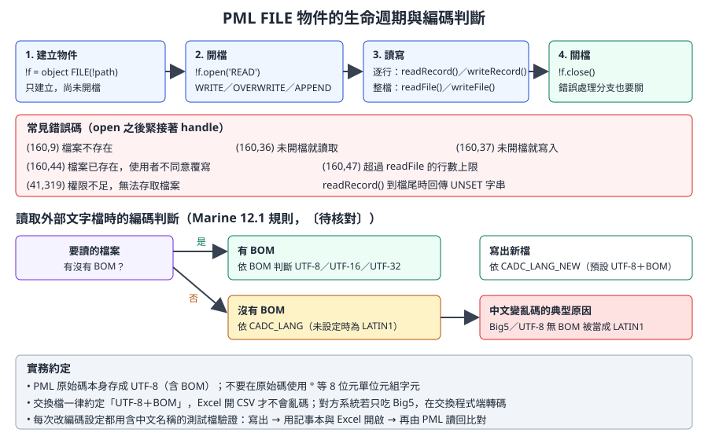
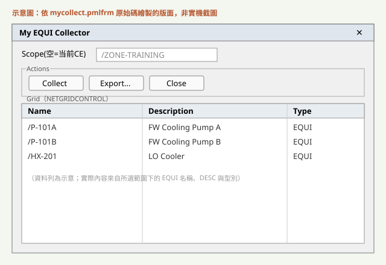
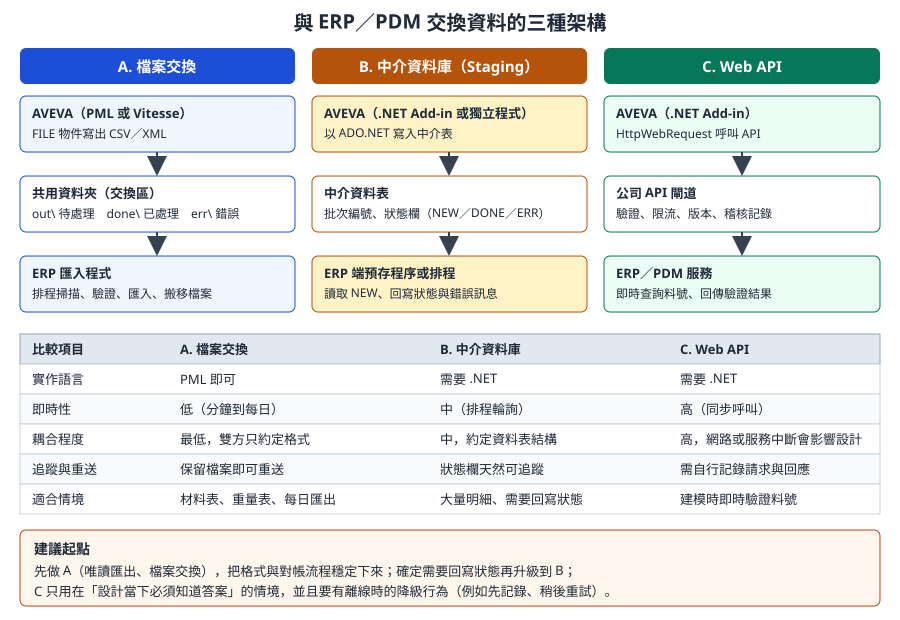

# 第 16 章　報表、檔案與外部系統整合

> 本章處理「資料離開 AVEVA」與「資料進入 AVEVA」兩個方向：用 PML 的 `FILE` 物件讀寫文字檔、處理中文編碼、輸出 CSV 與 Excel、讀取外部標準資料來驅動建模，以及與 ERP／PDM 交換資料時的架構選擇和排程批次。
>
> **資料可信度：** `FILE` 物件的開檔模式、讀寫方法與錯誤碼，取自 AVEVA 官方 *PML Customisation User Guide* 與 *Software Customisation Reference Manual*（help.aveva.com 上的 **E3D 2.1** 版本，PML 語法與 Marine 12.1 相同系譜）。編碼規則中的環境變數（`CADC_LANG`、`CADC_LANG_NEW`）來自開源知識庫 aveva-marine-dev-skill 對 PDMS 12.1 使用手冊的摘錄，標為〔待核對〕。整合架構與排程是一般系統整合的工程實務，本章依 AVEVA 的限制調整；凡涉及 AVEVA 批次啟動參數的部分都標為〔待核對〕。程式碼除了來自 `examples/` 的部分外，都標示「示意」。

## 16.1 學習目標

讀完本章，你應該能夠：

1. 使用 PML `FILE` 物件以正確的模式開檔、逐行或整檔讀寫，並處理常見錯誤碼。
2. 說明中文在 AVEVA 中出現亂碼的原因，並訂出公司的編碼約定。
3. 產生格式正確的 CSV（含逗號與引號跳脫），以及從表格控制項匯出 Excel。
4. 設計「讀外部資料、驗證、預覽、再建模」的資料驅動工具。
5. 比較檔案交換、中介資料庫、Web API 三種整合架構，選出適合的方案。
6. 規劃排程與批次執行，並知道哪些環節需要在公司環境驗證。

## 16.2 輸出管道總覽

| 管道 | 寫法 | 適合 | 注意 |
|---|---|---|---|
| 命令列 | `$P`、`q var` | 開發時檢查 | 不是給使用者的輸出 |
| 訊息框 | `!!alert.message()` | 簡短結果 | 會阻斷操作；不要在迴圈中使用 |
| 表單表格 | `NETGRIDCONTROL`（第 13 章） | 互動檢視、排序、篩選 | 大量資料時注意效能 |
| 文字檔、CSV | `FILE` 物件 | 交換、存檔、給 Excel | 編碼與跳脫 |
| Excel 檔 | 表格控制項的匯出功能，或 .NET | 直接給使用者 | 版本與授權 |
| 系統內建報表 | 第 9 章的報表功能 | 標準材料表 | 客製化程度有限 |
| 外部資料庫、API | .NET（第 14 章） | 系統整合 | 帳號、網路、重送 |

> **開發人員須知：** 報表工具幾乎都是**唯讀**的，是最適合新手開始的工具類型（第 18 章的優先順序第 1 名）。但「唯讀」只是對 AVEVA 模型而言；把檔案寫到共用資料夾、寫進外部資料庫，仍然會影響別人。輸出位置、命名與保存期限要先講好。

## 16.3 PML FILE 物件

### 16.3.1 生命週期



*圖 16-1　`FILE` 物件的生命週期、錯誤碼與編碼判斷。（本課程自繪，錯誤碼依官方 PML Customisation User Guide）*

`object FILE(路徑)` 只建立物件，**不會開檔**。開檔模式：

| 模式 | 行為 |
|---|---|
| `READ` | 讀取；檔案不存在時錯誤 (160,9) |
| `WRITE` | 寫入新檔；**檔案已存在時會跳出確認對話框**，使用者拒絕時錯誤 (160,44) |
| `OVERWRITE` | 直接覆寫，不詢問 |
| `APPEND` | 加在檔尾 |

批次或排程工具不能有對話框，所以輸出檔請用 `OVERWRITE`（或檔名加時間戳記搭配 `WRITE`）。

### 16.3.2 常用方法

| 方法 | 用途 |
|---|---|
| `open(模式)`、`close()`、`isOpen()`、`accessMode()` | 開關檔與狀態 |
| `readRecord()` | 讀一行，回傳 STRING；**到檔尾時回傳 UNSET 字串**，用 `.set()` 或 `.unset()` 判斷 |
| `writeRecord(字串)` | 寫一行 |
| `readFile()` | 整檔讀成字串陣列，**預設上限 10000 行**，可傳入行數上限；超過時錯誤 (160,47) |
| `writeFile(模式, 陣列)` | 把字串陣列整批寫出 |
| `exists()`、`size()`、`dtm()` | 檔案是否存在、大小、修改時間 |
| `copy()`、`move()`、`deleteFile()` | 檔案操作（請小心使用） |
| `files()`、`subDirs()` | 當 FILE 指向目錄時，列出檔案與子目錄 |

〔待核對〕上表中檔案操作與目錄列舉的方法名稱，來自開源知識庫整理的參考手冊摘要，請在公司版本用 `q meth !f` 確認。

### 16.3.3 讀檔：逐行與整檔

```pml
-- 示意：逐行讀取，適合大檔或需要邊讀邊處理
define function !!mycoReadLines(!path is STRING) is ARRAY
  !result = ARRAY()
  !f = object FILE(!path)
  !f.open('READ')
  handle (160,9)
    !!alert.error('找不到檔案：' & !path)
    return !result
  elsehandle (41,319)
    !!alert.error('沒有權限讀取：' & !path)
    return !result
  endhandle

  do
    !line = !f.readRecord()
    break if (!line.unset())
    !result.append(!line)
  enddo
  !f.close()
  return !result
endfunction
```

| 重點 | 說明 |
|---|---|
| `handle` 緊接在 `open` 之後 | PML 的錯誤只能被**下一行**的 `handle` 攔截（第 11 章） |
| 開放式 `do ... enddo` 一定要有 `break if` | 否則是無窮迴圈 |
| 以 `.unset()` 判斷檔尾 | `readRecord()` 到檔尾回傳 UNSET，不是空字串；空白行會回傳空字串，兩者不同 |

整檔讀取比較簡短：

```pml
-- 示意：整檔讀取，檔案不超過 readFile 的行數上限時使用
!f = object FILE(!path)
!lines = !f.readFile()
handle (160,9)
  !!alert.error('找不到檔案：' & !path)
  return
endhandle
```

### 16.3.4 寫檔

```pml
-- 示意：整批寫出；先組好陣列，再一次寫入，減少檔案操作
!lines = ARRAY()
!lines.append('Name,Description')
!lines.append('/E-101,Main pump')
!f = object FILE('C:\temp\myco_out.csv')
!f.writeFile('OVERWRITE', !lines)
handle any
  !!alert.error('寫檔失敗：' & !!error.text)
endhandle
```

> **專業提醒：** 輸出路徑不要寫死在程式碼中。可以讓使用者用檔案對話框選擇（知識庫提到官方用 `object PMLFILEBROWSER('SAVE')`〔待核對〕），或從公司設定檔讀取預設目錄。寫到共用資料夾前，先確認使用者帳號有寫入權限，錯誤 (41,319) 就是權限不足。

## 16.4 文字編碼：中文為什麼會變亂碼

中文名稱、描述、UDA 值在 AVEVA 內部顯示正常，輸出到檔案或讀入外部檔案時卻變成亂碼，幾乎都是**同一段位元組被用不同的編碼解讀**。

### 16.4.1 規則整理

依開源知識庫摘錄的 PDMS 12.1 使用手冊內容〔待核對〕：

| 對象 | 規則 |
|---|---|
| PML 原始碼檔案 | 只接受 UTF-8（含 BOM，優先）、UTF-16／UTF-32（含 BOM）或純 ASCII；不要使用 `°` 這類 8 位元單位元組字元，在 CJK 語系環境會出錯 |
| 讀取外部文字檔 | 有 BOM 時依 BOM 判斷；沒有 BOM 時依環境變數 `CADC_LANG`（未設定時視為 LATIN1） |
| 寫出新檔 | 依環境變數 `CADC_LANG_NEW`（預設 UTF-8＋BOM），可設定為 CP950（Big5）等 |
| 轉碼 | 安裝目錄附有轉碼工具 `transc.exe`，PML 函式 `!!pmlTranscFile` 有封裝 |

### 16.4.2 公司約定建議

| 約定 | 原因 |
|---|---|
| PML 原始碼一律存 UTF-8 含 BOM | 編輯器、Git、AVEVA 三方一致 |
| 交換檔一律 UTF-8 含 BOM | Excel 依 BOM 判斷 CSV 編碼；沒有 BOM 的 UTF-8 CSV 在中文 Windows 的 Excel 會被當成 Big5 而亂碼 |
| 對方系統只吃 Big5 時，由交換程式端轉碼 | AVEVA 端維持單一編碼，轉換集中在一處 |
| `CADC_LANG` 由系統管理員統一設定 | 每台電腦設定不同，同一支工具在不同人電腦結果不同，是最難查的問題 |

### 16.4.3 編碼驗證步驟

每次調整編碼設定、或新工具第一次輸出中文時，都跑一次：

1. 在訓練專案建立一個描述含中文、全形符號與 `°` 的測試元素（例如 `測試泵浦 φ100 45°`）。
2. 用工具輸出 CSV。
3. 用記事本開啟，確認右下角顯示的編碼；用 Excel 直接開啟，確認中文正常。
4. 用 PML 讀回該檔，與元素原本的描述比較是否完全相同。
5. 把結果記錄在工具的測試紀錄（第 17 章）。

## 16.5 CSV 與 Excel 輸出

### 16.5.1 CSV 的跳脫規則

CSV 欄位含逗號、雙引號或換行時，整個欄位要用雙引號包起來，欄位內的雙引號要寫成兩個。設計者常在描述中使用逗號，忽略這條規則會讓欄位錯位。

```pml
-- 示意：mycocsvfield.pmlfnc
define function !!mycoCsvField(!value is STRING) is STRING
  !s = !value
  if (!s.match(',') gt 0 or !s.match('"') gt 0) then
    !s = '"' & !s.replace('"', '""') & '"'
  endif
  return !s
endfunction
```

### 16.5.2 完整範例：設備清單 CSV

```pml
-- 示意：mycoexportequicsv.pmlfnc（唯讀）
-- 收集範圍內的 EQUI，輸出名稱、描述、位置
define function !!mycoExportEquiCsv(!scope is DBREF, !path is STRING) is REAL
  !coll = object COLLECTION()
  !coll.type('EQUI')
  !coll.scope(!scope)
  !items = !coll.results()

  !lines = ARRAY()
  !lines.append('Name,Description,Position')
  do !e values !items
    !row = !!mycoCsvField(!e.flnn) & ','
    !row = !row & !!mycoCsvField(!e.desc) & ','
    !row = !row & !!mycoCsvField(!e.pos.string())
    !lines.append(!row)
  enddo

  !f = object FILE(!path)
  !f.writeFile('OVERWRITE', !lines)
  handle any
    !!alert.error('寫檔失敗：' & !!error.text)
    return 0
  endhandle
  return !items.size()
endfunction
```

使用方式：

```pml
!n = !!mycoExportEquiCsv(!!ce, 'C:\temp\equi_list.csv')
$P 已輸出 $!n 筆
```

| 設計 | 原因 |
|---|---|
| 參數傳入範圍與路徑 | 函式可被表單、排程、其他工具重複使用 |
| 先組陣列再一次寫出 | 減少檔案 I/O；寫檔失敗時不會留下半個檔案以外的副作用 |
| 回傳筆數 | 呼叫端可以記錄或顯示 |
| 位置用 `.string()` | 位置在 PML 是 POSITION 物件，輸出前要轉成字串；格式依目前單位設定〔待核對：是否要指定 WRT 與格式〕 |

### 16.5.3 從表格控制項匯出 Excel

第 13 章的 MyCollect 範例用 `NETGRIDCONTROL` 顯示資料，再呼叫匯出函式：

```pml
define method .export()
  !!exportToExcel(!this.grid, ||, |Save EQUI List|)
endmethod
```

`!!exportToExcel` 是 AVEVA 內建的表格匯出函式〔待核對：依版本而定〕；表格控制項本身也有 `saveGridToExcel(路徑)` 方法（開源知識庫引自官方 `NetGridExample` 範例〔待核對〕）。



*圖 16-2　MyCollect 的表單示意（依原始碼繪製，非實機截圖）。表格中的資料可直接匯出 Excel。*

**選擇方式：**

| 方式 | 優點 | 缺點 |
|---|---|---|
| CSV | 最簡單，任何系統都能讀，適合交換 | 沒有格式、多工作表、公式 |
| 表格控制項匯出 | 使用者看到什麼就匯出什麼 | 需要表單；欄位格式受控制項限制 |
| .NET 產生 xlsx | 可控制格式、多工作表 | 需要相容 .NET 3.5 的函式庫並確認授權；不要在伺服器端使用 Office COM 自動化 |

## 16.6 讀取外部資料驅動建模

第 18 章的管支架案例把「每種管夾的尺寸」放在資料檔中，程式讀檔後建模，改尺寸不必改程式。這是**資料與程式分離**的基本做法。

### 16.6.1 流程

```
Excel（標準件尺寸表，由領域人員維護）
   ↓ 另存為 UTF-8 CSV，放到受控目錄
讀檔 → 解析 → 驗證 → 預覽 → 使用者確認 → 建模（訓練專案先測）→ 記錄
```

| 步驟 | 重點 |
|---|---|
| 來源 | 由誰維護、放在哪裡、怎麼審核版本；不要讓工具讀使用者桌面上的檔案 |
| 解析 | 第一行是標題；以欄名而非欄位位置取值，欄位順序調整時才不會錯 |
| 驗證 | 必填欄位、數值範圍、單位、重複鍵；任何一列不合格就整批停止並列出錯誤 |
| 預覽 | 在表單列出將建立的物件與尺寸；可用 AID 輔助圖形在 3D 中畫出位置（第 17 章） |
| 建模 | 先 Claim、建立、設定屬性；整批一個 `MARKDB` 標記，讓使用者可復原（第 12 章） |
| 記錄 | 寫入使用的資料檔版本、建立的元素名稱 |

### 16.6.2 範例：解析與驗證

假設尺寸表 `clamp_std.csv`：

```
type,dn,width,height,thk
CL-A,50,120,80,6
CL-A,80,150,95,8
CL-B,50,110,70,6
```

```pml
-- 示意：mycoloadclampstd.pmlfnc
-- 讀取尺寸表，回傳二維陣列；任何錯誤都記在 !errors
define function !!mycoLoadClampStd(!path is STRING, !errors is ARRAY) is ARRAY
  !rows = ARRAY()
  !f = object FILE(!path)
  !lines = !f.readFile()
  handle any
    !errors.append('無法讀取 ' & !path & '：' & !!error.text)
    return !rows
  endhandle

  -- 以標題決定欄位位置
  !head = !lines[1].split(',')
  !need = ARRAY()
  !need.append('type')
  !need.append('dn')
  !need.append('width')
  !need.append('height')
  !need.append('thk')
  !col = ARRAY()
  do !k index !need
    !pos = !head.findfirst(!need[!k])
    if (!pos.unset()) then
      !errors.append('缺少欄位：' & !need[!k])
      return !rows
    endif
    !col[!k] = !pos
  enddo

  do !i from 2 to !lines.size()
    if (!lines[!i].trim().empty()) then
      skip
    endif
    !cells = !lines[!i].split(',')
    !row = ARRAY()
    !row[1] = !cells[!col[1]]
    do !k from 2 to 5
      !v = !cells[!col[!k]].real()
      handle any
        !errors.append('第 ' & !i.string() & ' 行的 ' & !need[!k] & ' 不是數字')
        skip
      endhandle
      if (!v le 0) then
        !errors.append('第 ' & !i.string() & ' 行的 ' & !need[!k] & ' 必須大於 0')
      endif
      !row[!k] = !v
    enddo
    !rows.append(!row)
  enddo
  return !rows
endfunction
```

〔待核對〕`ARRAY.findfirst()`、`STRING.trim()` 的確切名稱與回傳值，請在公司版本以 `q meth` 確認；若沒有 `findfirst`，可改用迴圈比對標題。

建模部分（只在訓練專案）：

```pml
-- 示意：依驗證通過的尺寸建立一個以 BOX 表示的管夾設備
-- 前提：CE 位於訓練專案中可寫的 ZONE，命名規則依公司標準
MARKDB 'MYCO create clamp'
NEW EQUI /MYCO-CLAMP-0001
NEW BOX
XLEN 120
YLEN 80
ZLEN 6
```

建模命令只是示意；實際的設備樣板、命名、位置與方向計算，請依第 7 章與公司標準設計，並且通過第 17 章的審查才能上線。

### 16.6.3 為什麼不直接讀 Excel 檔

| 理由 | 說明 |
|---|---|
| 依賴少 | 讀 xlsx 需要 .NET 與額外函式庫；CSV 用 PML 就能讀 |
| 可審查 | CSV 是文字，可放進 Git 比對版本差異 |
| 不受 Excel 版本與巨集影響 | 合併儲存格、隱藏欄、公式結果都可能讓程式讀錯 |

建議讓領域人員在 Excel 維護，發佈時「另存為 CSV UTF-8」並放進受控目錄或 Git。

## 16.7 與 ERP／PDM 交換資料

### 16.7.1 三種架構



*圖 16-3　三種整合架構的比較與建議起點。（本課程自繪）*

| 架構 | AVEVA 端 | 外部端 | 典型用途 |
|---|---|---|---|
| A. 檔案交換 | PML 寫 CSV／XML 到交換資料夾 | 排程程式匯入，處理後搬到 `done` 或 `err` | 材料表、重量重心表、每日匯出 |
| B. 中介資料庫 | .NET 寫入中介資料表 | ERP 端讀取狀態為 NEW 的資料，回寫結果 | 大量明細、需要狀態回饋 |
| C. Web API | .NET 呼叫公司 API | ERP／PDM 服務即時回應 | 建模時驗證料號、查詢庫存 |

### 16.7.2 資料契約：比技術更重要

整合失敗的主因通常不是程式，而是雙方對資料的定義不同。開工前先寫好資料契約：

| 項目 | 要回答的問題 |
|---|---|
| 鍵值對應 | AVEVA 的哪個屬性對應 ERP 料號？是目錄元件、等級、UDA，還是名稱規則？（第 8 章） |
| 粒度 | 一列是一個元件、一條管線，還是一個材料彙總？ |
| 單位 | 長度 mm 或 m？重量 kg？口徑以 DN 或英寸？ |
| 版本 | 同一設計物件被修改後再次匯出，ERP 如何更新而不是重複新增？ |
| 刪除 | 設計中刪除的物件，如何通知 ERP？ |
| 批次識別 | 每次匯出有批次編號與時間，方便對帳與重送 |
| 錯誤回饋 | ERP 拒收的資料，誰處理、怎麼通知設計者？ |
| 冪等性 | 同一批資料送兩次，結果要與送一次相同 |

> **開發人員須知：** 設計資料在 AVEVA 中會持續變動，而 ERP 通常需要「某一時點、經過審核」的資料。比較好的做法是只匯出**已發行狀態**的資料（依公司的發行屬性或流程判斷），而不是任何時刻的工作中資料。這和第 6 章「生產資料是模型的快照」是同一個觀念。

### 16.7.3 .NET 寫入中介資料表

```csharp
// 示意：.NET 3.5 寫入中介資料表；連線字串由設定檔讀取，使用 Windows 驗證
using System;
using System.Data;
using System.Data.SqlClient;

public static class StagingWriter
{
    public static void WriteBatch(string connStr, string batchId, DataTable rows)
    {
        using (SqlConnection cn = new SqlConnection(connStr))
        {
            cn.Open();
            using (SqlTransaction tx = cn.BeginTransaction())
            {
                foreach (DataRow r in rows.Rows)
                {
                    using (SqlCommand cmd = new SqlCommand(
                        "INSERT INTO aveva_mto_staging (batch_id, item_code, qty, unit, status) " +
                        "VALUES (@b, @c, @q, @u, 'NEW')", cn, tx))
                    {
                        cmd.Parameters.AddWithValue("@b", batchId);
                        cmd.Parameters.AddWithValue("@c", r["item_code"]);
                        cmd.Parameters.AddWithValue("@q", r["qty"]);
                        cmd.Parameters.AddWithValue("@u", r["unit"]);
                        cmd.ExecuteNonQuery();
                    }
                }
                tx.Commit();   // 整批成功才提交，失敗時自動回滾
            }
        }
    }
}
```

| 設計 | 原因 |
|---|---|
| 參數化查詢 | 避免 SQL 注入與引號問題 |
| 整批一個交易 | ERP 端不會讀到一半的批次 |
| 狀態欄 `NEW` | ERP 端處理後改成 `DONE` 或 `ERR`，可追蹤與重送 |
| 連線字串不寫在程式中 | DLL 可被反編譯（第 14 章） |

### 16.7.4 Web API 的注意事項

- .NET 3.5 預設不支援較新的 TLS 版本，呼叫只接受 TLS 1.2 的 API 可能失敗，需要 Windows 更新與程式設定配合〔待核對：公司環境的 .NET 3.5 修補狀態〕。必要時改由公司內部的中介服務轉呼叫。
- 呼叫要設定逾時，並在背景執行，不要卡住 AVEVA 的畫面（第 14 章的執行緒提醒）。
- API 無法連線時，工具要能降級：記錄待送資料、提示使用者，而不是讓設計作業停擺。

## 16.8 排程與批次執行

### 16.8.1 四種執行方式

| 方式 | 說明 | 適合 | 待確認 |
|---|---|---|---|
| 使用者觸發的批次 | 表單按鈕啟動，在使用者的工作階段執行，顯示進度 | 數十到數百個物件的處理 | 無 |
| 命令列模式啟動模組 | 以批次檔啟動模組（不開圖形介面或最小化），登入後執行巨集，結束後離開 | 夜間報表 | 啟動參數、登入方式〔待核對〕 |
| .NET 獨立程式 | 依官方 `Samples\ImportDXF` 的結構，以 `PdmsStandalone` 開啟專案與 MDB 後操作 | 資料轉檔、整合 | 授權與環境〔待核對〕 |
| Windows 工作排程器 | 定時呼叫上兩者 | 每日匯出 | 執行帳號與網路磁碟權限 |

### 16.8.2 使用者觸發的批次：進度與中斷

```pml
-- 示意：依開源知識庫整理的 FMSYS 進度寫法〔待核對〕
-- !!fmstop 是一張只有「停止」按鈕的小表單，需另外定義
!!FMSYS.setInterrupt(!!fmstop.stopButton)
do !i index !items
  -- 處理 !items[!i]
  !!FMSYS.setProgress(!i * 100 / !items.size())
  if (!!FMSYS.interrupt()) then
    break
  endif
enddo
!!FMSYS.setProgress(0)
```

### 16.8.3 夜間批次的設計原則

```bat
@echo off
rem 示意：每日匯出排程的外殼。AVEVA 端的啟動與登入方式請依公司版本設定〔待核對〕
setlocal
set STAMP=%DATE:~0,4%%DATE:~5,2%%DATE:~8,2%
set LOG=\\toolsrv\aveva_jobs\logs\daily_mto_%STAMP%.log
set OUT=\\toolsrv\aveva_jobs\out

echo [%TIME%] start >> "%LOG%"
rem 1. 以公司批次帳號、唯讀 MDB 啟動模組並執行匯出巨集（此行依公司環境填寫）
rem call <公司啟動批次檔> <模組> <登入參數> <執行巨集>
if errorlevel 1 (
  echo [%TIME%] AVEVA job failed >> "%LOG%"
  exit /b 1
)
rem 2. 確認輸出檔存在且非空，再交給 ERP 匯入程式
for %%F in ("%OUT%\mto_%STAMP%.csv") do if %%~zF GTR 0 (
  echo [%TIME%] output ok %%~zF bytes >> "%LOG%"
) else (
  echo [%TIME%] output missing or empty >> "%LOG%"
  exit /b 2
)
echo [%TIME%] done >> "%LOG%"
endlocal
```

| 原則 | 原因 |
|---|---|
| 使用專用批次帳號與**唯讀** MDB | 報表不需要寫入；避免與設計者的 Claim 衝突 |
| 排在無人作業的時段，並考慮 Global 同步時間 | 讀到的是一致的資料 |
| 每一步寫記錄、檢查結果 | 夜間失敗要在早上被發現，而不是等使用者抱怨 |
| 輸出先寫暫存檔再改名 | 下游程式不會讀到寫到一半的檔案 |
| 確認授權數 | 批次啟動模組會占用授權，可能影響白天的使用者〔待核對：公司授權方式〕 |

> **專業提醒：** 開源知識庫提到 PML 的 `PMLUSERLOGIN` 物件可產生加密的自動登入巨集，以及 .NET 的 `PdmsStandalone.Open(專案, 帳號, 密碼, MDB)` 可開啟專案〔待核對〕。無論哪一種，都不要把明文密碼寫在批次檔或程式中，請與系統管理員討論帳號管理方式。

## 16.9 開發人員須知

- **輸出是契約。** 報表欄位一旦被下游使用，就不能任意改名、改順序或改單位。需要調整時增加版本號或新欄位。
- **大量資料先收集再寫。** 先用 `COLLECTION` 收集、組好陣列，再一次 `writeFile`；不要在迴圈中反覆開關檔案。
- **缺值不是 0。** 屬性未設定時輸出空白，並在報表說明中定義。
- **中文測試要常態化。** 每個會輸出文字的工具，測試資料都要包含中文與特殊符號。
- **整合先唯讀。** 先從 AVEVA 單向匯出開始；要把外部資料寫回 AVEVA，屬於第 18 章優先順序中的高風險工具。
- **路徑與帳號都來自設定。** 共用目錄、資料庫連線、API 位址，放在受控的設定檔，部署時依環境（測試、試用、正式）切換。

## 16.10 練習（只能在訓練專案）

1. **逐行讀檔。** 寫一個函式，讀取一個含空白行的文字檔，統計總行數與空白行數。確認你能區分「空白行」與「檔尾」。
2. **CSV 跳脫。** 在訓練專案中建立描述含逗號與雙引號的設備，用 16.5.2 的函式輸出，再用 Excel 開啟確認欄位沒有錯位。
3. **編碼驗證。** 依 16.4.3 的步驟完成一次編碼驗證，記下你電腦上 `CADC_LANG` 與 `CADC_LANG_NEW` 的值（用 `q evar CADC_LANG`）。
4. **資料驅動。** 依 16.6.2 讀取尺寸表，故意在一列放入非數字與負數，確認錯誤清單正確且整批不建模。
5. **整合設計。** 針對你們公司的一個 ERP 交換需求，填完 16.7.2 的資料契約表，並選擇 A、B、C 其中一種架構，寫出理由。

## 16.11 自我檢核

- [ ] 我知道 `WRITE` 與 `OVERWRITE` 的差別，以及批次工具為什麼不能用會跳對話框的模式。
- [ ] 我能用 `readRecord()` 與 `.unset()` 正確判斷檔尾，並說出 `readFile()` 的行數上限。
- [ ] 我能列出 (160,9)、(160,44)、(160,47)、(41,319) 的意義。
- [ ] 我能解釋中文亂碼的原因，並說明 BOM、`CADC_LANG` 與 Excel 開啟 CSV 的關係。
- [ ] 我能寫出正確跳脫逗號與雙引號的 CSV 輸出。
- [ ] 我能設計「讀檔、驗證、預覽、確認、建模、記錄」的資料驅動流程。
- [ ] 我能比較檔案交換、中介資料庫、Web API 的優缺點，並寫出資料契約。
- [ ] 我知道夜間批次需要唯讀 MDB、記錄、結果檢查與授權確認。

## 資料來源

- AVEVA E3D 2.1 *PML Customisation User Guide*（官方，PML 語法與 Marine 12.1 同系譜）：[檔案讀取](https://help.aveva.com/AVEVA_Everything3D/2.1/PMLPUG/PMLCG12.12.4.html)、[FILE 物件錯誤處理與錯誤碼](https://help.aveva.com/AVEVA_Everything3D/2.1/PMLPUG/PMLCG12.12.7.html)、[檔案處理章節](https://help.aveva.com/AVEVA_Everything3D/2.1/PMLPUG/PMLCG12.12.1.html)
- AVEVA E3D 2.1 *Software Customisation Reference Manual*：[FILE 物件](https://help.aveva.com/AVEVA_Everything3D/2.1/SCRM/SCRM3.3.37.html)
- 開源知識庫 [aveva-marine-dev-skill](https://github.com/912141548/aveva-marine-dev-skill)（MIT）：《AVEVA-Marine-PML開發技能》（編碼規則、FMSYS 進度）、《Marine-PML對象API字典精要》（FILE 方法）、《Marine-PML錯誤碼速查》、《AVEVA-Marine-NET-API用法Cookbook》（`ImportDXF` 獨立程式結構、`NetGridExample`）。
- 範例：[`examples/starter-kit-mycollect/`](examples/starter-kit-mycollect/)（MIT，同上）。
- 案例：eryar，[AVEVA MARINE 中用 PML 寫管支架程序（二）](https://blog.csdn.net/eryar/article/details/4457072)（資料檔驅動建模）。
- CSV 格式：[RFC 4180](https://www.rfc-editor.org/rfc/rfc4180)。
