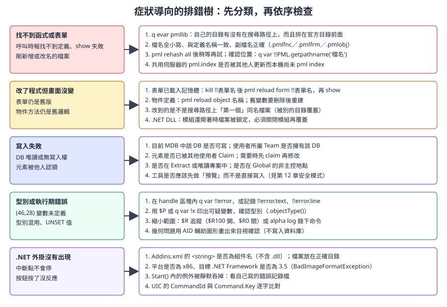
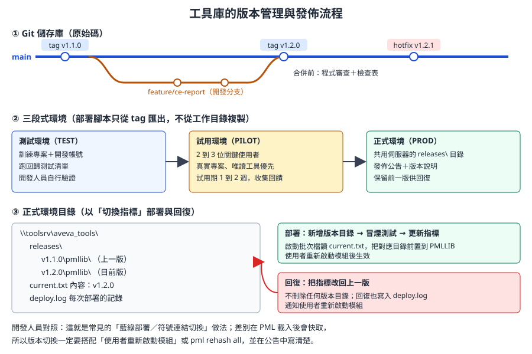

# 第 17 章　除錯、測試、部署與版本管理

> 前面幾章教的是「怎麼寫出能動的工具」，本章處理「怎麼讓工具可靠、可維護、可以安全上線」：PML 的除錯工具、常見錯誤的排除順序、測試策略、程式碼規範、用 Git 管理工具庫、部署與回復腳本、PML Publisher 加密，以及 Service Pack 升級時的回歸清單。
>
> **資料可信度：** 除錯命令（`$P`、`$R`、`q var`、`alpha log`、`pml reload` 等）是 PDMS／Marine 通用的 PML 功能，細節參考開源知識庫 aveva-marine-dev-skill 對 PDMS 12.1 使用手冊的摘錄；PML Publisher 的說明取自 AVEVA 官方 *PML Publisher User Guide*（help.aveva.com 上的 **E3D 1.1** 版本，Marine 12.1 是否隨附相同工具與參數〔待核對〕）。Git 結構、部署與回復腳本是本課程依一般軟體工程實務設計的建議做法，**不是 AVEVA 官方流程**，腳本標示「示意」，請依公司 IT 規範調整。

## 17.1 學習目標

讀完本章，你應該能夠：

1. 熟練使用 `$P`、`q var`、`$R` 追蹤、`alpha log`、`!!alert`、AID 輔助圖形與 `!!error` 除錯。
2. 依症狀分類，按順序排除「找不到函式」「表單沒更新」「寫入失敗」「型別錯誤」等問題。
3. 建立訓練專案的測試資料與回歸測試清單，落實唯讀優先。
4. 依公司程式碼規範撰寫檔頭、命名、錯誤處理，不寫死路徑、不殘留除錯命令。
5. 用 Git 管理 PMLLIB、.NET 與 Vitesse 工具庫，搭配分支與標籤發佈。
6. 以「測試、試用、正式」三段流程部署，並能用腳本快速回復。
7. 說明 PML Publisher 加密與 .NET DLL 在保護上的取捨。
8. 在 Service Pack 升級時，依清單完成回歸驗證。

## 17.2 除錯工具

| 工具 | 寫法 | 用途 | 交付時 |
|---|---|---|---|
| 輸出訊息 | `$P 文字 $!變數` | 在命令列印出進度與變數值 | 移除或改為記錄函式 |
| 查詢變數 | `q var !x`、`q var LOCAL`、`q var GLOBAL` | 查看變數的型別與值 | 不可留在程式中 |
| 查詢方法 | `q meth !obj` | 列出物件可用的方法與簽章，查 API 最可靠的方法 | 不可留 |
| 錯誤內容 | `!!error.text`、`!!error.line`、`q var !!error` | 在 `handle` 區塊中取得錯誤訊息與行號 | 寫入記錄 |
| 追蹤 | `$R100` 開啟、`$R0` 關閉（或 `PML TRACE ON`／`OFF`） | 逐行顯示執行到哪裡 | 必須移除 |
| 命令記錄 | `alpha log /C:\temp\debug.log` … `alpha log end` | 把命令窗口的輸出錄到檔案 | 必須移除 |
| 訊息框 | `!!alert.message()`、`!!alert.error()` | 給使用者的提示；除錯時也可暫停流程 | 只保留給使用者的訊息 |
| 輔助圖形 | `aid sphere ...`、`aid line ...` | 在 3D 視圖畫出計算結果，**不寫入資料庫** | 必須移除或做成開關 |
| 重新載入 | `pml reload form !!f`、`pml reload object 名稱`、`pml rehash all` | 修改後不必重啟模組 | 不寫在程式中 |
| 檔案位置 | `q var !!PML.getpathname('檔名.pmlfnc')` | 確認實際載入的是哪個檔案 | 不寫在程式中 |

〔待核對〕`$R` 的編號（例如 `$R100`、`$R102`、`$R109`）代表不同的追蹤細節與輸出位置，請以公司版本的 PML 使用手冊或 `$HR` 說明確認。

### 17.2.1 用 AID 輔助圖形除錯幾何

第 18 章的外板開孔論文提供了真實的示範：作者把計算出的交點與線段用 `aid sphere`、`aid line` 畫在 3D 視圖上，用眼睛確認演算法是否正確。


*圖 17-1　論文中以 `aid sphere $!templist[$!i] dia 200` 標出每個交點，再以 `AID LINE` 畫出找到的線段。（Kim, Park & Yang, 2020, Figure 11，CC BY-NC 3.0）*

建議把除錯圖形做成開關，交付時預設關閉：

```pml
-- 示意：以全域旗標控制除錯圖形
define function !!mycoDebugMark(!pos is POSITION, !label is STRING)
  -- 未定義的全域變數直接取用會產生 (46,28)，先以 undefined() 檢查〔待核對〕
  if (undefined(!!mycoDebug)) then
    return
  endif
  if (not !!mycoDebug) then
    return
  endif
  aid sphere $!pos dia 100
  $P DEBUG $!label at $!pos
endfunction
```

開啟方式：命令列輸入 `!!mycoDebug = true`。〔待核對〕清除輔助圖形的命令（例如 `aid clear all`）請以公司版本確認。

### 17.2.2 記錄函式

給使用者的工具不應該在命令列印出一堆訊息，但出問題時又需要資訊。可以寫一個記錄函式，寫到每位使用者自己的記錄檔：

```pml
-- 示意：mycolog.pmlfnc，附加一行到使用者暫存目錄的記錄檔
define function !!mycoLog(!tool is STRING, !level is STRING, !msg is STRING)
  -- 正式版應從公司設定檔或環境變數取得記錄目錄；此處簡化為固定目錄
  !dir = 'C:\temp'
  !clock = object DATETIME()
  !line = !clock.string() & ' | ' & !tool & ' | ' & !level & ' | ' & !msg
  !f = object FILE(!dir & '\myco_tools.log')
  !f.open('APPEND')
  handle any
    return
  endhandle
  !f.writeRecord(!line)
  !f.close()
endfunction
```

在錯誤處理中使用：

```pml
handle any
  !!mycoLog('mycollect', 'ERROR', !!error.text)
  !!alert.error('收集失敗，請將 C:\temp\myco_tools.log 提供給工具負責人。')
  return
endhandle
```

〔待核對〕`DATETIME` 物件的建構與格式化方法、讀取環境變數的 PML 寫法，請用 `q meth` 在公司版本確認。記錄函式本身失敗時必須安靜返回，不能讓「寫記錄失敗」中斷使用者的工作。

## 17.3 常見錯誤與排除



*圖 17-2　症狀導向的排錯樹。先判斷症狀屬於哪一類，再依序檢查。（本課程自繪）*

| 症狀 | 最常見原因 | 檢查 |
|---|---|---|
| 呼叫函式時說找不到 | 新檔案未重建索引；檔名有大寫；檔名與定義名不同 | `pml rehash all`；檔名全小寫；`q var !!PML.getpathname(...)` |
| 修改後行為沒變 | 表單或物件已在記憶體中 | `kill !!表單` 後 `pml reload form`；物件用 `pml reload object` |
| 改了檔案但載入的是別的檔 | 搜尋路徑中有同名檔案排在前面 | `q evar pmllib` 看順序；`getpathname` 確認 |
| (46,28) | 變數未定義：拼字錯誤，或在 `handle` 之後用了沒被賦值的變數 | 檢查拼字與賦值路徑 |
| (2,109) | 元素不存在：名稱打錯或已被刪除 | 先用 `handle (2,109)` 處理，給使用者清楚訊息 |
| (41,12) | 建立元素時名稱已存在 | 命名規則加流水號，或先檢查 |
| 寫入失敗 | DB 唯讀、Team 不擁有該 DB、元素被他人 Claim | 第 2 章的寫入權限檢查 |
| 比較時出錯 | REAL 與 STRING 混用、對 UNSET 值操作 | `.real()`、`.string()` 轉換；先 `.unset()` 判斷 |
| (1000,n) | PML.NET 的 .NET 端例外 | 第 14 章 |
| 迴圈不會結束 | 開放式 `do` 沒有 `break if` | 改用 `do !i index` 或 `do !x values` |

> **專業提醒：** PML 的錯誤只能被緊接在下一行的 `handle` 攔截。很多「明明有寫 handle 卻沒攔到」的問題，都是 `handle` 前面多了一行其他命令。

## 17.4 測試策略

### 17.4.1 四個原則

| 原則 | 做法 |
|---|---|
| 訓練專案 | 所有測試在訓練專案或其複本進行，使用開發用帳號；**不在生產專案「試一下」** |
| 固定測試資料 | 建立一個專用的測試 ZONE（例如 `/ZONE-MYCO-TEST`），內容固定且有文件：幾台設備、哪些有中文描述、哪些缺屬性 |
| 唯讀優先 | 工具先做出唯讀版本（查詢、預覽），確認資料理解正確後，才加寫入功能 |
| 回歸測試 | 每次修改與每次 SP 升級，都依清單重跑 |

### 17.4.2 測試資料設計

好的測試資料要涵蓋「正常」與「邊界」：

| 類別 | 例子 |
|---|---|
| 正常 | 名稱、描述、位置都完整的設備 |
| 中文與符號 | 描述含中文、逗號、雙引號、`°` |
| 缺值 | 沒有描述、UDA 未設定 |
| 空範圍 | 沒有任何設備的 ZONE |
| 大量 | 數百個元素的範圍，觀察效能 |
| 權限 | 唯讀 DB 中的元素、被他人 Claim 的元素 |
| 名稱衝突 | 已存在的名稱（建立型工具） |

### 17.4.3 回歸測試清單範本

每個工具都附一份清單，放在 Git 的 `tests/` 目錄：

```text
工具：MyCollect 1.2.0　　測試環境：訓練專案 TRN，帳號 DEVTEST
日期：________　測試者：________　AVEVA 版本：Marine 12.1 SP__

[ ] 1. 啟動 Outfitting，Utilities 選單出現 My EQUI Collector...
[ ] 2. CE = /ZONE-MYCO-TEST，Collect，筆數 = 12
[ ] 3. 中文描述「主海水泵浦, 1 號」顯示正確
[ ] 4. Scope 輸入不存在的名稱，出現錯誤訊息且表單不關閉
[ ] 5. 空的 ZONE，出現「No EQUI found」警告
[ ] 6. Export 存成 Excel，Excel 開啟中文正常、欄位不錯位
[ ] 7. 關閉後重新開啟，無殘留錯誤
[ ] 8. 記錄檔沒有 ERROR
結果：通過 ／ 不通過（附說明）
```

### 17.4.4 自動化測試的可能性

- PML 有開源的單元測試框架 PmlUnit（GitHub：PoByBolek/PmlUnit），可評估是否適用公司版本〔待核對：與 Marine 12.1 的相容性〕。
- 把純邏輯（字串處理、CSV 跳脫、尺寸驗證）寫成不依賴資料庫的函式，最容易自動測試。
- .NET 端的純邏輯可用一般的單元測試框架在開發機測試；與 AVEVA 互動的部分仍需人工冒煙測試。
- Vitesse 端同理：不 import `kcs_*` 的模組可以在開發機測試（第 15 章）。

## 17.5 程式碼規範

### 17.5.1 命名

| 對象 | 規則 | 例子 |
|---|---|---|
| 全域函式、表單、物件 | 公司前綴，避免與官方或他人衝突 | `!!mycoExportEquiCsv`、`!!mycoCollect`、`MYCOCLAMP` |
| 檔名 | 全小寫，與定義名相同 | `mycoexportequicsv.pmlfnc` |
| 目錄 | `pmllib/myco/{forms,functions,objects}` | 與官方結構一致 |
| 區域變數 | 有意義的英文 | `!items`、`!errors`，不要 `!a1`、`!tmp2` |
| 工具產生的元素 | 可追溯的命名規則 | `/MYCO-CLAMP-0001` |
| .NET | 命名空間「公司.工具」 | `MyCompany.MyBrowser` |
| Vitesse | 檔名加公司前綴 | `myco_dex.py` |

### 17.5.2 檔頭

```pml
--------------------------------------------------------------------------------
-- File:        mycoexportequicsv.pmlfnc
-- Type:        Function
-- Module:      Outfitting / Design
-- Description: 收集範圍內的 EQUI，輸出 CSV（唯讀）
-- Arguments:   !scope DBREF  收集範圍
--              !path  STRING 輸出檔完整路徑
-- Returns:     REAL  輸出筆數；失敗時 0
-- Data access: READ ONLY
-- Author:      ____  Reviewer: ____
-- History:     1.0  2026-10-28  初版
--------------------------------------------------------------------------------
```

`Data access` 一欄一定要寫：`READ ONLY`、`WRITE（範圍）` 或 `HULL RED ZONE`（第 15 章），審查者第一眼就知道風險。

### 17.5.3 規範條目

| 編號 | 規則 | 理由 |
|---|---|---|
| R1 | 註解用 `--`，不要用 `!` 或 `//` | `!` 是變數前綴，會造成解析錯誤 |
| R2 | 比較用 `eq`、`ne`、`gt`、`lt`、`ge`、`le`，條件加括號，`if` 後面要有 `then` | PML 沒有 `==`、`>` 等符號比較 |
| R3 | 每個資料庫寫入與檔案操作後都有 `handle` | 錯誤不可被吞掉，也不可讓整批中斷而不說明 |
| R4 | 不用 `golabel`、`gosub`；開放式 `do` 必須有 `break if` | 可讀性與避免無窮迴圈 |
| R5 | 不寫死路徑、帳號、專案名稱 | 由參數、設定檔或環境變數提供 |
| R6 | 交付程式不得留有 `$R`、`PML TRACE`、`q var`、`alpha log`、未受開關控制的 `aid` | 影響效能，也會讓使用者看到內部資訊 |
| R7 | 不修改官方檔案；需要改官方行為時，以平行目錄或掛勾方式擴充 | SP 升級時不會被覆蓋，也容易回復 |
| R8 | 寫入型工具要有預覽與確認，整批一個復原標記 | 第 12 章安全模式 |
| R9 | 原始碼存 UTF-8 含 BOM | 第 16 章 |
| R10 | 使用者訊息清楚說明「發生什麼、下一步怎麼做」 | 減少支援負擔 |

開源知識庫附有一份 PML 審核規範與靜態檢查腳本（`pml_audit.py`），可作為公司規範的參考；依本課程的共同規則，**請只閱讀其規則內容，在公司審查通過前不要執行其中任何腳本**。

## 17.6 用 Git 管理工具庫

### 17.6.1 建議的儲存庫結構

```text
aveva-tools/                    公司工具庫（一個 Git 儲存庫）
├─ pmllib/
│  └─ myco/
│     ├─ forms/                 *.pmlfrm
│     ├─ functions/             *.pmlfnc
│     └─ objects/               *.pmlobj
├─ pdmsui/
│  └─ DES/DFLTS/ADDINS/         PML Add-in 定義檔（例如 MYCOLLECT）
├─ dotnet/
│  ├─ MyBrowser/                C# 專案（.csproj、src）
│  └─ caf/                      公司版 OutfittingAddins.xml、*.uic
├─ vitesse/
│  ├─ Lib/                      myco_*.py
│  └─ Context_Menu/
├─ data/                        標準資料 CSV（由領域人員維護，經審查合併）
├─ config/
│  ├─ test.cfg                  各環境的路徑、輸出目錄
│  ├─ pilot.cfg
│  └─ prod.cfg
├─ deploy/
│  ├─ deploy.bat
│  └─ rollback.bat
├─ tests/
│  ├─ regression_mycollect.txt  回歸測試清單
│  └─ testdata.md               測試 ZONE 的內容說明
├─ docs/
│  └─ tools.md                  工具清單：用途、風險、負責人、入口
├─ CHANGELOG.md
├─ .gitattributes
└─ .gitignore
```

`.gitattributes` 與 `.gitignore` 的建議：

```text
# .gitattributes：PML 與批次檔以 CRLF 儲存，避免換行差異
*.pmlfnc text eol=crlf
*.pmlfrm text eol=crlf
*.pmlobj text eol=crlf
*.pmlmac text eol=crlf
*.bat    text eol=crlf
*.py     text eol=crlf
*.uic    text eol=crlf

# .gitignore：建置產物與執行期檔案不進版控
dotnet/**/bin/
dotnet/**/obj/
pml.index
*.pyc
*.log
```

> **開發人員須知：** `pml.index` 是索引檔，會由 `pml rehash` 重新產生，不要放進 Git，否則每個人的路徑差異會造成衝突。編輯器請設定「保留 UTF-8 BOM」，否則 Git 會顯示整個檔案都被改過。

### 17.6.2 分支與發佈

| 分支或標籤 | 用途 |
|---|---|
| `main` | 隨時可以發佈的版本；只能經由合併請求更新 |
| `feature/<工具>-<功能>` | 開發新功能；完成後經審查合併回 `main` |
| `hotfix/<版本>` | 正式環境緊急修正 |
| 標籤 `v1.2.0` | 每次發佈打一個標籤；**部署腳本只從標籤匯出** |

合併到 `main` 前的審查清單：

- [ ] 符合 17.5 的規範；檔頭的 `Data access` 正確。
- [ ] 回歸測試清單已更新並在訓練專案通過。
- [ ] `CHANGELOG.md` 已記錄變更、相容性與移除方式。
- [ ] 寫入型或船體紅區工具，有領域人員簽核。

### 17.6.3 版本號

採用「主版本.次版本.修正」：

| 位數 | 何時增加 | 例子 |
|---|---|---|
| 主版本 | 輸出格式、資料契約或操作方式不相容 | CSV 欄位改名 |
| 次版本 | 新功能，向下相容 | 新增一個匯出欄位 |
| 修正 | 錯誤修正 | 修正中文亂碼 |

## 17.7 部署：測試、試用、正式



*圖 17-3　版本管理與三段式發佈。部署時新增版本目錄、更新指標；回復時把指標改回上一版。（本課程自繪）*

| 階段 | 環境 | 誰使用 | 通過條件 |
|---|---|---|---|
| 測試 | 訓練專案、開發帳號 | 開發人員 | 回歸清單全部通過 |
| 試用 | 真實專案，限定 2 到 3 位使用者 | 關鍵使用者 | 1 到 2 週無重大問題，回饋已處理 |
| 正式 | 共用伺服器的發佈目錄 | 全體使用者 | 發佈公告、版本說明、回復方式已備妥 |

### 17.7.1 正式環境的目錄與啟動方式

```text
\\toolsrv\aveva_tools\
├─ releases\
│  ├─ v1.1.0\  pmllib\  pdmsui\  caf\  vitesse\
│  └─ v1.2.0\  pmllib\  pdmsui\  caf\  vitesse\
├─ current.txt        內容只有一行：v1.2.0
└─ deploy.log
```

公司啟動批次檔在呼叫 AVEVA 原本的啟動批次檔之前，讀取 `current.txt` 並把對應目錄加到搜尋路徑**前面**：

```bat
@echo off
rem 示意：公司啟動批次檔片段（呼叫 AVEVA 原啟動批次檔之前）
set TOOLROOT=\\toolsrv\aveva_tools
set /p TOOLVER=<"%TOOLROOT%\current.txt"
set TOOLDIR=%TOOLROOT%\releases\%TOOLVER%

if not exist "%TOOLDIR%\pmllib" (
  echo [WARN] 公司工具 %TOOLVER% 不存在，略過載入
  goto :start_aveva
)
set PMLLIB=%TOOLDIR%\pmllib %PMLLIB%
set PDMSUI=%TOOLDIR%\pdmsui %PDMSUI%
set CAF_ADDINS_PATH=%TOOLDIR%\caf;%CAF_ADDINS_PATH%

:start_aveva
rem 接著呼叫 AVEVA 原本的啟動批次檔
```

〔待核對〕`PMLLIB`、`PDMSUI` 多個路徑的分隔方式（空格或分號）與 AVEVA 啟動批次檔是否會覆寫這些變數，請依公司版本的 `evars.bat` 確認；若 AVEVA 的批次檔會重設變數，改在專案層級的 evars 批次檔中前置。第 10 章有搜尋路徑的完整說明。

### 17.7.2 部署腳本

```bat
@echo off
rem 示意：deploy.bat <版本標籤>
rem 由工具負責人在有寫入權限的電腦執行；從 Git 標籤匯出，不從工作目錄複製
setlocal
if "%~1"=="" ( echo 用法：deploy.bat v1.2.0 & exit /b 1 )
set VER=%~1
set TOOLROOT=\\toolsrv\aveva_tools
set TARGET=%TOOLROOT%\releases\%VER%
set REPO=%~dp0..

if exist "%TARGET%" ( echo [ERR] %TARGET% 已存在，版本不可覆蓋 & exit /b 1 )

rem 1. 確認標籤存在
git -C "%REPO%" rev-parse "%VER%" >nul 2>&1 || ( echo [ERR] 找不到標籤 %VER% & exit /b 1 )

rem 2. 從標籤匯出到暫存目錄
set STAGE=%TEMP%\aveva_tools_%VER%
if exist "%STAGE%" rmdir /s /q "%STAGE%"
mkdir "%STAGE%"
git -C "%REPO%" archive --format=zip -o "%STAGE%\src.zip" "%VER%" || exit /b 1
powershell -NoProfile -Command "Expand-Archive -Path '%STAGE%\src.zip' -DestinationPath '%STAGE%\src'" || exit /b 1

rem 3. 複製到新的版本目錄（.NET DLL 需先另行建置並放入 caf\）
mkdir "%TARGET%"
xcopy /s /i /y "%STAGE%\src\pmllib"  "%TARGET%\pmllib"  >nul || exit /b 1
xcopy /s /i /y "%STAGE%\src\pdmsui"  "%TARGET%\pdmsui"  >nul || exit /b 1
xcopy /s /i /y "%STAGE%\src\vitesse" "%TARGET%\vitesse" >nul || exit /b 1
copy /y "%STAGE%\src\config\prod.cfg" "%TARGET%\myco.cfg" >nul || exit /b 1

echo %DATE% %TIME% %USERNAME% DEPLOYED %VER% (not yet current) >> "%TOOLROOT%\deploy.log"
echo [OK] 已部署到 %TARGET%
echo      請以試用帳號把 PMLLIB 指向該目錄、執行 pml rehash all 並完成冒煙測試，
echo      通過後再執行：switch.bat %VER%
endlocal
```

切換與回復共用同一支腳本，只改指標：

```bat
@echo off
rem 示意：switch.bat <版本>，用於正式切換與回復
setlocal
set TOOLROOT=\\toolsrv\aveva_tools
if "%~1"=="" ( echo 用法：switch.bat v1.1.0 & exit /b 1 )
if not exist "%TOOLROOT%\releases\%~1\pmllib" ( echo [ERR] 版本 %~1 不存在 & exit /b 1 )

set /p OLD=<"%TOOLROOT%\current.txt"
> "%TOOLROOT%\current.txt" echo %~1
echo %DATE% %TIME% %USERNAME% SWITCH %OLD% -^> %~1 >> "%TOOLROOT%\deploy.log"
echo [OK] current: %OLD% -^> %~1。請通知使用者重新啟動模組。
endlocal
```

| 設計 | 原因 |
|---|---|
| 版本目錄不可覆蓋 | 正在使用舊版的人不會讀到一半新一半舊的檔案 |
| 從標籤匯出 | 部署內容可追溯到確定的原始碼 |
| 部署與切換分開 | 先放上去、驗證，再切換；回復只是再切一次 |
| 永不刪除舊版本目錄 | 回復不需要重新部署 |
| 記錄誰、何時、從哪版切到哪版 | 出問題時能對照時間點 |

> **專業提醒：** `pml.index` 需要對新版本目錄重新產生。做法是由有寫入權限的工具負責人，用指向新目錄的 `PMLLIB` 啟動模組並執行 `pml rehash all`〔待核對：rehash 寫入索引檔的位置與權限需求；開源知識庫另提到安裝目錄附有 `pmlscan.exe` 可離線產生索引〕。.NET DLL 被執行中的模組鎖定，所以 DLL 也要隨版本目錄分開存放，不能覆蓋正在使用的檔案。

## 17.8 保護：PML Publisher 與 .NET DLL

### 17.8.1 PML Publisher

官方的 PML Publisher 以命令列工具 `pmlencrypt.exe` 加密 PML 檔案。依 E3D 1.1 的 *PML Publisher User Guide*：

| 重點 | 說明 |
|---|---|
| 不可逆 | **官方沒有提供解密工具**；加密前務必保留原始碼（Git 就是你的原始碼備份） |
| 處理整個目錄 | 例如 `pmlencrypt.exe -pmllib pmllib_original pmllib`，處理 `.pmlmac`、`.pmlfrm`、`.pmlobj`、`.pmlfnc` 等檔案 |
| 演算法 | 預設使用 RC4；`-basic` 較弱、不建議；另有僅供測試的簡易加密 |
| `-buffer` | 讓常用的加密檔留在記憶體，減少重複解密 |
| 強度有限 | 官方明言加密強度有限，不能抵擋所有攻擊 |

〔待核對〕Marine 12.1 安裝目錄是否附有 `pmlencrypt.exe`、參數是否相同。

建議流程：Git 保存原始碼 → 部署腳本在「複製到版本目錄」之後執行加密 → 加密後在試用環境冒煙測試（加密可能暴露原本不明顯的語法問題）。

### 17.8.2 PML、加密 PML 與 .NET 的取捨

| 方式 | 保護程度 | 除錯 | 部署 | 適合 |
|---|---|---|---|---|
| 明碼 PML | 無 | 最容易，使用者端也能看 | 最簡單 | 公司內部工具 |
| 加密 PML | 中（強度有限） | 使用者端無法看原始碼，需在開發環境重現 | 多一步加密 | 交付給外部或含業務規則的工具 |
| .NET DLL | 中（可被反編譯，可再混淆） | 需要 Visual Studio | 需要建置與版本綁定 | 本來就需要 .NET 的功能 |

> **開發人員須知：** 對公司內部工具來說，最大的風險通常不是被偷看，而是「只有一個人看得懂」。保護之前先確定原始碼、文件與回歸清單都在 Git 中，任何人都能接手。

## 17.9 Service Pack 升級回歸清單

AVEVA 升級 Service Pack 時，官方檔案會被替換。依賴官方行為的工具，可能在沒有任何錯誤訊息的情況下行為改變。

### 17.9.1 升級前

- [ ] 閱讀新 SP 的版本說明，標出與 PML、.NET、Vitesse、資料庫結構有關的變更。
- [ ] 盤點工具清單（`docs/tools.md`），列出每個工具依賴的官方元件：官方表單、官方函式、`Addins.xml`、`.uic`、marAPI、Vitesse Trigger。
- [ ] 備份目前安裝目錄中**被公司修改過**的官方檔案（理想上應該是零個；Vitesse 的 `trig_draft_popup_menu.py` 是常見例外）。
- [ ] 準備一個安裝新 SP 的測試環境，訓練專案與測試 ZONE 一併複製。

### 17.9.2 升級後逐項檢查

| 類別 | 檢查項目 |
|---|---|
| 啟動環境 | 新版啟動批次檔是否改變變數名稱或順序；公司前置的 `PMLLIB`、`PDMSUI`、`CAF_ADDINS_PATH` 是否仍生效 |
| PML | `pml rehash all`；所有工具的回歸清單；有覆蓋或擴充官方表單、選單的工具特別注意（官方表單結構可能改變） |
| PML Add-in | 選單入口是否還在；`.modifyMenus()` 掛勾使用的官方選單名稱是否改變 |
| .NET | 參考指向新安裝目錄重新建置；確認強名與版本；Addins.xml 是否被安裝程式覆蓋；UIC 的父選單名稱是否改變 |
| PML.NET／marAPI | 用 `q meth` 對照工具使用的方法是否仍存在 |
| Vitesse | 官方 Trigger 是否被覆蓋，公司修改區段需重新合併；`kcs_*` 函式行為抽樣驗證 |
| 編碼 | 依第 16 章重跑一次中文驗證 |
| 效能 | 大量資料的工具抽測執行時間 |
| 試用 | 關鍵使用者在試用環境使用一週 |

### 17.9.3 升級紀錄

把每次升級的結果記在 `CHANGELOG.md` 或升級報告中：版本、日期、受影響工具、修改內容、測試者。下一次升級時，這份紀錄就是最好的檢查清單起點。

## 17.10 開發人員須知

- **先重現，再修改。** 使用者回報問題時，先在訓練專案用相同資料重現；無法重現時，請使用者提供記錄檔與操作步驟。
- **一次只改一件事。** 除錯時同時改多處，就無法確定是哪一處解決了問題。
- **除錯命令不進版本庫。** 合併前搜尋 `$R`、`PML TRACE`、`q var`、`alpha log`，可以寫成簡單的 Git 檢查。
- **部署是可重複的程序。** 任何靠「記得要手動做」的步驟，都應該寫進腳本或清單。
- **回復要演練。** 第一次正式部署前，先在測試環境演練一次切換與回復。
- **工具清單是資產。** 每個工具的用途、風險等級、負責人、入口、移除方式都要登記，人員異動時才能接手。

## 17.11 練習（只能在訓練專案）

1. **追蹤一次執行。** 對第 16 章的 `!!mycoExportEquiCsv` 開啟 `$R` 追蹤與 `alpha log`，錄下一次執行，找出它讀了哪些屬性。完成後關閉並確認程式中沒有殘留。
2. **AID 除錯。** 寫一個函式，把目前 ZONE 中每台設備的位置用 `aid sphere` 標出，並以 `!!mycoDebug` 控制開關。
3. **測試資料。** 依 17.4.2 在訓練專案建立測試 ZONE，寫成 `tests/testdata.md`。
4. **建立儲存庫。** 依 17.6.1 建立工具庫的 Git 儲存庫，放入 MyCollect，打上 `v1.0.0` 標籤。
5. **部署與回復演練。** 在本機資料夾模擬 `\\toolsrv\aveva_tools`，用 `deploy.bat` 部署 `v1.0.0` 與 `v1.1.0`，切換後再回復，檢查 `deploy.log`。
6. **升級盤點。** 針對你們目前使用中的工具，填寫 17.9.1 的依賴盤點。

## 17.12 自我檢核

- [ ] 我能說明 `$P`、`q var`、`q meth`、`$R`、`alpha log`、`!!error`、AID 各自的用途。
- [ ] 我知道 `handle` 只攔截上一行的錯誤。
- [ ] 我能依症狀分類排除常見錯誤，並知道 `pml reload` 與 `pml rehash all` 的差別。
- [ ] 我能設計涵蓋中文、缺值、空範圍、權限的測試資料與回歸清單。
- [ ] 我的程式有標準檔頭、公司前綴、錯誤處理，沒有寫死路徑與殘留除錯命令。
- [ ] 我能說明工具庫的 Git 結構、分支、標籤與 `.gitignore` 的內容。
- [ ] 我能用「新增版本目錄、更新指標」的方式部署與回復。
- [ ] 我知道 PML Publisher 加密不可逆，以及它與 .NET DLL 的取捨。
- [ ] 我能依清單完成 Service Pack 升級後的回歸驗證。

## 資料來源

- AVEVA E3D 1.1 *PML Publisher User Guide*（官方）：[PML Publisher 概述](https://help.aveva.com/AVEVA_Everything3D/1.1/PMLPUG/PMLPUG3.3.01.html)、[User Guide 章節](https://help.aveva.com/AVEVA_Everything3D/1.1/PMLPUG/PMLPUG3.3.03.html)、[相關章節（加密選項）](https://help.aveva.com/AVEVA_Everything3D/1.1/PMLPUG/PMLPUG3.3.16.html)
- AVEVA E3D 2.1 *PML Customisation User Guide*：[FILE 物件錯誤處理](https://help.aveva.com/AVEVA_Everything3D/2.1/PMLPUG/PMLCG12.12.7.html)
- 開源知識庫 [aveva-marine-dev-skill](https://github.com/912141548/aveva-marine-dev-skill)（MIT）：《AVEVA-Marine-PML開發技能》（除錯工具箱、`pml reload`、部署驗證）、《Marine-PML錯誤碼速查》、《PML審核規範》、《AVEVA-Marine-TTY環境自檢腳本》。
- 論文圖片：Kim, C.-S., Park, D.-W., & Yang, Y.-J. (2020). Development of an automatic shell plate hole generation system using AVEVA Marine. *Journal of Advanced Marine Engineering and Technology*, 44(3), 196–202. [https://doi.org/10.5916/jamet.2020.44.3.196](https://doi.org/10.5916/jamet.2020.44.3.196)（CC BY-NC 3.0）
- PML 單元測試框架：[PoByBolek/PmlUnit（GitHub）](https://github.com/PoByBolek/PmlUnit)
- 版本號規則參考：[Semantic Versioning 2.0.0](https://semver.org/)
