# 第 18 章　實戰案例與完整範例

> 本章把前面各章串起來：先精讀一個有**實機畫面與實際 PML 程式**的學術案例（外板開孔自動化），再看一個物件化 PML 工具的設計（管支架），接著導覽本課程的三個可部署範例（PML、C#、Vitesse），最後說明公司工具如何立案與排定優先順序。
>
> **資料可信度：** 案例一的圖片全部取自開放取用論文 Kim, Park & Yang (2020)（CC BY-NC 3.0），是作者在 AVEVA Marine 上實際執行的畫面；文字為本課程自行撰寫的導讀，論文中的函式庫方法是否存在於公司版本〔待核對〕。案例二取自資深開發者的部落格文章，屬於較早期的 Marine 版本。三個範例來自 MIT 授權的開源專案 aveva-marine-dev-skill，針對 Marine 12.1 SP4 撰寫，**本課程未在實機上執行**，示意圖依原始碼繪製。工具立案與優先順序是本課程的建議做法。

## 18.1 學習目標

讀完本章，你應該能夠：

1. 用「業務問題、系統架構、關鍵技術、成效與限制、啟發」五個面向分析一個開發案例。
2. 讀懂論文中三段真實 PML 程式：以包圍盒找外板、求曲面與平面的交線、以兩點求方向。
3. 說明物件化 PML 工具與「資料與程式分離」的設計方式。
4. 依步驟部署 MyCollect、MyBrowser 與 Vitesse 船體報表三個範例，完成冒煙測試與延伸練習。
5. 為公司工具撰寫立案單，並依效益與風險排定優先順序。

## 18.2 怎麼讀案例

每個案例都用同一個架構分析：

| 面向 | 要回答的問題 | 對應章節 |
|---|---|---|
| 業務問題 | 現場遇到什麼困難？代價是什麼？ | 第 5 至 9 章 |
| 系統架構 | 資料從哪裡來、存在哪裡、誰使用？ | 第 2、3 章 |
| 關鍵技術 | 用了哪些 PML 物件、.NET 介面或船體 API？ | 第 11 至 15 章 |
| 成效與限制 | 解決了什麼？還有什麼問題？ | 第 17 章 |
| 啟發 | 公司可以借鏡什麼？ | 18.7 |

## 18.3 案例一：外板開孔自動產生系統（學術論文）

**出處：** Chang-Su Kim、Dong-Woo Park、Young-Jun Yang，〈Development of an automatic shell plate hole generation system using AVEVA Marine〉，*Journal of Advanced Marine Engineering and Technology*, 44(3), 196–202, 2020。[DOI: 10.5916/jamet.2020.44.3.196](https://doi.org/10.5916/jamet.2020.44.3.196)，CC BY-NC 3.0。

### 18.3.1 業務問題

船殼外板上有許多功能性開孔：海水箱孔（Sea Chest，讓海水進入冷卻系統）、排水孔、通氣孔。傳統做法是：

1. 舾裝設計把開孔需求交給船體設計。
2. 船體在圖面上標示開孔位置。
3. 現場依圖面量測、劃線，以氧乙炔手工切割。

論文指出三個問題：

| 問題 | 說明 |
|---|---|
| 資訊轉手出錯 | 開孔座標在部門之間傳遞時出錯，是船廠設計錯誤的主要來源之一 |
| 外板沒有自動化 | 既有的開孔管理只用在內部平板；曲面外板仍在現場施工 |
| 安全風險 | 外板開孔常在高處作業，有墜落與工具掉落的危險 |

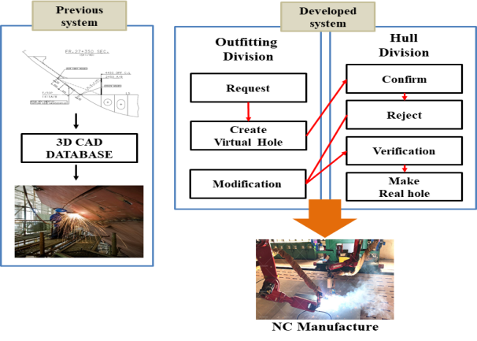

*圖 18-1　舊流程（左）與新流程（右）。新流程中，舾裝負責申請、建立虛擬孔與修改；船體負責確認、退回、驗證與產生實際孔，最後交給 NC 切割。（Kim et al., 2020, Figure 1）*

### 18.3.2 系統架構

系統分成舾裝端與船體端兩個模組，以一個**開孔資訊資料庫**串接：

| 模組 | 使用者 | 功能 |
|---|---|---|
| Outfitting Hole Manager | 舾裝設計 | 輸入開孔型式、參考軸、座標；產生虛擬孔 |
| 開孔資訊資料庫 | 兩個部門共用 | 記錄每個開孔的型式、位置與狀態 |
| Hull Hole Manager | 船體設計 | 依資料確認、退回，或產生實際孔，交給 NC |

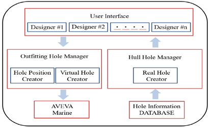

*圖 18-2　系統架構。（Kim et al., 2020, Figure 2）*

開孔有兩種狀態：**Marked**（虛擬孔，只標示位置，等待確認）與 **Burnt**（實際孔，NC 階段要切出）。用開發人員的語言說，這就是一個有職責分離的工作流程狀態機：

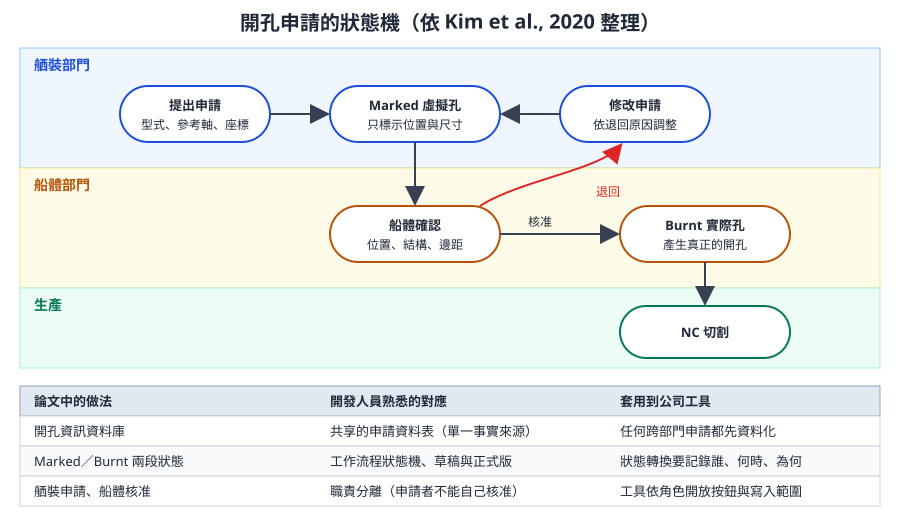

*圖 18-3　開孔申請的狀態機與開發概念對照。（本課程依論文自繪）*

### 18.3.3 實際執行畫面

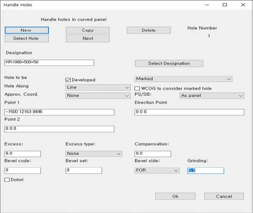

*圖 18-4　輸入開孔資訊的對話框。`Designation` 選開孔型式；`Approx. Coord.` 選參考軸；`Marked`／`Burnt` 選虛擬孔或實際孔；`Point 1` 輸入孔中心座標。（Kim et al., 2020, Figure 3）*

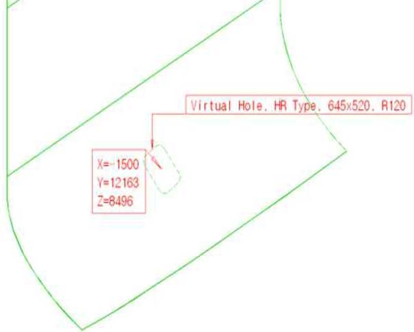

*圖 18-5　產生的虛擬孔。圖面上自動標註孔型、尺寸、圓角與中心座標（X=-1500、Y=12163、Z=8496），供船體人員確認。（Kim et al., 2020, Figure 4）*

> **開發人員須知：** 注意虛擬孔上「自動標註」的設計。確認者不需要另外查資料，看圖就知道孔的型式、尺寸與位置。審查型工具的價值，常常來自「把審查者需要的資訊放在他眼前」。

### 18.3.4 關鍵技術：在曲面上求開孔方向

平板上的開孔只要座標就夠了；曲面外板則要知道該點的**表面方向**，孔才會垂直於外板。論文的演算法可以歸納為五步：

| 步驟 | 做法 | 相關章節 |
|---|---|---|
| 1. 找外板 | 依序載入分段與外板，判斷孔中心落在哪一塊外板上 | 第 3、12 章 |
| 2. 建虛擬平面 | 在孔中心建立一個與外板相交、大小有限的平面 | 第 4 章 |
| 3. 求交點 | 取得外板與虛擬平面的交線點，挑出包夾孔中心的兩點 | 第 4 章 |
| 4. 算方向 | 把兩點視為直線，以投影求出方向 | 第 4 章 |
| 5. 產生開孔 | 以中心、方向、型式產生實際孔 | 第 5 章 |

排水孔與通氣孔尺寸小、形狀不影響結構，論文直接以座標產生，省略方向計算。這是「依風險決定處理深度」的務實做法。

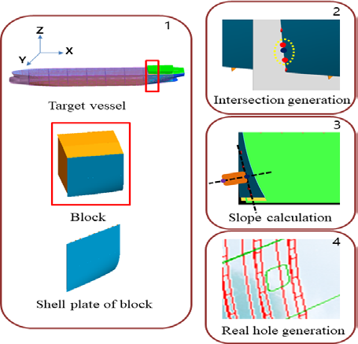

*圖 18-6　整體流程。（Kim et al., 2020, Figure 5）*

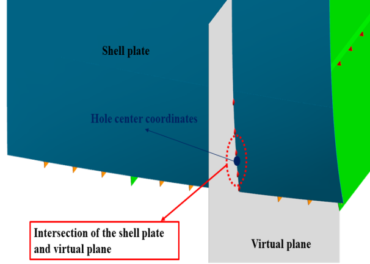

*圖 18-7　外板（藍綠色）與虛擬平面（灰色）相交。紅色虛線圈內是交點，深藍點是開孔中心。（Kim et al., 2020, Figure 10）*

### 18.3.5 讀懂論文中的 PML 程式

論文附了三段實際執行的 PML 截圖，是「PML 如何操作船體幾何」難得的真實教材。

**步驟 1：用包圍盒找出孔中心落在哪一塊外板**

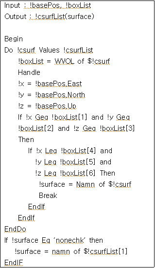

*圖 18-8　（Kim et al., 2020, Figure 6）*

| 程式片段 | 意義 | 開發人員對照 |
|---|---|---|
| `Do !csurf Values !csurfList` | 逐一走訪分段中的外板清單 | `foreach` |
| `!boxList = WVOL of $!csurf` | 取得外板的世界座標包圍盒，6 個值依序是最小 E、N、U 與最大 E、N、U | 軸對齊包圍盒（AABB） |
| `!basePos.East`、`.North`、`.Up` | 取出孔中心的三個座標分量 | 點的 x、y、z |
| `Geq`、`Leq` 比較 | 判斷中心是否在包圍盒內 | 範圍判斷 |
| `Namn of $!csurf` | 取得外板名稱 | 讀屬性 |
| `Handle ... EndHandle` | 某塊外板取不到屬性時不讓程式中斷 | try／catch |

> **照抄前請注意：** 論文截圖中有幾處不符官方標準語法，例如 `Handle` 沒有指定錯誤碼、`If` 條件沒有加括號、陣列索引出現 `[0]`（PML 陣列從 1 開始）。這些寫法可能依賴該版本或作者環境；學習時以理解演算法為主，實作請改用第 11、12 章的標準語法。

包圍盒判斷快但不精確：曲面外板的包圍盒可能互相重疊，論文保留第一個符合的外板作為預設。實務上可以再加一層精確判斷，例如計算點到曲面的距離。

**步驟 2：建立虛擬平面並求交線**

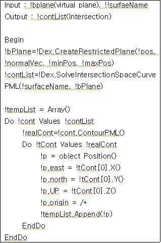

*圖 18-9　（Kim et al., 2020, Figure 8）*

| 程式片段 | 意義 |
|---|---|
| `!!Dex.CreateRestrictedPlane(!pos, !normalVec, !minPos, !maxPos)` | 以位置、法向量與上下限建立有限大小的平面 |
| `!!Dex.SolveIntersectionSpaceCurvePML(!surfaceName, !bPlane)` | 求外板曲面與平面的空間交線 |
| `!cont.ContourPML()` | 把交線轉成點列 |
| `object Position()` 與 `.east`、`.north`、`.up` | 把點列轉成 PML 的 POSITION 物件 |
| `!tempList.Append(!p)` | 收集所有交點 |

注意方法名稱的 `PML` 字尾：第 15 章提過，marAPI 的方法常成對出現，PML 只能呼叫 `PML` 結尾的版本。〔待核對〕`!!Dex` 物件與其方法屬於論文所用版本的函式庫，公司版本是否相同，請用 `q meth` 確認。

**步驟 3：用兩個交點求方向**


*圖 18-10　（Kim et al., 2020, Figure 11）*

| 程式片段 | 意義 |
|---|---|
| `!tempList.SortUnique()` | 排序並去除重複交點 |
| `aid sphere $!templist[$!i] dia 200` | 在 3D 視圖畫出輔助球，**用來目視除錯**（第 17 章） |
| `!line = !pos1.Line(!pos2)` | 以相鄰兩點建立直線 |
| `!line.OnProjected(!basepos)` | 判斷中心點的投影是否落在這段線上 |
| `!line.Near(!basePos)` | 求線上最接近中心點的位置 |
| `AID LINE`、`AID SPHERE` | 把找到的線段與點畫出來，供人工確認 |

### 18.3.6 成效與限制

論文報告，系統於 2018 年應用在一艘散貨船上：

| 項目 | 導入前 | 導入後 |
|---|---|---|
| 切割方式 | 氧乙炔手工切割 | NC 自動切割 |
| 每孔工時 | 約 3 人時 | 約 0.1 人時以下 |
| 切割品質 | 依工人技術而定 | 穩定 |
| 額外作業 | 高處作業、事先劃線、修磨 | 不需要額外修整 |

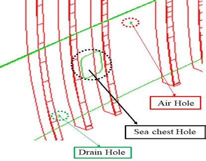

*圖 18-11　外板上產生的海水箱孔（黑圈）、排水孔（綠圈）與通氣孔（紅圈）。（Kim et al., 2020, Figure 14）*

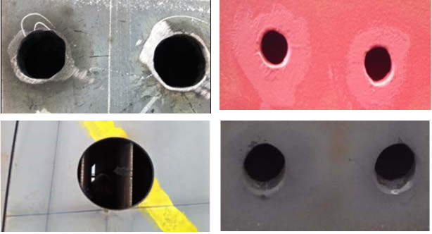

*圖 18-12　切割成果比較。左欄為導入前的手工切割，右欄為導入後的 NC 切割。（Kim et al., 2020, Table 1 照片拼接）*

作者也指出限制：

- 交點間距難以調整，方向計算的精度還有改進空間。
- 尺寸大或靠近構件邊緣的孔，在外板成形時可能變形。可採用船廠常用的 Bridge 做法（保留連接筋，成形後再切除），並將做法標準化。

### 18.3.7 對我們的啟發

| 啟發 | 說明 |
|---|---|
| 先把跨部門介面資料化 | 開孔資訊從「圖面標示」變成「資料庫記錄」，自動化才有可能 |
| 狀態管理 | 申請、確認、執行的狀態機可以套用在任何跨部門申請 |
| 自動化停在確認點之前 | 系統產生虛擬孔，由船體人員確認後才變成實際孔，符合第 15 章「輔助而非代替」的安全界線 |
| 依風險決定深度 | 形狀要求高的海水箱孔走完整流程；小孔走簡化流程 |
| 用 AID 除錯幾何 | 幾何演算法先畫出來看，再寫入資料庫 |

## 18.4 案例二：PML 管支架自動建立

**出處：** eryar，〈AVEVA MARINE 中用 PML 寫管支架程序（二）〉，[CSDN 部落格](https://blog.csdn.net/eryar/article/details/4457072)。原文日期未明確標示，屬較早期的 Marine 版本。

### 18.4.1 業務問題

原本以 MDS 模組建立管支架，作者指出：

- 支架數量多時，建模、量尺寸、製表都要人工處理，費時又容易出錯。
- MDS 每次都會重新載入管夾設定檔，速度慢。
- 管夾以附件（ATTA）形式跟著管線，可能破壞管段資訊。

### 18.4.2 設計重點

| 設計決策 | 做法 | 好處 | 相關章節 |
|---|---|---|---|
| 管夾的資料型態 | 以 EQUI 建立，不掛在管線上 | 不影響管段與材料表 | 第 7 章 |
| 尺寸資料外部化 | 每種管夾一個資料檔；螺帽尺寸依設計手冊另存 | 改尺寸不必改程式 | 第 16 章 |
| 物件導向 | 以一個 `.pmlobj` 封裝建立與修改邏輯 | 邏輯集中、易於擴充 | 第 11 章 |
| 命名所有圖形元素 | 每個基本體都有名稱 | 之後可對齊、修改、查詢 | 第 3 章 |

物件提供的方法包括：依型式建立、旋轉、變更型式，以及檢查是否對齊基準管夾。系列文章也提到角鋼支撐以起點、終點與規格參照（SPREF）定義。

### 18.4.3 物件骨架

```pml
-- 示意：mycoclamp.pmlobj，說明物件化工具的結構，不是原文程式
define object MYCOCLAMP
  member .pipe     is DBREF
  member .type     is STRING
  member .dataFile is STRING
  member .dims     is ARRAY
endobject

define method .mycoclamp(!pipe is DBREF, !type is STRING)
  !this.pipe = !pipe
  !this.type = !type
  -- 資料檔目錄由公司設定提供，不寫死
  !this.dataFile = !!mycoConfig('clampDataDir') & '\clamp_' & !type & '.csv'
endmethod

define method .load() is BOOLEAN
  -- 讀取並驗證尺寸（第 16 章的 !!mycoLoadClampStd 寫法）
  !errors = ARRAY()
  !this.dims = !!mycoLoadClampStd(!this.dataFile, !errors)
  return (!errors.size() eq 0)
endmethod

define method .preview()
  -- 以 AID 圖形畫出預定位置，不寫入資料庫
endmethod

define method .create()
  -- 1. 確認 .load() 成功、使用者已確認預覽
  -- 2. MARKDB 標記；在指定 ZONE 下建立 EQUI 與命名的基本體
  -- 3. 依管線外徑定位；記錄建立的元素名稱
endmethod
```

`!!mycoConfig` 是假設的公司設定讀取函式，需自行實作。

### 18.4.4 對我們的啟發

- **資料與程式分離**：標準件尺寸放資料檔或 UDA，不寫死在程式。
- **不破壞既有資料結構**：工具產生的物件不能干擾管段、材料表等下游功能。
- **可追溯命名**：工具產生的物件要有一致的命名，日後才能查詢與批次修改。
- **先預覽再建立**：骨架中加入 `.preview()`，是本課程依第 12 章安全模式建議的改進。

## 18.5 其他公開資料

| 題目方向 | 出處 | 可學到什麼 |
|---|---|---|
| .NET Add-in 入門 | eryar，[AVEVA .NET Quick Start Guide](https://developer.aliyun.com/article/235787)（2012） | CAF 外掛架構（第 14 章已整理） |
| AVEVA Marine 在船體生產設計中的應用 | 賀幫永、張乖平，《廣東造船》，2024 | 船廠導入船體生產設計的實務 |
| 以 C# 二次開發加快船舶元件庫建立 | 王星宇等，2024 | .NET 批次建立目錄元件 |
| PDMS 二次開發在海上石油平台的應用 | 《海洋工程裝備與技術》5(1), 2018 | PML 自動化在海工專案的做法 |
| 以 AVEVA Marine 自動套用鋼料餘量的建模系統 | 大韓造船學會特別論文集，2013 | 套料前階段的餘量自動化 |

連結見本章資料來源與附錄 A。

## 18.6 三個完整範例：導覽與部署

三個範例分別代表三條開發路線，原始碼都在 [`examples/`](examples/)，授權見 [`examples/LICENSE-aveva-marine-dev-skill.txt`](examples/LICENSE-aveva-marine-dev-skill.txt)。

| 範例 | 路線 | 做什麼 | 資料存取 | 詳細解說 |
|---|---|---|---|---|
| MyCollect | PML2 表單＋PML Add-in | 收集範圍內的設備，顯示在表格，可匯出 Excel | 唯讀 | [第 13 章](ch13_pml_forms_addins_zh-TW.reading.html) |
| MyBrowser | C# CAF Add-in | 右側停靠視窗即時顯示目前元素的所有屬性 | 唯讀 | [第 14 章](ch14_dotnet_zh-TW.reading.html) |
| 船體板厚報表 | Vitesse Python 2.6 | 抽取板架的板厚與材質，產生報表或右鍵選單 | 唯讀 | [第 15 章](ch15_hull_vitesse_zh-TW.reading.html) |

> **專業提醒：** 三個範例都針對 Marine 12.1 SP4 撰寫，且未經本課程實機驗證。請先在訓練環境部署，並依公司資安規範審查原始碼；部署腳本在執行前也要逐行看過。

### 18.6.1 範例一：MyCollect（PML）

**檔案：**

| 檔案 | 內容 |
|---|---|
| [`pmllib/myco/forms/mycollect.pmlfrm`](examples/starter-kit-mycollect/pmllib/myco/forms/mycollect.pmlfrm) | 表單：範圍輸入、Collect／Export／Close 按鈕、.NET 表格 |
| [`pmllib/myco/objects/appmycollect.pmlobj`](examples/starter-kit-mycollect/pmllib/myco/objects/appmycollect.pmlobj) | Add-in 物件：在 Utilities 選單加入入口 |
| [`addins-des/MYCOLLECT`](examples/starter-kit-mycollect/addins-des/MYCOLLECT) | Add-in 定義檔：`Name: MYCOLLECT`、`Object: APPMYCOLLECT` |
| [`install.cmd`](examples/starter-kit-mycollect/install.cmd) | 部署腳本 |


*圖 18-13　MyCollect 表單示意（依原始碼繪製，非實機截圖）。*

> **部署前先看：** 第 13 章 13.9.5 節列出這個範例與官方寫法的差異，包括表單內可能需要加上 `using namespace 'Aveva.Pdms.Presentation'`、每次顯示都重建表格，以及 `!!exportToExcel` 不一定存在。另外 `install.cmd` 用 `%PMLLIB%myco` 組合路徑，PMLLIB 含多個目錄時會出錯；第 10 章附有改良的部署腳本骨架。

**部署步驟：**

1. 開啟已執行 AVEVA 啟動批次檔的命令環境（`PMLLIB`、`PDMSUI` 已定義）。
2. 閱讀並執行 `install.cmd`。它做兩件事：把 `pmllib\myco` 複製到 `%PMLLIB%myco`（新增目錄，不修改官方檔案），把 `MYCOLLECT` 複製到 `%PDMSUI%DES\DFLTS\ADDINS\`。
3. 重新啟動 Outfitting 或 Design。
4. 在命令列確認：

```pml
q evar pmllib
pml rehash all
show !!mycollect
```

5. 從 **Utilities → My EQUI Collector...** 開啟。

`install.cmd` 的關鍵片段：

```bat
if "%PMLLIB%"=="" (
  echo [ERR] 请先在 Marine 启动环境里运行本脚本 ^(marine.bat 环境^)
  goto :eof
)
set KIT=%~dp0
xcopy /s /y /i "%KIT%pmllib\myco" "%PMLLIB%myco"
copy /y "%KIT%addins-des\MYCOLLECT" "%PDMSUI%DES\DFLTS\ADDINS\MYCOLLECT"
```

| 重點 | 說明 |
|---|---|
| 先檢查環境變數 | 沒有在 AVEVA 環境中執行就停止 |
| `%PMLLIB%myco` | 依賴 `PMLLIB` 以反斜線結尾（AVEVA 的 evars 會統一加上）；若公司的 `PMLLIB` 含多個路徑，這行會出錯，需改成明確的目標目錄 |
| 直接寫入安裝目錄 | 適合單機練習；正式環境請改用第 17 章的版本目錄與前置搜尋路徑 |

**冒煙測試：** 選一個 ZONE 為目前元素 → 開啟表單 → Collect → 確認設備清單 → Export 存成 Excel → Close。

**移除：** 刪除 `%PMLLIB%myco` 與 `%PDMSUI%DES\DFLTS\ADDINS\MYCOLLECT`，重新啟動模組。

**延伸練習：**

- 增加一欄 `POS` 或公司的 UDA。
- 把型別改成 `PIPE`，列出管線與其等級（`PSPE`）。
- 加一個篩選欄位，只列出名稱符合條件的元素。
- 改用第 16 章的 CSV 輸出，並處理逗號與中文。

### 18.6.2 範例二：MyBrowser（C#）

**檔案：** `src/MyBrowserAddin.cs`、`src/ShowBrowserCommand.cs`、`src/AttributeListControl.cs`、`MyBrowser.uic`（逐行解說見第 14 章）。

**建置：**

1. 在 Visual Studio 新增 C# 類別庫專案：**.NET Framework 3.5、x86**。
2. 加入 `src/` 下三個檔案，命名空間 `MyCompany.MyBrowser`。
3. 加入參考（HintPath 指向公司安裝目錄，`Copy Local = false`）：`Aveva.ApplicationFramework`、`Aveva.ApplicationFramework.Presentation`、`Aveva.Pdms.Shared`、`Aveva.Pdms.Database`。
4. 建置出 `MyBrowserAddin.dll`。

**部署：**

1. 關閉 Outfitting。
2. 把 `MyBrowserAddin.dll` 與 `MyBrowser.uic` 複製到安裝目錄（或依第 14 章以 `CAF_ADDINS_PATH` 放在公司目錄）。
3. 在 `OutfittingAddins.xml` 加入 `<string>MyBrowserAddin</string>`。
4. 重新啟動 Outfitting（`marodes.exe`）。

**冒煙測試：** 工具列出現「My Browser」狀態按鈕 → 按下後右側出現停靠視窗 → 在 Explorer 點選不同元素，屬性清單跟著更新 → 關閉視窗，按鈕勾選狀態同步取消。

**移除：** 從 Addins.xml 刪除該行，關閉模組後刪除 DLL 與 UIC。

**延伸練習：**

- 套用第 14 章 14.5.5 的改進（解除事件、null 檢查、`BeginUpdate`）。
- 加一個篩選文字框。
- 雙擊參照屬性（例如 `OWNER`）時，把目前元素切換過去。

### 18.6.3 範例三：Vitesse 船體板厚報表

**檔案：** 說明文件 [`examples/vitesse-hull-report/`](examples/vitesse-hull-report/AVEVA-Marine端到端示例-Vitesse船体脚本.md) 中包含三段程式：

| 檔案（部署位置） | 角色 |
|---|---|
| `Vitesse\Lib\myhelpers.py` | 共用抽取函式 `get_real`、`get_string` 等 |
| `Vitesse\Context_Menu\ctx_my_report.py` | 右鍵選單項目，入口 `run(*args)` |
| `Vitesse\Lib\my_batch_report.py` | 批次報表 |

**部署步驟：**

1. 從說明文件複製三段程式，存成 UTF-8 檔案。
2. 在 `ctx_my_report.py` 開頭補上 `from myhelpers import get_real, get_string`（原文缺少，見第 15 章）。
3. 把檔案放到對應目錄；**不修改官方檔案**。
4. 若要出現在右鍵選單，需在官方 `trig_draft_popup_menu.py` 加入 `menu_item_usr_add` 的註冊；修改前備份並登記（第 15 章 15.6.2）。
5. 批次版：把板架名稱改成訓練專案中實際存在的板架，輸出目錄改成可寫的位置。

**冒煙測試：** 在 Marine Drafting 的模型視圖中對一個板架按右鍵 → 選報表項目 → 訊息框顯示板架名稱、板厚與材質；批次版產生的文字檔每行一個板架。

**延伸練習：**

- 改用第 15 章 15.6.3 的 CSV 版本，加入所有板的板厚。
- 從文字檔讀取板架清單。
- 加入檢查：板厚小於公司規範下限時標記。

### 18.6.4 部署前檢查表

- [ ] 已在**訓練環境**完成部署與冒煙測試。
- [ ] 確認公司版本與範例的目標版本（12.1 SP4）相容。
- [ ] 程式碼經過審查：不寫死路徑、不修改官方檔案（或已登記例外）、錯誤處理完整。
- [ ] 唯讀工具與會修改資料的工具分開部署，後者需要額外審核。
- [ ] 記錄部署位置與移除方式。
- [ ] 實機執行後，用實際截圖取代本章的示意圖。

## 18.7 公司工具立案與優先順序

### 18.7.1 五個優先等級

| 優先 | 工具類型 | 資料風險 | 例子 | 技術建議 |
|---|---|---|---|---|
| 1 | 唯讀查詢與報表 | 低 | 某分段未定義材質的板、未有開孔申請的貫穿管線 | PML、Vitesse |
| 2 | 檢查工具 | 低 | 命名規則、屬性完整性、設計審查表自動化 | PML |
| 3 | 輔助建立 | 中 | 依標準資料檔建立支架、標準開孔（先虛擬、後確認） | PML、物件化 |
| 4 | 批次修改 | 高 | 批次更新屬性、重新命名 | PML，含預覽與復原 |
| 5 | 系統整合 | 高 | 與 ERP／PDM 交換資料 | .NET（第 16 章） |

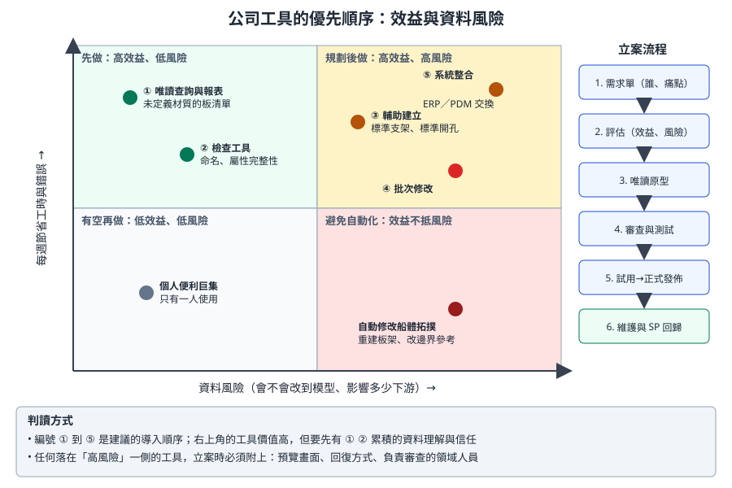

*圖 18-14　依效益與資料風險排定優先順序，右側是立案流程。（本課程自繪）*

### 18.7.2 立案單

每個工具在開發前都填一份立案單，放進工具庫的 `docs/`：

| 欄位 | 內容 |
|---|---|
| 工具名稱與編號 | 例如 `MYCO-012 未定義材質板清單` |
| 需求者與部門 | 誰提出、誰會使用 |
| 現況與痛點 | 現在怎麼做？每週花多少時間？出過哪些錯？ |
| 預期效益 | 節省工時、減少錯誤的估計，以及衡量方式 |
| 資料存取 | 唯讀、寫入（範圍）、船體紅區（第 15 章） |
| 輸入與輸出 | 讀哪些元素與屬性、輸出什麼檔案或畫面 |
| 技術路線 | PML、PML.NET、CAF Add-in、Vitesse，及理由（第 14 章 14.2） |
| 領域審查者 | 負責確認資料理解正確的設計人員 |
| 驗收條件 | 回歸測試清單的初版 |
| 風險與回復方式 | 出錯時怎麼發現、怎麼復原 |
| 維護負責人 | 上線後誰負責 |

### 18.7.3 評估方式

可以用簡單的分數排序待辦工具：

| 項目 | 1 分 | 3 分 | 5 分 |
|---|---|---|---|
| 效益（每週節省或避免的錯誤） | 少於 1 小時 | 1 到 5 小時 | 超過 5 小時或避免重大錯誤 |
| 使用人數 | 1 人 | 一個小組 | 跨部門 |
| 資料風險（反向計分） | 改船體模型或生產資料 | 寫入舾裝模型 | 唯讀 |
| 開發成本（反向計分） | 超過 1 個月 | 1 到 4 週 | 少於 1 週 |
| 依賴（反向計分） | 依賴外部系統或未核對的 API | 依賴官方表單或 marAPI | 只用通用 PML |

總分高者優先。分數只是討論的起點，最終由工具負責人與領域主管決定。

### 18.7.4 角色

| 角色 | 職責 |
|---|---|
| 需求者 | 說明痛點、提供測試情境、參與試用 |
| 領域審查者 | 確認資料理解與業務規則正確；寫入型工具必須簽核 |
| 開發者 | 實作、單元測試、撰寫說明與回歸清單 |
| 工具負責人 | 審查程式、部署、版本與升級回歸（第 17 章） |
| 系統管理員 | 環境變數、權限、授權、共用目錄 |

### 18.7.5 生命週期

```
立案 → 評估排序 → 唯讀原型 → 領域審查 → 加入寫入功能（若需要）→ 程式審查與測試
    → 試用 → 正式發佈 → 維護與 SP 回歸 → 退役（無人使用或被官方功能取代時）
```

> **開發人員須知：** 第一批工具建議選「唯讀、使用者多、痛點明確」的需求，例如設計審查前的檢查報表。它們風險低、見效快，也能累積團隊對資料模型的理解，以及使用者對工具的信任。等這兩樣都有了，再處理輔助建立與批次修改。

## 18.8 開發人員須知

- **案例的價值在設計，不在程式碼。** 論文最值得學的是資料化、狀態機與「停在確認點」，而不是特定的函式名稱。
- **函式庫名稱要核對。** 論文與文章中的 API 屬於特定版本；寫進公司工具前，用 `q meth` 與官方文件確認。
- **範例是起點。** 三個範例都需要依公司規範修改（路徑、命名、記錄、部署方式）才能上線。
- **唯讀先行。** 本章三個範例都是唯讀的；這不是巧合，而是建議的起步方式。
- **把成果寫回知識庫。** 每完成一個工具，把踩過的坑、核對過的 API、實機截圖補回團隊文件。

## 18.9 練習（只能在訓練專案）

1. **案例分析。** 用 18.2 的五個面向，分析你們公司目前一個跨部門的資料交接流程（例如開孔申請、材料表交付），畫出它的狀態機。
2. **讀程式。** 不看本章的表格，自己解讀圖 18-8 至圖 18-10 的 PML 截圖，寫下每一行的意義，再與本章比對。
3. **部署三個範例。** 依 18.6 在訓練環境部署 MyCollect、MyBrowser、Vitesse 報表，各完成冒煙測試，記錄遇到的問題與解法。
4. **延伸一個範例。** 從 18.6 的延伸練習中選一項完成，提交程式審查。
5. **立案。** 為你們部門最想要的一個工具填寫 18.7.2 的立案單，並用 18.7.3 評分。

## 18.10 自我檢核

- [ ] 我能用五個面向分析一個開發案例。
- [ ] 我能說明論文中 Marked 與 Burnt 兩種狀態的意義，以及它對應的開發概念。
- [ ] 我能解讀論文中包圍盒判斷、求交線、以兩點求方向三段 PML 程式。
- [ ] 我能說明管支架案例「資料與程式分離」「不破壞既有結構」的設計理由。
- [ ] 我能部署並移除 MyCollect、MyBrowser、Vitesse 報表三個範例。
- [ ] 我能說明五個優先等級，並為一個工具填寫立案單與評分。

## 資料來源

- Kim, C.-S., Park, D.-W., & Yang, Y.-J. (2020). Development of an automatic shell plate hole generation system using AVEVA Marine. *Journal of Advanced Marine Engineering and Technology*, 44(3), 196–202. [https://doi.org/10.5916/jamet.2020.44.3.196](https://doi.org/10.5916/jamet.2020.44.3.196)（CC BY-NC 3.0；本章圖 18-1、18-2、18-4 至 18-12 取自該論文）
- eryar，[AVEVA MARINE 中用 PML 寫管支架程序（二）](https://blog.csdn.net/eryar/article/details/4457072)
- eryar，[AVEVA .NET Quick Start Guide](https://developer.aliyun.com/article/235787)
- 範例原始碼：[aveva-marine-dev-skill](https://github.com/912141548/aveva-marine-dev-skill)（MIT，Copyright © 2026 erbi112211-boop），本地副本 [`examples/`](examples/)。
- 賀幫永、張乖平（2024），《廣東造船》：[NAPSTIC 索引](https://search.napstic.cn/literature/periodical/010gdzc202401018)
- 王星宇等（2024）：[NAPSTIC 索引](https://search.napstic.cn/literature/periodical/010zcjs202401018)
- 《海洋工程裝備與技術》2018, 5(1): 74–76：[上海交大期刊網](https://www.qk.sjtu.edu.cn/oeet/CN/Y2018/V5/I1/74)
- 大韓造船學會特別論文集（2013）：[KoreaScience](https://koreascience.kr/article/CFKO201323436147171.pub)
