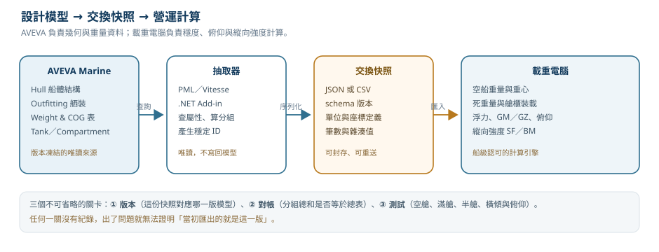
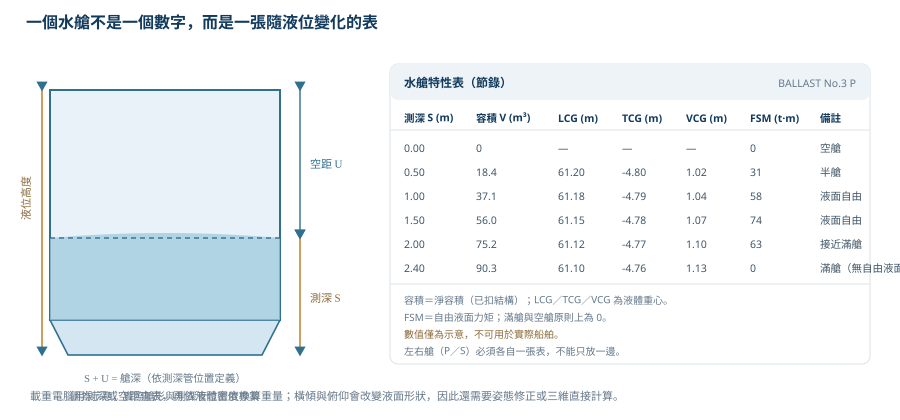

# 第 42 章　載重電腦整合：從 AVEVA 取得重量重心與水艙資料

> 這一章談一個很實際、也很容易被低估的題目：**外部載重電腦（loading computer／loading instrument）要怎麼從 AVEVA 取得它需要的重量、重心與水艙資料**。
>
> 很多團隊以為這件事就是「寫一個匯出按鈕」。真正會出問題的地方，通常不是按鈕，而是兩邊對「一噸」「一個艙」「一個方向」的定義不一樣。本章會把資料流、資料契約、對帳方法與法規邊界拆開來看，讓匯出的數字能被船廠、船東與船級協會接受。
>
> 如果你們的載重電腦是自行開發的，本章可以當成介面規格與驗收清單；如果是外購軟體，則用來檢查匯出檔是否符合它的輸入格式與版本要求。
>
> **資料可信度：** AVEVA 的 Weight and Centre of Gravity（WCoG）表、`NWEI`／`GWEI`／`NCOF`／`GCOF` 等屬性的名稱，取自 AVEVA 官方文件與 PDMS/E3D 語法資料；水艙元素的實際型別與屬性名稱，依版本與公司模板而異，文中標為〔待核對〕。法規部分引用 SOLAS XII/11、2008 IS Code、IACS UR L5 與 CSR 的公開資訊；條文編號與適用範圍仍請以現行版本為準。程式碼除特別註明外均為**示意**，未在公司環境驗證。

## 42.1 學習目標

讀完本章，你應該能夠：

1. 說明載重電腦與 AVEVA 的分工，以及為什麼兩者之間需要一份「凍結的快照」。
2. 列出載重電腦需要的四類資料：空船重量重心、死重量項目、水艙特性表、船體靜水性能與艙區定義。
3. 從 AVEVA 的 WCoG 表與元素屬性取得重量、重心，並設計可對帳的分組。
4. 說明水艙表為什麼不是一個容積數字，並列出測深、容積、重心與自由液面力矩的欄位。
5. 訂出座標、單位、符號與版本的交換規則，寫出一份兩邊都能驗證的資料契約。
6. 建立三層對帳、水艙抽查與回歸測試，處理模型變更後的重新匯出。
7. 知道載重儀的船級認可、年度測試與軟體變更控制的重點。

## 42.2 載重電腦在做什麼，不做什麼

載重電腦是**營運階段**的工具。它接收一組裝載狀態（貨物、壓載、燃油、淡水、備品、船員），算出：

- 艏、艉與平均吃水，以及俯仰差（trim）與橫傾（list）。
- 初穩度 GM、大角度穩度 GZ 曲線，以及完整穩度準則的通過與否。
- 縱向強度：剪力（SF）與彎矩（BM）對容許曲線的比值。
- 受損穩度（若船級與船型要求）。
- 裝載手冊指定的限制：艙櫃裝載上限、甲板載重、吃水與乾舷。

AVEVA 則是**設計階段**的模型：它管幾何、拓撲、屬性、目錄與重量資料，不做營運狀態的穩度判定。兩者的關係可以用一句話總結：

> **AVEVA 回答「這艘船有什麼、有多重、在哪裡」；載重電腦回答「這樣裝，安不安全」。**

| 項目 | AVEVA Marine | 載重電腦 |
|---|---|---|
| 主要使用者 | 設計公司、船廠 | 船東、船長、大副、岸上營運 |
| 資料時間點 | 設計模型，會持續變更 | 某一個凍結版本的快照 |
| 核心資料 | 元素、屬性、幾何、目錄、重量 | 裝載狀態、艙櫃表、穩度與強度 |
| 計算責任 | 重量與重心、材料表、幾何 | GM／GZ、俯仰、SF／BM、法規判定 |
| 變更流程 | 設計變更、版本控制 | 船級認可、測試、船上驗證 |



*圖 42-1　從設計模型到營運計算的資料流。真正需要設計的是中間的交換快照，而不是最後的匯入按鈕。（本課程自繪）*

> **開發人員須知：** 不要把載重電腦當成「另一個 AVEVA 報表」。它是一個**受船級協會認可的計算系統**，輸入資料的錯誤會被放大成航行決策。你的匯出工具可以很簡單，但它的資料契約、版本與對帳紀錄必須很嚴謹。

## 42.3 載重電腦需要的四類資料

| 類別 | 內容 | 通常從哪裡來 | 更新頻率 |
|---|---|---|---|
| 空船重量與重心 | 鋼材、舾裝、設備、管路、電纜、絕緣、塗裝、裕度 | AVEVA WCoG／重量控制、材料表 | 設計里程碑 |
| 死重量項目 | 貨物、壓載、燃油、柴油、淡水、滑油、備品、船員、常數 | 裝載狀態、艙櫃表、營運資料 | 每一航次 |
| 水艙特性表 | 測深／空距對應的容積、LCG／TCG／VCG、自由液面力矩 | 艙櫃幾何、艙容計算、船級認可表 | 新船、改艙、塢修 |
| 靜水性能與艙區 | 排水量、LCB、LCF、KB、BM、MCT、斷面面積、受損艙區與滲透率 | 船體幾何、船舶原理計算、船級認可資料 | 新船、改艙 |

這四類資料裡，AVEVA 最直接提供的是**第一類與第二類的一部分**；第三類需要艙櫃幾何與艙容計算；第四類通常由船舶原理軟體或船廠的正式計算書提供。把這條界線畫清楚，才不會寫出「用模型直接算 GM」這種工具。

### 42.3.1 空船重量不是一個數字

空船重量（lightship）要拆成可追溯的分組，才能和載重電腦、船級計算書對帳。常見分組：

| 分組 | 內容 | 常見來源 |
|---|---|---|
| 船體鋼材 | 外板、甲板、艙壁、內底、骨材、肘板 | Hull 模型與零件資料 |
| 鐵舾裝 | 平台、梯子、欄杆、基座、艙口蓋結構 | Outfitting 結構元素 |
| 設備 | 主機、發電機、泵、鍋爐、甲板機械 | 設備元素與目錄重量 |
| 管路與閥件 | 管、閥、法蘭、支架、保溫 | 管路模型與等級 |
| 電纜與電氣 | 電纜、托盤、配電盤、燈具 | 電氣模型或電纜表 |
| 絕緣與塗裝 | 艙室絕緣、管路保溫、塗裝 | 規範與表面積 |
| 裕度 | 設計裕度、未建模項目、未來改裝 | 公司政策與專案設定 |

如果只匯出一個總數，日後模型改了一片板、換了一台泵，沒有人知道總數為什麼變。**分組是對帳的單位，也是變更影響分析的單位。**

## 42.4 重量與重心：從元素到可對帳的分組

### 42.4.1 AVEVA 的 WCoG 表與重量控制

AVEVA Marine 提供 Weight and Centre of Gravity（WCoG）相關功能，可以依階層或選取範圍產生重量與重心。對載重電腦整合而言，它是最好的**起點**，因為：

- 它已經處理了元素階層與聚合，不必自己從每個板件重算。
- 它可以輸出分組小計，適合與載重電腦的重量分組對照。
- 它的結果可以和模型的材料表、零件資料交叉檢查。

但 WCoG 表不是「絕對真理」。它的品質取決於：

1. 材料密度與板厚是否正確。
2. 目錄元件是否有重量；沒有 `CMPREF` 或規格參照的設備，重量可能為零或帶預設值（[第 25 章](ch25_catalogue_spec_zh-TW.reading.html)）。
3. 保溫、塗裝、焊材、裕度是否被包含。
4. 生產零件與設計模型是否為同一版本（[第 15 章](ch15_hull_production_zh-TW.reading.html)）。

### 42.4.2 淨重、毛重與常見屬性

在 PDMS／E3D 系譜中，常見的重量與重心查詢屬性包括：

| 屬性 | 意義 | 使用注意 |
|---|---|---|
| `NWEI` | 淨重（nett weight） | 通常不含保溫、塗裝等附加重量 |
| `GWEI` | 毛重（gross weight） | 可能含保溫、附件或內容物，依元素類型而定 |
| `NCOF` | 淨重心（net centre of gravity） | 位置，通常相對於專案座標 |
| `GCOF` | 毛重心（gross centre of gravity） | 與 `GCOF` 搭配 `GWEI` 使用 |
| `NVOL`／`GVOL` | 淨容積／毛容積 | 常用於管路、設備或艙櫃 |
| `DNST` | 密度 | 確認單位是 kg/m³ 還是 t/m³ |
| `MASS` | 質量 | 部分元素或版本提供，語意需確認 |

這些是**查詢屬性（pseudo attributes）**，由系統依幾何、材料與目錄即時計算，不一定能像一般屬性一樣直接寫入或批次過濾。使用前先在命令列確認：

```text
Q NWEI
Q GWEI
Q NCOF
Q GCOF
Q NVOL
Q DNST
Q ATT
```

〔待核對〕不同元素型別支援的屬性不同；有些元素只有 `NWEI`，有些只有目錄重量。PML 中能否用 `!!CE.NWEI` 直接取值，還是要用 `GetAttribute()` 或資料抽取 API，依版本而異。**先做一個元素的實驗，再寫批次工具。**

### 42.4.3 分組與聚合：三個容易重複計算的地方

| 情況 | 錯誤做法 | 結果 | 正確做法 |
|---|---|---|---|
| 父組合與子零件 | 父組合有聚合重量，又加子零件 | 重量重複 | 只取葉節點，或只取父層小計 |
| 板與加強材 | 板已含加強材重量，又加 `HSTIFF` | 鋼材偏重 | 確認板的重量定義，通常分開取 |
| 設備與基座 | 設備重量含基座，又加 `STRU` 基座 | 重複 | 以目錄與結構的責任邊界為準 |

還有一種相反的問題：**漏算**。常見漏算項目包括焊材、塗裝、管路保溫、電纜托盤、臨時加強、未建模的雜項與設計裕度。這些不一定要塞進模型，但必須在分組表裡有明確的「包含／排除」欄位。

### 42.4.4 用 PML 收集重量與重心（示意）

```pml
-- 示意：先確認屬性可用，再批次收集；查詢字串與屬性名依公司資料結構調整〔待核對〕
!rows = ARRAY()
!elems = !!ce.world.query('OWNER EQ /SITE-01')   -- 僅為示意，實際查詢依專案
do !e values !elems
  !id  = !e.NAME
  !typ = !e.TYPE
  !w   = !e.NWEI
  !c   = !e.NCOF
  !row = OBJECT ARRAY()
  !row[1] = !id
  !row[2] = !typ
  !row[3] = !w.string()
  !row[4] = !c.east.string()
  !row[5] = !c.north.string()
  !row[6] = !c.up.string()
  !rows.append(!row)
enddo
```

這段程式碼有三個刻意留白的地方，因為它們依公司環境而異：

1. `query()` 的查詢字串：要用哪個 OWNER、TYPE 或集合，取決於你們的資料階層。
2. `!e.NWEI`：查詢屬性是否可直接存取〔待核對〕。
3. 座標軸的名稱：`east`／`north`／`up` 是 PDMS 常見寫法，但船體專案可能用 `X`／`Y`／`Z` 或 `LP`／`FR`。

> **專業提醒：** 批次工具不要邊查邊寫檔。先用集合收集、在記憶體組成陣列，再一次寫出；同時記錄「讀了幾個元素、跳過幾個、為什麼跳過」。沒有跳過紀錄的匯出工具，等於沒有辦法對帳。

## 42.5 水艙：從幾何到特性表

### 42.5.1 水艙在模型裡可能是兩種東西

「水艙」在 AVEVA 裡不是單一固定型別。依版本與公司模板，它可能表現為：

- **Hull 的艙區（compartment）**：由艙壁、外板、甲板等邊界圍出的空間，常用於艙容、受損穩度與艙區檢查。
- **Outfitting 的艙櫃元素（tank）**：帶有艙櫃屬性、管嘴、測深管與相關設備的舾裝物件。
- **兩者都有，且需要對應**：幾何邊界在 Hull，設備與管嘴在 Outfitting。

〔待核對〕實際的元素型別名稱（例如 `TANK`、`COMP` 或公司自訂型別）、容積屬性與測深管屬性，請用 `Q TYPE`、`Q ATT` 與 SCRM 查證。**不要從別艘船的型別名稱直接複製。**

水艙資料最基本的識別欄位：

| 欄位 | 說明 | 為什麼重要 |
|---|---|---|
| 艙櫃 ID | 穩定不變的識別碼 | 名稱會改，ID 不能改 |
| 名稱 | 圖面與口語使用的名稱 | 要能和裝載手冊對照 |
| 類型 | 壓載、貨油、燃油、柴油、淡水、滑油、污水 | 決定密度、法規與顏色 |
| 側別 | P（左）、S（右）、C（中） | 左右艙不能合併成一張表 |
| 密度 | 設計密度與營運密度 | 重量換算的基準 |
| 容量 | 100% 容積，註明淨容積或毛容積 | 與艙表最後一點一致 |
| 測深管 | 位置、高度、是否可用空距 | 船上實測的介面 |

### 42.5.2 一張水艙表要有哪些欄位



*圖 42-2　水艙特性表的欄位與測深／空距的關係。數值僅為示意，不可用於實際船舶。（本課程自繪）*

一張可用的艙表，每個液位點至少要有：

| 欄位 | 單位 | 說明 |
|---|---|---|
| 測深（sounding） | m | 從測深管參考點量到液面的高度 |
| 空距（ullage） | m | 從艙頂或測深管頂量到液面的距離 |
| 容積 | m³ | 該液位下的液體體積，註明淨容積 |
| LCG | m | 液體重心縱向位置，註明原點 |
| TCG | m | 液體重心橫向位置，註明正負 |
| VCG | m | 液體重心垂向位置，從基線量 |
| FSM | t·m | 自由液面力矩，滿艙與空艙通常為 0 |
| 備註 | — | 滿艙、空艙、不可用區間、結構限制 |

「只有一個 100% 容積」的資料，對載重電腦幾乎沒有用。船在中間液位時，重心與自由液面才是穩度的主要變數。

### 42.5.3 測深、空距與姿態修正

測深與空距的關係是：

```text
測深 S + 空距 U = 測深管參考高度（依測深管位置定義）
```

但船不是永遠平浮。艙表通常是在**平浮（even keel）** 或特定俯仰下計算的；實際裝載時有俯仰與橫傾，液面會改變形狀，容積與重心也跟著變。處理方式有兩種：

1. **艙表加修正**：載重電腦依俯仰與橫傾，對艙表做內插與修正。
2. **三維直接計算**：載重電腦直接依艙櫃幾何與液面平面計算容積與重心，不依賴預先產生的表。

第二種方法對不規則艙形更準，但需要高品質的艙櫃幾何與計算引擎。無論哪一種，**艙表與幾何必須来自同一個版本**，否則修正量會對不上。

### 42.5.4 自由液面：不是「有液體就有」

自由液面力矩（free surface moment，FSM）來自艙內液體在橫傾時的自由流動。對一個自由液面，近似式是：

```text
FSM = ρ × I
```

其中 `ρ` 是液體密度，`I` 是自由液面對傾斜軸的面積慣性矩。自由液面修正對 GM 的影響是：

```text
FSC = ΣFSM / Δ
GM_effective = GM_solid − FSC
```

有三個常見誤解：

- **滿艙也有自由液面？** 原則上沒有；滿艙時液面被艙頂限制，不再自由流動，FSM 應為 0（或依規範的極小值）。
- **空艙也有自由液面？** 沒有液體，FSM 為 0。
- **FSM 是常數？** 對矩形艙，在未滿艙前 FSM 近似常數；對有斜邊、艙頂結構或測深管的不規則艙，FSM 會隨液位變化。**不要用一個最大值套用到所有液位。**

### 42.5.5 淨容積、滲透率與可裝載容積

同一個艙區，至少有三種「容積」：

| 容積 | 定義 | 用途 |
|---|---|---|
| 毛容積（gross） | 艙區邊界圍出的完整體積 | 初步佈置、幾何檢查 |
| 淨容積（net） | 扣除艙內結構、管路、加熱盤管等佔據體積 | 艙表、裝載計算 |
| 可裝載容積 | 依規範與營運限制（填充上限、膨脹餘裕）可裝的體積 | 營運與法規 |

受損穩度還會用到**滲透率（permeability）**（Calc 與 Geometry XML 中的 `perm`、`damperm` 見[第 8 章 8.7.4 節](ch8_initial_design_zh-TW.reading.html)）：艙區受損後，海水能進入的體積比例。它不是艙櫃容積，而是艙區分類與規範的輸入。把「艙櫃表」與「受損艙區表」混在一起，是另一個常見的資料模型錯誤。

### 42.5.6 艙表從哪裡來

對新船，艙表通常由船舶原理軟體或船廠的艙容計算程式產生，再經船級協會認可。AVEVA 可以提供：

- 艙區邊界與幾何。
- 結構佔據體積的扣除依據。
- 艙櫃名稱、側別、類型與管嘴位置。

Calc 的 Tank Calibration 與 Calculation Geometry 的釋出方式見[第 8 章 8.7.4 節](ch8_initial_design_zh-TW.reading.html)與[第 8 章 8.6.5 節](ch8_initial_design_zh-TW.reading.html)。但 AVEVA 不一定直接產生「船級認可的艙表」。比較穩妥的流程是：

1. 在 AVEVA 定義艙區與艙櫃，確認邊界與名稱。
2. 匯出艙區幾何或斷面到艙容計算工具。
3. 產生測深／空距對應的容積、LCG／TCG／VCG 與 FSM。
4. 由船級協會或認可單位審查。
5. 把審查後的艙表放進載重電腦，並保留版本與來源。

> **開發人員須知：** 如果你們的載重電腦使用「三維直接計算」，AVEVA 的艙區幾何就是關鍵輸入；如果是「查表」，艙表才是關鍵輸入。兩者的資料契約不同，不要用同一份匯出檔交差。

## 42.6 座標、單位與符號：最便宜也最貴的錯誤

重量與重心資料只要方向或原點錯一個，整艘船的俯仰與穩度就會跟著錯。匯出前，先用一個**已知點**驗證兩邊的座標定義。Calc 內建的座標約定見[第 8 章 8.7.3 節](ch8_initial_design_zh-TW.reading.html)，仍須與載重電腦逐項確認。

| 項目 | 常見約定 | 必須確認 |
|---|---|---|
| X 原點 | 艉垂線（AP）、FR0、船舯或艏垂線（FP） | 圖上與載重電腦用哪一個 |
| X 正向 | 向艏為正（常見） | 是否有專案用向艉為正 |
| Y 原點 | 中線（CL） | 左右舷哪一邊為正 |
| Y 正向 | 左舷或右舷都可能 | 用一個已知左／右舷構件驗證 |
| Z 原點 | 基線（BL） | 是否從龍骨頂、基線或甲板量 |
| Z 正向 | 向上為正（常見） | 是否有專案用向下為正 |
| 俯仰正負 | 艏吃水大於艉吃水為正（常見） | 載重電腦的定義可能相反 |
| 橫傾正負 | 右傾或左傾為正 | 與 Y 正向一起確認 |
| 單位 | t、kg、m、mm | 密度是 t/m³ 還是 kg/m³ |

### 42.6.1 一個實際的換算例

假設某專案的肋距是 0.8 m，X 原點在 AP，向艏為正；某構件在 FR 120、左舷 3.5 m、基線上方 7.2 m。若載重電腦的 X 原點在 FP，且 LBP 為 180 m，則：

```text
X_AP = 120 × 0.8 = 96.0 m
X_FP = LBP − X_AP = 180 − 96.0 = 84.0 m
Y = +3.5 m（若左舷為正）
Z = 7.2 m
```

如果沒有先確認原點，這個構件會從「艏部」跑到「艉部」，而且總重量不變，對帳時只看總數是抓不出來的。**對帳要對分組與重心，不是只對總重。**

### 42.6.2 單位與密度的三個陷阱

1. **kg 與 t**：AVEVA 的屬性可能是 kg，載重電腦要 t；差 1000 倍。
2. **密度與比重**：海水密度約 1.025 t/m³，淡水約 1.000 t/m³；不要把「1.025」當成無單位比重到處乘。
3. **mm 與 m**：板厚常用 mm，座標常用 m；計算體積時要統一。

> **專業提醒：** 在交換檔的 metadata 裡明寫單位與座標定義，比在程式裡「大家都知道」可靠。介面欄位名稱建議帶單位後綴，例如 `mass_t`、`lcg_m`、`fsm_tm`。

## 42.7 交換格式：一份兩邊都信得過的資料契約

### 42.7.1 必要的中介資料

一份可追溯的匯出檔，除了數字，還要帶這些「關於資料的資料」：

| 欄位 | 範例 | 用途 |
|---|---|---|
| `schema` | `aveva-loading-export/1.0` | 格式版本，讓下游知道怎麼解析 |
| `exportId` | `S1234-20261102-001` | 唯一識別這次匯出 |
| `project`／`vessel` | `S1234`／`HULL 123` | 對應專案與船 |
| `model.version` | `2026-11-02T08:00Z` 或公司版本號 | 這份快照對應哪一版模型 |
| `extractor` | 名稱與版本 | 出問題時知道是哪支程式 |
| `units` | `t`、`m`、`t/m3`、`t*m` | 避免單位誤解 |
| `axes` | 原點與正負 | 避免方向誤解 |
| `counts` | 重量筆數、艙數、艙表點數 | 快速檢查是否漏資料 |
| `hash` | SHA-256 | 檔案完整性與封存 |

### 42.7.2 JSON 範例（節錄）

```json
{
  "schema": "aveva-loading-export/1.0",
  "exportId": "S1234-20261102-001",
  "project": "S1234",
  "vessel": "HULL 123",
  "model": {
    "mdb": "S1234_MDB",
    "version": "2026-11-02T08:00Z",
    "frozenBy": "design-office"
  },
  "extractor": {
    "name": "wcg-export",
    "version": "1.2.0",
    "runAt": "2026-11-02T08:05Z"
  },
  "units": {
    "mass": "t",
    "length": "m",
    "density": "t/m3",
    "fsm": "t*m"
  },
  "axes": {
    "x": { "origin": "AP", "positive": "forward" },
    "y": { "origin": "CL", "positive": "port" },
    "z": { "origin": "BL", "positive": "up" }
  },
  "lightship": {
    "mass_t": 12500.0,
    "lcg_m": 78.40,
    "tcg_m": 0.02,
    "vcg_m": 9.10
  },
  "weightGroups": [
    { "code": "HULL-STEEL", "mass_t": 8420.0, "lcg_m": 79.10, "vcg_m": 8.40 },
    { "code": "OUTFIT", "mass_t": 2180.0, "lcg_m": 76.20, "vcg_m": 10.80 }
  ],
  "tanks": [
    {
      "id": "TANK-BW3P",
      "name": "No.3 Ballast Port",
      "type": "ballast",
      "side": "P",
      "density_t_m3": 1.025,
      "capacity_m3": 1250.0,
      "points": [
        { "sounding_m": 0.0, "ullage_m": 8.4, "volume_m3": 0.0, "lcg_m": 61.2, "tcg_m": 4.8, "vcg_m": 0.0, "fsm_tm": 0.0 },
        { "sounding_m": 4.2, "ullage_m": 4.2, "volume_m3": 625.0, "lcg_m": 61.2, "tcg_m": 4.8, "vcg_m": 2.1, "fsm_tm": 310.0 },
        { "sounding_m": 8.4, "ullage_m": 0.0, "volume_m3": 1250.0, "lcg_m": 61.2, "tcg_m": 4.8, "vcg_m": 4.2, "fsm_tm": 0.0 }
      ]
    }
  ],
  "counts": {
    "weightGroups": 7,
    "tanks": 14,
    "tankPoints": 310
  }
}
```

這個範例故意只放三個液位點，實際艙表通常更密。**不要用三個點去內插一個形狀複雜的艙**；點距要依艙形變化與精度要求決定。

### 42.7.3 CSV 的拆分方式

如果下游只吃 CSV，建議拆成三個檔，而不是一個大寬表：

| 檔案 | 內容 | 主鍵 |
|---|---|---|
| `weights.csv` | 分組與元素重量 | `group_code` + `element_id` |
| `tanks.csv` | 艙櫃主檔 | `tank_id` |
| `tank_points.csv` | 艙表液位點 | `tank_id` + `sounding_m` |

`weights.csv` 範例：

```csv
group_code,element_id,name,type,mass_t,lcg_m,tcg_m,vcg_m,include,note
HULL-STEEL,PL-001,Shell plate S-12,HPLATE,1.234,82.10,0.00,6.40,1,
HULL-STEEL,ST-001,Longitudinal L-05,HSTIFF,0.312,80.55,-2.10,7.05,1,
OUTFIT,STR-010,Platform P-12,STRU,0.845,74.20,3.40,12.30,1,
OUTFIT,EQP-003,Main engine,EQUI,185.000,42.00,0.00,5.20,1,catalogue weight
```

`tank_points.csv` 範例：

```csv
tank_id,sounding_m,ullage_m,volume_m3,lcg_m,tcg_m,vcg_m,fsm_tm
TANK-BW3P,0.0,8.4,0.0,61.2,4.8,0.0,0.0
TANK-BW3P,4.2,4.2,625.0,61.2,4.8,2.1,310.0
TANK-BW3P,8.4,0.0,1250.0,61.2,4.8,4.2,0.0
```

### 42.7.4 穩定 ID 與變更

- **ID 不要用名稱。** 艙名會因船東要求、語言或習慣改變；ID 應該在模型建立時產生，之後不變。
- **不要重複使用 ID。** 刪除的艙如果 ID 被新艙重用，下游會把舊資料套到新艙。
- **刪除要明確。** 匯出檔要能表達「這個 ID 已不存在」，而不是默默消失。用 `status: active/deleted` 或獨立的 delta 檔。
- **名稱可以改，但要留別名。** 例如 `aliases: ["No.3 WBT P", "3P WBT"]`，方便與裝載手冊對照。

### 42.7.5 檔案層級的保護

| 措施 | 做法 |
|---|---|
| 編碼 | UTF-8，不加 BOM（或依下游要求） |
| 原子寫入 | 先寫 `.tmp`，完成後改名，避免下游讀到半檔 |
| 完整性 | 檔案附 SHA-256，匯入端比對 |
| 權限 | 匯出目錄唯讀給下游，只有匯出帳號可寫 |
| 保存 | 依公司與船級要求保留歷史快照，不要只留最新版 |
| 日誌 | 每次匯出記錄筆數、耗時、跳過元素、錯誤清單 |

## 42.8 對帳與測試：怎麼知道匯出是對的

### 42.8.1 三層對帳

| 層級 | 比對對象 | 通過條件（範例） |
|---|---|---|
| 第一層 | 元素明細加總 vs 分組小計 | 差額 < 0.1% 或 0.5 t |
| 第二層 | 分組小計 vs AVEVA WCoG 報表 | 每個分組都在容許差內 |
| 第三層 | 匯入載重電腦後的總重與重心 vs 匯出檔 | 完全一致（或僅差顯示精度） |

第一層抓「程式漏加」，第二層抓「分組定義不同」，第三層抓「匯入程式解析錯誤」。三層都要有紀錄，不能只看最後的總數。

### 42.8.2 水艙抽查

至少抽查 3 個艙，每個艙比 4 個液位：

- 空艙（0%）。
- 25% 或 50%（液面自由）。
- 75%（接近滿艙）。
- 100%（滿艙）。

比對項目：容積、LCG、TCG、VCG、FSM。數值來源可以是艙表、船舶原理軟體或手算的簡化幾何。**抽查不是形式，是確認「查表邏輯」與「內插方向」都對。**

### 42.8.3 測試案例

| 案例 | 目的 | 預期 |
|---|---|---|
| 空船 | 只有空船重量 | 排水量等於空船重，吃水合理 |
| 滿載 | 貨物、壓載、油水都滿 | 吃水不超過載重線，GM 與 SF／BM 合格 |
| 半艙 | 多個艙半滿 | FSM 正確計入，GM 下降 |
| 橫傾 | 單側壓載 | 橫傾角與 TCG 符號正確 |
| 俯仰 | 艏艉艙不均 | 艏艉吃水與 trim 符號正確 |
| 受損 | 一個艙區進水 | 滲透率、自由液面與穩度曲線正確 |

### 42.8.4 自動化檢查（Python 範例）

```python
import json
import sys
from collections import defaultdict

with open(sys.argv[1], encoding="utf-8") as f:
    data = json.load(f)

tol = 0.001  # 0.1%，依公司規定調整

# 1. 分組加總與空船總重對帳
total = sum(g["mass_t"] for g in data["weightGroups"])
assert abs(total - data["lightship"]["mass_t"]) <= tol * total, "weight total mismatch"

# 2. 艙表單調性與邊界檢查
for tank in data["tanks"]:
    pts = tank["points"]
    assert pts, f"{tank['id']}: empty table"
    prev = -1.0
    for p in pts:
        assert p["volume_m3"] >= prev, f"{tank['id']}: volume not monotonic"
        prev = p["volume_m3"]
    assert abs(pts[0]["volume_m3"]) < 1e-9, f"{tank['id']}: first point not empty"
    assert pts[0]["fsm_tm"] == 0, f"{tank['id']}: empty tank has FSM"
    assert pts[-1]["fsm_tm"] == 0, f"{tank['id']}: full tank has FSM"
    assert abs(pts[-1]["volume_m3"] - tank["capacity_m3"]) <= tol * tank["capacity_m3"], \
        f"{tank['id']}: capacity mismatch"

# 3. 筆數檢查
assert len(data["weightGroups"]) == data["counts"]["weightGroups"], "group count mismatch"
assert len(data["tanks"]) == data["counts"]["tanks"], "tank count mismatch"
assert sum(len(t["points"]) for t in data["tanks"]) == data["counts"]["tankPoints"], "point count mismatch"

print("OK:", data["exportId"])
```

這段程式碼只檢查「內部一致性」，不檢查「物理正確性」。物理正確性要靠艙表抽查、與正式計算書比對，以及船級認可。

### 42.8.5 簽核與凍結

匯出完成後，至少要留下：

- 匯出檔與雜湊值。
- 模型版本與 MDB。
- 匯出工具版本。
- 對帳報表與差異說明。
- 簽核人與日期。

這份紀錄就是日後「為什麼船上的數字和設計室不一樣」的答案來源。

## 42.9 變更管理：模型改了怎麼辦

載重電腦的輸入不是「匯出一次就結束」。模型會改，艙表會改，載重電腦的軟體也會改。建議把變更分成三級：

| 級別 | 例子 | 處理 |
|---|---|---|
| 輕微 | 單一設備重量微調、非結構艙櫃修改 | 更新快照，重跑對帳，記錄差異 |
| 中度 | 艙櫃邊界改變、壓載艙重新劃分、主要設備更換 | 重算艙表，重新送認可，完整回歸測試 |
| 重大 | 船體加長、艙區重新配置、穩度曲線改變 | 重新建立載重電腦模型，重新認可 |

不論哪一級，都要回答三個問題：

1. 這次變更影響哪些重量分組與艙櫃？
2. 影響的量是否超過容許差？
3. 是否需要重新送船級協會？

> **專業提醒：** 不要用「最新版模型」直接覆蓋船上正在用的版本。先產生候選快照，完成對帳與測試，再依變更流程發布。船上需要的是「可追溯的穩定版本」，不是「最新的版本」。

## 42.10 法規與船級：載重電腦不是普通報表

載重電腦／穩度儀的資料與軟體，通常受下列規範約束：

- **SOLAS XII/11**：適用範圍內的散貨船應裝設載重儀（loading instrument），並能在船上驗證 SF／BM 在容許範圍內。
- **2008 IS Code（完整穩度）**：完整穩度準則與穩度儀的測試要求。
- **IACS UR L5**：船上穩度計算電腦的統一要求，涵蓋輸入、計算、測試與文件。
- **IACS CSR**：散貨船與油輪的縱向強度要求，載重儀的 SF／BM 容許曲線通常由此而來。
- **船級協會的個別規範**：型式認可、軟體變更、年度測試與船上驗證。

幾個實務重點：

1. **載重儀是受認可的系統。** 不是「公司自己寫的 Excel」；軟體、船舶模型與測試條件都要能被審查。
2. **年度測試不是可選項。** 船長通常需要在年度檢驗時，用至少一個經認可的測試裝載條件驗證準確性；實際要求依船級與船型〔待核對〕。
3. **軟體變更要控制。** 改匯出程式、改艙表、改計算模型，都可能影響結果；要有版本、測試與核准紀錄。
4. **AVEVA 不是認可單位。** AVEVA 提供設計資料；載重儀的認可與船上驗證，是船級協會與船東的責任。

> **開發人員須知：** 如果你的匯出工具會影響載重儀的輸入，它就不只是「內部小工具」。從第一天就要有版本、測試與簽核；否則日後很難通過船級審查。

## 42.11 完整範例：散貨船壓載與燃油匯出

### 42.11.1 情境

- 5 個貨艙，雙層底壓載艙左右各 4 對（共 8 艙）。
- 燃油艙 2 個、柴油艙 2 個、淡水艙 2 個。
- 空船重量 12,500 t，LCG 78.40 m（AP 起算），VCG 9.10 m，TCG 0.02 m。
- 載重電腦使用 JSON 匯入，X 原點 AP、向艏為正；Y 左舷為正；Z 基線向上。

### 42.11.2 步驟

1. **定義範圍。** 只匯出空船分組與 14 個艙；貨物、船員、備品由營運端輸入。
2. **確認屬性。** 對三種代表元素（板、設備、艙）執行 `Q NWEI`、`Q NCOF`、`Q NVOL`，記錄可用性。
3. **建立分組對照。** 把 AVEVA 的階層對到載重電腦的 7 個重量分組。
4. **抽重量。** 依分組收集元素，輸出 `weights.csv`；父層與子層只能取一邊。
5. **抽艙櫃。** 取得艙名、側別、類型、密度、容量與測深管；確認左右艙分開。
6. **產生艙表。** 從艙容計算工具取得液位點；每個艙至少覆盖空、半、滿與形狀變化處。
7. **對帳與測試。** 跑三層對帳、抽查 3 個艙、執行 6 個測試案例，簽核後發布。

### 42.11.3 重量分組對帳表（示意）

| 分組 | 重量（t） | LCG（m） | VCG（m） | 備註 |
|---|---:|---:|---:|---|
| 船體鋼材 | 8,420.0 | 79.10 | 8.40 | 含板與骨材 |
| 鐵舾裝 | 2,180.0 | 76.20 | 10.80 | 平台、梯子、基座 |
| 設備 | 1,120.0 | 70.50 | 9.60 | 目錄重量 |
| 管路與閥件 | 380.0 | 74.80 | 8.90 | 含支架 |
| 電纜與電氣 | 95.0 | 72.30 | 11.20 | 電纜表 |
| 絕緣與塗裝 | 180.0 | 75.60 | 9.40 | 依表面積估算 |
| 裕度 | 125.0 | 78.00 | 9.00 | 公司政策 |
| **合計** | **12,500.0** | **78.40** | **9.10** | 與 WCoG 表比對 |

合計的 LCG／VCG 不是各分組的算術平均，而是**重量加權**：

```text
LCG_total = Σ(mass_i × LCG_i) / Σmass_i
VCG_total = Σ(mass_i × VCG_i) / Σmass_i
TCG_total = Σ(mass_i × TCG_i) / Σmass_i
```

### 42.11.4 艙表抽查（矩形艙驗算）

用一個 10 m × 8 m × 6 m 的矩形艙做 sanity check（僅用於驗證程式，不是實際艙）：

- 容積：`V = 10 × 8 × h`
- LCG：5.0 m（固定）
- TCG：0.0 m
- VCG：`h / 2`
- 自由液面慣性矩：`I = L × B³ / 12 = 10 × 512 / 12 = 426.67 m⁴`
- FSM：`ρ × I = 1.025 × 426.67 = 437.33 t·m`（未滿艙時近似常數）

| 測深 h（m） | 容積（m³） | VCG（m） | FSM（t·m） |
|---:|---:|---:|---:|
| 0.0 | 0.0 | 0.0 | 0.0 |
| 1.0 | 80.0 | 0.5 | 437.3 |
| 3.0 | 240.0 | 1.5 | 437.3 |
| 5.0 | 400.0 | 2.5 | 437.3 |
| 6.0 | 480.0 | 3.0 | 0.0 |

如果程式在滿艙時仍算出 437.3 t·m，就是沒有處理「滿艙無自由液面」；如果半艙的 FSM 是 0，就是漏算自由液面。這兩個錯誤都會讓 GM 偏樂觀。

### 42.11.5 匯入後的檢查

| 檢查 | 方法 | 通過條件 |
|---|---|---|
| 總重 | 載重電腦匯入報表 vs JSON | 差 < 0.01 t |
| LCG／VCG／TCG | 匯入報表 vs JSON | 差 < 0.001 m |
| 艙數 | 匯入清單 vs `counts.tanks` | 完全相同 |
| 艙表點數 | 匯入清單 vs `counts.tankPoints` | 完全相同 |
| 空艙／滿艙 FSM | 抽查 | 都為 0 |
| 抽艙容積 | 25／50／75／100% | 與認可艙表一致 |

## 42.12 常見錯誤

| 錯誤 | 症狀 | 原因 | 對策 |
|---|---|---|---|
| 父層與子層重複計算 | 總重偏高 | 同時取聚合與明細 | 只取葉節點或只取父層小計 |
| 淨重與毛重混用 | 重量差幾個百分點 | 不確定 `NWEI`／`GWEI` 的定義 | 用已知元件比對，固定使用一種 |
| kg 當成 t | 總重差 1000 倍 | 單位未統一 | metadata 寫單位，欄位加後綴 |
| X 原點用錯 | 重心前後偏移 | AP／FP／FR0 混用 | 用已知點驗證，記錄原點 |
| Y 正負用錯 | 左右艙互換 | 左舷／右舷正向不同 | 用已知左／右舷構件驗證 |
| 只有 100% 容積 | 中間液位不準 | 沒有艙表 | 產生完整液位點 |
| 滿艙仍有 FSM | GM 偏保守或偏樂觀 | 沒有處理滿艙 | 滿艙 FSM 設 0 |
| 半艙 FSM 為 0 | GM 偏樂觀 | 漏算自由液面 | 每個液位點都算 FSM |
| 艙表未做俯仰修正 | 艏艉吃水不準 | 平浮艙表直接用 | 用修正或三維計算 |
| 毛容積當淨容積 | 艙容偏大 | 未扣結構 | 使用淨容積並註明 |
| 艙名當 ID | 改名後對不上 | 名稱不穩定 | 使用不可變 ID |
| 刪除艙仍留在檔內 | 幽靈艙櫃 | 沒有刪除標記 | 使用 `status` 或 delta |
| 貨物重心當艙重心 | 貨物穩度錯 | 把液體艙表套到固體貨 | 固體貨另建模型 |
| 裕度重複 | 總重偏高 | 分組已含裕度又加一次 | 裕度只放一層 |

## 42.13 開發人員須知

1. **先定義契約，再寫程式。** 欄位、單位、座標、ID、版本與錯誤處理，先寫成一頁規格，再開始匯出。
2. **只讀，不寫回。** 匯出工具不應該修改 AVEVA 模型；需要修正資料時，走設計變更流程。
3. **分組是為了對帳。** 沒有分組的總重，無法定位差異。
4. **缺值不是 0。** 重量或重心缺失時，輸出 `null` 並記錄原因，不要默默補 0。
5. **排序要穩定。** 每次匯出的元素順序要一致，否則 diff 會充滿雜訊。
6. **可重跑。** 同一版模型、同一版工具，應該產生相同內容（雜湊可不同，因時間戳）。
7. **記錄跳過的元素。** 「為什麼這台泵沒出現」要有答案。
8. **設定外部化。** 分組對照、艙型分類、單位轉換、輸出路徑，都放在設定檔。
9. **用已知船驗證。** 找一艘有正式計算書的船，逐項比對，不要只用新建的小模型。
10. **把法規當需求。** 船級認可、年度測試、軟體變更控制，從一開始就納入設計。

## 42.14 練習（只能在訓練專案）

1. **屬性探索。** 選一個板、一台設備、一個艙，分別執行 `Q NWEI`、`Q GWEI`、`Q NCOF`、`Q GCOF`、`Q NVOL`，記錄哪些有值、單位是什麼。
2. **分組對照。** 為你們公司的載重電腦重量分組，建立一張 AVEVA 階層對照表，標明「包含」與「排除」。
3. **匯出重量。** 用 PML 或 .NET 匯出一個分組的明細 CSV，加上 metadata 與筆數；再用 Excel 樞紐分析驗證小計。
4. **艙表驗算。** 用 42.11.4 的矩形艙，寫一個小程式產生 11 個液位點，檢查容積單調、空艙與滿艙 FSM 為 0。
5. **對帳程式。** 用 42.8.4 的 Python 範例，對你們的匯出檔跑一次，故意改壞一個數字，確認它會失敗。
6. **測試案例。** 依 42.8.3 設計六個裝載案例，寫出每個案例的預期吃水、trim、GM 與 SF／BM 檢查點。

## 42.15 自我檢核

- [ ] 我能說明載重電腦與 AVEVA 的分工，以及為什麼需要凍結快照。
- [ ] 我能列出載重電腦的四類輸入資料，並指出 AVEVA 直接提供哪些。
- [ ] 我能區分 `NWEI`／`GWEI` 與 `NCOF`／`GCOF`，並知道使用前要驗證。
- [ ] 我能設計可對帳的重量分組，並說出三種重複計算的情境。
- [ ] 我能列出水艙表的必要欄位，並解釋測深與空距的關係。
- [ ] 我能說明自由液面力矩的公式、滿艙與空艙為什麼是 0。
- [ ] 我能分辨毛容積、淨容積、可裝載容積與滲透率。
- [ ] 我能用已知點驗證 X／Y／Z 的原點與正負。
- [ ] 我能寫出一份含版本、單位、座標與雜湊的資料契約。
- [ ] 我能執行三層對帳、水艙抽查與六個測試案例。
- [ ] 我知道載重儀的船級認可、年度測試與軟體變更控制的重要性。

## 資料來源

- AVEVA 官方文件：[Weight and Centre of Gravity (CofG) form](https://docs.aveva.com/bundle/hull-and-outfitting/page/1139789.html)、[Data Model Reference Manual（E3D 3.1）](https://help.aveva.com/AVEVA_Everything3D/3.1/DMRM/DMRM_FP.html)、[PML Customisation User Guide（檔案與屬性章節）](https://help.aveva.com/AVEVA_Everything3D/2.1/PMLPUG/PMLCG12.12.1.html)。重量與重心屬性名稱另參考 PDMS/E3D 語法資料中的 `NWEI`、`GWEI`、`NCOF`、`GCOF`、`NVOL`、`DNST` 查詢說明。
- IACS：[Unified Requirement L5 — Onboard Computers for Stability Calculations](https://iacs.org.uk/resolutions/unified-requirements)；[Common Structural Rules](https://iacs.org.uk/resolutions/common-structural-rules)。
- IMO：[International Code on Intact Stability, 2008（MSC.267(85)）](https://wwwcdn.imo.org/localresources/en/KnowledgeCentre/IndexofIMOResolutions/MSCResolutions/MSC.267(85).pdf)；[SOLAS](https://www.imo.org/en/About/Conventions/Pages/International-Convention-for-the-Safety-of-Life-at-Sea-(SOLAS),-1974.aspx)。SOLAS XII/11 的載重儀要求與適用範圍，請查現行 consolidated edition。
- 船舶原理與穩度：SNAME，《Principles of Naval Architecture》；IMO 穩度相關課程教材。艙表、自由液面與俯仰修正的通用概念，本章只做工程導讀，未引用特定頁次或數值。
- 載重電腦實務：[NAPA Loading Computer](https://www.napa.fi/software-and-services/ship-operations/napa-loading-computer/)、[ASC Marine Loading Computer](https://autoship.com/)、[MetaCAD：Loading Computer 入門](https://metacad.io/en/knowledge/loading-computer-intro/)（僅供概念參考，非本章數據來源）。
- 本課程延伸：[第 9 章 船體建模](ch09_hull_modelling_zh-TW.reading.html)、[第 15 章 生產資訊](ch15_hull_production_zh-TW.reading.html)、[第 17 章 舾裝設計](ch17_outfitting_zh-TW.reading.html)、[第 25 章 目錄與等級](ch25_catalogue_spec_zh-TW.reading.html)、[第 27 章 圖面與報表](ch27_drawings_zh-TW.reading.html)、[第 38 章 報表與整合](ch38_reports_integration_zh-TW.reading.html)、[第 40 章 除錯與部署](ch40_debug_deploy_zh-TW.reading.html)。

> **授權與界線：** 本章文字、表格與兩張圖解為本課程自製，可在公司內部教學使用；不重製官方手冊的圖表或長段文字。所有艙表數值、重量與法規要求均為示意，實際應用請以公司安裝版本、船級認可文件與現行法規為準。
