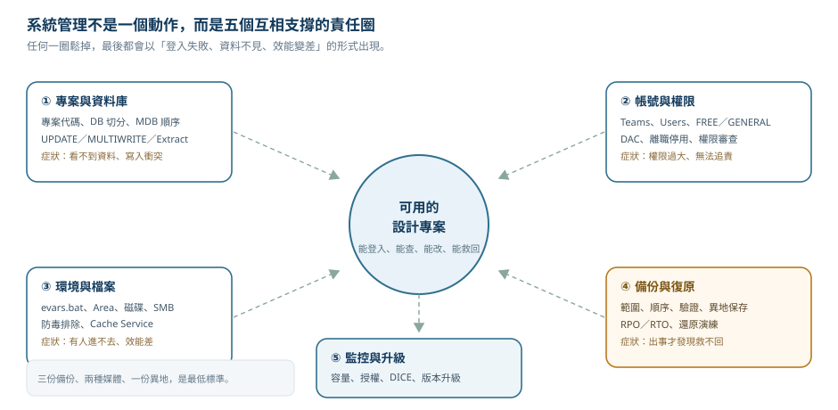
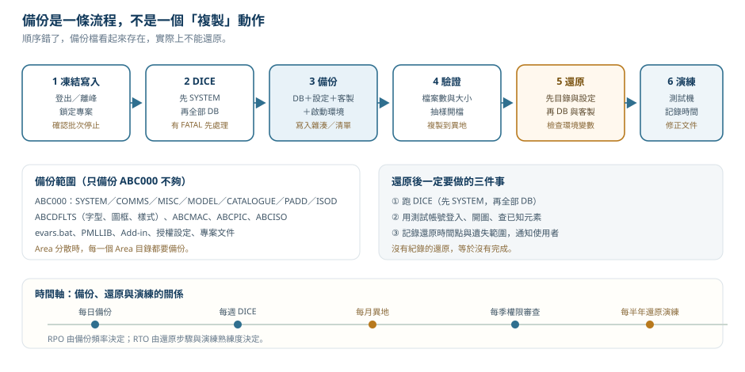

# 第 43 章　系統管理與維運：安裝、資料庫、帳號、備份與檔案管理

> 前面十九章談的是「怎麼用 AVEVA 做設計、寫工具」。這一章換一個位置：**站在系統管理員的位置，讓整套系統能被安裝、授權、備份、還原、升級與稽核。**
>
> 很多團隊的 AVEVA 問題不是模型做錯，而是系統面沒有負責人：專案目錄放在個人電腦、備份只複製一半的資料庫、離職員工的帳號還留著、升級前沒有備份、磁碟滿了才發現。這些問題一旦發生，重做模型事小，資料救不回來才是大事。
>
> **資料可信度：** 資料庫型別、`teamName/databaseName` 命名、FREE／GENERAL 使用者、UPDATE／MULTIWRITE／CONTROLLED、Session、DICE、Replicate、Cache Service、資料庫升級與分散式資料庫，取自 AVEVA E3D 1.1 *Administrator User Guide*（AUGA，help.aveva.com 靜態頁）。安裝硬體需求、授權型式與作業系統支援矩陣，依版本與合約而異，文中標為〔待核對〕。備份、還原、監控與災難復原屬於一般 IT 維運實務，本章依 AVEVA 的檔案式資料庫特性調整；實際排程請以公司政策與 AVEVA 支援建議為準。

## 43.1 學習目標

讀完本章，你應該能夠：

1. 說明 AVEVA 系統管理員的責任邊界，以及哪些事必須由 AVEVA 原廠或授權夥伴處理。
2. 列出 AVEVA Marine／E3D 的安裝需求項目，並說明「模型資料不走 SQL Server」這件事的意義。
3. 說明專案目錄、資料庫檔案命名、Area 環境變數與磁碟配置的關係。
4. 建立專案、設定環境變數，並用 ADMIN 建立 Teams、Users、DBs 與 MDBs。
5. 區分 FREE／GENERAL 使用者、UPDATE／MULTIWRITE／CONTROLLED 資料庫與 Extract 的存取行為。
6. 規劃帳號生命週期、權限審查與 DAC 的使用時機。
7. 執行 DICE 完整性檢查，讀懂常見錯誤，並知道 Patch 與 Reconfigure 的界線。
8. 設計一套可還原的備份策略，包含備份範圍、順序、驗證與還原演練。
9. 管理 Session、Stamp、Merge 與 Backtrack，避免把歷史紀錄當成備份。
10. 規劃磁碟、網路、防毒排除、環境變數與監控，並知道升級與災難復原的檢查點。

## 43.2 系統管理員在做什麼

系統管理不是「安裝完就走」。它是一組持續的責任，可以分成五個圈：



*圖 43-1　系統管理的五個責任圈。中間是「可用的專案」，外圈是讓它持續可用的工作。（本課程自繪）*

| 責任圈 | 具體工作 | 沒有做好的症狀 |
|---|---|---|
| 專案與資料庫 | 建專案、切 DB、設 MDB、控管 DB 模式、Extract | 使用者看不到資料、寫入衝突、DB 膨脹 |
| 帳號與權限 | Teams、Users、密碼、FREE／GENERAL、DAC、離職停用 | 權限過大、無法追責、前任帳號仍可寫入 |
| 環境與檔案 | 環境變數、目錄配置、磁碟、網路分享、防毒排除 | 登入失敗、效能差、檔案損毀 |
| 備份與復原 | 備份排程、離線副本、還原演練、異地保存 | 出事才發現備份不完整 |
| 監控與升級 | 容量、Session、DICE、授權、版本升級 | 磁碟滿、授權不足、升級失敗 |

### 43.2.1 三種角色不要混在一起

| 角色 | 負責 | 不負責 |
|---|---|---|
| AVEVA 系統管理員 | 專案結構、帳號、DB 模式、備份、DICE、升級執行 | 船舶設計正確性、PML 工具功能 |
| 設計部門主管 | 誰該有什麼權限、哪個 Team 負責哪個區域 | 資料庫檔案與伺服器 |
| IT 基礎設施 | 伺服器、儲存、網路、作業系統、防毒、網域帳號 | AVEVA 專案內部結構 |

> **專業提醒：** 最常見的災難是「三個人各做一部分，但沒有人對整份備份負責」。請明確指定一位 AVEVA 系統管理員，並把備份還原的演練列入他的年度工作。

### 43.2.2 哪些事不要自己來

- **資料庫檔案損毀的深層修復。** DICE 的 Patch 只能處理部分結構問題；修不好時應開 AVEVA 支援案件，不要用十六進位編輯器改 DB 檔。
- **未經確認的版本升級。** 升級涉及資料模型變更與 all-or-nothing 的 Part Upgrade，必須先備份、先在測試專案驗證。
- **修改 SYSTEM 資料庫的內部結構。** 它只能透過 ADMIN 模組維護。
- **把正式專案目錄直接複製成另一個專案。** 專案名稱存在 DB 內部，必須用 `Project > Replicate`（見 43.6）。

## 43.3 安裝需求與環境

### 43.3.1 先破除一個常見誤解

AVEVA Marine／E3D 的模型資料主要存在**一組專案目錄下的專屬資料庫檔案**（Dabacon 格式），不是存在 SQL Server 的資料表裡。因此：

- 系統管理員要管的是**檔案伺服器、網路分享、NTFS 權限、磁碟空間與檔案鎖定**，不是 SQL 資料庫的 `BACKUP DATABASE`。
- SQL Server／Oracle 只在某些周邊產品或整合情境出現（例如 AVEVA Engineering、AVEVA NET、部分儀控或報表元件）。〔待核對：依你們購買的模組與版本為準。〕
- 把「備份 AVEVA」想成「備份 SQL」是錯的；真正要備份的是整個專案目錄與相關設定。

### 43.3.2 安裝需求檢查表

| 類別 | 需求 | 說明 |
|---|---|---|
| 作業系統 | Windows 專業版／伺服器版，版本依 AVEVA 支援矩陣 | 〔待核對〕不要用家用版或已終止支援的版本 |
| 處理器 | 多核心，時脈與快取影響建模與批次 | 大型模型與出圖需要較高單核效能 |
| 記憶體 | 依模型規模與模組 | 大型專案建議 32 GB 以上〔待核對〕 |
| 磁碟 | 系統碟與專案碟分開；專案碟用本機或低延遲儲存 | 不要把 DB 放在 USB 隨身碟、OneDrive 或壓縮磁碟 |
| 網路 | 穩定、低延遲的 SMB 分享；伺服器與用戶端時間同步 | 網路錯誤是 DB 損毀的常見原因 |
| 顯示 | 支援 OpenGL 的繪圖卡與正確驅動 | 驅動不穩會造成當機與資料未存 |
| 元件 | .NET Framework／.NET、MSMQ（若用 Cache Service）、Visual C++ 執行檔 | 依安裝程式指示 |
| 權限 | 安裝帳號需本機系統管理員 | 安裝與 MSMQ 啟用都需要 |
| 授權 | AVEVA 授權伺服器可連線，或本機授權檔 | 〔待核對〕授權型式與埠號依合約 |
| 目錄 | 專案、MAC、PIC、ISO、DFLTS、PMLLIB 各自獨立 | 見 43.5 與 43.12 |

> **開發人員須知：** 如果你的工具會啟動第二個 AVEVA 程序或呼叫外部程式，請確認它在**使用者權限**下可執行，而不是只在管理員帳號測試過。很多「只有某些人會失敗」的問題，來源是環境變數與權限，不是程式。

### 43.3.3 單機、檔案伺服器與多站

| 佈署型態 | 適合 | 優點 | 風險 |
|---|---|---|---|
| 單機 | 訓練、示範、小型專案 | 簡單、無網路延遲 | 沒有集中備份；電腦壞就全沒 |
| 檔案伺服器 | 一般設計團隊 | 集中管理、集中備份 | 網路與伺服器成為單點 |
| 分散式（Area） | 大型專案、多磁碟 | 分攤 I/O、隔離部門 | 環境變數多，容易設錯 |
| Global 多站 | 跨地點協作 | 各地有本地副本 | 設定複雜、同步問題難排 |

Global 專案一旦建立就**無法用 AVEVA 指令回復**，建立前必須完整備份。Global 的建立、分配與恢復細節見[第 46 章](ch46_dabacon_global_zh-TW.reading.html)。

## 43.4 專案結構、資料庫檔案與 Area

### 43.4.1 專案目錄

一個專案由三個字元的專案代碼識別（例如 `ABC`；也支援 8 字元長專案識別碼〔待核對〕）。專案目錄由環境變數 `ABC000` 指向：

```text
ABC000        專案目錄，內含 DB 檔
  ABCSYS      SYSTEM 資料庫
  ABCCOM      COMMS 資料庫
  ABCMIS      MISC 資料庫
  ABC001 ~ ABCnnnn   模型與其他資料庫
ABCMAC        跨資料庫連線巨集（inter-DB macros）
ABCPIC        DRAFT 產生的圖片檔
ABCISO        ISODRAFT 需要的檔案
ABCDFLTS      專案預設檔（字型、圖框、樣式等）
ABCMAR        Marine 相關目錄〔待核對：依版本與模組〕
```

實際目錄名稱可以自訂，只要環境變數指對；**檔名不能自訂**，一定是 `prjnnnn` 格式。

### 43.4.2 資料庫檔案命名

AUGA 說明的檔名格式是：

```text
xxxnnnn_mmmm
```

| 部分 | 意義 | 範圍 |
|---|---|---|
| `xxx` | 專案代碼 | 例如 `abc` |
| `nnnn` | 資料庫編號 | 1–6999（7001–10000、250001–255000 保留給 AVEVA） |
| `_mmmm` | Extract 編號 | 衍生資料庫才會有 |

也就是說，**資料庫編號是有限資源**。一直建 DB、刪 DB、再建 DB，會把編號用掉；大型專案要一開始就規劃編號區段（例如船體 100–199、管路 200–299、目錄 900–999）。

### 43.4.3 Area：把資料庫放到不同磁碟

資料庫不一定要全部放在 `ABC000`。AUGA 提供 Area 機制：建立另一個目錄，設定環境變數 `ABCnnn`（`nnn` 是 1–999 的 Area 編號），建立或移動 DB 時指定 Area。

```bat
rem 示意：把 Area 500 指向 D 磁碟
set ABC500=D:\aveva_areas\area500
```

| 做法 | 好處 | 注意 |
|---|---|---|
| 依部門分 Area | I/O 分散、權限較好管 | 環境變數要同步到所有工作站 |
| 依專案階段分 Area | 舊資料可降到較慢的儲存 | 不要隨便改 Area，參照會失效 |
| 單一 Area | 簡單 | 大型專案容易成為 I/O 瓶頸 |

可用 `LIST AREA` 指令列出某個 Area 的資料庫〔指令語法待核對〕。

> **專業提醒：** Area 環境變數必須用**大寫**，且每一台工作站都要有相同設定。只在管理員電腦設定，會造成「有人進得去、有人進不去」的經典問題。

## 43.5 建立專案與環境變數

### 43.5.1 建立順序

AUGA 的建立流程可以整理成五步：

1. **規劃。** 決定專案代碼、DB 切分、Team、MDB、Area、磁碟與備份策略。
2. **建目錄。** 建立 `ABC000`、`ABCMAC`、`ABCPIC`、`ABCISO`、`ABCDFLTS` 等目錄。
3. **設環境變數。** 編輯 `evars.bat`，設定 `ABC000`、`ABCMAC`、`ABCPIC`、`ABCISO`、`ABCDFLTS`（Marine 另加 `ABCMAR`）。
4. **執行產品附的腳本與巨集。** 建立初始資料庫與專案檔。
5. **以 SYSTEM 進入 ADMIN。** 建立 Teams、Users、DBs、MDBs。

```bat
rem 示意：evars.bat 的專案段落，路徑依公司配置
set ABC000=\\filesrv\aveva\ABC\ABC000
set ABCMAC=\\filesrv\aveva\ABC\ABCMAC
set ABCPIC=\\filesrv\aveva\ABC\ABCPIC
set ABCISO=\\filesrv\aveva\ABC\ABCISO
set ABCDFLTS=\\filesrv\aveva\ABC\ABCDFLTS
set ABCMAR=\\filesrv\aveva\ABC\ABCMAR
```

> **開發人員須知：** 不要把專案路徑寫死在 PML 或 .NET 程式裡。用環境變數或公司設定檔取得，否則換伺服器就要重編譯。

### 43.5.2 SYSTEM 帳號與首次登入

第一次進入 ADMIN 使用 `SYSTEM` 帳號。這個帳號是專案的萬用管理者，應該：

- 只在建立專案與緊急維修時使用。
- 密碼由兩人保管或放在公司的機密保管庫。
- 平日使用具 ADMIN 權限的個人帳號，不要共用 `SYSTEM`。

### 43.5.3 專案資訊與模組定義

ADMIN 的 `Project` 選單還有幾個系統管理員會用到的項目：

| 選項 | 用途 | 風險 |
|---|---|---|
| Information | 專案名稱、描述、訊息、編號（每次登入顯示） | 低 |
| Font Families／TrueType Fonts | 設定 MODEL 與 DRAFT 字型 | 設錯會讓圖面字型跑掉 |
| Module Definitions | 調整模組定義 | 可能讓使用者進錯模組 |
| Replicate | 複製專案資料或結構 | 見 43.6 |
| Expunge | 清除幽靈使用者與釋放認領 | 誤清可能影響正在執行的程序 |
| NT Authentication | 切換網域驗證 | 切換前要先確認所有帳號對應 |
| Data Access Control | 切換 DAC | 開啟後權限規則沒設好會鎖死 |
| Lock | 鎖定專案資料庫 | 鎖定時所有人無法寫入 |

## 43.6 複製專案：為什麼不能直接複製目錄

AUGA 明確警告：**不可用「複製整個專案目錄」的方式在 AVEVA 外複製專案**，因為專案名稱等資訊存在資料庫檔案內部。

正確做法是 `Project > Replicate`：

| 選項 | 作用 | 使用時機 |
|---|---|---|
| Project Data | 複製整個專案（含資料）到新專案 | 建立新船專案的起點、複製訓練環境 |
| Project Structure | 只產生複製結構的巨集 | 建立同結構但空資料的新專案 |

操作前必須：

1. 先建立新專案的目錄。
2. 先設定新專案的環境變數。
3. 在 Replicate 表單輸入新專案代碼。
4. 執行後**重設使用者密碼**——AUGA 說明密碼不會寫入 Replicate 輸出，複製後的使用者必須由新專案管理員設定密碼才能登入。

> **專業提醒：** 用 Replicate 複製出來的專案，資料庫編號可能與來源相同。若兩個專案會同時掛載（例如共用目錄），要特別小心參照與 MDB 設定。

## 43.7 帳號、Teams 與使用者特權

### 43.7.1 三個基本元素

| 元素 | 說明 |
|---|---|
| User | 有識別碼與密碼，可進入 AVEVA |
| Team | 擁有資料庫；使用者可屬於多個 Team |
| DB | 屬於**一個** Team；名稱格式 `teamName/databaseName` |

規則：

- 使用者必須是 DB 擁有 Team 的成員，才有該 DB 的**寫入**權。
- 只讀使用者不一定要加入 Team。
- 一個 Team 可以只有一個使用者，甚至沒有使用者；沒有使用者時，只有 FREE 使用者能寫入該 Team 的 DB。
- 進一步的限制可用 DAC（43.9）。

### 43.7.2 FREE 與 GENERAL

| 使用者類型 | 可進入模組 | 可更新的 DB |
|---|---|---|
| FREE | 所有模組，包括 ADMIN、LEXICON | 任何 DB |
| GENERAL | 不能進入受限模組（通常是 ADMIN、LEXICON） | 只能更新自己所屬 Teams 的 DB |

FREE 不是「比較厲害的一般使用者」，而是**特權帳號**。實務上：

- `SYSTEM` 是 FREE。
- 少數系統管理員帳號可以是 FREE，但要列管。
- 設計人員、外包、實習生一律 GENERAL。
- 定期清查 FREE 帳號，離職或轉調立即降權。

### 43.7.3 帳號生命週期

| 階段 | 動作 | 紀錄 |
|---|---|---|
| 申請 | 主管核准，註明專案、Team、角色、期限 | 申請單 |
| 建立 | ADMIN 建 User，加入最少必要的 Team | 建立日期與操作人 |
| 變更 | 調部門時調整 Team，不要直接給 FREE | 變更單 |
| 停用 | 離職或長期不用時停用／刪除，並 Expunge 其殘留 | 停用日期 |
| 審查 | 每季或每半年列出 FREE 帳號與 Team 成員 | 審查報告 |

> **專業提醒：** 外包與短期協力人員最容易留下萬年帳號。請在帳號欄位或公司資產管理系統記錄「到期日」，到期自動停用。

### 43.7.4 NT 驗證

ADMIN 可以切換 **NT Authentication**，讓使用者用 Windows 網域帳號登入，而不是 AVEVA 自己的密碼。〔待核對：實際對應方式與版本支援。〕

| 優點 | 缺點 |
|---|---|
| 離職停用網域帳號即失效 | 網域與 AVEVA 帳號對應要維護 |
| 不需另外記密碼 | 服務帳號與跨網域情境較複雜 |
| 符合公司密碼政策 | 切換時可能鎖住所有人 |

切換前一定要在測試專案驗證，並保留一個可用的 FREE 緊急帳號。

## 43.8 MDB、DB 模式與 Extract

### 43.8.1 MDB 是「這次連線的資料庫組合」

MDB 決定使用者看得到哪些 DB。AUGA 的建議：

- MODEL 使用者的 MDB 必須包含 CATALOGUE 與他要寫入的 MODEL DB。
- 同一個物理區域內的其他 MODEL DB 也應放入，以確保碰撞檢查（clash checking）準確。
- 有連線關係的其他 MODEL DB 也要放入。
- **DB 在 MDB 中的順序很重要**：新建頂層元素時，系統會寫到該類型的第一個 DB。

三種常見規劃：

| 規劃 | 做法 | 適合 |
|---|---|---|
| 一人一個 MDB | 可寫 DB 放在該類型第一位 | 大型專案、DB 與人多 |
| 一個 MDB 多人共用 | 管理員先建好 Site／Department 等頂層元素 | 中小型專案、多寫入 DB |
| 特殊用途 MDB | 只含管路資料，供 MTO 產生 | 批次報表、介面整合 |

### 43.8.2 UPDATE 與 MULTIWRITE

| 模式 | 允許 | 說明 |
|---|---|---|
| UPDATE | 1 個寫入者 + n 個讀取者 | 傳統單寫入，衝突少但協作差 |
| MULTIWRITE | m 個寫入者 + n 個讀取者 | 以元素認領（Claim）協調 |

可以多寫入的類型：MODEL、CATALOGUE、PADD（DRAFT）、ISOD。**SYSTEM 永遠是多寫入。**

轉換規則：

- UPDATE → MULTIWRITE：隨時可以。
- MULTIWRITE → UPDATE：**只有在沒有任何 Extract 從它產生時**才可以。

### 43.8.3 CONTROLLED：外部系統控制寫入

CONTROLLED 的 DB 由外部系統（透過 `EDMSlink` 程式）控制認領。使用者必須 Claim 元素才能修改；Claim 以元素名稱為基礎，第一次更新時才發生，直到明確釋放。

| 適合 | 不適合 |
|---|---|
| 需要與 PDM／EDM 連動的正式區域 | 快速迭代的設計前期 |
| 有正式簽核流程的圖面或目錄 | 沒有 EDMSlink 整合的環境 |

### 43.8.4 Extract：從主 DB 衍生工作區

Extract 讓使用者從 master DB 認領元素，完成後 Issue 回 master。適合：

- 外包或跨部門工作，不想直接開放 master 寫入。
- 需要隔離實驗性設計。
- 多地點分工。

管理員要注意：

- Extract 會增加資料庫檔案與編號複雜度。
- DICE 檢查外部參照時，若專案有很多同編號的 Extract，要用 Preferred MDB 指定優先檢查的 MDB。
- MULTIWRITE 轉 UPDATE 前，必須先處理完 Extract。

### 43.8.5 幽靈使用者與殘留認領

當使用者不正常結束（當機、斷網、強制關機），可能留下：

- **幽靈使用者（phantom user）**：COMMS 中仍顯示在線。
- **殘留認領（claim list）**：元素仍被標記為某人所有，別人無法修改。

處理方式在 `Project > Expunge`：

| 選項 | 作用 |
|---|---|
| All Users | 清除所有幽靈使用者 |
| User Process | 選擇要清除的程序（不能清除自己） |
| Claimlist | 選擇 DB，釋放殘留認領 |

> **專業提醒：** Expunge 前先確認那個人真的不在線上。把正在跑批次匯出的程序清掉，會讓它寫入失敗甚至留下半完成資料。

## 43.9 DAC：比 Team 更細的權限

Team 的權限粒度是「整個 DB 可讀或可寫」。如果需求是「這個 Team 只能改某個區域」或「只能改某些屬性」，就需要 **Data Access Control（DAC）**。

DAC 由三個概念組成：

| 概念 | 意義 |
|---|---|
| Role | 一組權限的集合（能做什麼） |
| Scope | 作用範圍（對哪些元素） |
| ACR（Access Control Right） | Role + Scope 的組合，指派給使用者或 Team |

使用時機：

- 同一 DB 內不同區域由不同組負責。
- 需要限制某些屬性只能由特定角色修改。
- 需要比 Team 更精確的稽核與隔離。

注意：

- DAC 是**額外**限制，不會取代 Team 的 DB 寫入權。
- 開啟 DAC 前要先建好規則，否則可能所有人都不能寫。
- DAC 規則會影響工具：原本可寫的元素，可能因為 Scope 不在範圍內而失敗。

> **開發人員須知：** 寫入型工具上線前，請在**開啟 DAC 的測試環境**跑一次。很多工具在管理員帳號測試都正常，一般使用者卻因為 Scope 不符而失敗。

## 43.10 Session、Stamp、Merge 與 Backtrack

### 43.10.1 Session 是什麼

每次 `SAVEWORK` 或切換模組，系統會為每個被修改的 DB 建立一個新的 Session。Session 會記錄使用者與日期，GUI 模組可加註解。

編號規則（AUGA）：

```text
Session 1 = 資料庫建立
Session 2 = World 建立
Session 3 = 第一個使用者 Session
Session 0 = 目前尚未 Savework 的狀態
```

### 43.10.2 資料是附加的

`SAVEWORK` 會把變更**附加到資料庫檔案尾端**，不是原地覆寫，所以可以回溯，但檔案會持續長大；`Merge Changes` 可合併 Session 回收空間，`Backtrack` 則會讓之後的 Session 消失。Savework／Getwork 的行為與指令見[第 45 章 45.4.1 節](ch45_database_management_zh-TW.reading.html)。

### 43.10.3 Stamp

Stamp 用來標記重要時間點（例如「開工」「送審」「交船」）。被 Stamp 的 Session 在 Merge 時會被視為永久保留，Merge 的保留規則與 Extract 上的注意事項詳見[第 45 章 45.4.3 節](ch45_database_management_zh-TW.reading.html)。

建議在這些時點建立 Stamp：

- 設計凍結。
- 送船級協會審查。
- 主要版本發布。
- 專案移交。

### 43.10.4 Backtrack 不是備份

Backtrack 很方便，但它：

- 只作用在**單一資料庫**。
- 會**刪除後續 Session**。
- 無法處理「整台伺服器損毀」或「檔案被誤刪」。

AUGA 也提醒：Backtrack 前最好先複製一份資料庫。真正的資料保護仍然要靠備份（43.11）。若只想回復單一元素或階層，可先評估不刪資料的 `REVERT`，比較見[第 45 章 45.4.4 節](ch45_database_management_zh-TW.reading.html)。

## 43.11 備份與還原

### 43.11.1 備份範圍

只備份 `ABC000` 是不夠的。完整的備份範圍：

| 類別 | 內容 | 為什麼要備份 |
|---|---|---|
| 專案資料庫 | `ABC000` 下所有 DB 檔（SYSTEM、COMMS、MISC、MODEL、CATALOGUE、PADD、ISOD、PROPERTIES、DICTIONARY） | 設計資料本體 |
| 專案設定 | `ABCDFLTS`、`ABCMAC`、`ABCPIC`、`ABCISO` | 沒有它們，圖面與預設行為會不同 |
| 啟動環境 | `evars.bat`、公司啟動批次檔、捷徑參數 | 還原時最容易漏 |
| 客製化 | PMLLIB、Add-in、表單、字型、圖框、目錄匯入檔 | 工具與公司標準 |
| 授權與設定 | 授權檔或伺服器設定、`Cache Service` 設定 | 換機時需要 |
| 文件 | 專案結構圖、MDB 清單、Team 清單、帳號清單 | 沒有文件，還原只能靠猜 |



*圖 43-2　備份不是「複製檔案」一個動作，而是一個有順序的流程。（本課程自繪）*

### 43.11.2 備份前：先讓資料庫靜止

檔案式資料庫最怕「複製到一半還有程序在寫」。備份前：

1. 通知使用者登出，或選擇低峰時段。
2. 確認沒有批次程式、匯出工具、背景 Add-in 在寫入。
3. 用 `Project > Lock` 鎖定專案資料庫（若版本支援）。
4. 執行 DICE，確認沒有 FATAL 錯誤。
5. 再開始檔案複製或儲存快照。

AUGA 對 DICE 的建議很明確：**每天備份前跑一次，至少每週一次**，這樣才能在損毀早期就用備份替換。

### 43.11.3 三種備份方式

| 方式 | 做法 | 優點 | 缺點 |
|---|---|---|---|
| 冷備份 | 所有人登出，複製整個專案目錄 | 一致、可驗證 | 需要停機窗口 |
| 儲存快照 | 用 VSS／儲存設備快照，瞬間凍結 | 幾乎不停機 | 快照不是異地備份 |
| 第三方備份軟體 | 檔案伺服器層級備份 | 集中、可排程 | 需設定正確的檔案排除與鎖定 |

不建議：

- 只複製 `ABC000`，漏掉 `ABCDFLTS`、`ABCMAC`。
- 在資料庫使用中直接複製。
- 把備份放在同一個磁碟或同一個機房。
- 用 `robocopy /MIR` 同步正式與備份目錄（會把誤刪同步過去）。

### 43.11.4 備份策略：3-2-1 與保留期

| 原則 | 做法 |
|---|---|
| 3 份 | 正式、近端備份、離線／異地備份 |
| 2 種媒體 | 例如磁碟陣列 + 磁帶或物件儲存 |
| 1 份異地 | 另一個機房或雲端封存 |
| 保留期 | 每日 × 14、每週 × 8、每月 × 12、每年 × 專案年限（依公司政策） |
| 不可變 | 備份完成後設唯讀或物件鎖定，防勒索軟體 |

### 43.11.5 還原順序

還原不是「把檔案倒回去」就好。建議順序：

1. **準備乾淨環境。** 相同的 AVEVA 版本、相同路徑或已更新的環境變數。
2. **還原專案目錄。** `ABC000` 與所有 Area。
3. **還原設定目錄。** `ABCDFLTS`、`ABCMAC`、`ABCPIC`、`ABCISO`。
4. **還原啟動環境。** `evars.bat` 與公司批次檔。
5. **還原客製化。** PMLLIB、Add-in、字型、圖框。
6. **檢查檔名與環境變數。** 專案代碼、Area 編號、大小寫。
7. **跑 DICE。** 先檢查 SYSTEM，再檢查全部 DB。
8. **登入測試。** 用測試帳號進 ADMIN 與 MODEL，開一個已知元素。
9. **通知使用者。** 說明還原到哪個時間點、哪些資料可能遺失。

### 43.11.6 還原演練

備份沒有演練，等於沒有備份。每半年至少做一次：

| 演練項目 | 通過條件 |
|---|---|
| 從備份還原到測試機 | 可登入、可開圖、可查元素 |
| DICE 全部通過 | 無 FATAL |
| 抽樣比對 | 隨機 10 個元素的屬性與備份前一致 |
| 還原時間 | 符合 RTO（例如 4 小時內） |
| 文件 | 記錄實際步驟、遇到的問題、修正 |

> **專業提醒：** 請把「還原步驟」寫成一頁紙，放在備份旁邊。真正出事時，沒有人有心情翻 50 頁手冊。

### 43.11.7 RPO 與 RTO

| 指標 | 意義 | 範例 |
|---|---|---|
| RPO（復原點目標） | 最多可以接受損失多少時間的資料 | 每日備份 → RPO 24 小時 |
| RTO（復原時間目標） | 多久要恢復可用 | 4 小時 |

如果 RPO 要求小於一天，就需要更頻繁的快照或即時複寫；但要注意 AVEVA DB 的檔案鎖定與一致性，不能直接對使用中的檔案做非一致性複寫。

## 43.12 檔案、磁碟與環境變數管理

### 43.12.1 磁碟配置原則

| 原則 | 說明 |
|---|---|
| 系統與資料分開 | 作業系統、AVEVA 程式、專案資料不要同一顆碟 |
| 日誌與備份分開 | 備份不要與正式資料同一儲存 |
| 保留成長空間 | DB 只會因 Session 附加而變大；至少留 30% 以上 |
| 不要壓縮 | NTFS 壓縮、OneDrive 按需下載會造成檔案行為異常 |
| 不要用網路磁碟的家用同步 | OneDrive／Dropbox 會鎖檔與回寫，極不適合 |
| 路徑短 | 避免超過 Windows 路徑長度限制；12.1 另有路徑不可含空白資料夾的限制，見[第 47 章 47.3.2 節](ch47_release_upgrade_zh-TW.reading.html) |

### 43.12.2 網路與防毒

| 項目 | 建議 |
|---|---|
| SMB 版本 | 使用伺服器支援的穩定版本，關閉不安全的 SMBv1 |
| 延遲 | 設計工作站到檔案伺服器的延遲要低且穩定 |
| 防毒 | 對專案目錄與 AVEVA 程式目錄設排除；即時掃描會鎖檔 |
| 備份軟體 | 排除暫存檔與 Cache，但**不可排除 DB 檔** |
| 時間同步 | 所有機器對時，否則 Session 時間與稽核會錯亂 |

### 43.12.3 Cache Service

Database Cache Service 會把專案資料快取到本機磁碟，改善「專案在網路上、重複讀取多」的效能；專案已在本機磁碟則不適用。必要條件是 MSMQ（啟用需要本機管理員權限），管理工具是 Cache Manager。啟用位置、適用模組與版本細節見[第 47 章 47.3.2 節](ch47_release_upgrade_zh-TW.reading.html)。快取是「加速」，不是「備份」；清除快取不會影響正式資料。

〔待核對〕Cache Service 的安裝與版本支援，請依公司的 *Database Cache Service Installation Guide*。

### 43.12.4 環境變數清單要版本化

`evars.bat` 應該放進版控（或至少備份），並記錄：

- 每個變數的用途。
- 哪些機器需要哪些變數。
- 修改日期與修改人。
- 與正式環境的差異。

> **開發人員須知：** 工具如果需要額外環境變數（例如匯出路徑、樣板路徑），請用公司前綴（例如 `ABC_EXPORT_DIR`），不要佔用 AVEVA 的命名空間。

## 43.13 監控、授權與容量

### 43.13.1 每日／每週檢查

| 頻率 | 檢查 | 工具 |
|---|---|---|
| 每日 | 磁碟剩餘空間、備份成功與否、DICE 結果 | 監控系統、備份報表、DICE |
| 每日 | 幽靈使用者與殘留認領 | ADMIN `Expunge` 表單 |
| 每週 | DB 大小與成長趨勢、Session 數量 | 檔案大小、ADMIN |
| 每月 | 授權使用率、FREE 帳號清單 | 授權伺服器、ADMIN |
| 每季 | 帳號權限審查、還原演練 | 申請單、測試機 |
| 每年 | 版本升級評估、容量規劃 | AVEVA 支援矩陣 |

### 43.13.2 容量規劃

| 指標 | 觀察 | 行動 |
|---|---|---|
| DB 檔成長 | 每週增加百分比 | 排程 Merge Sessions、清理不需要的 Extract |
| Session 數量 | 單一 DB 的 Session 數 | 依政策 Merge，但保留 Stamp |
| 磁碟 | 剩餘百分比 | 擴充、搬 Area、清理暫存 |
| 網路 | 尖峰吞吐與延遲 | 調整 Area 配置、啟用 Cache |
| 授權 | 同時上線人數與拒絕次數 | 調整授權或使用時段 |

### 43.13.3 授權

AVEVA 的授權依產品與合約有多種型式（本機、網路浮動、訂閱等）〔待核對〕。系統管理員要確認：

- 授權伺服器可被所有工作站連線。
- 防火牆與埠號已開放。
- 授權到期日與續約窗口。
- 離線／借用授權的歸還。
- 授權不足時的錯誤訊息與處理流程。

> **專業提醒：** 授權到期通常不會「慢慢變慢」，而是某天早上所有人一起進不去。請設定到期前 90／30／7 天的提醒。

## 43.14 DICE：資料庫完整性檢查

### 43.14.1 DICE 檢查什麼

DICE（Database Integrity Checker）檢查資料庫的**內部結構**：

- 資料階層是否完整（list 是否包含應有的成員）。
- 元素名稱是否正確儲存且可存取。
- 對其他資料庫的參照是否有效（DB 是否還存在、型別是否正確、位置是否在範圍內）。
- 可產生統計資訊（DB 大小、元素數量）。

它**不檢查**屬性內容是否工程正確；那要用 MODEL／DRAFT 的 Data Consistency 選項。

### 43.14.2 常見損毀原因

| 原因 | 說明 |
|---|---|
| 網路錯誤 | 資料遺失或未到達 |
| 複製錯誤 | 複製到一半，DB 被截斷 |
| 磁碟或配額不足 | 更新時專案區滿了 |
| 刪除被參照的 DB | 其他 DB 仍指向它 |
| Reconfigure 後未更新參照 | 參照位置失效 |
| 資料庫管理軟體未偵測的錯誤 | 少見但存在 |

### 43.14.3 執行與選項

`Utilities > Integrity Checker` 開啟 DICE 表單。可選：

| 選項 | 作用 |
|---|---|
| Selection | 勾選要檢查的 DB |
| All | 專案中所有 DB（可能很久） |
| System／MISC／COMMS | 只檢查管理資料庫 |
| Statistics | 產生統計摘要 |
| External References | CHECK／NOCHECK／REJECT |
| Patch | 嘗試自動修正部分結構錯誤 |

### 43.14.4 Patch 的界線

Patch 可以修的例子：

- 子 Extract 記錄在 SYSTEM 但不在 DB header。
- DB header 有子 Extract 但 SYSTEM 沒有。
- Claim 記錄不一致。
- 目錄 DB 的 LIMBOSPEC 成員過多。

Patch **不能**修：

- Extract 階層操作造成的問題（要用 EXTRACT FLUSH／DROP／ISSUE）。
- 部分需要 Reconfigure 的結構問題。
- Patch 失敗（例如沒有寫入權）時。

AUGA 也提醒：可 Patch 的清單永遠不完整，有些問題 Patch 與 Reconfigure 都修不好，這時要聯絡 AVEVA 支援。

### 43.14.5 DICE 排程建議

| 時機 | 範圍 |
|---|---|
| 每日備份前 | 全部 DB（或至少 SYSTEM + 最近修改的 DB） |
| 每週 | 全部 DB + Statistics |
| 升級前後 | 全部 DB |
| 還原後 | 全部 DB |
| 異常當機後 | 受影響的 DB 與其參照 DB |

> **專業提醒：** DICE 的輸出要保存。只跑不存，出了問題還是無法證明「當時檢查過、結果正常」。

## 43.15 升級與災難復原

### 43.15.1 升級不是「換程式」

AVEVA 的資料庫升級由一連串 **Part Upgrade** 組成。AUGA 的幾個重點：

- 個別資料模型變更稱為 Part Upgrade。
- 新軟體通常可以讀取未升級的 DB，但可能無法寫入，且新功能不完整。
- 未升級的 Foreign DB（例如共用的公司目錄）可以繼續留在專案中。
- 升級框架提供**一個**升級動作，採 all-or-nothing：任何一部分失敗，專案必須保持原狀。
- 升級後**不能 Backtrack 到升級前的 Session**。

12.1 的 Part Upgrade 清單、版本比對與 Optional Upgrade 見[第 47 章 47.4 節](ch47_release_upgrade_zh-TW.reading.html)。

### 43.15.2 升級檢查表

以下為通用的維運層檢查點；官方 16 步順序（含多地點鎖定、Working Extract、Unicode Reconfigure）詳見[第 47 章 47.4.4 節](ch47_release_upgrade_zh-TW.reading.html)，版本風險排序見 [47.9 節](ch47_release_upgrade_zh-TW.reading.html)。

| 階段 | 工作 |
|---|---|
| 升級前 | 完整備份、DICE、記錄版本、確認授權、通知使用者 |
| 測試 | 在複製的專案上升級，跑登入、開圖、查詢、批次工具、DICE |
| 正式 | 停機、鎖定專案、升級、驗證、開放 |
| 升級後 | 再跑 DICE、檢查工具、更新文件、保留回復計畫 |
| 回復 | 若失敗，還原備份與舊版程式；不要嘗試部分回復 |

### 43.15.3 災難類型與對策

| 災難 | 影響 | 對策 |
|---|---|---|
| 單一 DB 損毀 | 部分區域無法讀寫 | 用備份替換該 DB，跑 DICE |
| 專案目錄誤刪 | 整個專案消失 | 從備份還原；確認 Area 與設定 |
| 檔案伺服器損毀 | 全部專案停止 | 切換備援伺服器、還原 NAS／SAN 快照 |
| 勒索軟體 | 檔案被加密 | 離線備份、唯讀備份、隔離網路 |
| 機房事故 | 長時間停機 | 異地備份、異地重建 |
| 人員流失 | 沒人知道怎麼還原 | 文件化、交接、演練 |

### 43.15.4 回復計畫的最小內容

1. 誰有權決定啟動災難復原。
2. 聯絡清單（AVEVA 支援、IT、部門主管）。
3. 備份位置與存取方式。
4. 還原步驟與預估時間。
5. 暫時替代方案（例如唯讀查詢、紙本圖）。
6. 事後檢討與改善項目。

## 43.16 常見錯誤

| 錯誤 | 症狀 | 原因 | 對策 |
|---|---|---|---|
| 直接複製專案目錄 | 新專案不能開或資料錯亂 | 專案名稱存在 DB 內 | 用 `Project > Replicate` |
| 只備份 `ABC000` | 還原後圖框、字型、巨集不見 | 漏備份 DFLTS／MAC／PIC／ISO | 依 43.11.1 清單備份 |
| 使用中備份 | DB 損毀或 DICE FATAL | 檔案邊寫邊複製 | 停機、鎖定或快照 |
| 把快照當異地備份 | 機房事故全毀 | 快照與正式同儲存 | 3-2-1 原則 |
| 用 `robocopy /MIR` 同步 | 誤刪被同步到備份 | 鏡像會刪目的地 | 備份用增量與版本化 |
| 專案放 OneDrive | 檔案鎖定、同步衝突 | 雲端同步不支援檔案式 DB | 放檔案伺服器或本機 |
| 防毒即時掃描專案目錄 | 效能差、隨機鎖檔 | 掃描會開檔 | 設排除 |
| Area 變數只設在管理員電腦 | 部分人登入失敗 | 其他機器沒有變數 | 用群組原則或登入腳本 |
| MULTIWRITE 直接轉 UPDATE | 轉換失敗 | 仍有 Extract | 先處理 Extract |
| 把 Backtrack 當備份 | 伺服器壞了救不回 | Backtrack 只作用單一 DB | 建立真正備份 |
| 升級前沒備份 | 升級失敗無法回復 | 省略檢查表 | 強制備份與測試 |
| FREE 帳號過多 | 權限過大、無法追責 | 圖方便 | 最小權限、定期審查 |
| 離職帳號未停用 | 前員工可登入 | 沒有生命週期流程 | 到期日與季審查 |
| 幽靈使用者佔用 | 元素被鎖、別人不能改 | 異常結束 | `Project > Expunge` |
| DICE 從不跑 | 損毀晚期才發現 | 沒有排程 | 每日備份前、至少每週 |

## 43.17 練習（只能在訓練專案）

1. **畫出專案地圖。** 用 `LIST` 或 ADMIN 查出你們專案的 DB 清單、型別、擁有 Team、MDB 成員與順序，畫成一張圖。
2. **檔案命名練習。** 依 43.4.2 的規則，說明 `abc0123_0002` 代表什麼；再查你們專案中最大的三個 DB 檔。
3. **建立測試專案。** 用 `Project > Replicate` 複製一個訓練專案，重設密碼，確認可登入。
4. **帳號審查。** 列出所有 FREE 使用者與其所屬 Team，標註哪些是必要的。
5. **MDB 順序實驗。** 在測試專案建立兩個同型別 DB，觀察新建頂層元素會放在哪一個。
6. **DICE 實作。** 對測試專案跑一次 DICE（含 Statistics），保存輸出並解釋每一個警告。
7. **備份還原。** 備份測試專案，故意刪除一個 DB，依 43.11.5 的順序還原，並記錄時間。
8. **Session 觀察。** 做三次 Savework，觀察 Session 編號與檔案大小；再 Merge，比較差異。
9. **災難腳本。** 寫一頁「檔案伺服器損毀時，前 60 分鐘要做什麼」。

## 43.18 自我檢核

- [ ] 我能說明 AVEVA 系統管理員的五個責任圈，以及哪些事不該自己處理。
- [ ] 我能解釋為什麼 AVEVA 的模型資料不是存在 SQL Server，並列出真正要備份的範圍。
- [ ] 我能說明專案目錄、DB 檔名 `xxxnnnn_mmmm` 與 Area 環境變數的關係。
- [ ] 我能依序建立專案：目錄、環境變數、產品腳本、SYSTEM 登入、Teams／Users／DBs／MDBs。
- [ ] 我能說明為什麼不能用複製目錄的方式複製專案，以及 Replicate 後要重設密碼。
- [ ] 我能區分 FREE／GENERAL 與 UPDATE／MULTIWRITE／CONTROLLED。
- [ ] 我能說明 Extract 的用途，以及 MULTIWRITE 轉 UPDATE 的限制。
- [ ] 我能處理幽靈使用者與殘留認領。
- [ ] 我能說明 DAC 的 Role／Scope／ACR，並知道它與 Team 的差異。
- [ ] 我能解釋 Session 編號、Merge 與 Backtrack，並知道 Backtrack 不是備份。
- [ ] 我能規劃含專案、設定、客製化與文件的備份，並執行還原演練。
- [ ] 我能跑 DICE、讀懂警告，並知道 Patch 的界線。
- [ ] 我能說明升級的 all-or-nothing 特性與升級後不能 Backtrack 的限制。
- [ ] 我能列出至少六個常見的系統管理錯誤與對策。

## 資料來源

- AVEVA 官方文件：*Administrator User Guide*（E3D 1.1）— [資料庫型別](https://help.aveva.com/AVEVA_Everything3D/1.1/AUGA/AUG4.04.02.html)、[專案結構](https://help.aveva.com/AVEVA_Everything3D/1.1/AUGA/AUG4.04.03.html)、[管理資料庫](https://help.aveva.com/AVEVA_Everything3D/1.1/AUGA/AUG4.04.04.html)、[資料庫儲存與檔名](https://help.aveva.com/AVEVA_Everything3D/1.1/AUGA/AUG4.04.08.html)、[Teams 與 Users](https://help.aveva.com/AVEVA_Everything3D/1.1/AUGA/AUG4.04.09.html)、[Database Access](https://help.aveva.com/AVEVA_Everything3D/1.1/AUGA/AUG4.04.10.html)、[MDB](https://help.aveva.com/AVEVA_Everything3D/1.1/AUGA/AUG4.04.11.html)、[資料庫更新](https://help.aveva.com/AVEVA_Everything3D/1.1/AUGA/AUG4.04.12.html)、[CONTROLLED](https://help.aveva.com/AVEVA_Everything3D/1.1/AUGA/AUG4.04.14.html)、[Session](https://help.aveva.com/AVEVA_Everything3D/1.1/AUGA/AUG4.04.15.html)、[Cache Service](https://help.aveva.com/AVEVA_Everything3D/1.1/AUGA/AUG4.04.18.html)。
- AVEVA 官方文件：[Setting Up a New Project](https://help.aveva.com/AVEVA_Everything3D/1.1/AUGA/AUG6.06.1.html)、[Setting the Environment Variables](https://help.aveva.com/AVEVA_Everything3D/1.1/AUGA/AUG6.06.2.html)、[Replicating a Project](https://help.aveva.com/AVEVA_Everything3D/1.1/AUGA/AUG14.14.12.html)、[Deleting Phantom Users](https://help.aveva.com/AVEVA_Everything3D/1.1/AUGA/AUG14.14.13.html)、[Merging Sessions](https://help.aveva.com/AVEVA_Everything3D/1.1/AUGA/AUG14.14.15.html)、[Backtracking Sessions](https://help.aveva.com/AVEVA_Everything3D/1.1/AUGA/AUG14.14.16.html)、[Distributed Databases](https://help.aveva.com/AVEVA_Everything3D/1.1/AUGA/AUG14.14.18.html)、[Global Databases](https://help.aveva.com/AVEVA_Everything3D/1.1/AUGA/AUG14.14.19.html)。
- AVEVA 官方文件：[Data Integrity Checking](https://help.aveva.com/AVEVA_Everything3D/1.1/AUGA/AUG17.17.01.html)、[Using DICE](https://help.aveva.com/AVEVA_Everything3D/1.1/AUGA/AUG17.17.04.html)、[Checking External References](https://help.aveva.com/AVEVA_Everything3D/1.1/AUGA/AUG17.17.06.html)、[Patch Option](https://help.aveva.com/AVEVA_Everything3D/1.1/AUGA/AUG17.17.07.html)、[Database Upgrade](https://help.aveva.com/AVEVA_Everything3D/1.1/AUGA/AUG19.19.1.html)、[Upgrade Framework](https://help.aveva.com/AVEVA_Everything3D/1.1/AUGA/AUG19.19.2.html)。
- 本課程延伸：[第 2 章 產品架構與啟動環境](ch02_architecture_zh-TW.reading.html)、[第 3 章 專案、資料庫、MDB 與權限](ch03_project_database_zh-TW.reading.html)、[第 31 章 開發環境](ch31_dev_environment_zh-TW.reading.html)、[第 40 章 除錯、測試、部署與版本管理](ch40_debug_deploy_zh-TW.reading.html)、[第 42 章 載重電腦整合](ch42_loading_computer_zh-TW.reading.html)、[造船領域知識](shipbuilding_fundamentals.html)。
- 一般 IT 維運實務：3-2-1 備份原則、RPO／RTO、變更管理與還原演練，屬業界通用做法，本章依 AVEVA 檔案式資料庫特性調整，未引用特定標準條文。

> **授權與界線：** 本章文字、表格與兩張圖解為本課程自製，可在公司內部教學使用；不重製官方手冊的圖表或長段文字。所有安裝需求、授權型式、備份排程與數值均為示意或一般實務，實際應用請以公司安裝版本、AVEVA 支援文件與 IT 政策為準。
